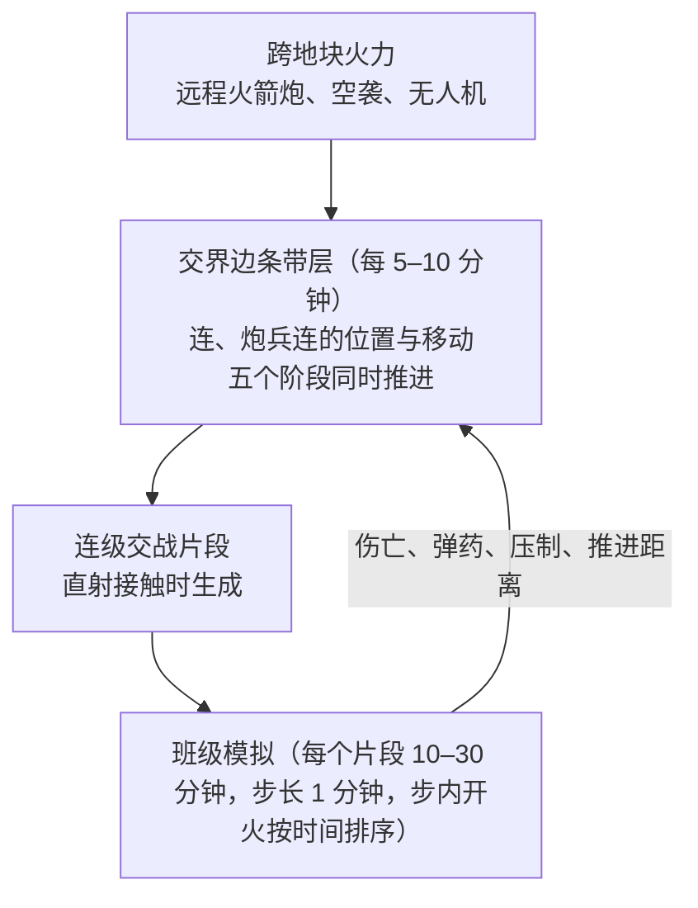
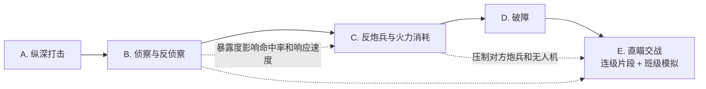
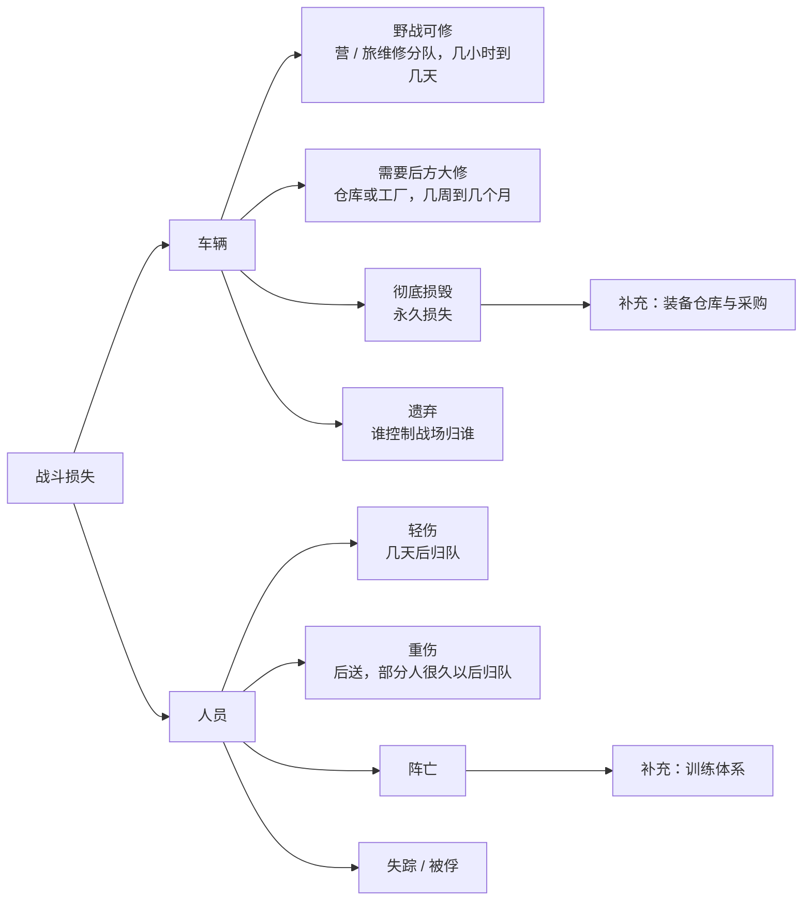

# 设计文档 v0.1：现代国防装备选择与作战模拟（暂名）

> 状态：草案。✅ 表示已确认，🟡 表示是我的建议、还需要你确认，❓ 表示还没定。

---

## 1. 核心循环


---

## 2. 三军的最小单位和编组 ✅

### 2.1 最小单位（同时也是地图上的作战单位）

| 军种 | 最小控制单位 | 采购 / 型号绑定 | 说明 |
|---|---|---|---|
| 陆军 | **营** | 营（可以继承上级编组设定的默认型号） | 营以下（连 / 排 / 班）由玩家设计编制 |
| 海军 | 单艘舰 | 单艘舰（可以国产，也可以外购） | 每艘舰可以有多套舰载机配置 |
| 空军（作战飞机） | 4 架一组 | 4 架一组 | |
| 空军（预警机 / 加油机 / 电子战飞机等高价值支援机） | 1–2 架 | 1–2 架 | |
| 大型无人机 | 组 | 组 | |
| 小型无人机 | 算作营里的装备 / 消耗品 | 跟着营采购 | |
| 远程防空、岸舰导弹、弹道导弹、远程火箭炮 | 营（防空营、导弹营等） | 营 | 可以再编成防空旅、导弹旅 |

### 2.2 三军统一的编组规则 ✅
- 玩家可以把最小单位自由编成更高一级的编组：
  - 陆军：营 → 旅 → 师 → 集团军
  - 空军：4 机组 → 中队（比如 12 架）→ 大队 / 联队
  - 海军：单舰 → 编队 → 舰队
- 每个编组都可以**整体操作**，也可以**拆开**操作其中的下级单位。
- 🟡 编组分两种：
  - **建制编组**：有指挥部单位（指挥部要占人员和装备）。会影响指挥负荷、火力支援的请求链、默认型号的继承。
  - **临时编组**：纯粹为了操作方便，没有指挥部，也没有机制上的加成或惩罚。
- 🟡 单位离开自己所属的建制编组（比如营配属给别的旅），火力支援的请求链会变长，指挥负荷也会上升。
- 🟡 对编组整体下命令时，由**编组 AI** 把任务分配给下级单位（比如防守某段战线、在某空域做防空巡逻）。这一块是工作量的重点。

---

## 3. 陆军编制系统

### 3.1 模板 ✅
- 编制层级：班 → 排 → 连 → **营（最小作战单位）**。营以上（旅、师、集团军）是编组，见 2.2 节。
- **逐级嵌套** ✅：
  - 玩家先建若干种**班模板**。只有班模板直接包含人员和装备槽位。
  - 建排模板时，只需要选用哪些班模板、各几个；连选排模板，营选连模板，依此类推。
  - 改了底层模板，所有引用它的上层模板会自动更新。
- **指挥和直属单位** ✅：排部、连部、营部，以及直属的侦察、通信、维修、医疗单位，也都做成特殊的“班模板”。旅部、师部这类编组指挥部，做成特殊的“营”。
- **跨级引用** ✅：上级可以直接引用任何更低一级的模板。
- 🟡 旅、师的标准编组也可以存成模板（几个营模板 + 指挥部），方便批量组建。
- 提供美式、俄式、解放军式、北约小国式等预设模板库，玩家在这个基础上修改。✅
- 一个营只能套用一个营模板。🟡
- 班模板里的**槽位只定装备类别**，不定具体型号，比如“主战坦克 ×1”“步枪 ×9”“单兵防空导弹 ×1”。

### 3.2 具体型号的绑定 ✅
- 每个营，每个装备类别，只选一个具体型号。
- 🟡 **继承**：在旅（或师）上设默认型号，下属各营自动沿用，也可以单独改。这样就能做“先给某一个营换装”。
- 全军需求 = Σ（模板槽位数 × 采用该模板的营数），再按每个营选的型号分别汇总。

### 3.3 装备怎么分配到营 ✅
- **平均分配**：所有营按比例补充。
- **优先整编**：按玩家定的顺序，先把排在前面的营（或旅）补满。
- **替代装备规则** ✅：新型号不够时，可以先用同类的老型号顶上。属性按老型号算，型号专有练度也按老型号算。

### 3.4 战备等级 ✅
- 分三档：常备满编 / 简编 / 预备役（骨干营）。
- 不同等级平时的人员在编比例和维护费不一样，战时动员所需的时间也不一样。

---

## 4. 人员与练度 ✅

### 4.1 两层练度
- **通用练度**：基本军事素养，和具体型号无关。
- **型号专有练度**：针对当前装备的熟练程度。

### 4.2 换装后的练度重置
- 换装后，专有练度 = 原来的值 × **型号相似度系数**。🟡 参考档位：

| 新旧型号的关系 | 相似度系数（示例） |
|---|---|
| 同一型号的升级版（比如 X-1 → X-1M） | 0.7–0.9 |
| 同一系列、同一国家的设计体系 | 0.4–0.6 |
| 同类但不同体系（比如俄式坦克换成西方坦克） | 0.1–0.2 |

- 不再单独设计“换装期”。换装后的战斗力下降，直接由练度下降体现出来。✅

### 4.3 练度怎么增长和衰减 🟡
- 日常训练让练度增长，但**训练要消耗弹药基数、燃料、装备寿命和备件**。在训练上省钱，练度就会下降，这样训练投入和战备状态就挂上了钩。
- 实战经验也会提高练度。
- 长期不训练，练度会慢慢衰减。
- 专业人员的培养受**训练学校的产能**限制，按专业分别计算（坦克乘员、炮手、无人机操作员、飞行员、舰员等）。✅
- 练度不按单个人记录，而是按“旅 × 专业”记录平均值。🟡

---

## 5. 弹药 ✅

### 5.1 陆军：弹药基数
- **装备数量**由编制决定，是固定的。**弹药数量**由玩家决定，是可变的。
- **一个弹药基数** = 这个旅的每种武器各带若干发，按弹种配比。🟡 实现上：
  - 每种武器型号自带一个默认的基数，比如某型坦克 = 穿甲弹 18 发 + 榴弹 16 发 + 炮射导弹 6 发。
  - 玩家可以在旅这一级调整配比，也可以选具体弹药型号，比如 155mm 炮弹用普通榴弹还是制导炮弹。
  - 旅的基数 = 旅内所有武器的基数加起来。
- **采购量** = 每个旅要几个基数，按旅采购。
- 口径相同、通用的弹药，可以共用库存。🟡 这本身也是“统一型号”的一个好处。
- 弹药存在哪：旅的随行携带量 + 后方仓库。从仓库运到前线的方式，见第 19 节（后勤补给）。✅

### 5.2 海军和空军 ❓
- 🟡 建议海空军按具体弹药型号采购，存在基地或舰上的弹药库，出任务前再挂载或装填（比如垂直发射单元装什么）。

---

## 6. 型号多样性的代价：让机制自然产生 ✅

不设专门的惩罚数值，靠下面三个机制让代价自然出现：
1. **型号专有练度**：型号越多，人员越不容易在不同部队之间调用和补充。
2. **维修保养设备**：每个型号都要配自己的维修设备和检测设备，型号越多，这部分投入越大。
3. **备件随机短缺** 🟡：
   - 每个型号有自己的备件库存，用一个抽象的数量值表示，不细分到具体零件。
   - 装备使用中会随机出故障，消耗备件。备件不够时，装备就不能用。也可以“拆东补西”（拆一辆修另一辆）。
   - 进口装备的备件可能受制裁或外交关系影响而断供。

---

## 7. 海军：舰载机配置 ✅

- 每艘舰可以创建**多套配置**，每套配置要精确到每种飞机几架。
- 一套配置能不能成立，受下面几项限制：
  - 机库、甲板面积和形状
  - 升降机的尺寸和载重
  - 起降方式（弹射 / 滑跃 / 短距或垂直起降）和机型是否匹配 🟡
  - 燃油和航空弹药库容量 🟡
- **摆机功能**：在机库和甲板的平面图上摆放飞机（每架飞机按折叠后的外形计算）。全部飞机都能摆下，配置才算有效。
  - 🟡 建议同时提供“自动摆放”和“手动微调”两种方式。实现上可以做成二维多边形的排布问题，用碰撞检测来校验。
  - 🟡 甲板怎么摆，还可以影响出动架次率，这样摆机就不只是个限制条件，而有真正的玩法意义。
- 驱逐舰、护卫舰这类小舰只带 1–2 架直升机，用简单的“槽位”规则就行，不需要摆机。🟡
- 切换配置需要在港口花一段时间。🟡
- 舰员训练和维修周期 ✅（大约只有三分之一的舰随时能出动）。

---

## 8. 数据结构草案 🟡

```text
EquipmentCategory   { id, name }                       // 主战坦克、卡车、步枪、单兵防空导弹……
EquipmentModel      { id, category, family, specs, cost, origin, partsProfile, defaultAmmoLoad }
SimilarityRule      { modelA, modelB, factor }         // 也可以由 family 层级自动推导
SquadTemplate       { id, name, personnel[{specialty, count}], slots[{category, count}] }
UnitTemplate        { id, level(排|连|营|旅), children[{templateId, count}] }   // 只引用下级模板，不直接带装备
Brigade             { id, templateId, readinessTier,
                      modelBinding{category -> modelId},
                      inventory{modelId -> count},
                      personnel{specialty -> {count, generalSkill, typeSkill}},
                      ammoBasis{ composition, stockCount } }
Ship                { id, class, configs[{aircraft{modelId->count}, layout}], activeConfig }
Flight              { id, modelId, size(4|1|2), pilots{...} }
PartsStock          { modelId, quantity }
```

---

## 9. 旅内战斗模型（草案）🟡

### 9.1 设计原则
- **不写死“某武器应该配到哪一级”**。武器配到哪一级合适，应该从机制里**自然推出来**。
- **校验标准**：用真实国家的编制去跑模拟，结果应该显示真实的配属方式是合理的。玩家自己优化编制，也应该大体重新发现现实中的规律，比如“各级武器射程 ≈ 本级纵深的 1–2 倍”“班用武器加一个基数不超过 15kg”。如果模拟出来的最优解和现实差得很远，说明模型有问题。

### 9.2 知乎回答里的五个因素，分别对应什么机制

| 因素 | 对应机制 |
|---|---|
| 职能匹配 | **目标类别 × 武器效能矩阵**，加上**火力分配**（每个目标由最合适的武器去打）。职能重复的武器会自然闲置，战报里会显示“闲置原因”。 |
| 射程 | **纵深带**加上**地形视距分布**。武器射程超出本级负责的纵深，或者超出地形能看到的距离，多出来的射程就白费了。 |
| 重量 | 徒步时的负重会影响机动速度和疲劳；弹药基数的重量决定能带多少、补给要多少运力；也决定这种武器适不适合轻步兵（空降、山地等）。 |
| 复杂度 | **指挥负荷**：下级单元越多、种类越杂，命令延迟越长；另外，武器对**操作练度有要求**。 |
| 配属到哪一级 | **火力支援的请求链**：本级建制内的武器能马上响应、专门为本级服务；放在上级的武器要申请、排队，有延迟，但火力可以集中使用。 |
| 成本 | 已经在采购层体现。 |

> 最关键的是“请求链”这一条：武器放得越低，响应越快，但火力越分散，需要的总数也越多；放得越高，越集中、越灵活，但响应越慢。这就是“这件武器该配到哪一级”的核心取舍。

### 9.3 战场怎么表示：六角格大地块 + 交界边战斗 + 逐级嵌套结算 ✅🟡

**玩家的操作（✅）**：和 HOI4 类似。玩家只决定每个地块投入哪些旅或营，以及这个地块是**进攻**还是**防御**，没有战术层面的微操。

**地块（✅🟡）**：六角格。**确定大小的原则**：一个旅自带的打击兵器，射程一般不会超出相邻地块的范围。这样旅属兵器只在交界边的战斗里起作用，不需要跨地块打击的命令。
- 旅属打击兵器的射程上限大约在 40km 左右：122mm / 155mm 自行榴弹炮用普通弹药约 20–40km，旅属火箭炮约 20–40km，长钉 NLOS 约 25km，FPV 无人机 10–20km。
- 火炮一般部署在接触线后方 5–15km，所以能打进对方地块的深度大约 25–35km。
- 🟡 **取对边距离 ≈ 40km，边长 ≈ 23km**，面积约 1400km²。
  - 一条边约 23km，差不多正好是现代一个旅的防御正面（俄乌战场上一个旅常常负责 15–30km）。
  - 一条边上同时能接敌的连数 ≈ 23km ÷ 每个连 1–1.5km ≈ 15–20 个连，大约相当于 1.5–2 个旅的一线兵力。
- 旅属炮兵和防空只要在本地块里，就能支援本地块所有边上的战斗。
- 只有射程明显超过一个地块的单位，才能**跨地块作战**：集团军级远程火箭炮（70–300km，能打到 2–8 格以外）、战术导弹、航空兵、中大型无人机。侦察无人机的航程决定它能侦察哪些地块、效率多高。
- 🟡 **编制提醒**：如果玩家把射程超出相邻地块的兵器（比如射程 70km 以上的远程火箭炮）编进战斗旅，编制编辑器会提醒：这类兵器在旅里只能参加交界边的战斗，**不能使用跨地块打击命令**。想用跨地块打击，就要把它编成独立的火力营或火力旅。
- 🟡 **俄乌战争规模的估算**：活跃战线约 1000–1200km，换算成大约 25–35 个前线地块（每一方），沿战线的交界边大约 50–60 条。全战区（乌克兰加俄罗斯西部相关地区）大约 500–700 格。
- ⚠️ **代价**：地块变大以后，小国和小岛会显得很粗。比如以色列大约只有十几格，台湾岛大约 25 格，新加坡还不到一格。城市战之类的细节，只能靠交界边条带内部的地形来体现。
- 🟡 **比较过的另一个方案：边长 40km**（对边约 69km，面积约 4200km²）。没有采用：一格要放 3–4 个旅，“一格约等于一个旅”的对应关系没了；推进 10–30km 往往还换不了一格；跨地块打击变得很少用；小国更粗。

**全球地图（✅🟡）**
- ✅ 地图覆盖全球。大多数情况下，玩家只关注自己周边的战线（美国玩家选择全球开战时例外）。
- 🟡 **用 H3 网格的第 4 级**：H3 是 Uber 开源的球面六角网格。第 4 级每格平均面积约 1770km²，平均边长约 22.6km，和上面定的 23km 几乎一样。
  - 平面地图投影在高纬度会严重变形（比如俄罗斯、加拿大），球面网格没有这个问题。
  - 球面上不可能全是六边形，会有 12 个五边形，但 H3 把它们都放在了海上。
  - 各格面积有一些差异。射程、距离一律按真实距离计算，所以影响不大。
- 🟡 **只给陆地分格**：全球陆地大约 8–10 万格。海洋不分格，海军和空军用连续坐标（见第 12 节）。沿海的几格用来处理两栖登陆。
- 🟡 **分层管理**：地块（战斗和移动）→ **区域**（几十格组成，用于补给、行政、战略 AI 思考）→ 国家或战区。AI 的寻路和规划先在区域这一层做，再落到地块。
- 🟡 **计算量只看有战斗的地方**：没有部队、没有战斗的地块是静态数据，不消耗计算。10 万格的数据量只有几十 MB。
- 🟡 **按关注度分级模拟**：
  - 玩家参与的战线：按第 9 节完整模拟（加时间预算调度）。
  - 玩家没有参与、AI 和 AI 之间的远方战争：用结果缓存或者代理模型粗略结算（比如每天结算一次）。
  - 美国这类多战区全球作战：以后可以给每个战区配一个战区 AI，由玩家决定把哪些战区交给 AI（见 13.4 节的“先放着的想法”）。
- 🟡 **地形数据自动生成**：用全球公开数据给每一格算出地形构成，比如高程（SRTM / Copernicus DEM）、地表覆盖（ESA WorldCover）、道路和城市（OpenStreetMap），边界用 Natural Earth。有争议的边界和地区要谨慎处理。

**交界边战斗（✅）**：战斗发生在两个地块的交界边上，而不是地块内部。

**交战条带（✅🟡）**：每条交战的边对应一张**条带地图**：
- 宽 = 边长（约 23km），纵深从进攻方地块的 -40km 到防守方地块的 +40km，0 是接触线。
- 🟡 条带上的地形（森林、城市、高地、河流）根据两个地块的地形构成**生成后固定下来**，同一条边每次打都是同一块地形。有真实高程数据时，直接用真实地形。
- 条带上记录**每个连、每个炮兵连、每个营属支援分队的位置**，分辨率大约几百米。由 AI 按条令自动部署和移动：推进、后撤、轮换、投入预备队、炮兵打了就转移。
- 射程就在条带上起作用：
  - **曲射火力**：从发射位置到目标位置的距离，决定能不能打到。射程更远的武器可以摆得更靠后，不容易被反击。
  - **直射火力**：连与连之间的距离、地形视线，以及双方的观瞄距离和武器射程，共同决定谁先发现、谁先开火。真正的直射交火在连级片段里，按班模拟（见 ② 和 ③）。
- 计算量：每条边几十个连级单位，每 5–10 分钟游戏时间更新一次，计算量很小。所以**条带层始终都实时模拟**，只有班级片段在快速模式下使用缓存（见 ④）。

**逐级结算（🟡）**：



**连级可视化视图（✅🟡）**：玩家只能看，不能操作。
- 每条交战的边都可以打开一个条带视图：用北约军标显示双方的连和炮兵连、接触线、雷场和破障通道、火力打击的连线、武器射程的覆盖范围。
- 🟡 **敌方单位按暴露度显示**：L1 只显示“有东西”，L2 显示大概规模，L3 显示类型……所以这个视图本身也在体现侦察的价值。
- 有时间轴，可以回放。点一个连，可以看它参与的片段记录和各班的状态；实时模拟的片段可以回放到班这一级。
- 🟡 可以叠加一层“瓶颈提示”，比如“这个炮兵连够不到对方的炮兵阵地”“第 2 连等迫击炮支援已经等了 6 分钟”。

#### ① 交界边上的分阶段战斗（在条带上进行，每 5–10 分钟游戏时间更新一次）✅🟡

**依据**：现代重装部队交战时，大部分损失来自远程火力、无人机和地雷，直瞄交战只是最后一段（推演见对话记录）。所以地块战斗分成五个阶段，让侦察、炮兵、防空、工兵这些旅、营级支援单位也能发挥作用。

**这五个阶段不是依次走完的，而是同时进行的五条线**。每个游戏小时，五条线都各算一次，前面几条线的结果会决定后面能不能开始，以及效果如何。🟡



| 阶段 | 地块层模拟什么 | 主要输入 | 主要输出 | 体现谁的价值 |
|---|---|---|---|---|
| **A. 纵深打击** | 跨地块火力和空袭，打击集结的部队、炮兵阵地、指挥所、补给线 | 对目标的暴露度（L4 才能精确打击）、对方的防空 | 对方纵深单位的损失，补给中断 | 远程火箭炮、战术导弹、航空兵、防空、伪装 |
| **B. 侦察与反侦察** | 双方在地块内争夺暴露度（见第 10 节） | 侦察营、无人机、电子侦察，以及对方的反侦察和防空 | 双方的**局部暴露度** | 侦察营、各级无人机、电子战、伪装 |
| **C. 反炮兵与火力消耗** | 炮兵对射；巡飞弹和 FPV 无人机持续打击；反无人机作战 | 暴露度、反炮兵雷达、炮兵数量、弹药库存 | 双方炮兵和无人机的剩余力量，持续造成的损耗 | 炮兵、反炮兵雷达、近程防空和反无人机 |
| **D. 破障** | 进攻方清理雷场和障碍；防守方持续布设 | 工兵和扫雷装备、防守方的布雷能力、C 阶段能不能压制住对方火力 | **破障进度**（决定直瞄进攻能不能开始，以及推进速度） | 工兵、扫雷装备、远程布雷系统 |
| **E. 直瞄交战** | 连级片段 + 班级模拟（见下面的 ② 和 ③） | 破障进度、局部暴露度、C 阶段剩下的支援火力 | 伤亡、推进距离 | 班、排、连的编制 |

**各阶段之间的门槛和耦合** 🟡
- **暴露度**：局部暴露度决定 C 阶段炮兵的命中率和首轮效果，也决定 E 阶段谁先发现谁、能不能打伏击。
- **火力压制**：C 阶段没能压住对方的炮兵和无人机时，E 阶段进攻方推进时会持续挨打，伤亡大增。
- **破障门槛**：破障进度不够时，E 阶段只会生成侦察、渗透这类小规模片段，不会有成建制的进攻。
- **集结的代价**：进攻方投入的部队越多，特征值越高，在 A、B、C 阶段越容易挨打。所以“堆兵”有代价，**兵力集中和分散之间有取舍**。
- **防守方**：也在五条线上同时作战（反侦察、反炮兵、持续布雷、准备反冲击）。

**其他规则**（在原来的设计上保留）
- **正面宽度决定能同时投入多少部队**：地块交界的正面长度 ÷ 每个连的作战正面 = E 阶段同时能有几个连级片段。其余的部队自然成为第二梯队和预备队。这相当于 HOI4 的“战斗宽度”，但它是从真实的几何关系推出来的。
- 由 AI 按默认条令自动完成：梯队划分、轮换和投入预备队的时机、旅属炮兵和无人机在 C、E 两个阶段之间怎么分配。
- **防御优势由机制自然产生**：工事等级随防守时间提高，带来更低的特征值和更好的防护；防守方炮兵预先测好了射击诸元；防守方已经布好雷场。
- **怎么算攻占了地块**：E 阶段的推进距离累积成“纵深推进度”。推进度达到 100%，或者防守方的营失去战斗力、被迫撤退，地块就易手。

**战后报告按阶段拆分损失** 🟡，比如：“本旅 60% 的装备损失发生在 C 阶段（敌无人机），破障用了 14 小时，直瞄交战只占损失的 25%。”这样玩家就知道该补哪一环。

#### ② 连级交战片段（每个小时生成若干个）
- 每个片段就是一场“我方一个连 vs 敌方一个排或一个连”的交战，加上营、旅属支援火力的介入。
- 片段的条件是**抽样**出来的：
  - 地形：从地块的地形构成里抽，比如城市 20%、森林 30%、开阔地 50%。
  - 交战类型：攻击阵地、遭遇战、反冲击、渗透。
  - 昼夜、天气。
- **营和旅属的支援火力是所有片段共用的**：迫击炮、反坦克导弹、榴弹炮被多个连同时申请时，要排队。所以支援武器放在低层级，响应快但分散；放在高层级，集中但要排队。这就是 9.2 节里“请求链”的具体体现。
- 跨地块打击（火箭炮、空袭）有两种用法：作为片段里的外部火力介入；或者打对方的纵深，比如炮兵阵地、预备队、补给线（反炮兵战）。

#### ③ 班级模拟（每个片段内部）
- 片段内部用 **“正面槽位 × 纵深带”**（0–300m / 300m–1km / 1–4km）。
- **模拟精度：班是“空间单元”，单兵是“状态单元”** 🟡
  - **位置、移动、视线、压制状态按班算**：一个班就是一个点，不模拟班里每个人站在哪里。
  - **人员、武器、车辆按个体记录**：班里有一份名册，记录每个人的角色、携带的武器和弹药、负重，以及状态（完好 / 轻伤 / 重伤 / 阵亡）。每辆车单独记录装甲、损伤和载员。
  - **开火按武器算**：每件武器只要还有足够的人操作、没被压制，就能开火。被命中后，按暴露程度和角色把伤亡分配到具体的人身上。武器没人操作时，按规则重新分配人手。
  - **乘车班下车后，拆成两个空间单元**：车（加车组）和下车步兵。
  - **单兵不单独记录练度**：练度用“营 × 专业”的平均值（见 4.3 节），也不给单兵起名字。
  - 伤员分类会进入兵员补充系统：轻伤一段时间后归队，重伤和阵亡需要补充新兵。
- 侦察、通信、火力丰富度、火力强度、防护、重量这六项属性，都在这一层起作用（见 9.10 节）。
- 片段结束后，结果写回营的状态：各班剩多少人、剩多少装备、剩多少弹药、疲劳程度、推进了多少距离。
- 减员严重的班会在营里合并重组。补充兵员和装备，从后方仓库进入，受训练产能和采购的限制。

#### ④ 计算量和快速模式
- **规模估算**（🟡 量级）：
  - 一个重装旅大约有 600–900 个班级单元（每辆坦克、每辆步战车、每门炮、每个步兵班各算一个），其中会参与战斗的大约 400–500 个。
  - 一次旅对旅的战斗，总共约 1000–1800 个单元。但同一时刻真正在班级模拟里的，只有接触中的那些连级片段：每条边大约 8–10 个片段 × 每个片段 30–60 个单元 ≈ **300–600 个单元**。其余单元在条带层按连汇总处理，被打击时再展开。
  - 计算量：每个片段内两两检测（50×50 ≈ 2500 对）× 每步 1 分钟（每小时 60 步）。一条边每个游戏小时大约 150 万次检测，每次 50–200 纳秒，**单核约 0.08–0.3 秒**（步内的开火事件排序会多一点开销）。
  - 换算：中美这个量级的大战，假设全线有 100 条边同时开战，全部实时模拟的话，6–8 核 CPU 算一个游戏小时要 **1.5–5 秒**，仍然跟不上类似 HOI4 的推进速度。
- **三个降低计算量的手段**（叠加使用）：
  1. **按阶段决定要不要算到班**：A–D 阶段（纵深打击、侦察、火力消耗、破障）只在条带层按连计算，**只有 E 阶段（直瞄接触）才展开班级模拟**。直瞄接触通常只占交战时间的一小部分（🟡 估计 10–30%），计算量能降到原来的几分之一。
  2. **自适应步长**：没有接触时用大步长（5–10 分钟），有直瞄接触时才用 1 分钟。
  3. **按时间预算调度** 🟡：每个游戏小时给模拟分配一个固定的计算时间预算，各场战斗按优先级排队——玩家标星的单位、规模大的、关键地块的战斗优先实时模拟，其余的用结果缓存。游戏速度调快时，自动让更多战斗改用缓存。
  - 三个手段加起来，100 条边同时开战时，可以做到每个游戏小时 0.5–2 秒以内。
  - ⚠️ 实时模拟和缓存的结果有细微差别，所以调度方式会影响结果是否完全可复现。以后做多人模式时，要用固定的调度规则（比如按优先级，而不是按玩家机器的性能来决定）。
- **工程上要注意**：采用面向数据的架构（ECS），用空间哈希只检测射程内的单元对，视线判断用条带格子预先算好的结果或者概率模型，固定步长、随机种子可复现，模拟核心不依赖画面。
- 解决办法：**结果分布缓存**。
  - 玩家的连模板数量有限（几十种）。对“我方连模板 × 敌方连模板 × 地形 × 交战类型 × 支援等级”这些组合，先在后台跑班级模拟，得到结果的分布，缓存起来。
  - 实际结算时，从缓存的分布里抽样，再用当前的兵力比例、弹药、练度、疲劳做修正。
  - 玩家修改模板时，在后台重新计算相关的组合。
  - 玩家正在看的战斗，或者关键战斗，用实时的完整模拟，可以回放。
- 这个缓存表和战略 AI 用的代理模型（9.10 节 (8)），可以是同一个东西。

### 9.4 目标类别
- 人员：暴露 / 有掩体 / 在建筑物里 / 在反斜面
- 轻装甲、重装甲、工事
- 低空目标：直升机 / 无人机
- 另外两种不造成杀伤的效果：**压制**和**烟雾**（降低某个纵深带的视距）。

### 9.5 武器属性
```text
WeaponModel {
  effect[targetClass]   // 对每类目标的杀伤和压制效能
  rangeMin, rangeMax, accuracyCurve(range)
  fireMode              // 直射 / 低伸曲射 / 高抛（只有高抛能打反斜面，在城市里会受高楼影响）
  rof, ammoPerBase, ammoWeight, weaponWeight, crew
  setupTime, skillReq   // 架设时间、操作练度要求（比如迫击炮的要求就比较高）
  canSmoke, canAntiAir
  aimTime               // 从发现目标到开火的时间
}
```

### 9.6 每一步模拟的流程（Δt = 1 分钟，步内开火按时间排序）✅🟡

> 🟡 **步内事件排序**：直瞄交火很快。从发现目标到开火只要几秒，反坦克导弹飞行 10–20 秒，所以一分钟里可能会交火好几轮。做法是：移动、压制、决策按 1 分钟一步；每一步内部，算出每次开火的具体时刻（发现时刻 + 瞄准时间 + 弹丸飞行时间），**按时间先后结算**。先被打掉的一方，同一分钟里排在后面的射击就作废。这样“谁先发现、谁先开火”的优势不会因为步长变粗而丢掉。
1. **侦察**：各单元在视距和传感器范围内发现目标。情报逐级上报会有延迟，有数据链可以缩短延迟。
2. **直射火力分配**：每件武器从自己看得到的目标里挑一个。评分 = 效能 × 命中率 × 威胁程度 ÷ 弹药价值。
3. **间瞄火力请求**：下级向拥有支援武器的上级申请火力，进入队列排队。响应时间 = 通信时间 + 排队时间 + 射击准备时间。
4. **结算**：伤亡、车辆被毁、压制状态（压制会随时间消退）。
5. **机动**：根据命令、压制状态和负重来推进或后撤。
6. **消耗**：弹药、燃料、疲劳。

### 9.7 指挥负荷
- 每一级指挥官有一个指挥能力值，由“部班”的通信装备和练度决定。
- 指挥负荷 = 直接下级的数量 × 下级种类的多样性。
- 负荷超过能力时：命令延迟变长，协同效果（比如步坦配合）打折扣。

### 9.8 战后报告（这是编制系统最重要的反馈）
- 按武器型号统计：开火次数、杀伤、压制时长。
- **闲置时间按原因拆分**：没有合适目标 / 超出射程 / 没有视线 / 没有弹药 / 被压制 / 等待命令。
- 火力支援响应时间的分布、弹药消耗曲线。

### 9.9 编制试验场 🟡
- 玩家可以拿一个旅模板，和参考对手在标准地形上批量模拟（比如 100 场），看结果的分布。
- 这个功能既是给玩家用的，也是开发时调平衡的工具。

### 9.10 班一级的属性怎么影响战斗 🟡

**总体思路**：玩家操作的是旅，但营与营之间的战斗是**由一个个班的实例逐步模拟出来的**，班的属性直接参与每一步计算，不会被汇总成一个营的总数值。营的“总战力”只是给界面和 AI 参考的估算值。

把一次交战看成一条**杀伤链**，班的六项属性分别作用在链上的不同环节：


#### (1) 侦察能力 → 谁先发现、发现得多准
- 属性：观瞄器材（望远镜、热像仪、夜视仪）、班用无人机、侦察兵的练度。
- 发现概率 = f（传感器，目标的暴露程度，地形视距，昼夜和天气，目标姿态）。
- 作用：
  - **先发现的一方先开火**。在交战模型里，这往往是最大的胜负因素。
  - **定位精度**会影响上级间瞄火力的命中率和弹药消耗：侦察越好，越省炮弹。
  - 热像仪和夜视仪决定夜战时的差距。

#### (2) 通信能力 → 信息和火力请求多快能传到
- 属性：班里有没有电台、有没有数据链终端或战场管理系统、有没有前沿观察员。
- 把通信做成一张**信息网络**：每传一级都有延迟，延迟 = f（通信装备，练度，敌方电子干扰）。
- 作用：
  - 发现目标后，上报给有支援武器的单位要多久。
  - 申请火力要多久。如果班里有可以直接呼叫火力的观察员，请求可以**跳过几级**。
  - 通信断了，班只能按最后收到的命令行动，没法参与协同。
  - **电台发射信号会暴露位置**，所以电子侦察可以引导炮火打过来（这是俄乌战争里很典型的教训）。

#### (3) 火力丰富度 → 能不能自己解决眼前的威胁
- 每场战斗会**随机出现各类目标**，目标的种类由敌方的实际编制和地形决定，比如敌步战车、建筑物里的敌人、地堡、反斜面后的敌人、无人机。
- 每种威胁有一个**威胁窗口**：如果不处理，它多久会对我方造成严重杀伤。
  - 班里有合适的武器：马上就能打，在窗口内解决。
  - 没有合适的武器：只能向上级请求，或者用效率低的武器勉强对付。如果响应时间超过威胁窗口，就会出现损失。
- 所以，**火力丰富度体现的是“自给能力”**，代价是重量、人员和练度。职能重复的武器只会增加负担，不会多带来什么。
- 敌人用什么编制，决定了哪种丰富度有价值。比如敌人步战车多，班里的一次性火箭筒就很有价值。

#### (4) 火力强度 → 杀伤和争夺火力优势
- 每件武器对每类目标都有**杀伤**和**压制**两种效果。
- **压制是核心**：
  - 被压制的班开火变少，也不能移动。
  - 进攻的一方必须先压制住防守方，才能推进到下一个纵深带。
  - 所以机枪、榴弹发射器的价值，主要体现在压制上，而不是杀伤数字。
- 压制会消耗大量弹药，这就和弹药基数、重量联系起来了。

#### (5) 防护能力 → 挨打以后还剩多少战斗力
- 人员防护：防弹衣、头盔，能降低轻武器和破片造成的伤亡。
- 车辆防护：装甲等级对比敌方武器的穿透等级。
- 暴露程度：班的人数越多、车越大、越常用电台，越容易被发现。
- **按角色计算减员**：
  - 武器需要一定人数操作，伤亡后要重新分配人手。比如 9 人的班减员 3 人后，可能还能操作机枪，但没人背火箭筒了。
  - 所以**大班更耐打，小班数量更多**，这本身就是一个编制上的取舍。
  - 班的人数低于某个比例时，就失去战斗力。
- **乘车和下车**：
  - 车载班 = 车组 + 下车步兵。车的容量限制了下车步兵的人数，比如有些步战车只能载 6–7 人。
  - 乘车时有装甲保护和车载火力，下车后才能清剿建筑和战壕。

#### (6) 重量 → 机动、疲劳、能打多久
- 每个士兵的负重 = 个人装备 + 武器 + 分到的弹药。
- 作用：
  - 负重占体重的比例越高，徒步机动越慢、疲劳越快，疲劳会降低命中率。
  - 弹药能随身带多少，决定了不补给能打多久。剩下的弹药放在车上，或者留在后方。
  - 轻步兵（空降、山地等没有车的部队）受影响最大：负重决定他们能带多少支援武器。
- 车辆的载重和容量也同样会约束编制。

#### (7) 玩家在旅这一层能看到什么
- 每个营有一份**属性摘要**：侦察距离、反装甲和反工事等各类自给能力、压制火力、防护、平均负重、通信延迟。
- 战后报告会把班一级的问题**汇总成看得懂的结论**，比如：
  - “本营遇到的装甲目标里，42% 要等连里的反坦克导弹来打，平均要等 3.5 分钟，期间损失了 6 个班。”
  - “夜间交战中，我方平均发现距离只有敌方的 60%。”
  - “第 2 连的电台信号被定位，招来 3 次炮击。”

#### (8) 性能和战略层 AI 🟡
- 营级战斗都按班模拟，计算量是可以接受的（见 9.3 节）。
- 战略层 AI 做决策时需要快速估算胜算。可以先用试验场批量跑模拟，再训练一个**代理模型**：输入营的属性摘要，快速估算交战结果。真正打仗时，仍然按班来模拟。

### 9.11 排以下编制的反馈：弱，但能看见 ✅🟡

**原则** ✅：排以下的编制对结果的影响**刻意做得比较弱**，主要的决策放在连、营、旅这几级。这既符合实际，也能减轻玩家负担。但是花了心思设计班、排的玩家，应该能**看到**区别。

#### (1) 不想设计班排的玩家：自动生成 🟡
- 玩家可以只设计到连：选好连的类型和装备，系统按预设的编制风格（美式、俄式、解放军式等）自动生成排和班。
- **预设的班排模板本身就接近最优**，所以不自己设计的玩家不会吃亏。自己设计的玩家，能拿到的是“针对特定需求的小幅优化”。

#### (2) 排以下的设计通过五个渠道影响连（影响都比较小）🟡

| 渠道 | 班排设计中的什么因素起作用 | 在连这一级表现为什么 |
|---|---|---|
| 自给能力 | 班里有没有一次性火箭筒、榴弹发射器等 | 连向营、旅申请支援的次数，等待支援时的损失 |
| 减员后的韧性 | 班的人数，关键武器有没有冗余 | **能力衰减曲线**：连减员到多少时，失去反装甲或压制能力 |
| 负重 | 人均负重 | 下车后的速度和疲劳。对轻步兵、空降兵影响最大 |
| 乘车适配 | 班的人数和车辆载员是否匹配 | 下车步兵是否完整，有没有被迫拆班 |
| 弹药 | 携弹量和消耗的节奏 | 多久需要补给一次 |

- 这些影响都是**自然产生**的：班一级的差异，主要在步兵为主、地形复杂的战斗里起作用（城市、森林、山地，以及轻步兵）；在开阔地的装甲对战里作用很小。
- 正好对应了另一件事：玩家会直接操作营的场景（小国、空降兵、特种部队），大多就是班排编制影响最大的场景。

#### (3) 反馈主要放在编制编辑器里（不用打仗就能看到）🟡
- 修改班模板后，**马上**显示上面五个渠道的数值变化，以及这些变化对连的影响。
- **向上传导的提示**：比如“9 人班改成 10 人班 → 全旅步兵班的人数 +11%，需要多训练 380 名步兵，每辆步战车的载员不够了”。
- **自动检查**：
  - 超重警告：班用武器加一个基数超过 15kg，排用武器超过 30kg。
  - 职能重复：比如“火箭筒和无后坐力炮职能重叠，边际价值很低”。
  - 能力缺口：比如“连以下没有任何对付轻装甲的手段”。
  - 乘车不匹配：比如“班 9 人，步战车只能载 7 人”。
- 这些规则直接来自现实中的配属原则，玩家能从中学到东西，也不需要真的去打一仗才知道。

#### (4) 战斗中和战斗后的反馈 🟡
- 连级视图里，鼠标悬停在一个连上，显示各排、各班的剩余人员和还保有哪些能力。
- 战后报告里有一小节，**把连的表现拆分到班模板**，比如“A 型班的机枪贡献了全连 40% 的压制”。

#### (5) 给爱好者的“班排沙盘” 🟡
- 主战斗界面只显示到连；但在**编制试验场**里，提供排对排、连对连的小规模模拟，**可以显示到班，也可以回放**。
- 喜欢钻研班排编制的玩家，可以在这里看到细节。其他玩家完全可以不碰这个功能。

### 9.12 战后损伤、修复与补充 🟡

**原则**：损失不是一个简单的“兵力 −30%”，而是**分门别类地进入几条恢复流程**。每条流程都由编制里的保障单位和战略层的资源来决定快慢，这样维修、医疗、回收这些“不打仗”的单位也有了价值。



#### (1) 损伤分类
- **车辆**：
  - 野战可修：失去机动能力或火力，但能在前线修好。
  - 需要后方大修。
  - 彻底损毁。
  - 遗弃：车没坏透，但被丢在了战场上。
- **人员**：轻伤、重伤、阵亡、失踪或被俘。
- **谁控制战场，谁就能回收**：守住战场的一方，可以把受损的车拖回去修；撤退的一方，受损车辆大多变成永久损失，甚至被对方缴获。所以撤退的代价比单纯的伤亡数字更大。（俄乌战争中大量装备是被遗弃、被缴获的。）

#### (2) 缺编状态与自动重组 🟡

**基本原则：保留真实的缺编状态，模板只是“目标”**
- 每个班、每个人、每件装备的真实状态都会保留下来。玩家可以从旅一路点进营、连、排、班，看到每个班还剩什么。
- 每一级都计算一个**满编率**，分人员、各类装备、**各项能力**分别显示，比如“反装甲能力 40%”。
- 模板的作用是：**和实际状态做对比，算出补充需求清单**，以及作为重组的目标。
- 不采用“按班四舍五入”的办法：四舍五入会凭空多出或少掉人和装备。同类班很少的时候（比如一个营只有 3 个迫击炮班），误差能达到这类能力的一半。

**重组：人和装备的总数守恒，按范围分级进行**

| 时机 | 范围 | 做法 |
|---|---|---|
| 战斗中 | 只在**排内** | 武器没人操作时，在班里重新分配人手；同类班都低于某个比例时，在排内合并 |
| 脱离接触、休整时 | **连内和营内**，自动进行 | 把同类班的人和装备集中起来，尽量组成完整的班。剩下凑不成一个班的人和装备，进入营的**待编池**，等补充到位后再组班 |
| 玩家下令时 | 营之间、旅之间 | 合并残缺的营或连，腾出来的骨干转为预备役 |

- **组班要看专业**：每个岗位优先由对口专业的人来填。专业不对口的人（比如步兵去操作迫击炮），可以顶上，但用的是很低的专业练度。这和第 4 节的练度系统直接衔接。
- 🟡 每个旅可以设一个重组策略：
  - **保持建制**：尽量不打乱原来的连和排，宁可让各单位都缺编。
  - **集中成完整单位**：优先凑出几个满编的连，其余的空出来，等待补充。
- 连、营的有效战斗力低于某个比例时，AI 自动把它撤下，换预备队上。

**缺编的部队，后续战斗照样能结算**
- 班级模拟本来就是根据**实际的名册**（每个人、每件武器、每辆车）来算的，并不依赖模板。所以部队缺编、不符合模板，完全不影响实时模拟。
- 需要调整的地方：
  - **结果缓存**（9.3 节 ④）：不能只用“连模板”当查询条件，要改成用**连的实际能力向量**来查，比如各类能力的剩余比例、人数、弹药。缓存里预先算好 100%、75%、50% 等几档兵力的结果，中间的情况插值估算。
  - **AI 部署**：按单位实际有的东西来安排，比如“剩下的火力支援分队”，而不是按模板里写的数量。
  - **战斗力门槛**：按实际剩余的能力来算，不按模板来算。

#### (3) 车辆修复链
- **回收**：要有抢救车，能力受编制里抢救车的数量和战场威胁（比如无人机）限制。
- **野战修理**：由营、旅维修分队负责，受修理能力和**备件库存**的限制（见第 6 节）。
- **后方大修**：送回仓库或工厂，进入战略层的维修队列，要花钱，也要时间。
- 结果是：编制里的抢救车和维修分队多一些，同样的战斗，永久损失就会少很多。

#### (4) 医疗链
- 编制里的卫生员和医疗分队，决定**重伤员能不能救活**（影响阵亡和受伤的比例），以及轻伤员多快能归队。
- 后送伤员会受战场威胁影响。无人机密集的时候，伤员很难运下去。
- **伤愈归队的人回到原来的部队，保留原来的练度**。这是练度最便宜的恢复方式。

#### (5) 补充方式（玩家按旅设置，或者在全军统一设置）

| 方式 | 做法 | 优点 | 代价 |
|---|---|---|---|
| **单兵补充** | 新兵和新装备直接补进在前线的部队 | 部队一直保持在线，战斗力恢复快 | 新兵练度低，会拉低平均练度 |
| **整建制轮换** | 把部队撤到后方，整体补充，再训练一段时间 | 练度恢复得好 | 一段时间不在前线，需要有部队顶替 |

- 补充的来源：
  - 兵员来自训练体系，按专业分别计算，受训练学校产能的限制（见第 4 节）。
  - 装备来自仓库和采购。
  - 装备不够时，按“平均分配 / 优先整编 / 一线优先”的规则分配，也可以用替代装备（见 3.3 节）。
- 🟡 可以加一个**凝聚力**属性：部队伤亡越重、新兵越多，凝聚力越低；在一起训练、待得越久，凝聚力越高。凝聚力影响协同效果和在压力下的表现。这一项可以作为可选机制，先不做。

#### (6) 建制层面的处理
- 每个营都显示**相对模板的满编率**，分人员和各类装备，比如“坦克 62%，步兵 81%，反坦克导弹 40%”。
- 玩家可以把两个残缺的营**合并成一个**，腾出来的骨干转为预备役，以后重建时用。也可以把营撤编。
- 🟡 **缴获装备**（可选）：缴获的敌方装备可以编入部队使用，但要有对应的备件，而且型号专有练度从很低开始。

#### (7) 战后报告
- 损失按“永久损失 / 可修复 / 已修复 / 遗弃”拆分。
- 显示修理队列、医疗归队预期、需要补充的兵员和装备，以及需要的采购预算。

---

## 10. 侦察与暴露度 ✅🟡

### 10.1 基本概念
- **暴露度是“某一方对某个敌方单位的了解程度”**，不是单位本身的属性。同一个营，对我方可能暴露度很高，对第三方可能是 0。✅
- 🟡 拆成两个量：
  - **特征值**（单位本身的属性）：单位越大、车越多、越活跃、电台和雷达开得越多，特征值越高；地形越复杂、伪装器材越好、伪装训练越到位，特征值越低。
  - **暴露度**（观察方积累的情报）：侦察力量持续投入就会增长，停止侦察就会衰减。

### 10.2 暴露度怎么变化 🟡
```text
每小时增量 = Σ(每种侦察手段的侦察能力 × 目标特征值 × 地形和天气系数) × (1 − 敌方反侦察系数)
每小时衰减 = 暴露度 × 衰减率（目标在机动时衰减更快，因为情报很快就过时了）
```
- 敌方反侦察：防空把无人机打下来、电子干扰、反侦察分队、对卫星过顶时间的规避。
- **姿态对特征值影响很大**：长期防守、挖好工事的部队最难发现；集结、行军、进攻中的部队最容易暴露。

### 10.3 暴露等级 ✅🟡

| 等级 | 能知道什么 | 用途 |
|---|---|---|
| L1 存在 | 这个地块有敌军 | 决定要不要派更多侦察 |
| L2 规模 | 大概是营级还是旅级（有误差） | 判断兵力对比 |
| L3 类型 | 编制类型：装甲、机步、炮兵、防空…… | 判断该用什么去打 |
| L4 目标级定位 🟡 | 足够精确、能直接用来打击的位置 | **跨地块精确打击的前提条件** |
| L5 状态 🟡 | 剩余兵力、弹药、疲劳 | 选择进攻的时机 |

- 🟡 情报是有误差的，等级越低误差越大。敌方可以用**假目标和假电台**骗出虚假的暴露度（欺骗、伪装）。

### 10.4 各种侦察手段的特点 🟡
每种手段有三个属性：**增长速度**、**最高能达到的等级**、**持续时间和生存能力**。

| 手段 | 特点 | 最高等级（示例） |
|---|---|---|
| 光学 / 雷达成像卫星 | 覆盖面大，但只有过顶的时候才能看到；光学卫星受云层影响；对伪装好的部队和机动目标效果差 | L3 |
| 电子侦察（卫星、飞机、地面站） | 专门发现电台、雷达和指挥所；完全取决于敌方是否保持电磁静默 | L3（指挥所、雷达可以到 L4） |
| 大型无人机 | 能长时间盯着一片区域；怕远程防空 | L4 |
| 对地监视雷达飞机（类似 E-8 JSTARS） | 擅长发现**行进中**的车队；对静止目标效果差 | L3 |
| 战斗机挂侦察吊舱 | 速度快、生存力强，但停留时间很短 | L3 |
| 陆军中型无人机 | 战术级侦察，作用范围只有本地块和相邻几格 | L4 |
| 特种部队 | 慢，有被消灭的风险，但精度最高 | L5 |
| 地面侦察部队 | 只能看到接触中或相邻的地块，在地块战斗中自然积累 | L4–L5 |

> 注：预警机（AWACS）主要探测空中目标，对地面部队帮助不大。对地监视要靠 E-8 这类对地监视雷达飞机。

### 10.5 暴露度对战斗的影响 🟡
- **跨地块火力**：L4 才能精确打击；只有 L2–L3 时，只能做面积打击，效率很低，弹药消耗很大。
- **地块战斗开始时，双方暴露度决定起始条件**：
  - 谁先发现谁、对方能不能形成伏击、炮兵的首轮射击精度。
  - 这就是第 9 节里“侦察与反侦察”阶段的起点；战斗中两边的地面侦察还会继续改变它。
- **炮兵和精确弹药的效率**：暴露度越高，命中率越高，每消灭一个目标需要的弹药越少。
- **战略决策**：玩家和 AI 只能根据情报画面做决定，有可能被欺骗。

### 10.6 怎么避免微操 🟡
- 侦察力量用**区域任务**来指派：给侦察单位划一片区域，系统自动在区域内的各个地块分配侦察时间。
- 有一个**“我方暴露度估算”视图**：显示敌人大概对我方掌握到什么程度。玩家据此决定要不要加强伪装、分散部署、保持电磁静默。

---

## 11. 时间推进、战斗触发与回放 ✅🟡

### 11.1 时间推进 ✅🟡
- 类似 HOI4 的**伪即时制**：玩家可以随时暂停、调速。
- ✅ **全局时钟精度 = 1 分钟**：玩家可以在任意一分钟给任何单位下命令。
- 🟡 **各系统仍按自己的频率更新**，不是每分钟把所有东西都算一遍：

| 系统 | 更新频率 |
|---|---|
| 战略（预算、生产、训练、补充、事件） | 1 小时 |
| 侦察暴露度 | 10 分钟（暴露度会随时间“过时”，太粗会让打击用到过期的情报） |
| 陆地移动、条带层 | 5–10 分钟 |
| 直瞄接触的班级模拟、交战中的空中层 | 1 分钟（步内按事件时间排序） |

- 界面上的时钟平滑走动。🟡 速度档位建议：最慢每秒 1 个游戏分钟，最快每秒几个游戏小时。

### 11.1.1 陆战命令 ✅🟡
- 陆战只有三种命令：**移动**、**跨地块侦察**、**跨地块打击**。✅
  - 🟡 移动进入敌方占领或者有敌军的地块，就是进攻；留在原地就是防御。不需要单独的“进攻 / 防御”按钮。
- 🟡 **命令延迟**：现实中旅、营的命令需要时间去规划、下达和执行准备。如果玩家下的命令下一分钟就生效，就会出现很不真实的灵活性，比如一看到对方炮击就立刻撤开，或者每分钟改一次目标。所以：
  - 命令生效前有一段延迟。延迟取决于：**层级**（旅比营慢）、**指挥部和通信装备的水平**、通信是否被干扰、部队当前状态（行军中、交战中、休整中）。
  - 参考量级：营级命令几十分钟到 2 小时，旅级命令 2–6 小时。紧急的简单命令（比如就地防御）更快。
  - 这样一来，**指挥通信装备就成了一项有实际价值的采购**，也和编制里的“部班”、指挥负荷衔接起来（见 9.7 节）。
  - 频繁改命令，会打断部队正在进行的准备，延迟重新开始计算。
- 🟡 **脱离接触有代价**：交战中的部队撤退，需要时间组织，撤退途中会持续挨打，受损车辆更容易被遗弃（见 9.12 节）。
- 🟡 **跨地块打击的响应时间** = 命令延迟 + 火力单位的准备时间（展开、装填）+ 弹药飞行时间。打击用的是下令时的暴露度情报，目标如果在移动，情报越旧，命中率越低。

### 11.1.2 移动中跨格的处理 🟡

**分层处理：地块归属按营算，具体位置按连算**

| 层次 | 规则 |
|---|---|
| **营：地块归属的最小单位** | 每个营在任何时刻只属于一个地块。行军纵队的长度大约 3–8km，比地块（对边约 40km）小得多，所以“一个营跨两格”只是过边时短暂的状态。 |
| **旅：可以分布在多个地块** | 旅的各个营本来就可以在不同的地块里，这很符合实际。旅部离各营越远，指挥延迟越长、指挥负荷越高（见 9.7 节、11.1.1 节）。 |
| **连：位置连续** | 交界边一旦发生战斗，条带层用连续的坐标记录每个连的位置，**条带本身就横跨两个地块**（见 9.3 节）。所以“一部分在这格、一部分在那格”在条带里是自然存在的，不需要特殊处理。 |

**过边的过程**
- 营行军到边界时，进入 **“过边中”** 状态。持续时间 = 纵队长度 ÷ 行军速度，比如 6km ÷ 20km/h ≈ 18 分钟。
- 过边中：
  - 地块归属在进度过半时切换。
  - 被跨地块火力或空袭打击时，**两边的地块都可以打到它**，按过边进度分配暴露比例。
  - 行军纵队的特征值很高，最容易被发现，也最容易挨打。
- 如果目标地块里有敌军，营一到边界就触发交界边战斗（见 11.2 节），营的各个连直接放到条带上，按纵队的先后位置展开。

**地块的控制权**
- 我方最后一个营离开（归属切换走）后，地块就变成无人防守。
- 敌方的营完成过边后，才算占领这个地块。如果有战斗，以战斗结果为准。

**旅属支援火力的覆盖范围**
- 旅的炮兵在本地块时，支援本地块所有边上的战斗（见 9.3 节）。
- 旅的营分散到其他地块作战时，按**炮兵所在位置到那条交界边中点的实际距离**和射程比较，决定能不能支援。所以，营走得离旅主力太远，就会失去旅的火力支援。
- 🟡 可选：行军时可以选“疏散”还是“密集”。疏散能降低被无人机和炮火打击的风险，但纵队更长、速度更慢、过边时间更久。

### 11.2 战斗什么时候开始 🟡
战斗发生在**交界边**上（见 9.3 节），而不是两个单位进入同一个地块时。触发分两类：
- **一直在进行的远程作战**：侦察（暴露度）和跨地块火力，只要在航程、射程之内就持续进行，不需要“开战”这个动作。
- **交界边战斗（五个阶段）**，以下情况会触发：
  - 一方对相邻的敌方地块下达**进攻**命令；
  - 双方的部队同时开进同一个地块，或者同一条边的两侧（**遭遇战**）；
  - 防守方对进攻方发起反冲击。

### 11.3 战斗什么时候算结束 🟡
现代战线常常是连续的，所以要明确“一场战斗”的边界：
- 地块易手；
- 进攻方停止进攻，或者撤退；
- 防守方撤退，或者失去战斗力；
- 持续很久的战斗，**每 24 小时出一份阶段战报**，可以单独回放。

### 11.4 回放与自动暂停 ✅🟡
- 保留**最近 X 场战斗的事件记录**，玩家可以随时打开连级条带视图回放。
  - 条带层始终是实时计算的，所以**就算这场战斗的班级部分用了缓存，连级回放也照样能看**；只有实时模拟的片段才能回放到班。
  - 回放只存事件，不存每一帧，数据量很小。
- **战斗结束时自动暂停并播放**：作为选项提供，但大战中一天会结束几十场战斗，每场都暂停会很烦。所以要加过滤条件 🟡：
  - 只在以下情况暂停：涉及玩家标星的单位；规模超过某个门槛；损失超过某个门槛；地块易手；第一次遇到某种新的敌方部队。
  - 其余的战斗进入**战报通知列表**（类似 HOI4 的通知），玩家想看时再点开。
- 可以关闭逐场的可视化，只看战报。关闭可视化只能节省画面的开销，模拟计算量不变（见 9.3 节 ④）。

---

## 12. 空中作战（基于 CMO 简化）✅🟡

### 12.1 时间：空中层要用更细的步长 ✅🟡
- 喷气机一小时能飞 800–1000km，相当于 40 多个地块；一次超视距空战从发现到导弹命中只要几分钟。所以 **1 小时对空战太粗了**。
- 🟡 **多速率时钟**：游戏时钟是连续走的，不同的系统按各自的步长更新：

| 系统 | 步长 |
|---|---|
| 战略（移动、后勤、暴露度、事件） | 1 小时 |
| 陆战条带层 | 5–10 分钟（无接触）/ 1 分钟（直瞄接触时的班级片段，步内按事件时间排序） |
| **空中层** | **1–2 分钟（转场、巡航）/ 1 分钟（离敌方 200km 以内或正在交战，步内按事件时间排序）** |

- 🟡 **统一的“战术步长” = 1 分钟**：陆战的直瞄接触和空中交战都用它，战略 1 小时 = 60 个战术步长，条带层 = 5–10 个战术步长。各层之间是整数倍关系，同步起来最简单。

- **玩家的命令随时生效**，不等到整点。否则拦截根本来不及：敌方的打击机群半小时就能飞过 400km。
- 计算量很小：全战区几百个飞行编组，加上在空中飞行的导弹，远远少于陆战的计算量。
- 🟡 **空中和陆地之间怎么同步**（陆战不需要跟着空中改成 1 分钟一步）：
  - **用带时间戳的事件队列衔接**：空袭命中、近距空中支援开火这类事件，一发生就马上写入陆地单位的状态（伤亡、压制）。陆地层在下一步计算时自然会用到这些结果。
  - **地面防空单位同时登记在空中层**：防空营的雷达和发射车，既是陆地单位，也在空中层按空中步长参与探测和拦截。因为拦截是以空中的速度发生的。
  - **空中看到的地面单位位置**：用陆地层最近一次的位置。地面部队 10 分钟最多走几公里，在条带的精度以内；打击移动目标时，按速度推算位置。
  - 所有系统都按同一个游戏时钟，按时间顺序处理事件，保证结果可以复现。

### 12.2 空中的位置是连续的 🟡
- 六角格只是**下命令时用的目标**。飞机实际按连续的坐标和航线飞行，雷达探测、导弹射程也按真实距离计算。
- 界面上：飞行编组显示为图标；**只有远程弹药（巡航导弹、弹道导弹等）显示实时位置**；空空导弹、短程弹药不单独显示。✅

### 12.3 任务类型

| 任务 | 目标 | 行为 | 状态 |
|---|---|---|---|
| 移动（转场） | 地块 | 飞到目的地的机场或航母 | ✅ |
| 截击 | 地块，或已发现的敌方单位 | 飞向目标，交战，打完自动返航 | ✅ |
| 空中战斗巡逻（CAP） | 地块 | 在上空盘旋，自动拦截进入范围的敌机，燃油到下限时返航（🟡 可以设置自动轮换接替） | ✅ |
| 近距空中支援（CAS） | 地块 | 介入这个地块的交界边战斗，为条带上的己方部队提供火力，会受到对方野战防空的威胁 | ✅ |
| 打击 | 地块，或已发现的敌方单位 | 根据武器射程，自动选择最早的投放点。目标是地块时，按暴露度自动选择目标（L4 才能精确打击，见第 10 节） | ✅ |
| **压制 / 摧毁敌防空（SEAD / DEAD）** | 地块，或已发现的防空单位 | 用反辐射导弹和防区外武器打击雷达和发射车 | 🟡 建议加 |
| **护航** | 依附在另一个任务上 | 跟随打击或 CAS 机群，拦截来袭敌机 | 🟡 建议加 |
| **支援盘旋** | 地块 | 预警机、加油机、电子战飞机在指定区域盘旋 | 🟡 建议加 |
| 侦察 | 地块或区域 | 提高暴露度（见第 10 节） | 🟡 已在第 10 节定义 |

- 🟡 **任务包**：打击任务可以选择“附带护航 / 附带 SEAD / 附带电子干扰”，系统自动让这几个编组同时到达目标，玩家不用手动调时间。

### 12.4 飞行剖面 ✅
| 剖面 | 航程 | 被发现的程度 | 主要威胁 |
|---|---|---|---|
| 高-高-高 | 最远 | 很早就会被远程雷达发现 | 远程防空导弹、截击机 |
| 高-低-高 | 中等 | 接近目标时躲到雷达地平线以下 | 野战防空、高炮、单兵防空导弹 |
| 低-低-低 | 最短（低空很费油） | 全程都很难被地面雷达发现 | 野战防空；被预警机从上方俯视发现 |

- 🟡 **雷达地平线**：探测距离 ≈ 4.12 × (√雷达高度 + √目标高度) km。比如雷达架在 10m 高，目标在 50m 高度飞行，地面雷达大约 42km 才能看到。这就让**预警机（从上往下看）的价值**自然体现出来。
- 每种飞机的作战半径按剖面分别给出（公开资料里常常就有高-高-高和高-低-高两种数据）。

### 12.5 交战结算（简化的 CMO）🟡
- **探测**：雷达探测距离 ∝ RCS 的四次方根，再加上雷达地平线、电子干扰、数据链共享（预警机看到，全编组都看到）。
- **超视距空战**：导弹的命中率随距离下降（在“不可逃逸区”以内最高），再考虑对方的机动、诱饵和干扰。
- **近距格斗**：简化成一次概率结算。
- **地面防空**：防空营有交战包线和雷达开关机状态（电磁静默）。开机就会暴露，可能招来 SEAD。拦截策略和舰队防空一样，分安全、均衡、弹药节省三种（见 14.1.1 节）。
- **弹药按型号采购和挂载**：每个编组按任务自动挂载。机场或航母上的弹药库存不够时，任务会降级或者不能执行（见第 5 节）。

---

## 13. 控制粒度：靠已有机制自然引导，不设专门机制 ✅

**决定** ✅：暂时不设计专门的防微操机制。指望玩家在大国规模下，自然不会把旅拆开。

### 13.1 为什么自然就不会拆
- **统一大小的六角格（对边约 40km、边长约 23km）≈ 一个旅的作战范围**（9.3 节）。一个旅正好能放进一个地块，并且由旅 AI 自动分配到地块的各条边上，所以没有理由把营拆出来单独放。
- 拆开本来就会自然失去一些东西，这些都是已有的机制，不是额外惩罚：
  - 离旅主力太远，失去旅属炮兵和防空的覆盖（11.1.2 节）；
  - 离开所属的建制编组，火力支援的请求链变长（2.2 节、9.2 节）；
  - 旅部离营太远，命令延迟变长（11.1.1 节）。
- 空军：任务以中队为单位分配，由中队 AI 拆分 4 机组、安排轮换（12.3 节）。

### 13.2 什么情况下玩家会拆（这些都是合理的）
拆不拆，主要看 **“要控制的地块数 ÷ 拥有的旅数”**：
- **人口密集、面积不大的国家**：地块数和旅数差不多，一格一个旅就够了，小国也不太会拆。
- **地广人稀的国家或地区**（比如大片沙漠、草原、远东地区）：地块多、部队少，就会用营去警戒和守卫次要的地块。
- **地形特殊的情况**：比地块还小的岛屿、山口、桥头堡，派一个营去守是合理的。
- **独立营**：空降兵、特种部队这类本来就以营为单位行动的部队。

### 13.3 配套规则 🟡
- **没有部队的地块，控制权保持不变**（类似 HOI4）：敌方部队进入之前，控制权仍归原来的一方。所以地广人稀的国家**不需要每格都派兵**，靠侦察覆盖空隙就行，这样可以进一步减少拆营的需要。
- 界面默认显示旅和中队；营和 4 机组要展开编组后才显示。（这只是界面上的默认设置，不算机制。）

### 13.4 先放着的想法（以后测试中发现微操问题再考虑）
- 越过旅部直接指挥营，带来额外的延迟和协同下降。
- 旅的意图设置（主攻方向、作战风格、预备队比例），以及“旅部越好，旅 AI 越聪明”。
- 类似 HOI4 的战线、作战计划，以及空中任务指令（ATO）式的自动分配。
- 测试时记录每分钟操作次数，以及微操带来的胜率提升。

---

## 14. 海军作战 ✅🟡

### 14.1 以舰队为单位
- ✅ 战斗绝大多数时候以**舰队**为单位进行。舰队在连续坐标上航行（和空中层一样，不用六角格）。
- ✅ **舰队防空全部自动完成**。
- ✅ 玩家只控制三件事：**舰载机的运作**、**舰对面导弹的发射**（包括反舰和对陆攻击）、**舰队阵型**。
- 🟡 建议再加两个舰队级的**设置项**（设好了就不用管，不算微操）：
  - **电磁管控**：雷达全开 / 部分开机 / 静默。开机看得远，但会暴露自己的位置；静默很难被发现，但要靠预警机和其他平台提供目标数据。这是现代海战里最关键的取舍之一。
  - **拦截策略** ✅：三种策略——**安全 / 均衡 / 弹药节省**，舰队防空和地面防空通用（见 14.1.1 节）。玩家不设定每枚来袭目标打几发。

### 14.1.1 拦截策略（舰队防空和地面防空通用）✅🟡
- ✅ 三种策略：**安全 / 均衡 / 弹药节省**。可以按舰队设置，也可以按防空营或防空旅设置。
- 🟡 系统根据策略和每个来袭目标的情况，**自动决定用什么拦截弹、打几发、用什么方式打**：
  - **来袭目标的类型**：亚音速巡航导弹、超音速反舰导弹、弹道导弹、高超音速武器、无人机、有人飞机。同一种拦截弹对它们的单发拦截率差别很大。
  - **它要打的是什么**：来袭目标瞄准的是航母、指挥所这类高价值目标，还是次要目标。
  - **还剩多少弹**，以及**还有没有第二次拦截的机会**：时间够的话可以“打一发、看结果、再补射”；来不及就一次齐射。
  - **用最便宜的有效手段**：能用近防炮、短程弹解决的，就不用远程拦截弹。

| 策略 | 目标拦截概率（示例） | 做法 | 代价 |
|---|---|---|---|
| **安全** | 约 95% 以上 | 多用齐射，优先用远程拦截弹尽早拦截 | 弹药消耗最快 |
| **均衡** | 约 85% | 时间够就先打一发再看，不够才齐射 | 折中 |
| **弹药节省** | 约 70% | 尽量先打一发再看；优先保护高价值目标；对次要目标的低价值威胁（比如廉价无人机）只用最便宜的手段，必要时放过 | 被击中的风险更高 |

- 这样“成本交换比”和“弹药库存”这两个现代战争的核心问题，就自然体现出来了：垂直发射单元在海上基本没法补充，地面防空的拦截弹产能也有限。

### 14.2 舰对面导弹
- 玩家选择目标，系统按估算的目标防空能力，**建议一次齐射多少枚**才能突破，玩家可以调整。
- 🟡 **超视距打击需要目标数据**：目标的暴露度要足够高，才能精确打击（见第 10 节）。对海目标的侦察来源：卫星、海上巡逻机、无人机、潜艇、舰载直升机。
- 对陆攻击（比如巡航导弹）按跨地块打击处理（见 11.1.1 节）。

### 14.3 舰队阵型
- ✅ 玩家设定各护航舰相对主力舰的位置。空间不够展开时，由 AI 自动调整。
- 🟡 提供几种预设阵型：防空环形、反潜屏障、雷达哨舰前出（提早发现掠海飞行的导弹）、疏散（降低被一次饱和攻击全部覆盖的风险，也更难被发现）。
- 阵型会影响：防空火力能不能互相覆盖、对掠海导弹的预警时间、反潜的覆盖范围。

### 14.4 建议补充的内容 🟡
- **潜艇**：一般独立行动，不编入水面舰队。简单的任务就够了：区域巡逻、伏击、布雷、护航。还要有对应的**反潜**能力：舰队的反潜也和防空一样自动完成。
- **水雷与扫雷**：对两栖登陆和港口封锁非常重要。
- **海上补给**：燃油和一般物资可以由补给舰在海上补充，但垂直发射单元的导弹基本要回港才能补充。
- **损管**：自动完成，结果受舰员练度影响。

### 14.5 舰载机和直升机：要增加的任务 🟡
在第 12.3 节已有任务（移动、截击、空中巡逻、近距空中支援、打击、压制敌防空、护航、支援盘旋、侦察）的基础上：

| 新增任务 | 说明 |
|---|---|
| **反潜巡逻** | 直升机用吊放声呐和声呐浮标搜索潜艇，发现后用鱼雷攻击 |
| **海上搜索与目标指示** | 搜索水面舰艇，给本方的反舰导弹提供目标数据（也就是提高暴露度） |
| **战斗搜救** | 救回被击落的飞行员。**飞行员是要花好几年才能练出来的资源**，能救回来很有价值 |
| **扫雷 / 布雷** | 直升机扫雷，配合两栖登陆 |
| **舰间运输** | 舰与舰之间、舰与岸之间运送人员和物资。可以由系统自动完成 |

---

## 15. 空运、空降与机降 ✅🟡

### 15.1 运输方式 ✅
| 平台 | 方式 | 说明 |
|---|---|---|
| 运输机 | **伞投** | 人员跳伞，装备空投。🟡 只有能空投的装备（比如空降战车）才能投；人员要有**伞降资格**（一种专业训练） |
| 运输机 | **机降** | 降落在机场或简易跑道上卸载。🟡 目的地地块要有可用的机场，跑道长度要满足机型要求 |
| 运输直升机 | **机降** | 在着陆场降落卸载 |
| 运输直升机 | **索降** | 只能运人员，不能运车辆 |
| 运输直升机 | **吊挂** | 货舱放不下的装备自动改用吊挂；货舱放得下时，玩家可以选择是否允许吊挂来多运一些。🟡 吊挂会降低速度、缩短航程 |

### 15.2 指派和计算 ✅
- 运输机和运输直升机都**按架指派**。
- 系统自动计算：需要多少架次、调整飞机数量后的预计运输时间、**哪些单位运不过去**。
- 🟡 预计时间要考虑：往返航程、装卸时间、地面周转、天气，以及敌方防空的威胁。

### 15.3 运不了的装备怎么处理 🟡
**建议细化到班，并且区分人员和装备**（和 9.12 节“保留真实状态、不四舍五入”的原则一致）：
- 每个班分成三种情况：
  1. **全部能运**；
  2. **人能运，部分装备运不了**（比如步战车太重）：班以“下车状态”到达，战斗力相应降低；
  3. **完全运不了**（比如操作坦克的车组，没有坦克就没有意义）。
- 留下来的人和装备，组成营的 **“留守分队”**，以后可以用别的方式（比如陆路、海运）跟上。
- 🟡 每次运输可以选一个策略：
  - **人员优先**：能去的人都先去，装备留下（默认，符合空降作战的实际）；
  - **只运完整的班**：装备运不了的班整体留下。
- 界面按连汇总显示，比如“3 连：可运 85%；留下 4 辆步战车，7 名车组人员”。

### 15.4 空降后的状态 🟡
- **伞降后要集结**：人员落地会比较分散，集结需要时间。时间取决于昼夜、天气、伞降训练水平。集结期间战斗力低，很脆弱。
- **机降要先控制机场**：通常先伞降一部分部队夺取机场，然后才能机降后续部队。
- **运输机群很脆弱**：通常需要护航和防空压制，可以用 12.3 节的任务包来组织。

---

## 16. 特种部队 ✅🟡
- ✅ 特种部队**可以按连操作**（是“营是最小作战单位”的一个例外）。
- ✅ 任务：对一个地块进行**侦察**。进入方式有三种：**地面渗透**、**伞降**、**直升机机降**。
- 🟡 规则：
  - 侦察精度最高，可以把暴露度提升到 L5，但速度慢，只能覆盖一个地块（见第 10 节）。
  - 特种部队自身也有特征值，可能被发现和消灭。用电台回报情报时，暴露的风险会增加。
  - 补给只能维持几天，到期需要撤出或者补给。撤出的方式可以和进入的方式不同。
  - 命令形式：“进入地块 X，侦察 N 天，然后撤出”。
- 🟡 以后可以扩展的任务：**目标指示**（把某个目标直接提升到 L4，引导精确打击）、破袭（打击指挥所、防空雷达、补给线）。

---

## 17. 两栖登陆 ✅🟡

### 17.1 港口装载 ✅🟡
- ✅ 整个舰队一起装载。陆军**以营为不可分割的单位**上船，由系统 AI 计算每艘登陆舰具体装了这个营的哪些装备。
- 🟡 **装载要按登陆计划来安排**（也就是“战斗装载”）：先上岸要用的东西，装在最容易卸下的位置；同一个连尽量装在同一艘船上，这样一艘船能把一个完整的连送上岸。代价是装载效率比单纯塞满要低。
- 🟡 **风险分散**：同一种关键能力（比如全部坦克、全部防空）不要都装在一艘船上，免得一艘船被击沉就整个丢掉。系统在“成建制”和“分散风险”之间自动平衡。
- 运不下的部分，按 15.3 节的规则处理：细化到班，留守分队留在港口，由后续船只运送。🟡 以后可以加入征用的民用滚装船：运力大，但只能在港口卸载，不能抢滩。

### 17.2 发起登陆 ✅
- 玩家决定**什么时候开始登陆**。
- 玩家可以把某些登陆载具**排除在外**，其余的由 AI 自动分配。
- 玩家为**每艘船选择离岸多远投送**。系统提示：在这个距离下，这艘船上哪些登陆载具可用，以及预计全舰队完成投送需要多久。
  - 🟡 取舍：离岸越远，越不容易被岸防导弹、火炮、无人机打到，但能用的载具越少（比如两栖装甲车只能在很近的距离下水，气垫艇和直升机可以从远得多的地方出发），往返时间也越长。

### 17.3 先上岸的部队怎么成体系（不需要玩家微操）🟡
现实中，两栖登陆是按 **“波次”** 来组织的：先是突击波次，再是计划波次、待命波次，最后是全面卸载。可以这样做：
- **AI 默认按优先级来分配载具**：
  1. 破障工兵 + 突击步兵（连同他们的战车和自带火力）；
  2. 坦克；
  3. 防空、反坦克；
  4. 炮兵；
  5. 后勤。
- 大载重的载具（比如气垫艇）优先运重装备，但要服从上面的波次顺序。
- 玩家只需要做两件事：
  1. 排列**各个营的登陆先后顺序**；
  2. 选择一个**登陆方式**：

| 登陆方式 | 做法 | 优点 | 代价 |
|---|---|---|---|
| **成建制优先**（默认） | 每一波都尽量送上完整的连，宁可载具没装满 | 上岸的部队马上就能形成战斗力 | 总的上岸速度慢一些 |
| **速度优先** | 每趟都装满，追求最大运力 | 总的上岸速度快 | 部队上岸时是零散的，要在滩头集结后才能形成完整的战斗力 |

- **和交界边战斗的衔接**：登陆就是一种特殊的交界边战斗，进攻方的纵深方向在海上。登陆计划算出的“每个连什么时候上岸”，直接决定条带上这个连什么时候出现。还没集结完整的营，按实际到达的部分参战（见 9.12 节）。
- 🟡 沿海地块要有**滩头属性**：能不能登陆、适合哪些载具（坡度、潮汐、海滩类型）、有没有港口。

---

## 18. 战略层 ✅🟡

**总原则** ✅：这不是经济模拟游戏。玩家扮演**国防部长**，**国防预算是固定值**（按国家和剧本设定，GDP 只作为固定参数，不模拟经济的增长和变化）。

### 18.1 采购方式 ✅🟡

**进口武器的三种方式** ✅

| 方式 | 合同价格 | 被批准的概率 | 战时风险 | 🟡 附带效果 |
|---|---|---|---|---|
| **纯外购** | 单价最高，但没有前期投入 | 最高 | 最大：成品、备件、弹药、软件都依赖对方 | — |
| **本地组装** | 前期要投资建组装厂，长期单价更低 | 中等 | 中等：仍然依赖进口零部件和供应链 | 本国获得组装产能，战时可以扩产 |
| **全部本地化** | 前期投入最大 | 最低（涉及技术转让） | 最小：只依赖少数关键原材料或部件 | 本国获得完整的生产能力，可以自己生产备件和弹药 |

- 🟡 批准概率取决于：双方关系、是否同一阵营、武器的敏感程度、卖方国家的出口政策、本国当时是否处在战争或制裁之中。

**本国武器** ✅
- 可以用国防预算**扩大产能**（扩建生产线）。产能决定每年最多能交付多少，扩产需要时间。
- 🟡 生产线停产太久，产能会萎缩，重启要花钱、花时间。所以“和平时期保持一点生产”本身就有价值。

### 18.2 发动战争：国防部长怎么施加影响 🟡
玩家不是最高决策者，但可以通过下面几个途径**推动**战争：

**1. 紧张程度阶梯**
- 和平 → 紧张 → 危机 → 有限冲突 → 全面战争。
- 玩家的军事行动会推高紧张程度，比如在边境集结、举行大规模演习、侦察飞行、灰色地带行动。对方的行动和随机事件也会推高。
- 每往上一级，都需要领导层批准。

**2. 向领导层提交作战方案**
- 方案包括：作战目标（比如夺取某些地块、摧毁对方舰队）、投入的兵力、预计成功率、预计伤亡和持续时间。
- 系统用代理模型给出“军方评估”。领导层根据以下因素决定是否批准：
  - 评估的成功率和代价；
  - 当时的紧张程度、有没有开战理由（自卫、领土主张、盟友请求等）；
  - **国防部长的信任度**。

**3. 信任度**（一种政治资本）
- 增加：演习成功、评估准确、采购按时完成、处理危机得当、打了胜仗。
- 消耗：提交作战方案、申请追加预算、申请敏感的进口项目。
- 下降：评估严重失准、打败仗、项目严重超支。

**4. 其他规则**
- 被对方进攻时，防御作战自动批准。
- 战争中会累积**战争疲劳**（伤亡、费用、时间）。疲劳太高时，领导层会要求停火谈判。达成作战目标时，也可以谈判结束战争。
- 🟡 提供一个**沙盒选项**：玩家直接作为最高决策者，可以自由宣战。

**5. 从 Rule the Waves 等游戏借鉴的三点** ✅
- **危机事件和选项**：系统随机触发外交和军事事件（比如舰艇对峙、边境摩擦、对方在争议地区修建设施），玩家选择强硬或克制，紧张程度随之变化。这也是和平时期的主要玩法之一。
- **职业风险**：信任度太低会被**解职**，游戏结束。推动开战却打输了，代价落在玩家自己身上。
- **预算随紧张程度浮动**：基础预算固定；危机时期领导层会给少量追加，和战时追加拨款用同一个框架（见 18.4 节）。

**6. 议题支持度** ✅🟡
- 领导层对一些**议题**有支持度（0–100），比如“对某国采取强硬立场”“增加国防预算”“放宽出口管制”“改革兵役制度”。
- 支持度达到门槛会触发相应的效果。比如“对某国强硬”的支持度足够高、而且紧张程度已经到了危机级，领导层就会**主动发动战争**，或者自动批准玩家的作战方案。
- 支持度会受到事件、战果、玩家行动的影响，也会随时间慢慢回落。

**7. 非常规政治手段** ✅（不设关闭开关，不想用的玩家不用就行）
- ✅ **整体风格保持硬核、严肃**。这些手段只是“不那么正当”，不是搞笑内容。文案用简报、调查报告、情报评估那种冷静、克制的语气。
- 相关事件只由玩家自己的游说、挑衅行为触发；AI 国家对你的挑衅，按普通的危机事件呈现。

**(a) 和军工企业合作游说**
- 玩家可以拿出一部分国防预算，以“咨询服务”“智库研究经费”“国防教育项目”等名义，**提高某个议题的支持度**。
- 🟡 收益递减：投得越多，每一笔钱的效果越小。
- 🟡 **利益交换**：合作的军工企业会在以后提出要求，比如：
  - 要求优先采购他们的某款产品（哪怕性能不是最好的）；
  - 要求保留某条快要停产的生产线；
  - 项目超支时，要求不予追究。
- 🟡 **腐败值和曝光风险**：游说会累积腐败值。腐败值越高，越可能被媒体或审计、调查机构曝光。一旦曝光，信任度暴跌、相关资金被冻结，严重时直接被解职。
- 🟡 文案示例（客观陈述，不带调侃）：“国防研究基金会发布评估报告，认为某国在争议地区的军事部署构成直接威胁。该基金会今年接受的研究经费中，约四成来自 X 集团。”
- 军工企业一律使用虚构的名字，避免法律问题。

**(b) 主动制造挑衅事件**
按风险从低到高：

| 行动 | 紧张程度上升 | 被识破的风险 | 识破后的后果 |
|---|---|---|---|
| 在争议地区、边境附近抵近巡逻 | 小 | 无（本来就是公开行动） | — |
| 挑衅性演习、雷达锁定对方舰机 | 中 | 无 | 国际关系小幅下降 |
| 散布对方“正在准备进攻”的情报 | 中 | 中 | 信任度下降 |
| **策划边境事件**（伪装成对方挑衅） | 大 | **高**：取决于对方和第三方的情报能力（比如卫星） | 国际关系暴跌，这场战争的正当性被判为“无端进攻”；国内信任度暴跌，可能被解职 |

- 🟡 **挑衅可能弄巧成拙**：对方可能抢先动手。这样你虽然拿到了“自卫”这个开战理由，却丢掉了先手。
- 🟡 被识破的概率，和对方的暴露度、侦察系统挂钩：对方的卫星、电子侦察越强，越难骗过去。

### 18.3 不做研发，装备按历史时间线出现 ✅🟡
- ✅ **不做研发系统**。
- 🟡 装备数据库里，每个型号都有**服役年份**和**生产国**：
  - 本国生产的型号，到了历史上的服役年份就可以采购；
  - 外国型号，到了服役年份以后，可以按三种方式申请进口（见 18.1 节）。历史上是否真的出口过，可以作为批准概率的参考。
- 🟡 本地组装、全部本地化的作用保留：降低单价、减少依赖、提高产能，但不会产生新的型号。
- ✅ 装备数据库覆盖 1990–2025 年在役和新服役的型号（包括 1990 年时仍在服役的冷战装备）。

### 18.4 战时军费 🟡
- **战时预算 = 平时预算 + 战时追加拨款**。
- 追加的多少，取决于**动员等级**（由领导层决定，玩家可以申请）：

| 动员等级 | 军费上限（示例，占 GDP） | 代价 |
|---|---|---|
| 不动员 | 平时水平 | 无 |
| 局部动员 | 约 5–10% | 战争疲劳累积较快 |
| 全面动员 | 约 20–40% | 战争疲劳累积很快，可能招来制裁，民众支持下降 |

- **钱多了，真正的瓶颈会变成产能**：追加的钱要先变成生产线，才能变成武器和弹药。这和俄乌战争中炮弹短缺的情况一致。
- **战后紧缩**：战后几年，平时预算会按战时的开支规模打一定的折扣（相当于还债）。这样不用模拟经济，也有长期的代价。

### 18.5 战争对国际关系的影响 🟡
- 每两个国家之间有一个**关系值**，再加几个状态：同盟、武器禁运、制裁、援助。
- **发动战争**：关系下降，下降幅度取决于开战理由的正当性（自卫 < 盟友请求 < 领土主张 < 无端进攻）。
- **打赢**：**威慑值**上升。邻国会分成两种反应：有的靠拢你，有的转向你的对手阵营（加入对方的同盟）。
- **打输**：威慑值下降，更容易被别国挑战。
- **具体的后果**：
  - 进口批准概率下降、被禁运或制裁（和 18.7 节直接挂钩）；
  - 盟友可能提供武器援助和**情报共享**（直接提高你的暴露度数据，见第 10 节）。

### 18.6 军火出口 🟡（建议放到第二阶段）
**对现在的玩法有意义**，而且实现成本不高：直接用进口系统的镜像，AI 国家用同样的三种方式（纯外购、本地组装、全部本地化）向你采购。

- **好处**：
  - 生产线规模变大，单价下降，生产线一直保持运转（战时更容易扩产）；
  - 一部分出口收入可以返还为国防预算（比如用于扩产）；
  - 买家会依赖你的备件和弹药，你在外交上有了筹码，在他们打仗时甚至可以对他们禁运；
  - 你的武器在别人的战争里使用，会产生战斗数据和声誉（好坏都有可能）。
- **代价**：
  - 技术可能外泄，尤其是“全部本地化”这种合同；
  - 买家的对手会和你关系变差；
  - 自己打仗时，出口订单会占用产能。
- 玩家要做的决定：要不要投标、批准哪些出口、提供哪种方式、开什么价。

### 18.7 战时依赖进口的负面影响 🟡
每种进口装备都有一份 **“依赖清单”**：成品交付、备件、弹药、软件支持，分别来自哪个国家、有多脆弱。战时会出现：

| 风险 | 说明 | 本地组装 / 本地化能缓解多少 |
|---|---|---|
| **暂停交付或禁运** | 供应国出于政治原因暂停交付。概率取决于双方关系，以及供应国对这场战争的态度 | 本地组装：部分缓解；本地化：基本不受影响 |
| **运输线被切断** | 进口的弹药和备件要走海路或空运，可能被封锁、拦截 | 本地化：不受影响 |
| **排队** | 供应国自己在打仗，或者同时在供应别国，你的订单要排队 | 本地化：不受影响 |
| **使用限制** | 合同附带限制，比如不许用来打击对方本土的地块。**直接禁用这些武器对相关地块的跨地块打击命令** | 本地化：可以在合同里谈掉这一条 |
| **软件和数据支持中断** | 雷达、电子战的威胁数据库要由供应国持续更新。中断后，面对新的威胁时性能逐渐下降 | 本地化：可以自己更新 |
| **战时涨价** | 供应国涨价，或者要求现款 | 部分缓解 |

### 18.8 游戏时间跨度与胜负 ✅🟡
- ✅ 开局年份可以选 **1990–2025 年之间**的任意一年（原定 1945 年起，因为数据量和作战模型的跨度问题，收窄到 1990 年起）；**玩家自己决定玩多久**（沙盒式，没有固定的胜利条件）。
- 🟡 **失败条件**只有两个：被解职（信任度太低、严重丑闻），以及**核大战爆发**（见 18.10 节）。
- 🟡 可以提供一些可选的剧本目标，比如“10 年内建成能独立打赢某场局部战争的军队”，但不是必须的。

### 18.9 和平时期的玩法 ✅🟡
✅ 和平时期，玩家主要做三件事：**建设军队**、**发展军工生产**、**和友好国家联合演习**，检验自己的空军、舰队、旅的表现，然后不断调整。

🟡 **联合演习**
- 和友好国家的部队对抗演习，**用的就是正式战斗的同一套模拟系统**，演习结束有完整的战后报告。
- **收益**：
  - 提高参演部队的练度；
  - 改善和对方国家的关系；
  - 拿到**对方真实装备的表现数据**（你在编制试验场里能用的，只是根据情报估算的数据）。
- **代价**：
  - 消耗预算、燃油、弹药和装备寿命；
  - **自己的能力也会暴露**：演习伙伴，以及在旁边观察的第三国，会提高对你的暴露度。
- 🟡 **和编制试验场的区别**：试验场免费、马上出结果，但对手的数据来自情报估算，可能不准；演习花钱，但数据真实，还能提高练度。

### 18.10 核武器 ✅🟡
- ✅ **不允许发生核大战，一旦爆发就算输**。
- ✅ 所以，对拥核国家发动的战争，**必须在很短的时间内达到战争目的**，否则核风险会不断累积。
- 🟡 **核风险值**（每场战争单独计算）：
  - 只要战争的一方是拥核国家，或者受拥核国家的核保护伞保护（比如同盟成员），就会开始累积。
  - 累积速度随这些情况加快：战争持续时间、打进对方本土的深度、**打击对方的战略目标**（比如战略导弹潜艇、预警雷达、核指挥系统）、对方处在惨败边缘、威胁到对方首都或政权。
- 🟡 **分阶段的警告**：核风险上升时，先出现对方的核威胁声明、核力量戒备等级提高这类事件，同时领导层会越来越倾向于停火。超过最高的门槛后，每天都有一定的概率爆发核大战，也就是游戏失败。
- 这样，对有核国家只能打**有限目标的速决战**，深入对方本土、长期消耗都要冒极大的风险。这也符合现实中的逻辑。

### 18.11 人力资源 ✅🟡
- ✅ 按各国的真实情况设定：义务兵还是职业兵、服役期多长、预备役规模、征兵上限，随开局年份不同而不同。
- 🟡 玩家可以通过议题支持度推动兵役制度改革（见 18.2 节第 6 条），改革需要好几年才能生效。

### 18.12 预算周期 ✅
- ✅ 预算**按年**分配。

### 18.13 同盟 ✅🟡
- ✅ **高等级的同盟会把你卷进战争**。
- 🟡 同盟分级：

| 等级 | 义务 | 好处 |
|---|---|---|
| **共同防御同盟** | 盟友遭到进攻时，必须参战。如果是盟友先动手，就没有参战义务 | 你遭到进攻时，盟友也会参战；武器进口批准概率高；情报共享 |
| **战略伙伴** | 没有参战义务 | 武器进口更容易、可以联合演习、部分情报共享 |
| **友好国家** | 无 | 可以联合演习，进口有一定便利 |

- 🟡 被卷进战争时，参战的规模由领导层决定，玩家至少要投入一部分兵力。拒绝履行义务的话，信任度和国际关系都会大幅下降，甚至可能被踢出同盟。
- 🟡 你主动发动战争时，盟友不一定会跟着参战，而且双方关系可能因此下降。

---

## 19. 后勤补给 ✅🟡

### 19.1 原则 ✅
- 玩家是国防部长，**不调度车队**。玩家只做配置：设置后勤节点、编制后勤旅、定储备目标。路线和运量由系统自动规划。
- 物资怎么流动、哪里是瓶颈，要让玩家**看得见**，这样玩家才能判断哪里需要重点保护。

### 19.2 现实参照：逐级补给 ✅
现代军队按层级逐级设置补给点，每一级的后勤部队负责把物资从本级补给点送到下一级补给点。下表以美军条令为主，距离都是大致量级：

| 补给点 | 离前线大约多远 | 谁运营 | 负责运到哪 |
|---|---|---|---|
| 战区仓库、港口、机场 | 几百 km | 战区保障司令部 | → 军、师保障区 |
| 铁路终点站 / 军（集团军）保障区 | 80–150 km | 保障旅、集团军后勤旅 | → 师保障区，或者直接到旅保障区 |
| 师保障区 | 30–80 km | 师保障旅 | → 旅保障区 |
| 旅保障区 | 15–35 km（在敌方身管火炮射程以外） | 旅保障营 | → 营的战斗辎重队 |
| 营战斗辎重队 | 2–5 km | 前方保障连 | → 连的补给点 |
| 连补给点 | 几百米到 1 km | 连军士长 | → 各排、各车 |

- **解放军**（2016 年改革后）：联勤保障部队（武汉联勤保障基地）→ 5 个联勤保障中心（无锡、桂林、西宁、沈阳、郑州，对口支援各战区，但不归战区建制）→ 集团军勤务支援旅 → 合成旅勤务保障营 → 合成营保障连。战区这一级是**固定的设施网络**，集团军这一级是**一支机动部队**。
- **俄军**：原则是“上级给下级送”，非常依赖铁路，卡车相对少。有效补给半径大约是离铁路终点站 150km。
- **俄乌战争的两个教训**：HIMARS 打仓库以后，俄军把大仓库后撤到约 80km 以外，并且拆成很多分散的小堆放点，代价是周转效率下降；无人机让最后 10–20km 变成杀伤区，前沿补给大多只能夜间进行，或者改用无人机、无人车投送。

### 19.3 两层模型 ✅


- **地块层（网络流）**：每小时按优先级把需求沿网络分配下去（简化的最小费用流），一直算到**旅保障区**为止。
- **条带层**：旅保障区正好落在条带纵深 -40km 以内，所以旅、营两级的补给直接在条带上模拟：卡车往返时间、被无人机和炮兵消耗、补给不及时导致连的弹药见底。旅属、营属的保障单位在战斗中有看得见的价值，和 9.12 节的维修、医疗链在同一层。

### 19.4 路网：从 OSM 导入，再抽象 ✅
- **离线预处理**：把 OpenStreetMap 的数据按 H3 地块切开，为每个地块和 6 个邻格之间的连接算出一个**运力等级**。游戏运行时只读这张表。
- **运量按绝对等级算**：高速公路 > 国道级公路 > 普通公路。
- **地图显示按相对等级选**：每个区域只显示本区域等级最高的道路（一般地区显示高速公路，偏远地区显示普通公路），所以地图上的主干网是连通的。
- **桥梁和隧道**：跨大河的连接标成**可打击的节点**（用 OSM 的 `bridge=yes` 等标签识别）。
- **铁路分三类**：

| 类型 | 能运什么 | 说明 |
|---|---|---|
| 普速 / 货运铁路 | 物资、重装备、人员 | 绝大多数铁路属于这一类；分单线、复线两档 |
| 高铁 | 只运人员（加轻装备） | |
| 轨距断点（属性） | 需要换装 | 只在国境口岸起作用（比如中俄、波乌边境）。换装站的能力会成为进口瓶颈 |

- ⚠️ **数据质量不均匀**：中国大陆限制测绘，OSM 数据不完整（主干高速和铁路基本有，次级道路缺失较多）；非洲、中亚的标签不够统一。预处理时要做**补全规则**，比如两个大城市之间没有道路时，自动补一条普通公路。

### 19.5 后勤节点 ✅
- 仓库、后勤中心、铁路终点站统一成**一种节点**，属性有：储存容量、吞吐能力、加固等级、分散度。不设硬性分级，只区分两种角色：

| 角色 | 对应现实 | 特点 | 玩家的决策 |
|---|---|---|---|
| **储备仓库** | 联保中心下的仓库、俄军的储备基地 | 容量大、可以加固、**位置固定**，新建要好几年 | 平时把物资囤在哪里 |
| **前进后勤中心** | 勤务支援旅、MTO 旅展开的补给点 | 容量小、**由后勤旅展开，能随战线移动**，展开和转移都要时间 | 战时放多靠前，什么时候前推 |

- **前进后勤中心必须由后勤旅展开**：有几个后勤旅，就能开几个中心。这样编制后勤旅和设置后勤中心自然挂钩。
- 位置限制：必须有铁路或主干公路接入。
- **多级结构自然形成**：玩家想在后方和前线之间加一个中转中心，就再开一个，网络流会自动穿过它。美、俄、解放军的真实结构作为**预设布局**提供。
- **前进中心的位置是个真实的取舍**：离得越近，旅属卡车往返越快；越靠前，也越容易挨打。
- **分散度设置**：分散的节点难以被打击，但周转效率低、需要更多卡车（对应俄军 2022 年的教训）。

### 19.6 物资和来源 ✅

**物资分 4 类**：弹药、燃油、备件、一般物资（给养、医疗等）。兵员和补充装备也占运力。
- 仓库里的弹药**按型号记账**（区分普通榴弹和制导炮弹）；运输时只看**吨位**。

**进口**
- 入口：陆地的铁路和公路口岸，加上海港和机场（海运入口第二阶段开放，跟海军一起做）。
- 玩家为每种进口物资选一个渠道策略：**分散**（分摊到多个入口）/ **最快**（用时最少）/ **最安全**（离敌方最远）。

**本国生产：混合粒度**
- 主要军工厂（坦克、飞机、船厂、炮弹、导弹）**按真实位置放进地块**，18.1 节的生产线和产能挂在具体的工厂上。工厂也是战略打击目标。
- 其余的生产抽象成**国家工业节点**，放在几个工业城市里。
- 第一版只给 MVP 涉及的国家做真实工厂数据，其他国家用自动生成。
- 🟡 扩产选址：可以在现有工厂扩产，也可以选新地点建线。越靠后方越安全，但更慢、更贵。

**储备**

| 类型 | 内容 | 机制 |
|---|---|---|
| **战备储备** | 平时生产好的弹药和物资，存在储备仓库里 | 战争初期最主要的物资来源（产能要几个月到几年才能扩起来） |
| **封存基地** | 封存的装备（比如俄军的坦克封存基地、美军的戴维斯-蒙森飞机“坟场”） | 启封要花时间、钱和备件；**状态逐年下降**，还会被拆东补西掏空。和装备生命周期挂钩（第 21 节第 11 项） |

- 开局用公开资料中的真实位置；资料不全的国家，按规则生成。
- **玩家可以新建仓库**：靠前反应快但容易挨打，靠后安全但战时运距长，加固或地下仓库更贵。这是和平时期的一项重要决策（见 18.9 节）。

### 19.7 储备目标和分配：玩家定“囤多少”，AI 定“放哪里” ✅

| 决策 | 谁来做 | 理由 |
|---|---|---|
| **储备目标**：按物资大类，比如“弹药 = 60 天战时消耗” | 玩家（全国统一设置） | 要占采购预算和仓储维护费，是典型的国防部长决策 |
| **重点战略方向**：比如东部 60%、北部 30%、其他 10% | 玩家 | 体现对威胁的判断，判断错了要付出代价 |
| 每个仓库放什么、配比多少 | AI | 按各方向部队实际装备的型号和口径自动计算 |
| 仓库之间调拨 | AI，玩家可以手动覆盖 | |

- **弹药有保质期**：囤得越多，每年要报废和轮换的量越大，所以多囤不是免费的。
- 系统会提醒缺口，比如“按当前编制，155mm 制导炮弹的储备只够 9 天”。

### 19.8 运力来源 ✅
- **国家级**：铁路、海运，和基础设施挂钩。
- **后勤旅**（集团军级）：展开前进后勤中心，负责从前进中心送到旅保障区。
- **旅属、营属卡车**：编制里真实存在的装备，负责最后一段。前进中心越远，往返越久，需要的卡车越多。
- ❓ 空运、空投补给（比如给被包围的部队）是否放进第一版，等定 MVP 范围时再决定。

### 19.9 威胁与切断 ✅
- 跨地块打击可以打仓库、铁路枢纽、桥梁、工厂（需要 L4 暴露度，见第 10 节）。
- 条带纵深 -40km 以内跑的卡车，会被 FPV、巡飞弹、炮兵持续消耗。
- 路线被切断后，系统自动绕行（有一段延迟）。
- **完全切断**（找不到补给路径）以后，部队先消耗随行携带量：弹药耗尽就不能开火，燃油耗尽就不能机动，给养断了几天以后，疲劳和减员开始累积。

### 19.10 显示 ✅
- **流量图**：线的粗细表示日运量，颜色表示利用率，接近饱和的路段标红。
- **节点面板**：每天收到多少、需求多少、库存还能撑几天。
- **关键节点分析**：比如“这座桥被炸掉，前线三个集团军的补给下降 45%”。实现方法是逐个删掉节点重算流量。这既告诉玩家该保护哪里，也告诉玩家敌人最可能打哪里。

---

## 20. AI 技术路线 ✅

**结论**：模拟核心用**规则和算法**；**模拟里不嵌入 LLM**。唯一嵌入游戏的 AI 模型，是离线训练好的小型**代理模型**。

### 20.1 各系统用什么

| 系统 | 本质 | 用什么 |
|---|---|---|
| 后勤路线、运量分配 | 优化问题 | 最小费用流、最短路径等经典算法（能直接算出最优解） |
| 条带层：连的部署、轮换、预备队、炮兵分配 | 按条令行事 | 条令规则 + 效用评分（Utility AI）+ 影响力图 |
| 班级模拟：选目标、开火、压制、移动 | 物理和概率 | 9.6 节的评分公式和流程 |
| **战略和作战层**：集团军往哪打、在哪集中兵力，AI 国家的采购、编制、开战 | 真正的决策问题 | 分层任务规划（HTN）+ 效用评分和影响力图 + 代理模型；可选蒙特卡洛树搜索（用代理模型快速推演几种方案） |

- 玩家不做战术微操，所以战术 AI 不需要多聪明，只要**稳定、合理、符合条令**。双方的战术 AI 用同一套规则，对称、公平。对手的“聪明”主要体现在战略层。
- **代理模型**：一个小的神经网络或梯度提升树，用试验场的数据离线训练。输入兵力和编制摘要，快速估算胜算。几 MB 大小，推理只要微秒级，结果确定。

### 20.2 为什么模拟里不用 LLM
1. **决策量太大**：一个游戏小时里有成千上万次决策，LLM 一次推理要几百毫秒到几秒。
2. **破坏可复现性**：结果要求可复现（第 21 节第 1 项），LLM 的输出很难做到完全确定。
3. **硬件开销**：本地跑 3–8B 的小模型要 4–8GB 显存，会和模拟抢资源。
4. **没法调平衡、没法调试**：决策出错时很难定位原因，也很难修。

### 20.3 机器学习用在开发阶段（离线）
- 训练代理模型。
- 用强化学习或自动搜索**寻找最优的编制和打法**：结果离现实太远，说明模型有问题（对应 9.1 节的校验原则）；找到无敌打法，说明有平衡漏洞。
- 自动调参，让模拟结果贴近历史战例。

### 20.4 LLM 可以用在哪（可选，不影响模拟结果）
- **文字内容**：战后报告的叙述、危机事件、领导层备忘录、情报简报。最好在**开发期预先生成**，人工审核后放进游戏，不在运行时调用。
- 🟡 **运行时顾问**（以后再考虑）：玩家问“第 3 旅为什么损失这么大”，由 LLM 读结构化的战报数据来回答。只负责解释，不做决策。

---

## 21. 待定问题 ❓
1. ~~**旅内战斗**：要不要画出来；结果用随机模拟还是期望值计算~~（已定：连级只读视图，见 9.3 节。结果按层次分别处理，2026-10-15 确定）：
   - ✅ **班级模拟、空战、拦截用随机**：用固定的随机种子，可以复现。
   - ✅ **条带层、地块推进不再额外加随机**：直接汇总各个片段的随机结果，靠大数定律自然降低方差。
   - ✅ **战略 AI、作战方案评估用期望值加置信区间**（来自代理模型），比如“成功率 70% ± 15%”。
   - ✅ **方差暂定偏低**，不提供让玩家调方差的选项，只调一套平衡。🟡 实现方式：压制、疲劳、暴露度这类连续量用期望值计算；击毁、伤亡、命中这类离散事件仍然随机抽样。
   - ✅ **随机种子跟着存档走**：读档以后，同样的命令得出同样的结果，没法靠反复读档刷出好结果。
2. ~~**地图和时间尺度**~~（已定：全球地图，H3 第 4 级六角格，伪即时制，预算按年，见 9.3 节、第 11 节、18.12 节）
3. ~~**后勤运输**：运力要细到什么程度？~~（已定：抽象的网络流，玩家只做配置，不调度车队，见第 19 节）
4. **MVP 剧本**：两个接壤的架空国家，先做陆军和空军，海军放到第二阶段？
5. ~~**工业**：国内的生产线和产能要不要建模？~~（已定：本国武器有产能，可以用预算扩产，见 18.1 节）
6. ~~**装备数据的范围**~~（已定：1990–2025 年）
7. ~~**早期年代的作战模型**~~（不再需要：起始年份为 1990 年。但 1990 年代初期精确制导武器、无人机还不普及，模型要能体现这种差别）

**设计缺口（2026-10-15 盘点）**

第一优先（影响核心玩法）：

8. ~~**后勤补给**：补给线、仓库、运力、弹药和燃油怎么送到前线，补给线被切断会怎样。~~（已定，见第 19 节）
9. **AI**：AI 国家怎么采购和编制、要不要开战；旅、集团军这一级的作战 AI。这是工作量和风险最大的部分。（技术路线已定，见第 20 节；战略和作战层 AI 的具体行为设计还没定）
10. **历史事件**：1990 年开局后，苏联解体、海湾战争这些历史事件是按剧本发生，还是让世界自由演变？
11. **装备的生命周期**：现役装备的升级改装、退役、二手装备市场（买卖二手装备）。在不做研发的前提下，这是重要的采购手段。
12. **预算结构与训练**：每年的预算怎么分配（人员、维护、采购、训练、基础设施）；玩家怎么控制训练强度和战备水平。
13. **基础设施**：机场、港口、加固机库、仓库、工厂，既是战斗的依托，也是被打击的目标。
14. **战争结束**：停火线、领土归属、和约内容、占领区管理。
15. **沙盒中的目标感**：没有胜利条件时，用什么指标让玩家感到进步（比如威慑值、战备评分、可选的挑战目标）。
16. **MVP 范围与路线图**：全球地图加三个军种的范围很大，需要定下第一个可玩版本的切片。

第二优先：

17. 太空（卫星的采购和发射、反卫星）与网络战。
18. 战略层的情报：和平时期对别国兵力、采购情况的了解。
19. AI 国家对玩家扩军的反应（军备竞赛、安全困境）。
20. 天气和季节（比如泥泞季节）对作战的影响。
21. 模组支持：装备数据库和剧本编辑器。
22. 多人模式要不要做。
23. 界面和新手引导。
24. 模型验证：用 1991 年海湾战争、俄乌战争等历史战例校验结果。
