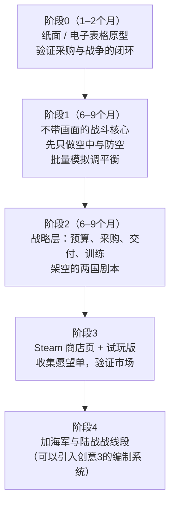

# 现代武器装备选择类游戏：三个创意的评估

> [!NOTE]
> 竞品和市场情况是根据我已有的了解写的，这次联网搜索没有查到有用的结果。销量、订阅数这类数字只代表量级，正式立项前要去 Steam / SteamDB / 创意工坊再核对一遍。

---

## 0. 先说结论

| | 创意1：CMO式 + 国防预算 | 创意2：HOI4 21世纪模组 | 创意3：陆军编制游戏 |
|---|---|---|---|
| 市场前景 | ★★★★ 有现成的成功范式 | ★★ 免费，赛道已经很挤 | ★★★ 小众，但差异化明显 |
| 可执行性 | ★★（做独立游戏）/ ★（做 CMO 模组） | ★★★★ 门槛最低 | ★★★ 范围可控 |
| 能不能实现你说的核心目标（参数影响战争） | 能 | **基本不能**，引擎限制 | 能（只限陆军） |
| 能不能赚钱 | 能 | 不能（模组只能免费） | 能 |
| 推荐度 | **首选**（做独立游戏，不做模组） | 只适合拿来练手或验证想法 | **次选**，也可以作为创意1的陆军模块 |

**一句话建议**：别做 CMO 模组，也别做 HOI4 模组。最值得做的是一款独立游戏，定位是“现代版 Rule the Waves”：战略层负责预算、采购、研发，战役层是简化版的 CMO 式海空作战，陆战做成抽象的战线。创意3里的编制设计可以以后作为扩展，或者单独做成第二款产品。

---

## 1. 核心设计问题（三个方案都要面对）

你真正想做的，其实是一个**“采购决策 → 战争检验 → 反思调整”的闭环**。所以不管选哪个方案，下面三个问题都要解决：

1. **战斗模型要能区分参数**。如果作战半径、雷达截面积（RCS）、导弹射程、弹药库存这些参数在战斗里看不出差别，采购就没有意义。
2. **不能有唯一最优解**。威胁环境、地理条件、预算、政治限制都应该不一样，比如岛国和内陆国、富国和穷国，最优选择应该不同。
3. **要能看清反馈**。打完仗后要告诉玩家“为什么输”，比如“你的拦截弹三天就打光了”“你的战机够不到对方纵深”。这一点比战斗本身有多真实更重要。

现代战争里最能体现装备选择的几个“教训点”，可以作为游戏的卖点：
- **成本交换比**：用 100 万美元的拦截弹打 2 万美元的无人机，长期打下去是亏的。
- **弹药库存和生产速度**：打的是消耗战，库存和产能决定能撑多久。
- **作战半径和基地**：航程、加油机、前沿基地，决定能不能打到对方。
- **体系比单件装备重要**：预警机、数据链、电子战这些看起来“不打仗”的装备，作用很大。
- **采购周期**：现在下单，可能 5 年后才交付。项目还可能超支、延期，甚至被砍。
- **人员训练**：飞机买来了，飞行员要好几年才能练出来。

---

## 2. 创意1：CMO式 + 国防预算 + 战略层

### 2.1 市场前景：★★★★
**已经有人证明这个模式能卖**：
- **Rule the Waves 系列**（NWS 出品）：玩法是预算、舰船设计、研发、外交危机、海战，循环往复。它很小众，但口碑和长线销量都很稳定。
- **Ultimate Admiral: Dreadnoughts**：玩法类似，画面更好，销量明显更高。说明“设计 / 采购 + 战争检验”这个循环，对大众军迷也有吸引力。
- **CMO**：卖得很贵，用户少但忠诚。说明现代海空作战有核心受众，只是很多人觉得太硬核、门槛太高。
- **Supreme Ruler 系列**：有现代背景，也有军费和单位研发，但战斗很粗糙，一直被批评。这正好说明这个空位还没人做好。

**空白点**：目前好像还没有一款游戏专门做“现代国家怎么花国防预算”，而且战斗层又能把参数差异真正体现出来。军事爱好者、军事媒体的读者、做国防政策研究的人，都可能是受众。另外，俄乌战争和中东冲突让“装备选择”成了大众话题，这在营销上是个利好。

### 2.2 为什么不建议做 CMO 模组
- CMO **没有真正意义上的模组接口**。能改的只有剧本、Lua 脚本，以及（受限的）数据库。它没有可以长期保存的战略层，也没有经济系统，你**没法往里加一个预算界面**。
- 硬要做也只能用一种别扭的办法：在 CMO 外面做个程序管预算和战略，每打一仗就生成一个剧本（.scen）塞进 CMO，打完再用 Lua 把结果读出来。玩家体验会很割裂。
- 玩家得先花大约 80 美元买 CMO，受众一下子就小了很多。
- 模组不能商业化，还可能碰到 Matrix 的数据库授权问题。
- 你本来就想要**比 CMO 简化**，可模组只能比它更复杂，方向反了。

👉 **结论：做独立游戏。** CMO 可以当成参考资料和“设计原型”来研究。

### 2.3 尺度问题：真的只能做海空军吗？
不是。可以学 Rule the Waves 的办法：**海空做细，陆战抽象**。
- 海空战：放在战区地图上（大约 1000–3000 km），按单机、单舰或中队建模。
- 陆战：用**战线段**模型。把陆地战线分成若干段，每段的实力由部署的旅及其装备算出来。空中支援、远程火力、弹药供应会影响结果。
- 这样陆军采购（坦克、火炮、防空、无人机）也有意义，又不用模拟到单车。

### 2.4 实现方案

**整体结构**

**战略层（回合制，一回合 = 一个季度）**
- 预算 = GDP × 国防开支占比。占比受政治和民意限制。
- 预算分几块：**采购 / 研发 / 维护（O&M）/ 人员 / 弹药储备 / 基础设施（基地、加固机库）**。
- 采购有几种来源：
  - 国产：要先有研发等级，有时间和超支风险。
  - 进口：受外交阵营、出口管制、制裁影响，还可能断零配件。
  - 合作研发。
- 买了装备不是马上能用：要考虑**交付周期、年产量、训练周期、战备率**。维护费不够，战备率就会下降。
- 情报系统：不同情报水平，看到的对手装备准确度不一样，可能被误导。
- 危机事件、外交关系，玩家也可以**主动开战**（会付出政治、经济代价）。

**战役层（简化版 CMO）**
- 玩家**以任务为单位下命令**（比如防空巡逻 CAP、打击、压制防空 SEAD、反舰、护航、对陆攻击）。下令后由 AI 执行，不需要去管单架飞机的操作。这是“降低硬核程度”的关键。
- 简化但保留关键的模型：
  - 探测：雷达探测距离大致和 RCS 的四次方根成正比（R ∝ σ^(1/4)），再加上地形遮挡和电子干扰。这样就足以体现隐身的价值。
  - 导弹：命中率（Pk）随距离和目标机动能力下降。有饱和攻击和拦截弹库存。
  - 航程：作战半径、空中加油、基地被打瘫后会怎样。
  - 弹药和燃料：**按基地分开计算的库存**，这是体现消耗战的核心。
- 战后报告：交换比、各单位贡献、弹药消耗曲线、“如果当初多买 X 会怎样”之类的提示。

**数据**
- 自己建一个数据库，参数用公开资料的量级（比如维基百科、公开的军事年鉴）。**不要追求精确**，“相对关系合理”就够了。
- 法律风险：真实型号名（比如 F-35）有商标争议的可能。可以先用真实名称做原型，发行前评估一下，或者改成“仿真名”，比如 “F-35A” → “F/A-XX Lightning-like”。
- 如果打算在中国发行：真实国家、边界、敏感地区的地图会有审核问题。建议用**架空国家和地图**，或者主打 Steam 国际区。

**技术选型**
- 引擎：Unity 或 Godot（2D 地图界面为主，CMO 风格也够用了）。地图可以用开源高程数据（DEM）和 Natural Earth。
- 模拟和渲染分开：战斗模拟写成一个**确定性的、不依赖画面的核心**，这样可以批量跑几千场战斗来调平衡。这一点非常重要。

**团队和周期（估算）**
- 可玩的最小原型（MVP）：1–2 名程序 + 1 名策划，大约 12–18 个月。
- 能上 Steam 抢先体验（EA）的版本：3–5 人，大约 2–3 年。

### 2.5 主要风险
- **范围失控**：三个军种都做细，必然做不完。一开始就要定好原则：首发版本只做空军和防空，海军和陆军后加。
- **平衡难做**：真实参数和好玩之间有冲突。靠批量自动模拟和可以调整的系数来解决。
- **AI 难做**：战役层的 AI 执行，加上战略层 AI 对手的采购逻辑，是工作量最大的地方。

---

## 3. 创意2：HOI4 的 21 世纪模组

### 3.1 已经有成熟模组了
- **Millennium Dawn（千禧黎明）**：这是 HOI4 里规模最大、最有名的现代模组之一，开局年份是 2000 年和 2017 年左右。里面有现代科技树、现代装备、改过的经济系统（包括债务、税收这类机制）、国家专属的国策树，开发团队也很大，一直在持续更新。
- 另外还有一些冷战或现代主题的模组，热度比 MD 低。

👉 新做一个同类模组，很难跟 MD 竞争。如果真想走这条路，更现实的做法是**给 MD 做子模组，或者加入 MD 团队**。

### 3.2 HOI4 能怎么体现作战半径？
- HOI4 的空战是**按战略空域来抽象**的：飞机部署在机场，有“航程”属性。任务只能指派给航程能覆盖到的空域。**只覆盖一部分时，任务效率会按覆盖比例下降**。
- 所以作战半径在 HOI4 里**能体现一部分**：航程短的飞机打不到远处的空域，航程长的可以从后方基地出击。

### 3.3 HOI4 体现不了的东西（引擎硬编码，模组改不了）
- 战斗是**师级数值对拼**：软攻、硬攻、突破、防御、穿甲、装甲、组织度。底层的公式改不了，只能调数值。
- **没有探测和传感器模型**：隐身、预警机、电子战，只能做成固定的数值加成。
- 导弹、拦截弹、精确制导弹药没法建模成“一发一发的弹药”，只能变成装备或者加成。
- 没有真正的防空网络或压制防空（SEAD）。空域内的空战基本是数值对比。
- 海战机制适合二战，模拟不了现代反舰导弹饱和攻击的逻辑。

👉 **结论：HOI4 能做出“复杂的科技树和装备设计”**（HOI4 本身有坦克、舰船、飞机设计器，模组可以扩展模块）。**但“细致模拟参数对现代战争的影响”这个核心目标，在 HOI4 里实现不了。**

### 3.4 适合拿来做什么
- 成本最低的创意验证：先做科技树和装备设计的平衡，看看玩家对“现代装备选择”有没有兴趣。
- 练手：学 Paradox 脚本，积累玩家社区和作品。
- 没法变现。

---

## 4. 创意3：陆军编制游戏

### 4.1 市场前景：★★★
相关的竞品和参考：
- **Shadow Empire**：有很深的编制和装备表（TO&E）设计系统，在硬核玩家里口碑很好。说明“自己设计编制”这件事确实有人喜欢。
- **The Operational Art of War IV、Gary Grigsby 系列**：有 TO&E，但基本都是固定的历史编制。
- **WARNO / Broken Arrow / Steel Division**：玩家组“卡组”，本质上是一种轻量的编成设计，这类游戏的受众比较大。
- **Combat Mission、Armored Brigade、Regiments**：战术层模拟，但不能自己设计编制。
- **自走棋 / 自动战斗类（比如 Mechabellum）**：“赛前组队，然后看战斗自动演算”这种形式，大众接受度很高。

**空白点**：从班开始自下而上设计编制，再到战场上验证，这种游戏几乎没有。卖点很清晰。

**热点**：无人机正在改变班排的编成，比如加入无人机操作手、电子战兵、反无人机手段。这正好是现在最热的军事话题，“为无人机时代设计步兵班”本身就是很好的宣传标题。

### 4.2 编制系统怎么设计
- 层级是**班 → 排 → 连 → 营 → 旅**。每一级由下一级单位加上本级直属的支援单位组成。
- 每个单位的属性**自下而上汇总**，比如：
  - 火力：分成对软目标、对硬目标、反空、间瞄几类
  - 生存力、机动性、侦察和传感器能力
  - **指挥跨度**：下级单位太多，命令延迟就会变长
  - **后勤需求**：燃料、弹药、维修
  - 人员数量、成本、训练难度
- 用约束防止“堆数值”：车辆载员、指挥跨度、预算、人员上限、后勤运力。
- 编制的好坏要通过**任务多样化**来体现：城市、开阔地、山地，进攻还是防御，打高强度战争还是反游击作战。这样就不会有一个通吃所有情况的编制。

### 4.3 战争系统怎么设计（你还没想好的部分）

| 方案 | 说明 | 优点 | 缺点 |
|---|---|---|---|
| A. 战术实时模拟 | 像 Combat Mission 或 Armored Brigade，按班建模，由 AI 控制 | 编制差异最直观 | 工作量极大，AI 很难做 |
| B. 战役级兵棋 | 格子地图，以营为单位，战斗用类似杜派 QJM/TNDM 或兰彻斯特方程的模型结算 | 开发量可控，硬核玩家认可 | 编制细节容易被“平均掉” |
| **C. 混合（推荐）** | 玩家只给营一级下命令；**战斗按班或排模拟，但用 2D 抽象画面演示，可以暂停**，下级由 AI 自动执行 | 编制差异能看到，开发量适中，像“陆军版足球经理” | 要把“看得懂的战斗回放”做好 |

方案 C 的关键机制：
- **侦察 → 打击链**：先发现目标才能打。所以无人机、侦察兵这类编制选择会直接影响战果。
- **压制和士气**：机枪、迫击炮的价值体现在压制上，而不只是直接杀伤。
- **兵种协同**：坦克没有步兵掩护，容易被反坦克手段打掉；步兵没有装甲，打不动阵地。这些要靠克制关系**自然出现**，而不是写死的加成。
- **损耗和补充**：长期战役中，编制越复杂，补充越难。
- **战后数据**：哪个班开火最多、哪个班损失最大、指挥延迟有多少。让玩家能据此迭代编制。

### 4.4 可执行性：★★★
- 只做陆军，范围比创意1小。2D 抽象画面也能降低美术成本。
- 小团队（2–3 人）大约 1.5–2 年能做出抢先体验版。
- 难点在战斗模型的调参，还有把战斗演示做得清晰易懂。

---

## 5. 推荐路线

**具体建议**
1. **先做“空中战役 + 预算”这个最小闭环**。空战加防空最能体现隐身、航程、导弹库存、预警机这些参数，单位数量也少，最适合先做。
2. **用架空的两国冲突开局**（比如岛国对大陆国）。这样不碰现实政治，也方便调平衡，以后再加真实国家的剧本包。
3. **战斗核心要和画面分开，并且结果可复现**。这样才能批量跑模拟，调出“没有唯一最优解”的平衡。
4. **尽早上线 Steam 商店页**，用愿望单数量判断市场反应。一般认为抢先体验上线前能有几千到上万个愿望单，才算不错的信号。
5. HOI4 / MD 子模组可以当作**低成本练手**的项目，但别把它当成主线。

---

## 6. 需要你确认的问题
- 团队规模、预算多少？是一个人业余做，还是打算组队创业？
- 会不会编程？熟悉哪个引擎？
- 目标市场：Steam 国际区、国内，还是两者都要？这会影响要不要用真实国家和地图。
- 你更在意“真实度和教育意义”，还是“好玩、好卖”？这决定战斗模型要细到什么程度。
