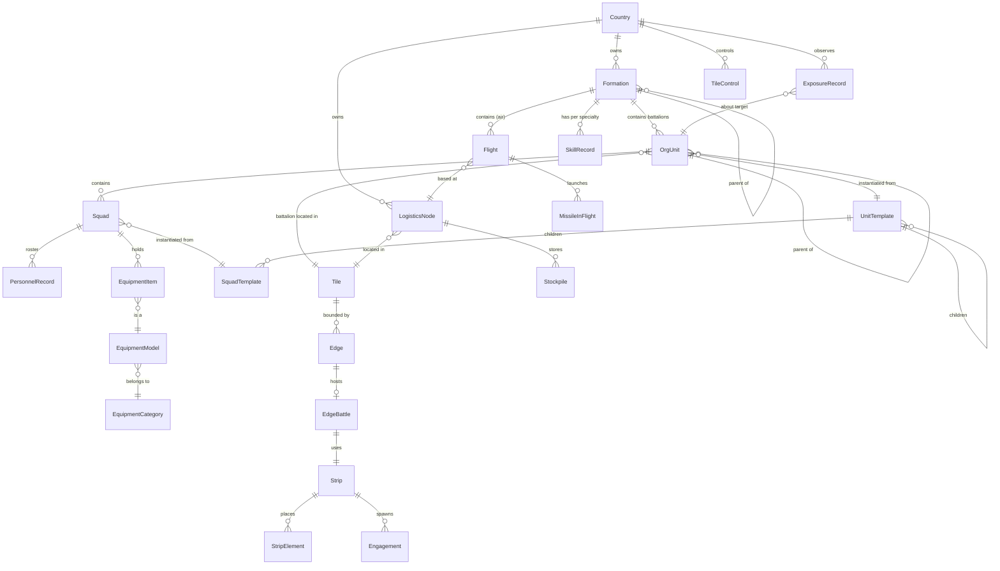

# 00 术语表与全局约定

> 所有规格作者**先读本文件**。术语、ID、单位、实体归属、更新顺序、确定性规则一律以本文件为准。
> 本文件不使用 11 节模板。需要新术语时，写进你自己文件末尾的“新增术语”一节，**不要改本文件**。
> 标记沿用总纲：✅ 总纲已确认；🟡 建议、待确认（编号 `G-xx`，见第 8 节）；❓ 未定。
> “出处”列里的 `§9.3` 指 [设计文档 v0.1](../design_doc_v0.1.md) 的章节号。

---

## 0. 怎么用本文件（给规格作者的 6 条硬规则）

1. **类型名只用第 1 节表里的英文标识**。表里有的概念，不许另起名字（比如不许把 `Engagement` 叫成 `Skirmish`，不许把 `Exposure` 叫成 `Visibility`）。
2. **一个类型只由一个规格文件定义**（第 4 节“归属”列）。别的规格需要给这个实体加字段时，**不许改它的定义**，而是定义一个**组件**（component）：`XxxState`，用实体 ID 做键，写在你自己的文件里（ECS 风格，总纲 §9.3④）。例：03 需要给 `Squad` 加压制值，就定义 `SquadCombatState { SquadId squadId; double suppression; ... }`。
3. **数值一律带单位后缀**（第 3 节）。没有后缀的数，必须是无量纲量，且写明取值范围。
4. **任何随机都走第 6 节的 RNG 规则**。禁止 `System.Random`、禁止 `Guid.NewGuid()`、禁止读系统时间。
5. **跨系统的调用时机以第 5 节总表为准**。你的系统在哪个阶段（`TickPhase`）、多久跑一次，必须和总表一致；要改，写成 🟡。
6. 引用别的规格的类型时，写成“`Tile`（10）”这种形式，括号里是归属规格编号。

---

## 1. 术语表

列说明：**中文** | **英文标识**（C# 类型名或枚举值；枚举值写成 `EnumType.Member`）| **定义**（一句话）| **出处**（总纲章节）| **归属**（定义它的规格编号，见第 7 节）。

### 1.1 编制与部队

| 中文 | 英文标识 | 定义 | 出处 | 归属 |
|---|---|---|---|---|
| 班 | `Squad` | 编制树的叶子；唯一直接拥有人员名册和装备的单元；班级模拟里的“空间单元”。车组、炮组、指挥部班都是 `Squad`。 | §3.1, §9.3③ | 01 |
| 排 | `OrgUnit`（`level = OrgLevel.Platoon`） | 由班组成的编制单元。 | §3.1 | 01 |
| 连 | `OrgUnit`（`level = OrgLevel.Company`） | 由排或班组成；条带层上的基本位置单元；炮兵连（battery）也是连级。 | §3.1, §9.3 | 01 |
| 营 | `OrgUnit`（`level = OrgLevel.Battalion`），常用别名 `Battalion` | 陆军**最小控制单位**和地图作战单位；地块归属的最小单位；型号绑定在营上。 | §2.1, §3.1, §11.1.2 | 01 |
| 编制单元 | `OrgUnit` | 排、连、营三级共用的运行时类型（因为允许跨级引用，排/连/营的子节点可以是任何更低级）。 | §3.1 | 01 |
| 编制层级 | `OrgLevel` | 枚举：`Squad, Platoon, Company, Battalion, Brigade, Division, Corps`。与数据文件 `level` 字段一一对应（`squad`…`corps`）。集团军 = `Corps`。 | §3.1, data/README | 01 |
| 编组 | `Formation` | 营以上的组织：旅、师、集团军；空军的中队、大队/联队；海军编队、舰队。可整体操作，也可拆开。 | §2.2 | 01 |
| 建制编组 | `FormationKind.Organic` | 有指挥部单位的编组；影响指挥负荷、请求链、默认型号继承。 | §2.2 🟡 | 01 |
| 临时编组 | `FormationKind.AdHoc` | 纯操作便利的编组；无指挥部，无任何机制加成或惩罚。 | §2.2 🟡 | 01 |
| 旅 / 师 / 集团军 | `Formation`（`echelon = OrgLevel.Brigade / Division / Corps`） | 陆军建制编组的三级。旅部、师部做成 `role = Hq` 的特殊营。 | §2.2, §3.1 | 01 |
| 中队 / 大队、联队 | `Formation`（`service = Service.Air`，`echelon = AirEchelon.Squadron / Wing`） | 空军编组。中队由若干 `Flight` 组成。 | §2.2, §13.1 | 01（结构）/ 08（行为） |
| 军种 | `Service` | 枚举：`Army, Air, Navy`（`Navy` 阶段 3）。 | §2 | 01 |
| 指挥部 | `Headquarters`（数据里 `role: hq`） | 排部/连部/营部是 `role = Hq` 的班；旅部/师部是 `role = Hq` 的营。决定指挥能力。 | §3.1, §9.7 | 01 |
| 模板角色 | `TemplateRole` | 枚举：`Line`（默认）、`Hq`、`Support`、`EquipmentPool`。对应数据 `role` 字段。 | data/README | 01 |
| 装备池伪班 | `TemplateRole.EquipmentPool` | 不占人员、只放共用装备的伪班（如“每排 2 具标枪”）。 | data/README | 01 |
| 聚合单位 | `Granularity.Aggregate` | 数据只给到总数、内部未细分的模板；汇总人数用 `expected_personnel` 回填。 | data/README | 01 |
| 战时加强 | `attached`（字段） | 不计入本级总数的战时配属（如前观员）。 | data/README | 01 |
| 配属 | `Attachment` | 营离开自己的建制编组，临时归另一个编组指挥；请求链变长、指挥负荷上升。营有 `organicFormationId`（建制上级）和 `currentFormationId`（当前上级）。 | §2.2 🟡 | 01 |
| 模板 | `Template`（抽象概念） | 编制的“目标状态”；班模板与上级模板的统称。 | §3.1 | 01 |
| 班模板 | `SquadTemplate` | 唯一直接带人员（专业→人数）和装备槽位（类别→数量）的模板。 | §3.1, §8 | 01 |
| 上级模板 | `UnitTemplate` | 排/连/营/旅/师/集团军模板；只引用下级模板 `children[{templateId, count}]`，不直接带装备。 | §3.1, §8 | 01 |
| 槽位 | `Slot` | 班模板里的“装备类别 × 数量”；**只定类别不定型号**。 | §3.1 | 01 |
| 不占编制装备 | `slotsUnassigned`（数据 `slots_unassigned`） | 随车携带、随取随用、不计入编制槽位的装备（如车上的一次性火箭筒）。 | data/README | 01 |
| 跨级引用 | —（规则） | 上级模板可以直接引用任何更低级的模板。 | §3.1 ✅ | 01 |
| 型号 | `EquipmentModel` | 具体装备型号（如 `ztz99a`），属于一个类别和一个系列。 | §8 | 01（核心）＋各 Profile 归属见 §4.3 |
| 类别 | `EquipmentCategory` | 装备类别（主战坦克、步枪……）；见 `data/schema/categories.yaml`。 | §3.1, §8 | 01 |
| 系列 | `family`（字段） | 同一设计谱系的型号组；用于推导型号相似度。 | §4.2, §8 | 01 |
| 装备实例 | `EquipmentItem` | 一件具体的武器/车辆/器材（有自己的状态），引用一个 `EquipmentModel`。 | §9.3③ | 01 |
| 型号绑定 | `ModelBinding` | 每个营“类别 → 型号”的映射；每营每类别只选一个型号。 | §3.2 ✅ | 01 |
| 默认型号继承 | `defaultBindings`（数据 `default_bindings`） | 旅/师上设的默认绑定，下属营自动沿用、可单独覆盖。 | §3.2 🟡 | 01 |
| 替代装备 | `Substitution` | 新型号不足时用同类老型号顶上；属性和专有练度都按老型号算。 | §3.3 ✅ | 01 |
| 分配策略 | `AllocationPolicy` | 枚举：`Even`（平均分配）、`PriorityFill`（优先整编）、`FrontlineFirst`（一线优先）。 | §3.3, §9.12(5) | 01 |
| 全军需求 | `ForceRequirement` | Σ(模板槽位数 × 采用该模板的营数)，按营所选型号分别汇总。 | §3.2 | 01 |
| 战备等级 | `ReadinessTier` | 枚举：`Active`（常备满编）、`Reduced`（简编）、`Cadre`（预备役骨干营）。 | §3.4 ✅ | 01（枚举）/ 02（在编比例）/ 11（动员时间） |
| 满编率 | `FillRate` | 实际/模板的比例，分人员、各类装备、各项能力分别计算，取值 [0, 1]（可 >1 表示超编）。 | §9.12(2)(6) | 07 |
| 能力向量 | `CapabilityVector` | 连/营实际剩余能力（反装甲、压制、人数、弹药…）的向量；结果缓存的查询键和战斗力门槛的依据。 | §9.12(2) | 03 |
| 待编池 | `UnassignedPool` | 营里凑不成完整班的人和装备的暂存处，等补充后再组班。 | §9.12(2) | 07 |
| 重组 | `Reorganization` | 人和装备总数守恒的重新编班；按排内（战斗中）/连营内（休整）/营旅间（玩家下令）三级。 | §9.12(2) | 07 |
| 重组策略 | `ReorgPolicy` | 枚举：`KeepStructure = 1`（保持建制）、`Consolidate = 2`（集中成完整单位）。01 的 `CountryOrgSettings.fillMode` 也用此枚举。 | §9.12(2) 🟡 | 07 |
| 留守分队 | `RearDetachment` | 空运/海运运不走而留下的人和装备，以后另行跟进。 | §15.3, §17.1 | 08（空运）/ 01（结构） |
| 属性摘要 | `BattalionSummary` | 营的侦察距离、各类自给能力、压制火力、防护、平均负重、通信延迟等汇总值（只供界面和 AI 参考，不参与结算）。 | §9.10(7) | 03 |
| 编制试验场 | `ProvingGround` | 拿模板在标准地形上批量对战看分布的工具；阶段 0 的核心。 | §9.9, §21-16 | 03（模拟）/ 13（界面） |
| 指挥负荷 | `CommandLoad` | 直接下级数量 × 下级种类多样性。 | §9.7 | 01 |
| 指挥能力 | `CommandCapacity` | 每级指挥官的能力值，由部班的通信装备和练度决定；负荷超过能力时命令延迟变长、协同打折。 | §9.7 | 01 |

### 1.2 人员与练度

| 中文 | 英文标识 | 定义 | 出处 | 归属 |
|---|---|---|---|---|
| 专业 | `Specialty` | 人员岗位专业（坦克炮长、步枪手……）；见 `data/schema/specialties.yaml`。 | §4.3 | 02 |
| 训练体系 | `School`（数据 `school` 字段） | 把多个专业归并成同一个训练学校，用于计算训练产能。 | §4.3 | 02 |
| 训练学校产能 | `SchoolCapacity` | 每个训练体系单位时间能培养的人数上限。 | §4.3 ✅ | 02 |
| 通用练度 | `GeneralSkill` | 与型号无关的基本军事素养，[0, 1]。 | §4.1 ✅ | 02 |
| 型号专有练度 | `TypeSkill` | 针对当前型号的熟练度，[0, 1]；换装时乘相似度系数。 | §4.1, §4.2 ✅ | 02 |
| 型号相似度系数 | `SimilarityFactor` / `SimilarityRule` | 新旧型号之间的练度保留系数，[0, 1]；可由 `family` 和 `origin` 推导。 | §4.2 🟡 | 02 |
| 练度记录 | `SkillRecord` | 按“编组 × 专业”记录的平均练度（见 G-07：旅还是营）。 | §4.3 🟡, §9.3③ | 02 |
| 人员记录 | `PersonnelRecord` | 名册里的一个人：专业、岗位、携带物、负重、伤亡状态。不起名字，不单独记练度。 | §9.3③ | 02 |
| 人员名册 | `Roster` | 一个班的 `PersonnelRecord` 列表。 | §9.3③ | 02 |
| 伤亡状态 | `CasualtyState` | 枚举：`Healthy, LightWounded, SeverelyWounded, Killed, MissingOrCaptured`。 | §9.12(1) | 07 |
| 补充方式 | `ReplacementMode` | 枚举：`Individual`（单兵补充）、`UnitRotation`（整建制轮换）。 | §9.12(5) | 07 |
| 凝聚力 | `Cohesion` | 可选机制，[0, 1]；**阶段 1 不做**。 | §9.12(5) 🟡 | 02 |
| 伞降资格 | `AirborneQualified`（标志） | 人员能否伞降的专业资格。 | §15.1 🟡 | 02 |
| 兵役制度 | `ConscriptionSystem` | 义务兵/职业兵、服役期、预备役规模、征兵上限。 | §18.11 | 11 |

### 1.3 弹药、后勤、物资

| 中文 | 英文标识 | 定义 | 出处 | 归属 |
|---|---|---|---|---|
| 弹药基数 | `AmmoBasis` | 陆军旅的弹药计量单位：旅内每种武器各带若干发（按弹种配比）之和。 | §5.1 ✅🟡 | 06 |
| 默认基数 | `DefaultAmmoLoad` | 每个武器型号自带的一个基数配比（如坦克 = 穿甲 18 + 榴弹 16 + 炮射导弹 6）。 | §5.1, §8 | 03（武器数据）/ 06（汇总） |
| 基数配比 | `AmmoComposition` | 旅一级对弹种比例和具体弹药型号的调整。 | §5.1 | 06 |
| 弹药型号 | `MunitionModel` | 具体弹药（155mm 普通榴弹、某型空空导弹）；数据上是 `EquipmentModel` 的一种（带 `MunitionProfile`）。 | §5.1, §5.2 | 03（地面）/ 08（空中） |
| 通用弹药组 | `CaliberGroup` | 可共用库存的弹药口径组。 | §5.1 🟡 | 06 |
| 随行携带量 | `CarriedLoad` | 部队随身/随车携带的物资；补给切断后先消耗它。 | §5.1, §19.9 | 06 |
| 物资类别 | `SupplyClass` | 枚举：`Ammunition, Fuel, SpareParts, General`（一般物资 = 给养、医疗等）。 | §19.6 ✅ | 06 |
| 库存 | `Stockpile` | 某个持有者（节点或部队）× 物资（弹药按型号、其他按类别）的数量。 | §19.6 | 06 |
| 储备目标 | `StockTarget` | 陆军按“天数战时消耗”，海空军精确弹药按“枚”设置的囤积目标。 | §5.2, §19.7 | 06 |
| 后勤节点 | `LogisticsNode` | 仓库、后勤中心、铁路终点站、机场、港口统一的节点类型；属性：容量、吞吐、加固、分散度。 | §5.2, §19.5 ✅ | 06 |
| 节点角色 | `NodeRole` | 枚举：`Depot`（储备仓库）、`ForwardHub`（前进后勤中心）、`Airbase`、`Port`（阶段 3）、`Factory`、`ImportGateway`（进口口岸）、`IndustryNode`（国家工业节点）、`FieldCache = 8`（临时堆放点，06 L-05）。整数值见 06 §3.1。 | §19.5, §19.6 | 06 |
| 储备仓库 | `NodeRole.Depot` | 容量大、可加固、位置固定、新建要好几年的节点。 | §19.5 ✅ | 06 |
| 前进后勤中心 | `NodeRole.ForwardHub` | 由后勤旅展开、容量小、能随战线移动的节点；有几个后勤旅就能开几个。 | §19.5 ✅ | 06 |
| 后勤旅 | `LogisticsBrigade`（`Formation` 的一种用途标记） | 集团军级保障部队；展开前进后勤中心，负责运到旅保障区。 | §19.5, §19.8 | 06 |
| 旅保障区 | `BrigadeSupportArea`（缩写 BSA） | 旅的补给点；位于己方纵深约 20–35km；地块层网络流的终点，条带层补给的起点。 | §19.2, §19.3 | 06（逻辑）/ 04（条带上的位置） |
| 营辎重队 | `BattalionTrains` | 营的补给点（己方纵深 2–5km）。 | §19.2, §19.3 | 06 |
| 连补给点 | `CompanySupplyPoint` | 连的补给点（几百米到 1km）。 | §19.2 | 06 |
| 补给网络流 | `SupplyNetworkFlow` | 每小时按优先级在地块层做的简化最小费用流，算到旅保障区为止。 | §19.3 ✅ | 06 |
| 运力等级 | `LinkCapacityClass` | 相邻两地块之间道路/铁路的运力等级（离线从 OSM 算出）。 | §19.4 ✅ | 10（数据）/ 06（使用） |
| 铁路类型 | `RailClass` | 枚举：`ConventionalSingle, ConventionalDouble, HighSpeed`；另有布尔属性 `gaugeBreak`（轨距断点）。 | §19.4 | 10 |
| 桥梁节点 | `BridgeNode` | 跨大河的连接，可被打击。实现类型为 10 的 `CrossingNode`（`CrossingKind` 区分桥/隧道，M-19）。 | §19.4 | 10（数据）/ 06（切断效果） |
| 渠道策略 | `ImportChannelPolicy` | 枚举：`Distributed, Fastest, Safest`。 | §19.6 | 06 |
| 战备储备 | `WarReserve` | 平时生产、存在储备仓库里的弹药和物资。 | §19.6 | 06 |
| 封存基地 | `StorageBase` | 封存装备的场所；启封花时间、钱、备件；状态逐年下降。 | §19.6 | 06（存储）/ 11（启封决策），阶段 2+ |
| 重点战略方向 | `StrategicDirectionWeight` | 玩家设定的各方向储备比例（如东 60%）。 | §19.7 | 06 |
| 保质期 | `shelfLife`（字段，`_y` 年） | 弹药报废和轮换的周期。 | §19.7 | 06 |
| 备件 | `SpareParts` / `PartsStock` | 每个型号一个抽象数量的备件库存。 | §6, §8 | 07（消耗）/ 06（存储与运输） |
| 拆东补西 | `Cannibalization` | 拆一件装备修另一件。 | §6 | 07 |
| 依赖清单 | `DependencyList` | 进口装备在成品、备件、弹药、软件上分别依赖谁、多脆弱。 | §18.7 | 11 |
| 装填模板 | `VlsLoadoutTemplate` | 舰艇垂直发射单元的装填方案。**阶段 3**。 | §5.2 | 01（通用结构，DC-075）；行为由阶段 3 海军规格定义 |

### 1.4 地图

| 中文 | 英文标识 | 定义 | 出处 | 归属 |
|---|---|---|---|---|
| 地块 | `Tile` | 一个 H3 第 4 级六角格（只给陆地和沿海分格）；平均面积约 1770km²，平均边长约 22.6km，对边约 40km。 | §9.3 ✅🟡 | 10 |
| 交界边 | `Edge` | 两个相邻地块之间的公共边；**无向**；战斗发生在边上。 | §9.3 ✅ | 10 |
| 区域 | `Region` | 几十个地块组成，用于补给、行政、战略 AI 寻路。 | §9.3 🟡 | 10 |
| 战区 | `Theater` | 剧本覆盖的一组区域（阶段 1 = 纳卡战区）。 | §9.3, §21-4 | 10 / 14 |
| 地形构成 | `TerrainComposition` | 每格各地形类型的面积占比（城市、森林、开阔地、山地、水体……）、高程统计、道路密度。 | §9.3 | 10 |
| 地形类型 | `TerrainType` | 地形构成和条带格子共用的枚举：`None = 0, Open = 1, Mixed = 2, Forest = 3, Urban = 4, Mountain = 5, Marsh = 6, Water = 7`（10 §3，M-02；无 `Hills`/`Wetland`，起伏用 `elevStdM` 表达）。 | §9.3 | 10 |
| 滩头属性 | `BeachProfile` | 沿海地块能否登陆、适合哪些载具、有无港口。阶段 3。 | §17.3 | 10 |
| 地块控制权 | `TileControl` | 地块当前归哪个国家控制；没有部队时保持不变。 | §11.1.2, §13.3 | 09 |
| H3 索引 | `H3Index` | H3 网格单元 ID（`ulong`）。 | §9.3 | 10 |

### 1.5 交界边战斗与条带

| 中文 | 英文标识 | 定义 | 出处 | 归属 |
|---|---|---|---|---|
| 交界边战斗 | `EdgeBattle` | 一条交界边上正在进行的一场战斗（五个阶段同时推进）；有开始、结束、参战方。 | §9.3, §11.2, §11.3 | 04（触发条件由 09 判定） |
| 交战条带 | `Strip` | 一场 `EdgeBattle` 所用的局部连续坐标空间：宽 = 边长，纵深 −40km…+40km。 | §9.3 ✅🟡 | 04 |
| 条带地形 | `StripTerrain` | 每条边**生成后固定**的条带地形栅格（以边的规范方向存储，见 §3.6）。 | §9.3 🟡 | 04（生成）/ 10（输入数据） |
| 接触线 | `ContactLine` | 双方前沿的分界线，是条带上沿 x 变化的一条折线 y = c(x)；战斗开始时 c(x) = 0。 | §9.3 | 04 |
| 条带元素 | `StripElement` | 条带上有位置的单元：连、炮兵连、营属支援分队（营直属的班组集合）。 | §9.3 | 04 |
| 战斗阶段（五条线） | `BattleLine` | 枚举：`DeepStrike`（A 纵深打击）、`Recon`（B 侦察与反侦察）、`CounterBattery`（C 反炮兵与火力消耗）、`Breaching`（D 破障）、`DirectFire`（E 直瞄交战）。五条线**同时**推进。 | §9.3① ✅🟡 | 04 |
| 破障进度 | `BreachProgress` | [0, 1]；决定 E 阶段能否开始成建制进攻以及推进速度。 | §9.3① | 04 |
| 纵深推进度 | `PenetrationProgress` | [0, 1]；E 阶段推进距离的累积；达到 1 地块易手。 | §9.3① | 04 |
| 工事等级 | `FortificationLevel` | 随防守时间增长；降低特征值、提高防护。 | §9.3① | 04 |
| 梯队角色 | `EchelonRole` | 枚举：`FirstEchelon, SecondEchelon, Reserve`。（注意：不要用 `Echelon` 指“层级”，层级用 `OrgLevel`。） | §9.3① | 04 |
| 正面宽度 | `Frontage` | 交界边可同时容纳的连级片段数 = 边长 ÷ 连作战正面。 | §9.3① | 04 |
| 连级交战片段 | `Engagement` | “我方一个连 vs 敌方一个排或连”的直射交战，加上营/旅支援火力介入；内部做班级模拟，持续 10–30 分钟。 | §9.3② | 03（内部模拟）/ 04（生成与写回） |
| 交战类型 | `EngagementType` | 枚举：`AttackPosition`（攻击阵地）、`Meeting`（遭遇战）、`Counterattack`（反冲击）、`Infiltration`（渗透）、`Reconnaissance`（侦察，小规模）。 | §9.3①② | 03 |
| 班级模拟 | `SquadSimulation` | 片段内部以 1 分钟为步长、步内按开火时刻排序的模拟。 | §9.3③, §9.6 | 03 |
| 正面槽位 | `FrontSlot` | 片段内部横向的位置格。 | §9.3③ | 03 |
| 片段纵深带 | `DepthBand` | 片段内部的纵深分档：`Close`（0–300m）、`Medium`（300m–1km）、`Far`（1–4km）、`Beyond`（>4km，03 §3.2）。（不要和 §9.2 的“本级负责纵深”混淆，后者叫 `EchelonDepth`。） | §9.3③ | 03 |
| 本级负责纵深 | `EchelonDepth` | 某层级单位负责的纵深距离，用来判断武器射程是否“白费”。 | §9.2 | 03 |
| 空间单元 | `SpatialElement` | 班级模拟里有位置的点：一个班；乘车班下车后拆成“车＋车组”和“下车步兵”两个。 | §9.3③ 🟡 | 03 |
| 乘车 / 下车 | `MountState` | 枚举：`Mounted, Dismounted`。 | §9.3③, §9.10(5) | 03 |
| 战术步长 | `TacticalStep` | 1 分钟；陆战直瞄接触和空中交战共用；其他步长都是它的整数倍。 | §12.1 🟡, §11.1 ✅ | 09 |
| 步内事件 | `IntraStepEvent` | 一个战术步内带毫秒时刻的事件（开火、命中、空袭到达），按时刻先后结算。 | §9.6 🟡 | 03（陆）/ 08（空）/ 15（排序规则） |
| 目标类别 | `TargetClass` | 枚举：`PersonnelExposed, PersonnelCovered, PersonnelInBuilding, PersonnelReverseSlope, LightArmor, HeavyArmor, Fortification, Helicopter, Uav, SoftVehicle`（`SoftVehicle = 10` 为 03 C-03 新增；整数值见 03 §3.1）。 | §9.4 | 03 |
| 非杀伤效果 | `Suppression`、`Smoke` | 压制（降低开火、禁止移动、随时间消退）；烟雾（降低某纵深带视距）。 | §9.4, §9.10(4) | 03 |
| 武器属性 | `WeaponProfile` | 总纲 §9.5 的 `WeaponModel`：效能矩阵、射程、命中曲线、射击方式、射速、重量、乘员、架设和瞄准时间、练度要求。挂在 `EquipmentModel` 上。 | §9.5 | 03 |
| 射击方式 | `FireMode` | 枚举：`Direct = 1`（直射）、`LowAngleIndirect = 2`（低伸曲射）、`HighAngleIndirect = 3`（高抛，唯一能打反斜面）、`Loitering = 4`（巡飞弹/FPV，03 C-02）。 | §9.5 | 03 |
| 压制值 | `suppression`（字段） | [0, 1]，按期望值连续计算。 | §9.10(4), §21-1 | 03 |
| 疲劳 | `fatigue`（字段） | [0, 1]；降低命中率和机动。 | §9.6, §9.10(6) | 03 |
| 负重 | `loadKg`（字段） | 单兵负重 = 个人装备 + 武器 + 分到的弹药。 | §9.10(6) | 03 |
| 威胁窗口 | `ThreatWindow` | 某威胁不处理时多久造成严重杀伤；响应超过窗口就出现损失。 | §9.10(3) | 03 |
| 闲置原因 | `IdleReason` | 枚举：`NoSuitableTarget, OutOfRange, NoLineOfSight, NoAmmo, Suppressed, AwaitingOrders`。 | §9.8 | 03 |
| 火力支援请求 | `FireSupportRequest` | 下级向拥有支援武器的上级申请间瞄火力的请求；进入支援武器的队列。 | §9.6, §9.3② | 03 |
| 请求链 | `RequestChain` | 请求从班到支援武器持有者经过的层级路径；响应时间 = 通信时间 + 排队时间 + 射击准备时间。观察员可跳级。 | §9.2, §9.10(2) | 03（结算）/ 01（层级路径） |
| 结果分布缓存 | `OutcomeCache` | 按“能力向量 × 敌方能力向量 × 地形 × 交战类型 × 支援等级”预先跑出的片段结果分布。 | §9.3④, §9.12(2) | 03 |
| 代理模型 | `ProxyModel` | 离线训练的小模型，输入属性摘要，快速估算交战结果；可与结果缓存合一。 | §9.10(8), §20.1 | 12 |
| 模拟精度档 | `FidelityTier` | 枚举：`Full`（实时班级模拟）、`Cached`（从 `OutcomeCache` 抽样）、`Proxy`（远方战争按代理模型日结）。 | §9.3④, §9.3 全球地图 🟡 | 09（调度）/ 03（Full/Cached）/ 12（Proxy） |
| 时间预算调度 | `SimBudgetScheduler` | 每个游戏小时给模拟固定计算预算，按优先级决定哪些战斗用 `Full`。必须用固定规则，不能按机器性能。 | §9.3④ 🟡 | 09 |
| 星标单位 | `starred`（标志） | 玩家标星的单位；调度优先实时模拟；触发自动暂停。 | §9.3④, §11.4 | 13（设置）/ 09（使用） |
| 战后报告 | `AfterActionReport`（缩写 AAR） | 按武器、阶段、班模板拆分的损失和闲置统计。 | §9.8, §9.3①, §9.12(7) | 13（呈现）；数据由各系统产出 |
| 战斗事件记录 | `BattleEventLog` | 只存事件、不存帧的回放数据。 | §11.4 | 15 |

### 1.6 侦察与暴露度

| 中文 | 英文标识 | 定义 | 出处 | 归属 |
|---|---|---|---|---|
| 特征值 | `Signature` | **单位自身**的可被发现程度（规模、车辆数、活动、电台雷达开机、姿态、地形、伪装）。≥ 0 的无量纲数。 | §10.1 🟡 | 05 |
| 暴露度 | `Exposure` | **观察方对某个敌方单位的了解程度**；不是单位属性。持续侦察增长、停止侦察衰减。 | §10.1 ✅ | 05 |
| 暴露等级 | `ExposureLevel` | 枚举：`None = 0, Presence = 1`（L1 存在）、`Size = 2`（L2 规模）、`Type = 3`（L3 类型）、`Targetable = 4`（L4 目标级定位，跨地块精确打击前提）、`Status = 5`（L5 状态）。 | §10.3 ✅🟡 | 05 |
| 暴露记录 | `ExposureRecord` | （观察方国家, 目标单位）→ 暴露度连续值 + 情报时间戳 + 误差。 | §10.1 | 05 |
| 反侦察系数 | `counterRecon`（字段） | [0, 1]；削减敌方暴露度增量。 | §10.2 | 05 |
| 侦察手段 | `ReconMeans` | 枚举：`OpticalSatellite, RadarSatellite, Elint, LargeUav, GmtiAircraft, ReconPod, MediumUav, SpecialForces, GroundRecon`；各有增长速度、最高等级、持续与生存性。 | §10.4 🟡 | 05 |
| 姿态 | `Posture` | 枚举：`Entrenched`（挖壕防守）、`Defending`、`Resting`（休整）、`Assembling`（集结）、`Marching`（行军）、`Attacking`、`CrossingEdge`（过边中）。 | §10.2, §11.1.2 | 05（对特征值的影响）/ 09（状态切换） |
| 区域侦察任务 | `AreaReconTask` | 给侦察单位划区域、系统自动分配侦察时间的任务。 | §10.6 | 05 |
| 我方暴露度估算 | `OwnExposureEstimate` | 估算敌人对我方掌握到什么程度的视图数据。 | §10.6 | 05（计算）/ 13（显示） |
| 欺骗 | `Deception` | 假目标、假电台制造的虚假暴露度。 | §10.3 | 05 |
| 电磁管控 | `EmconState` | 枚举：`Active, Partial, Silent`；雷达/电台开机状态。地面防空、舰队通用。 | §12.5, §14.1 | 05（对特征值）/ 08（防空行为） |
| 特种部队侦察任务 | `SofMission` | “进入地块 X，侦察 N 天，然后撤出”；进入方式 `SofInsertion`：`GroundInfiltration, Parachute, HeliInsertion`。 | §16 | 05 |

### 1.7 时间与命令

| 中文 | 英文标识 | 定义 | 出处 | 归属 |
|---|---|---|---|---|
| 全局时钟 | `GameClock` | 伪即时制的游戏时钟；精度 1 分钟；可暂停、调速。 | §11.1 ✅ | 09 |
| 游戏时刻 | `SimTime` | 从纪元起算的毫秒数（`long`），见 §3.3。 | — | 09 |
| 分钟刻 | `Tick` | 一个 1 分钟的推进单位；第 n 刻把世界从 n 分推进到 n+1 分。 | §11.1 | 09 |
| 更新阶段 | `TickPhase` | 一刻内各系统执行的顺序编号，见第 5 节。 | — | 09 |
| 速度档位 | `GameSpeed` | 最慢每秒 1 游戏分钟，最快每秒几游戏小时。 | §11.1 🟡 | 09 / 13 |
| 陆战命令 | `LandOrderType` | 枚举：`Move`、`CrossTileRecon`（跨地块侦察）、`CrossTileStrike`（跨地块打击）。进攻 = 移动进有敌军的地块，防御 = 留在原地。 | §11.1.1 ✅🟡 | 09 |
| 命令 | `Order` | 一条命令：下令时刻、生效时刻、目标、状态。 | §11.1.1 | 09 |
| 命令延迟 | `OrderDelay` | 下令到生效的时间；取决于层级、指挥部与通信水平、干扰、部队状态。 | §11.1.1 🟡 | 09 |
| 过边中 | `Posture.CrossingEdge` | 营在边界上的过渡状态；持续 = 纵队长度 ÷ 行军速度；进度过半时切换地块归属。 | §11.1.2 🟡 | 09 |
| 纵队长度 | `columnLengthM`（字段） | 行军纵队长度，约 3–8km。 | §11.1.2 | 09 |
| 行军方式 | `MarchMode` | 枚举：`Dense`（密集）、`Dispersed`（疏散）。（不要叫 `Formation`。） | §11.1.2 🟡 | 09 |
| 脱离接触 | `Disengage` | 交战中撤退；需要组织时间，途中持续挨打。 | §11.1.1 🟡 | 04 |
| 自动暂停 | `AutoPauseFilter` | 战斗结束时按过滤条件决定是否暂停。 | §11.4 🟡 | 13 |
| 阶段战报 | `PeriodicBattleReport` | 持续战斗每 24 小时出一份。 | §11.3 | 04（数据）/ 13 |
| 跨地块打击 | `CrossTileStrike` | 射程明显超过一个地块的兵器（远程火箭炮、战术导弹、空袭、中大型无人机）对其他地块目标的打击；响应 = 命令延迟 + 准备 + 飞行时间；L4 才能精确。 | §9.3, §11.1.1, §10.5 | 04（地面远程火力结算）/ 08（空袭结算） |

### 1.8 空中

| 中文 | 英文标识 | 定义 | 出处 | 归属 |
|---|---|---|---|---|
| 飞行编组 | `Flight` | 空军最小控制单位：作战飞机 4 架；预警/加油/电子战等高价值支援机 1–2 架；大型无人机为“组”。 | §2.1, §8 | 08 |
| 空中任务 | `AirMissionType` | 枚举：`Ferry`（转场）、`Intercept`、`Cap`（空中战斗巡逻）、`Cas`（近距空中支援）、`Strike`、`Sead`（含 DEAD）、`Escort`、`SupportOrbit`（支援盘旋）、`Recon`、`Airlift`（空运/空降，§15，08 §3）；阶段 3 增加 `Asw, MaritimeSearch, Csar, MineWarfare, ShipShuttle`。整数值见 08 §3。 | §12.3, §14.5 | 08 |
| 任务包 | `MissionPackage` | 打击任务附带护航/SEAD/干扰，系统自动同时到达。 | §12.3 🟡 | 08 |
| 飞行剖面 | `FlightProfile` | 枚举：`HiHiHi, HiLoHi, LoLoLo`。 | §12.4 ✅ | 08 |
| 雷达地平线 | `RadarHorizon` | 探测距离_km ≈ 4.12 × (√雷达高度_m + √目标高度_m)。 | §12.4 🟡 | 08 |
| 不可逃逸区 | `NoEscapeZone` | 空空导弹命中率最高的距离区间。 | §12.5 | 08 |
| 拦截策略 | `InterceptPolicy` | 枚举：`Safe`（约 95%）、`Balanced`（约 85%）、`Conserve`（约 70%）。地面防空与舰队防空通用。 | §14.1.1 ✅ | 08 |
| 防空双登记 | `AirDefenseRegistration` | 地面防空营既是陆地单位，又在空中层按空中步长参与探测拦截。 | §12.1 🟡 | 08 |
| 飞行中弹药 | `MissileInFlight` | 正在飞行的导弹/远程弹药实体（只有远程弹药在界面显示）。 | §12.2 | 08 |
| 挂载 | `Loadout` | 按任务自动从所在机场库存挂弹；不足时降级。 | §5.2, §12.5 | 08 |
| 空运方式 | `AirliftMethod` | 枚举：`Paradrop`（伞投）、`AirLanding`（机降）、`FastRope`（索降）、`SlingLoad`（吊挂）。 | §15.1 ✅ | 08 |
| 运输策略 | `LiftPriority` | 枚举：`PersonnelFirst`（默认）、`CompleteSquadsOnly`。 | §15.3 🟡 | 08 |

### 1.9 海军与两栖（阶段 3，只留名字）

| 中文 | 英文标识 | 定义 | 出处 | 归属 |
|---|---|---|---|---|
| 舰艇 | `Ship` | 海军最小单位。 | §2.1, §8 | 阶段 3（暂由 11 占位） |
| 舰队 | `Fleet` | 以舰队为单位作战。 | §14.1 | 阶段 3 |
| 舰载机配置 | `AirWingConfig` | 每舰多套配置，精确到每种飞机几架。 | §7 | 阶段 3 |
| 摆机 | `DeckLayout` | 机库/甲板二维排布校验。 | §7 | 阶段 3 |
| 舰队阵型 | `FleetFormationPreset` | 防空环形、反潜屏障、雷达哨舰前出、疏散。（不要叫 `Formation`。） | §14.3 | 阶段 3 |
| 登陆方式 | `LandingMode` | 枚举：`CohesionFirst`（成建制优先，默认）、`SpeedFirst`。 | §17.3 | 阶段 3 |
| 登陆波次 | `LandingWave` | 突击/计划/待命波次。 | §17.3 | 阶段 3 |

### 1.10 战略层

| 中文 | 英文标识 | 定义 | 出处 | 归属 |
|---|---|---|---|---|
| 国家 | `Country` | 真实国家；ID 为 ISO 3166-1 alpha-3。 | §21-4 ✅ | 11 |
| 国防预算 | `DefenseBudget` | 按年分配的固定值（GDP 只作参数）；战时 = 平时 + 追加。 | §18, §18.4, §18.12 | 11 |
| 采购方式 | `ProcurementMode` | 枚举：`DirectPurchase`（纯外购）、`LocalAssembly`（本地组装）、`FullLocalization`（全部本地化）。 | §18.1 ✅ | 11 |
| 生产线 | `ProductionLine` | 挂在具体工厂上的产能；停产太久会萎缩。 | §18.1, §19.6 | 11 |
| 工厂 | `Factory` | 按真实位置放进地块的主要军工厂；也是打击目标。数据上同时是 `LogisticsNode`（`NodeRole.Factory`）。 | §19.6 | 11（产能）/ 06（节点） |
| 服役年份 | `serviceYear`（数据 `service_year`） | 型号可采购的起始年份。 | §18.3 | 11 |
| 紧张程度 | `TensionLevel` | 枚举：`Peace, Tension, Crisis, LimitedConflict, TotalWar`。 | §18.2 🟡 | 11 |
| 作战方案 | `OperationPlan` | 向领导层提交的目标、兵力、预计成功率与代价。 | §18.2 | 11 |
| 信任度 | `Trust`（实现：11 `PoliticalState.trust`，[0,1]） | 国防部长的政治资本；太低被解职（失败）。 | §18.2 | 11 |
| 议题支持度 | `IssueSupport`（实现：11 `PoliticalState.issueSupport[IssueId]`，存 [0,1]，界面 ×100） | 领导层对某议题的支持度 0–100。 | §18.2-6 | 11 |
| 腐败值 | `Corruption`（实现：11 `PoliticalState.corruption`） | 游说累积；越高越易曝光。 | §18.2-7 🟡 | 11 |
| 开战理由 | `CasusBelli` | 枚举：`SelfDefense, AllyRequest, TerritorialClaim, Unprovoked`。 | §18.5 | 11 |
| 战争疲劳 | `WarFatigue`（实现：11 `WarSideState.fatigue` + `FatigueBreakdown`；不是独立类型） | 伤亡、费用、时间累积；太高要求停火。 | §18.2-4 | 11 |
| 动员等级 | `MobilizationLevel` | 枚举：`None, Partial, Full`。**国家级**：存于 11 `Country.mobilization`（危机中无战争也可动员）。 | §18.4 🟡 | 11 |
| 关系值 / 关系状态 | `Relation` / `RelationFlags` | 两国关系值；`[Flags]`：`Alliance, ArmsEmbargo, Sanctions, Aid`。 | §18.5 | 11 |
| 同盟等级 | `AllianceTier` | 枚举：`MutualDefense, StrategicPartner, Friendly`。 | §18.13 🟡 | 11 |
| 威慑值 | `Deterrence`（实现：11 `Country.deterrence`） | 打赢上升、打输下降。 | §18.5 | 11 |
| 核风险值 | `NuclearRisk`（实现：11 `War.nuclearRisk`，阶段 1 恒为 0） | 每场战争单独累积；超最高门槛后每天按概率爆发核大战（失败）。 | §18.10 🟡 | 11 |
| 危机事件 | `CrisisEvent`（实现：11 `CrisisEventDef` 定义 / `EventInstance` 实例；09 通知种类 `NotificationKind.CrisisEvent`） | 随机触发的外交/军事事件和选项。 | §18.2-5 | 11 |
| 联合演习 | `JointExercise` | 与友好国家用同一套模拟对抗演习。 | §18.9 🟡 | 11 |
| 战争 | `War` | 一组交战国家之间的战争状态；核风险、疲劳按战争计。 | §18 | 11 |

### 1.11 AI

| 中文 | 英文标识 | 定义 | 出处 | 归属 |
|---|---|---|---|---|
| 编组 AI | `FormationAi` | 对编组下整体命令时，把任务分配给下级（哪个营上哪条边）。 | §2.2 🟡 | 12 |
| 条令 AI（条带） | `StripDoctrineAi` | 条带上连的部署、轮换、预备队投入、炮兵分配。 | §9.3, §20.1 | 04 |
| 战略 AI | `StrategicAi` | HTN + 效用评分 + 影响力图 + 代理模型；AI 国家的采购、编制、开战、集团军作战。 | §20.1 | 12 |
| 效用 AI / 影响力图 / 分层任务规划 | `UtilityAi` / `InfluenceMap` / `Htn` | 通用 AI 技术构件。 | §20.1 | 12 |

### 1.12 各规格新增术语（审查合并）

> 以下由各规格第 11 节合并而来（01–10、15；11–14 的新增术语由第二轮审查合并）。“归属”= 定义该类型/字段的规格；与上面 1.1–1.11 冲突时以本节和对应规格为准。新增装备类别 `loitering_munition`（巡飞弹弹药，一枚 = 一件，group `air_munition`）、`loitering_launcher`（巡飞弹发射单元）、`fpv_drone`、`body_armor`、`tbm_launcher`、`camo_kit`、`decoy_vehicle`、`decoy_emitter`、`sam_missile`，以及地面弹药组（group `ground_munition`）`small_arms_ammo`、`autocannon_round`、`tank_gun_round`、`grenade_round`、`rocket_grenade`、`atgm_missile`、`mortar_bomb`、`artillery_shell`、`mrl_rocket`、`tbm_missile` 已加入 `data/schema/categories.yaml`（01 归属；DC-205、DC-206 按建议 ① 落实）。弹药类别不得出现在模板槽位中。

#### 1.12.1 来自 01（编制与模板）

| 中文 | 英文标识 | 定义 | 出处 | 归属 |
|---|---|---|---|---|
| 兵种 | `Branch` | 模板/营的兵种分类（装甲、机步、炮兵……），用于指挥负荷多样性、能力缺口规则、自动生成、05 的类型情报。 | 01 §11 | 01 |
| 显示层级名 | `echelonLabel`（数据 `echelon_label`） | 编组的显示名称（团、防区、集团军等），不影响机制（O-01）。 | 01 §11 | 01 |
| 武器层级 | `weaponEchelon`（数据 `weapon_echelon`） | 班模板的武器属于班用/排用/连用，决定超重阈值和职能重复比较范围。 | 01 §11 | 01 |
| 直属队合成营 | `isSyntheticDirect`（`OrgUnit` 字段） | 编组模板直接引用的连/排/班被装进的营级单位（O-03）。 | 01 §11 | 01 |
| 路径键 | `pathKey` | 节点在营内的稳定路径（模板 id + 序号），用于模板对齐与存档定位。 | 01 §11 | 01 |
| 型号来源 | `BindingSource` | 某营某类别型号的来源：营覆盖/编组继承/营模板/国家默认。 | 01 §11 | 01 |
| 全军需求行 | `ForceRequirementRow` | `ForceRequirement` 的一行：(类别, 型号) 的满编需求、平时目标、持有、库存。 | 01 §11 | 01 |
| 国家编制设置 | `CountryOrgSettings` | 每国的分配策略、优先列表、营内填充方式、国家默认型号、默认风格。 | 01 §11 | 01 |
| 营内填充方式 | `CountryOrgSettings.fillMode`（类型 `ReorgPolicy`（07）） | `Consolidate` / `KeepStructure`；全军装备分配时的营内填充方式。 | 01 §11 | 01 |
| 库存索引 | `DepotIndex` | (国家, 型号) → 未发放装备实例集合。 | 01 §11 | 01 |
| 指挥状态 | `CommandState` / `FormationCommandState` | 指挥负荷当量、指挥能力、比值、延迟倍率、协同系数、指挥质量、失能标志。 | 01 §11 | 01 |
| 通信档 | `CommsTier` | 指挥部通信水平：无/手持/车载/数字化。 | 01 §11 | 01 |
| 指挥质量 | `quality`（`GetCommandQuality`） | [0,1]，由通信档和指挥部练度归一化，供 09 使用。 | 01 §11 | 01 |
| 指挥部失能 | `isHeadless` | 指挥部在位人数低于门槛或指挥部营被歼灭。 | 01 §11 | 01 |
| 能力类别 | `CapabilityKind` | 能力缺口检查的能力（反重装甲、反轻装甲、高抛曲射、低空防空……）。 | 01 §11 | 01 |
| 检查结果 | `CheckResult`（代码如 `W40_vehicle_capacity`） | 编辑器自动检查的一条结果，含严重度和数字。 | 01 §11 | 01 |
| 传导报告 | `ImpactReport` | 模板修改对上级模板与全军需求、训练、采购的影响清单。 | 01 §11 | 01 |
| 编制风格 / 连类型 | `OrgStyle` / `archetype` | 自动生成排班的规则表（`data/styles/`）。 | 01 §11 | 01 |
| 生成参数 | `GenerateParams` | 自动生成的输入（风格、连类型、车型、排数、下车人数）。 | 01 §11 | 01 |
| 维护组 | `maintenanceGroup` | 共用维护工具组的型号集合，缺省 = `family`。 | 01 §11 | 01 |
| 维护组织 | `SkillHolderKey`（02） | 维护和练度的承载单位：建制旅，或自成一体的独立营。 | 01 §11 | 01 |
| 工具组 | `ToolsetState` | 某维护组织对某维护组持有的维护/检测工具组套数。 | 01 §11 | 01 |
| 装填模板（通用） | `LoadoutTemplate` / `host_classes` | 宿主装填单元的装填方案；阶段 3 的 `VlsLoadoutTemplate` 是其特例（O-15）。 | 01 §11 | 01 |

#### 1.12.2 来自 02（人员与练度）

| 中文 | 英文标识 | 定义 | 出处 | 归属 |
|---|---|---|---|---|
| 服役类型 | `ServiceType` | 义务兵、合同兵、军官、动员预备役、志愿者；映射到 11 的 `PayCategory`。 | 02 §11 | 02 |
| 练度归属 | `SkillHolderKey` | 练度记录的承载单位：建制旅，或无旅级上级的营（= 01 的维护组织）。 | 02 §11 | 02 |
| 型号练度条目 | `TypeSkillEntry` | (归属, 专业, 型号) 的人数与专有练度均值；型号键 0 = 专业技能。 | 02 §11 | 02 |
| 练度值 | `SkillValue` | `GetSkill` 返回的 (通用, 专有) 二元组。 | 02 §11 | 02 |
| 暂存练度 | `CarriedSkillState` | 人员离开归属期间（后送、待编池、在途）暂存的练度，归队时并入。 | 02 §11 | 02 |
| 训练人员池 | `TrainedPoolState` / `SkillPool` | 毕业待分配人员的聚合（人数 + 练度均值 + 受训型号）。 | 02 §11 | 02 |
| 学校型号 | `SchoolModel` | 某专业在本国件数最多的操作型号，学校按它培训。 | 02 §11 | 02 |
| 学员批次 | `SchoolCohort` | 同日入学、同专业、同服役类型的一批学员。 | 02 §11 | 02 |
| 预备役池 | `ReservePoolState` | 按专业的预备役人数与练度，随时间老化。 | 02 §11 | 02 |
| 训练状态 | `FormationTrainingState` | 归属的训练强度覆盖、休整标志、上小时资源满足率。 | 02 §11 | 02 |
| 训练参与比例 | `share` | 归属内不在战斗、不在整编、非骨干营的在位人员比例。 | 02 §11 | 02 |
| 实战经验报告 | `CombatExperienceReport` | 03/04 提交的（营, 专业, 型号, 存活人数, 交战分钟）。 | 02 §11 | 02 |
| 岗位下标 | `positionIndex` | 人员在班模板岗位表中的位置。 | 02 §11 | 02 |
| 代岗 | `GetSkillOffSpecialty` | 人员操作非本专业岗位时的练度计算。 | 02 §11 | 02 |
| 设计体系 | `DesignBloc` | 由 origin 推导的装备设计体系（苏式、中式、西方、其他），用于相似度。 | 02 §11 | 02 |
| 相似度下限 | `SimilarityFloor` | 简单装备（枪械、电台）跨体系相似度的最低值。 | 02 §11 | 02 |
| 练度预设 | `SkillPreset` | 试验场用的新兵/常备/老兵/精锐练度组合。 | 02 §11 | 02 |
| 平衡点 | `X*` | 给定训练强度与人员轮换下，归属平均练度的长期稳定值（界面显示）。 | 02 §11 | 02 |

#### 1.12.3 来自 03（班级战斗）

| 中文 | 英文标识 | 定义 | 出处 | 归属 |
|---|---|---|---|---|
| 片段格子 | `EngagementCell` | 片段内 槽位 × 100 m 行 的地形格，带微地形、视距尺度、反斜面标记、雷障与烟幕 | 03 §11 | 03 |
| 片段方 | `EngagementSide` | 枚举 `A`（片段内进攻方）/ `B`；与战斗的进攻方不一定相同（反冲击） | 03 §11 | 03 |
| 片段结局 | `EngagementOutcome` | 枚举：`AttackerSeized, DefenderHeld, AttackerRepulsed, DefenderWithdrew, Stalemate, MutualBreak` | 03 §11 | 03 |
| 片段结果 | `EngagementResult` | 片段结束时交给 04 的结果包 | 03 §11 | 03 |
| 元素类型 | `ElementKind` | `Infantry, Vehicle, MountedSquad, IndirectFireSection, Uav` | 03 §11 | 03 |
| 元素命令 | `ElementOrder` | `Hold, Advance, Assault, Overwatch, Withdraw, Mount` | 03 §11 | 03 |
| 弹种 | `MunitionKind` | 弹药物理类型枚举（`Bullet … Mine`） | 03 §11 | 03 |
| 效能行 | `EffectRow` | 弹药对某目标类别的 `pKillPerHit / lethalAreaM2 / suppPerShot` | 03 §11 | 03 |
| 观瞄等级 | `OpticsClass` | `NakedEye, Binocular, NightVision, VehicleDayOptics, ThermalGen1, ThermalGen2, UavCamera` | 03 §11 | 03（05 的 SensorProfile 引用） |
| 光照 | `LightCondition`（09） | `Day, Twilight, Night`；03 直接引用 09 的枚举 | 03 §11 | 09 |
| 班战斗状态 | `SquadCombatState` | 跨片段持久的压制、疲劳、战斗力标志（组件） | 03 §11 | 03 |
| 片段弹药缓存 | `EngagementAmmoCache` | 片段内班的随身/车载弹药缓存；持久存储是 06 的 `SquadCarriedState` | 03 §11 | 03 |
| 单兵负重状态 | `PersonLoadState` | 单兵负重（组件） | 03 §11 | 03 |
| 武器运行态 | `WeaponRuntime` | 片段内每件武器的操作者、目标、下次可射时刻 | 03 §11 | 03 |
| 威胁记录 | `ThreatRecord` | 威胁从发现到被处理的时间与等待期间损失 | 03 §11 | 03 |
| 武器统计 | `WeaponStats` | 开火、杀伤、压制、闲置秒数 | 03 §11 | 03 |
| 战斗力 | `CombatStrength` | 能力向量加权得到的 [0,1+] 标量；片段结束判据与缓存网格坐标 | 03 §11 | 03 |
| 缓存键 / 样本 | `OutcomeKey` / `OutcomeSample` / `OutcomeCacheEntry` | 结果分布缓存的键与条目 | 03 §11 | 03 |
| 标准地形类 | `TerrainClassPg` | 试验场与缓存的 5 类标准地形：`Open, Mixed, Forest, Urban, Mountain` | 03 §11 | 03 |
| 损失来源 | `LossSource` | 伤亡/损伤的归因标签（阶段线、来源型号、弹种、射手、误伤） | 03 §11 | 03（04、07 共用） |
| 本级负责纵深（取值） | `EchelonDepth` 表 | 班 300 m、排 600 m、连 1500 m、营 4000 m、旅 20 km（V1-c 与编辑器提示用）🟡 | 03 §11 | 03 |
| 请求优先级 | `RequestPriority` | `Emergency, Immediate, Normal` | 03 §11 | 03 |
| 扇区上下文 | `SectorContext` | 04 生成片段时传入的全部初始条件 | 03 §11 | 03（类型）/ 04（填写） |

#### 1.12.4 来自 04（条带层）

| 中文 | 英文标识 | 定义 | 出处 | 归属 |
|---|---|---|---|---|
| 条带侧 | `StripSide` | `Negative = −1`（y<0）/ `Positive = +1`；06 的 `int side` 即此值 | 04 §11 | 04 |
| 战斗角色 | `BattleRole` | `Attacker / Defender`（开战时） | 04 §11 | 04 |
| 条带元素类型 | `StripElementKind` | `Company, FireUnit, SupportDetachment, Headquarters, AirDefense, LoiteringBattery, Logistics` | 04 §11 | 04 |
| 条带任务 | `StripTask` | `Hold, Advance, Reserve, Withdraw, Counterattack, FireSupport, Relocate, Breach, Recon, Reorganize, Deploy` | 04 §11 | 04 |
| 元素状态 | `ElementState` | `Idle, Moving, Locked, Relocating, Firing, Disengaging, Gone` | 04 §11 | 04 |
| 扇区 | `SectorState` | 正面宽度的一个“槽”：每扇区至多 1 个活跃片段；带雷障密度、破障进度 | 04 §11 | 04 |
| 扇区地形摘要 | `SectorTerrainSummary` | 扇区的地形占比、车辆通道、起伏、视距 | 04 §11 | 04 |
| 条带格子 | `StripCell` | 250 m 地形格 | 04 §11 | 04 |
| 条令参数 | `DoctrineProfile` | 按国家的条带条令参数（正面、梯队比例、下车距离…） | 04 §11 | 04（14 填数据） |
| 火力单位状态 | `FireUnitState` | 间瞄火力单位的炮管、射程、队列、反炮兵暴露 | 04 §11 | 04 |
| 火力任务 | `FireMission` / `FireMissionKind` | 条带层间瞄/远程火力任务及其类型 | 04 §11 | 04 |
| 支援火力共享队列 | `SupportFireBroker` | 全局唯一的火力单位队列管理器，阶段末按全序键统一排队 | 04 §11 | 04 |
| 火力支援优先 | `FireSupportPriority` | 旅设置：`CloseSupport, Balanced, CounterFire` 🟡 | 04 §11 | 04 |
| 地面事件 | `ScheduledGroundEvent` | 已排程的落点事件 | 04 §11 | 04 |
| 损失账本 | `BattleLossLedger` / `BattleLossEntry` | 战斗内所有损失及其 `BattleLine` 归因 | 04 §11 | 04 |
| 线计数 | `LineCounters` | 五条线的任务、出动、拦截、定位等累计统计 | 04 §11 | 04 |
| 阶段战报数据 | `PeriodicBattleReportData` | 24 h 报告的数据包 | 04 §11 | 04 |
| 瓶颈提示 | `BottleneckHint` | 条带视图的规则化提示（H1–H6） | 04 §11 | 04 |
| 共享资产 | `isSharedAsset` / `tileLocalPosM` | 地块级资产在条带上的投影 | 04 §11 | 04 |
| 工兵当量 | `EngineerEquivalent`（公式量） | 工兵班、扫雷车、工程车折算的破障/布雷能力 | 04 §11 | 04 |
| 威胁场 | `TruckKillIntegral` / `density(x,y)` | 条带上卡车每米被毁期望，供 06 车队 | 04 §11 | 04 |

#### 1.12.5 来自 05（侦察与暴露度）

| 中文 | 英文标识 | 定义 | 出处 | 归属 |
|---|---|---|---|---|
| 物理特征值 / 电磁特征值 | `S_phys` / `S_emit`（`SignatureState.physical / emitter`） | 特征值的两个通道 | 05 §11 | 05 |
| 车辆当量 | `vehicleEquivalent`（VE） | 计算规模项用的“相当于几辆车” | 05 §11 | 05 |
| 特征值状态 | `SignatureState` | 营的特征值组件（含各乘子） | 05 §11 | 05 |
| 暴露目标引用 | `ExposureTargetId` / `ExposureTargetKind` | 营、SOF 小队、假目标组、后勤节点 | 05 §11 | 05 |
| 情报估计 | `IntelEstimate` | 带误差的情报快照，玩家和 AI 只读它 | 05 §11 | 05 |
| 观测样本 | `ReconDwellSample` | 08 写给 05 的空中观测时长 | 05 §11 | 05 |
| 条带侦察样本 | `StripReconSample` | 04 写给 05 的地面侦察速率 | 05 §11 | 05 |
| 卫星资产 | `SatelliteAsset` | 剧本给出的卫星过顶参数 | 05 §11 | 05 |
| 假目标组 | `DecoyGroup` / `DecoyGroupId` | 营布设的假目标集合，被敌方当作一个营观察 | 05 §11 | 05 |
| 识破进度 | `decoyRevealProgress` | [0,1]，到 1 识破 | 05 §11 | 05 |
| 地块反侦察状态 | `TileCounterReconState` | 地块 × 国家的 `vsUav`、`vsGround` | 05 §11 | 05 |
| 地面侦察力量 | `groundReconPower` | 营的侦察能力汇总（侦察连 ≈ 1） | 05 §11 | 05 |
| 自主获取 | `RegisterSelfFix` | 平台自己找到目标并把暴露度提到 L4 | 05 §11 | 05 |
| 精确打击许可 | `PrecisionStrikeAllowed` | L4 且定位未过时 | 05 §11 | 05 |
| 目标定位误差 | `TargetLocationErrorM` | GNSS 弹药使用的定位误差 | 05 §11 | 05 |
| SOF 任务阶段 | `SofMissionPhase` | 任务状态机 | 05 §11 | 05 |
| 区域任务风险容忍度 | `ReconRiskTolerance` | Low / Medium / High | 05 §11 | 05 |
| 地块优先级 | `TilePriority` | 区域任务里地块的权重 | 05 §11 | 05 |
| 情报类型猜测 | `IntelTypeGuess` | 敌方营的类型（L3） | 05 §11 | 05 |

#### 1.12.6 来自 06（后勤）

| 中文 | 英文标识 | 定义 | 出处 | 归属 |
|---|---|---|---|---|
| 临时堆放点 | `NodeRole.FieldCache`（= 8） | 断路滞留、库容溢出、转移遗留的货物形成的临时节点；无人看管，一定时间后散失；可被缴获 | 06 §11 | 06 |
| 物资键 | `ItemKey` | (物资大类, 句柄)：弹药按型号、备件按装备型号、燃油按油种 | 06 §11 | 06 |
| 油种 | `FuelType` | `Diesel, JetFuel` | 06 §11 | 06 |
| 承运方 / 运力池 | `CarrierPool` / `CarrierKind` | 国家铁路、国家公路、后勤旅、旅属、营属卡车的运力；以“吨·时”预算计 | 06 §11 | 06 |
| 吨·时预算 | （规则） | 承运方每小时可发吨位 = 可用载重 ÷ 往返小时 | 06 §11 | 06 |
| 在途货物 | `Shipment` | 已发出、沿路径逐弧推进的货物 | 06 §11 | 06 |
| 条带补给车队 | `SupplyConvoy` / `ConvoyState` | 条带上 BSA→BT、BT→连往返的卡车组 | 06 §11 | 06（逻辑）/ 04（调用） |
| 补给请求 | `SupplyRequest` | 每小时生成的 (汇点, 物资大类) 需求 | 06 §11 | 06 |
| 补给优先层 | `SupplyPriorityTier` | `P0`–`P4` | 06 §11 | 06 |
| 空陆运力优先 | `AirLandPriority` | `Balanced, AirFirst, LandFirst` | 06 §11 | 06 |
| 前沿补给方式 | `ForwardResupplyPolicy` | `Auto, Continuous, NightOnly` | 06 §11 | 06 |
| 班随身库存 | `SquadCarriedState` | 班的弹药/燃油/给养实际数量与满载参考；`CarriedLoad` 的落地 | 06 §11 | 06 |
| 战略方向 | `StrategicDirection` | 一组 Region + 权重；`StrategicDirectionWeight` 的载体 | 06 §11 | 06 |
| 前置命令 | `PrepositionOrder` | 把弹药提前推到某方向或机场 | 06 §11 | 06 |
| 交通线威胁 | `TileLocThreat` | 某国在某地块上观察到的卡车/货物损失率（EMA）与通行能力下降 | 06 §11 | 06 |
| 打击事件 | `NodeStrikeEvent` / `CrossingStrikeEvent` | 04/08 交给 06 的命中事件 | 06 §11 | 06 |
| 战斗部等级 | `WarheadClass` | `Small (<50kg)`、`Medium (50–250kg)`、`Large (>250kg)` | 06 §11 | 06（03/08 填） |
| 保质期分类 | `MunitionShelfClass` | `SmallArms, UnguidedGunMortar, UnguidedRocket, Guided` | 06 §11 | 06 |
| 标准战时日消耗 | `StdDay` | 用于“天数”目标的标准消耗率（与实际战况无关） | 06 §11 | 06 |
| 关键节点报告 | `KeyNodeReport` | 逐个删节点重算得到的补给下降排行 | 06 §11 | 06 |
| 包围圈 | `PocketInfo` | 与国家主源不连通的己方地块连通分量及其耐久预测 | 06 §11 | 06 |
| 口岸数据 | `ImportGatewayData` | 进口口岸的外部方式、过境国、日处理能力、轨距断点、外部运输时间 | 06 §11 | 06 |

#### 1.12.7 来自 07（损伤、修复、重组）

| 中文 | 英文标识 | 定义 | 出处 | 归属 |
|---|---|---|---|---|
| 医疗阶段 | `MedicalStage` | `WithUnit, AwaitingEvac, Evacuating, Role1, Role2, Hospital, ReturnedToDuty, Discharged, Dead` | 07 §11 | 07 |
| 人员伤亡状态组件 | `PersonCasualtyState` | 每个受过伤的人的伤情、医疗阶段、原属单位 | 07 §11 | 07 |
| 损伤等级 | `DamageLevel` | `Operational, FieldRepairable, DepotRepair, Destroyed, Abandoned, Captured` | 07 §11 | 07 |
| 损伤标志 | `DamageFlags` | `Mobility, Firepower, Sensor, Catastrophic, Mine, Breakdown, Cannibalized` | 07 §11 | 07 |
| 损伤原因 | `DamageCause` | `Combat, Mine, Interdiction, Breakdown, Strike, Scuttled`（06 引用） | 07 §11 | 07 |
| 弹药毁伤组 | `MunitionGroup` | 由 03 `MunitionKind` 映射的 6 组，用于损伤等级表 | 07 §11 | 07 |
| 回收状态 | `RecoveryState` | `NeedsRecovery … AtDepot` | 07 §11 | 07 |
| 回收类别 | `RecoveryClass` | `HeavyTracked, MediumTracked, Wheeled, Towed, ManPortable` | 07 §11 | 07 |
| 可靠性属性 | `ReliabilityProfile` | 故障间隔、备件消耗、修理工时、大修费用、启封备件 | 07 §11 | 07 |
| 备件单位 | （定义） | 1 单位 = 该型号 1 个标准修理工时的零件 | 07 §11 | 07 |
| 修理队列 / 医疗队列 | `RepairQueue` / `MedicalQueue` | 营/旅维修队列；营后送队列 | 07 §11 | 07 |
| 大修单 | `DepotRepairOrder` | 后方大修记录 | 07 §11 | 07 |
| 重组范围 | `ReorgScope` | `Platoon, CompanyBattalion, InterBattalion` | 07 §11 | 07 |
| 旅保障设置 | `BrigadeSustainSettings` | 重组策略、补充方式、是否拆东补西 | 07 §11 | 07 |
| 轮换状态 | `RotationState` / `RotationPhase` | 整建制轮换的阶段 | 07 §11 | 07 |
| 补充请求 | `ReplacementRequest` | 发给 06 的运输请求 | 07 §11 | 07 |
| 补充需求 | `ReplacementNeeds` | 模板 − 实际 − 待编 − 预计归队/修复 − 在途 | 07 §11 | 07 |
| 满编率报告 | `FillRateReport` | 人员、专业、装备、能力各项满编率 | 07 §11 | 07 |
| 损失状态汇总 | `LossStatusSummary` | 永久 / 可修 / 已修 / 遗弃 / 医疗 | 07 §11 | 07 |
| 跨专业系数 | `CrossTrainFactor` | 非对口人员操作某岗位时的练度系数 | 07 §11 | 07（03 调用） |
| 缴获池 | `CapturedPool` | 国家级缴获装备（可选使用） | 07 §11 | 07 |

#### 1.12.8 来自 08（空中）

| 中文 | 英文标识 | 定义 | 出处 | 归属 |
|---|---|---|---|---|
| 空中元素 | `FlightElement` / `FlightElementId` | 一起在空中飞的一组飞机（有人机编组整体；无人机组每架一个） | 08 §11 | 08 |
| 机体状态 | `AirframeState` / `AirframeStatus` | 每架飞机的出动状态组件 | 08 §11 | 08 |
| 空中任务 | `AirMission` / `AirMissionId` | 一次任务的完整规格 | 08 §11 | 08 |
| 飞机型号参数 | `AircraftProfile`（YAML `aircraft`） | 08 归属的型号 Profile | 08 §11 | 08 |
| 挂载方案 | `LoadoutOption` | 某任务可用的一套挂载，按优先级 | 08 §11 | 08 |
| 空中弹药字段 | `AirMunitionFields`（YAML `munition.air`） | `MunitionProfile` 的空中扩展 | 08 §11 | 08 |
| 防空系统参数 | `AirDefenseProfile`（YAML `air_defense`） | 新 Profile：通道、反应时间、待发弹、再装填等（建议补入 00 §4.3 表，归 08） | 08 §11 | 08 |
| 飞机角色 | `AircraftRole` | Fighter / Strike / UavStrike / UavRecon / Sead / Support / Transport / 直升机 / Decoy | 08 §11 | 08 |
| 空中目标类别 | `AirTargetClass` | 拦截率表的列 | 08 §11 | 08 |
| 制导类别 | `GuidanceClass` | 弹药制导方式 | 08 §11 | 08 |
| 空情航迹 | `AirTrack` | 国家对空中目标的实时航迹（不同于暴露度） | 08 §11 | 08 |
| 营属防空 | `OrganicAirDefense` | 非防空营的便携导弹、高炮汇总 | 08 §11 | 08 |
| 对地事件 | `GroundStrikeEvent` | 08 交给 03/04/06 的带时刻的对地命中/落点事件 | 08 §11 | 08 |
| 打击后备 | `StrikeFallback` | Abort / AreaAttack / SelfAcquire | 08 §11 | 08 |
| 无人机高度档 | `AltitudeBand` | Low / Medium / High | 08 §11 | 08 |
| 防空火力单元类型 | `AdFireUnitType` | SelfContained（单车）/ BatteryRadar（以连为单元） | 08 §11 | 08 |
| 拦截机会数 | m（`opportunities`） | 目标在包线内还能“打一发、看一发”的次数 | 08 §11 | 08 |
| 国家级拦截去重账本 | `TargetEngagementLedger` | 每步记录各目标已有在途拦截弹的合成概率 | 08 §11 | 08 |
| 中队营 | “squadron unit”（`OrgUnit`） | 承载中队飞机与人员的营级编制单元（A-25） | 08 §11 | 08 |

#### 1.12.9 来自 09（时间与命令）

| 中文 | 英文标识 | 定义 | 出处 | 归属 |
|---|---|---|---|---|
| 命令类别 | `OrderClass` | `Planned / Reactive / UrgentSimple / Administrative / Forced`，决定延迟系数 | 09 §11 | 09 |
| 命令槽位 | `OrderSlot` | 同一单位同一槽位只允许 1 条 Pending + 1 条 Active | 09 §11 | 09 |
| 命令状态 | `OrderStatus` | `Pending / Active / Completed / Superseded / Cancelled / Failed` | 09 §11 | 09 |
| 延迟明细 | `OrderDelayBreakdown` | 命令延迟各乘数的记录，供界面解释 | 09 §11 | 09 |
| 停止 | Halt（`Move` 且 path 为空） | 停止移动、就地防守的紧急简单命令 | 09 §11 | 09 |
| 移动阶段 | `MovePhase` | `Approach / Crossing / Depart / HeldAtEdge / WaitingDisengage` | 09 §11 | 09 |
| 营移动状态 | `BattalionMoveState` | 营的地块归属、段内进度、纵队长度等组件 | 09 §11 | 09 |
| 战斗触发 | `BattleTrigger` / `BattleTriggerKind` | 触发交界边战斗的记录；`Attack / Meeting` | 09 §11 | 09 |
| 战斗结束原因 | `BattleEndReason` | 见 §3.5 | 09 §11 | 09 |
| 精度档设置 | `FidelityProfile` | `Low / Standard / High / AllFull / AllCached`；决定每小时实时模拟预算 | 09 §11 | 09 |
| 精度分配 | `FidelityAssignment` | 某战斗本小时窗口的精度档与原因 | 09 §11 | 09 |
| 配对分钟 | pair-minutes | 调度成本单位：（空间单元数）² × 分钟 | 09 §11 | 09 |
| 光照条件 | `LightCondition` | `Day / Twilight / Night` | 09 §11 | 09 |
| 暂停原因 | `PauseReasons` | `[Flags]`：Player / AutoPauseBattle / AutoPauseEvent / Modal / Loading | 09 §11 | 09 |
| 通知 | `Notification` / `NotificationKind` | 通知列表条目 | 09 §11 | 09（数据）/ 13（呈现） |
| 被包围 | Encircled（`NotificationKind.UnitEncircled`） | 地块易手时无路可撤的营的状态 | 09 §11 | 09 |
| 情报快照 | `IntelSnapshot` | 下令时的暴露等级、时间戳、位置误差 | 09 §11 | 09 |
| 防守分配 | `EdgeAssignment` | 营在所在地块内负责哪条边或作为地块预备（定义在 12） | 09 §11 | 12 |

#### 1.12.10 来自 10（地图数据）

| 中文 | 英文标识 | 定义 | 出处 | 归属 |
|---|---|---|---|---|
| 交通中心 | `Tile.hub` | 地块内道路网的代表点（最大城镇附近的高等级道路节点）；边链路的起止点 | 10 §11 | 10 |
| 道路链路 / 路线 | `RoadLink` / `RoadRoute` | 两相邻地块 hub 之间最多 3 条互不共边的道路路线，各有瓶颈等级、长度、山地系数、依赖的 crossing | 10 §11 | 10 |
| 铁路链路 | `RailLink` | 两相邻地块之间的铁路连接：类型、长度、两侧轨距、轨距断点、电气化 | 10 §11 | 10 |
| 山地系数 | `mountainFactor` | [0.3, 1]，由路线平均坡度算出；06 用来折减容量和车速 | 10 §11 | 10 |
| 桥隧节点 | `CrossingNode` / `CrossingKind` / `CrossingId` | 可被打击的桥梁或隧道；`BridgeNode`（00）的实现 | 10 §11 | 10（数据）/ 06（状态） |
| 绕行路线 | `BypassRoute` | 某 crossing 断掉时某条路线的替代路线（预计算） | 10 §11 | 10 |
| 历史版本 | `LinkVariant` | 在某日期区间内（可附控制条件）替换某边道路/铁路链路的版本 | 10 §11 | 10 |
| 基础设施覆盖清单 | dated override（`data/map/overrides/*.yaml`） | 手工维护的历史路网差异 | 10 §11 | 10 |
| 控制快照 | `ControlSnapshot` | 某日期的地块控制归属（由手工控制线多数决得到），供 14 初始化 `TileControl` | 10 §11 | 10 |
| 外围格 | `TileFlags.IsContext` | 战区外的不可进入显示格 | 10 §11 | 10 |
| 边界类型 | `EdgeBorderKind` | `None, International, ContextBoundary` | 10 §11 | 10 |
| 条带地形输入 | `StripTerrainInput` | 每条边的真实地形采样文件（250 m × 320 行） | 10 §11 | 10（04 读取） |
| 分析格 | `AnalysisCellM`（250 m） | 地块构成统计与条带采样共用的分类单元 | 10 §11 | 10 |
| 地图查询接口 | `IMapQuery` | 模拟核心读地图的唯一入口 | 10 §11 | 10 |
| 行军道路档 | `MarchRoadClass` | `None, Ordinary, Trunk, Motorway`：`LinkCapacityClass` 到 09 `RoadFactor` 键的映射结果 | 10 §11 | 10（映射）/ 09（使用） |
| 地图数据版本 | `dataVersion` | 流水线输出内容的版本号；写入每个地图文件头与条带输入 | 10 §11 | 10 |

#### 1.12.11 来自 11（战略层）

| 中文 | 英文标识 | 定义 | 出处 | 归属 |
|---|---|---|---|---|
| 预算线 | `BudgetLine` | 年度预算的分配类别（人员、O&M、采购、训练、基建、战备储备、游说） | 11 §11 | 11 |
| 固定义务 | `ObligationKind` | 年初先扣除的债务偿还、合同付款 | 11 §11 | 11 |
| 预算分配 | `BudgetAllocation` | 玩家设定的 O&M 资金率、训练强度、可支配资金比例 | 11 §11 | 11 |
| 训练强度 | `TrainingIntensity` | `Minimal/Low/Normal/High` | 11 §11 | 11 |
| 信贷额度 | `CreditLine` | 剧本给出的外国军贷 | 11 §11 | 11 |
| 采购合同 | `ProcurementContract` | 一次采购（进口/国内/二手/升级）的全过程状态 | 11 §11 | 11 |
| 获取方式 | `AcquisitionKind` | `NewImport/Domestic/SecondHand/Upgrade` | 11 §11 | 11 |
| 采购属性 | `ProcurementProfile` | `EquipmentModel` 的采购子对象（YAML 键 `procurement`） | 11 §11 | 11 |
| 批准分项 | `ApprovalBreakdown` | 批准概率 logit 的各项 | 11 §11 | 11 |
| 交付批次 | `DeliveryLot` | 合同中一次到货 | 11 §11 | 11 |
| 二手批次 | `MarketLot` | 二手市场上的一批装备 | 11 §11 | 11 |
| 状态等级 / 状态值 | `ConditionGrade` / `EquipmentConditionState.condition` | 二手装备新旧程度 | 11 §11 | 11（组件 on 01 `EquipmentItem`） |
| 升级路径 / 升级项目 | `UpgradePath` / `UpgradeProject` | 型号 A → A′ 的改装 | 11 §11 | 11 |
| 项目 | `Project` | 扩产、重启、基建、升级的通用进度对象 | 11 §11 | 11 |
| 出口政策 | `ExportPolicy` | 卖方对各买方的意愿与敏感度上限 | 11 §11 | 11 |
| 外部行为体政策 | `ExternalActorPolicy` | 外部大国的倾向、介入阶梯、红线、调停模板 | 11 §11 | 11 |
| 介入阶梯 | `InterventionRung` | 声明→供货→情报→调停→维和→直接介入 | 11 §11 | 11 |
| 红线 | `RedLine` | 外部大国的触发区域与后果 | 11 §11 | 11 |
| 停火提议 / 停火模板 | `CeasefireOffer` / `CeasefireTemplate`（数据在 14） | 停火的提出与条款 | 11 §11 | 11（提议）/ 14（模板数据） |
| 维和区 | `PeacekeepingZone` | 停火后双方不得进入/打击的地块集合 | 11 §11 | 11 |
| 法理归属表 | `TileClaimTable` | 每个地块的 de jure 所有国（区别于 09 的 `TileControl`） | 11 §11 | 11 |
| 战争方状态 | `WarSideState` | 某国在某场战争中的动员、疲劳、地块统计 | 11 §11 | 11 |
| 疲劳分项 | `FatigueBreakdown` | 时间、伤亡、领土、费用、战果五项 | 11 §11 | 11 |
| 方案评估 | `PlanAssessment` | 代理模型给出的成功率 ± 区间、伤亡、天数 | 11 §11 | 11 |
| 危机事件定义 / 实例 | `CrisisEventDef` / `EventInstance` | 数据驱动事件 | 11 §11 | 11 |
| 条件 / 效果 | `Condition` / `Effect` | 事件的触发条件与效果 | 11 §11 | 11 |
| 国防评估 | `DefenseReview` | 年度沙盒指标报告 | 11 §11 | 11 |
| 历史模式 | `HistoricalMode` | `Historical/Plausible/Free` | 11 §11 | 11 |
| 战略设置 | `StrategicSettings` | 历史模式、最高决策者沙盒开关、世界种子 | 11 §11 | 11 |
| 薪酬类别 | `PayCategory` | 人员费计算类别 | 11 §11 | 11 |
| 边境行动 | `BorderActionType` | `Patrol/Exercise` | 11 §11 | 11 |
| 战略行动接口 | `IStrategicActions` | 玩家与 AI 共用的战略层命令接口 | 11 §11 | 11 |
| 情报共享（外部行为体） | 复用 05 `SatelliteAsset.sharesWith` | 外部行为体向受援国共享卫星情报（不新增类型） | 11 §11 | 05（字段）/ 11（写入） |
| 战略层状态 | `StrategicState` | 战略层全部运行时状态的容器（存档 `Countries`/`Strategic` 段） | 11 §11 | 11 |
| 地块集合引用 | `TileSetRef` / `TileSetKind` | 指向 de jure 领土、14 区域或运行时集合的引用，由 14 展开为 H3 列表 | 11 §11 | 11 |
| 红线步骤 / 红线状态 | `RedLineStep` / `RedLineState` | 红线按小时递进的效果序列；每条红线 × 违反方的计时与进度 | 11 §11 | 11 |
| 市场池条目 | `MarketPoolEntry` | 剧本给出的二手批次生成规则（卖方、型号、年份、概率、数量、状态权重） | 11 §11 | 11 |
| 历史指令 | `AiDirective` | Historical 模式下事件写给 AI 国家的到期指令（12 读取） | 11 §11 | 11 |
| 动员选中营 | `MobilizedBattalion` | 本次动员选中营的各专业到位终值、选中时刻、到位天数 | 11 §11 | 11 |
| 战略查询接口 | `IStrategicQuery` | 供其他系统同步调用的查询与扣款接口（单价、训练强度、动员目标、软件衰减、战争状态、命令封锁） | 11 §11 | 11 |
| 命令封锁原因 | `OrderBlockReason` | 09 命令校验时 11 返回的封锁原因：和平跨境、停火、维和区、使用限制 | 11 §11 | 11 |
| 采购报价 | `ProcurementQuote` | `Quote` 的结果：单价、前期投入、批准概率与分项、交付与付款表 | 11 §11 | 11 |
| 基建项目类型 | `InfraProjectKind` | 新建仓库、节点加固、机场掩体（效果由 06 定义） | 11 §11 | 11 |
| 软件衰减系数 | `SoftwareDegradeFactor` | 软件保障被切断后进口传感器效能的乘数（05/08 读取） | 11 §11 | 11 |
| 预算扣款 | `TryCharge` | 其他系统从指定预算线一次性扣款；余额不足返回 false | 11 §11 | 11 |
| 事件范围 | `EventScope` | `Global/Dyad/Country` | 11 §11 | 11 |

#### 1.12.15 来自 15（存档与确定性）

| 中文 | 英文标识 | 定义 | 出处 | 归属 |
|---|---|---|---|---|
| 存档段 | `SectionId` / `SectionEntry` / `SectionFlags` | 存档中按系统划分、独立版本与压缩的数据块 | 15 §11 | 15 |
| 存档头 | `SaveHeader` | 格式版本、游戏版本、数据哈希、种子、状态哈希、段表 | 15 §11 | 15 |
| 静态 ID 表 | `StaticIdTable` / `StaticKind` | 运行时句柄 → snake_case id 的映射，读档时用于重映射 | 15 §11 | 15 |
| 规范化写入器 | `CanonicalWriter` / `CanonicalReader` | 保证同一状态得到同一字节序列的序列化器 | 15 §11 | 15 |
| 段序列化器 | `ISectionSerializer` / `SaveRegistry` | 各规格注册自己状态的读写 | 15 §11 | 15 |
| 状态哈希 | `stateHash` / `sectionHashes` | 规范化序列化后的 XxHash64，确定性检查与去同步定位 | 15 §11 | 15 |
| 校验和记录 | `ChecksumRecord` | 某刻的状态哈希与分段哈希 | 15 §11 | 15 |
| 输入日志 | `InputLog` / `InputRecord` / `InputKind` | 影响模拟结果的玩家输入序列，用于完整回放 | 15 §11 | 15 |
| 完整回放 | full replay | 初始条件 + 输入日志重新模拟 | 15 §11 | 15 |
| 战斗记录段 | `BattleLog` / `BattleLogSegment` / `BattleEventRecord` / `BattleEventKind` | `BattleEventLog` 的具体存储结构 | 15 §11 | 15 |
| 与世界无关的流 | `Rng.ForKey` | worldSeed 视为 0 的键派生随机流 | 15 §11 | 15 |
| 确定性数学库 | `DMath` | fdlibm 移植的纯 C# 超越函数 | 15 §11 | 15 |
| 黄金哈希 | golden hashes | 仓库中固定场景的期望状态哈希序列 | 15 §11 | 15 |
| 派生缓存段 | `AiDerivedCache` | 需要存档的 AI 派生数据（见 12） | 15 §11 | 15 / 12 |


---

## 2. ID 与命名规则

### 2.1 数据文件 ID（YAML）

| 规则 | 内容 |
|---|---|
| 格式 | snake_case，正则 `^[a-z0-9]+(_[a-z0-9]+)*$`；只用小写 ASCII、数字、下划线。 |
| 唯一性 | **全局唯一**（跨所有数据类型），沿用 data/README。校验脚本目前只按类型分别查重，新规格可要求它补全局查重。 |
| 不可变 | ID 一经发布不改名（存档、模组引用它）。要废弃就加 `deprecated: true`。 |
| 装备型号 | 用型号本名，**不加前缀**（已有约定）：`ztz99a`、`m1a2_sepv2`、`t72b3`。同名冲突时加原产国后缀：`xxx_rus`。 |
| 弹药型号 | 同装备型号（它们就是 `EquipmentModel`）：`pl10`、`m795_155mm_he`（地面弹药建议带口径）。 |
| 类别 / 专业 / 档位 | 已有 schema 里的 id（`mbt`、`tank_gunner`、`prot_none`），新增时同风格。 |
| 模板 | `<所属方前缀>_<名称>_<层级后缀>`。 |
| 模板所属方前缀 | **已有前缀保留**：`us_`、`usmc_`、`pla_`。**新增国家用小写 ISO3（可加军种）**：`arm_`、`aze_`、`rus_`、`tur_`、`rus_vdv_`。🟡 G-12 |
| 模板层级后缀（新增数据推荐） | `_sq`（班）、`_plt`、`_coy`、`_bn`、`_bde`、`_div`、`_corps`、`_hq`（指挥部班/营）、`_pool`（装备池）。已有数据不强制改名。 |
| 国家 | 数据里用 **ISO 3166-1 alpha-3 大写**（`origin: CHN`），作为 id 前缀时用小写（`aze_`）。非 ISO 实体（如纳卡地方武装）见 G-13。 |
| 地块 | H3 第 4 级索引的 **15 位小写十六进制字符串**（如 `842a107ffffffff`）。 |
| 交界边 | `"<h3A>_<h3B>"`，其中 `h3A < h3B`（按 `ulong` 数值比较）。 |
| 后勤节点、工厂、机场 | `<iso3小写>_<类型>_<地名>`：`aze_depot_ganja`、`arm_airbase_erebuni`、`aze_factory_xxx`。 |
| 剧本 | `<战区>_<年份>[_<月>]`：`nk_2010`、`nk_2020_09`。 |
| 调参常数（数据） | snake_case 带单位后缀：`strip_step_min: 5`。 |

### 2.2 运行时 ID（C#）

- 每种实体一个**强类型 ID**：`readonly record struct OrgUnitId(int value)` 之类（`SquadId`、`PersonnelId`、`EquipmentItemId`、`FormationId`、`FlightId`、`NodeId`、`EdgeBattleId`、`EngagementId`……）。不许用裸 `int` 在系统之间传 ID。营、连等编制单位一律用 `OrgUnitId`（营级 OrgUnit），不另设 `BattalionId`。
- 运行时 ID **按创建顺序从 1 开始顺序分配**，`0` = 空（none）。同一存档内**永不复用**。分配器状态随存档保存（15）。
- 创建实体的代码必须在确定的顺序下执行（见第 6 节），这样同样的输入产生同样的 ID。
- 静态数据（型号、模板、类别、专业）在加载时转成运行时整数句柄：**按 snake_case id 的 ordinal 字符串排序后依次编号**，保证与文件读取顺序无关。
- `Tile` 的运行时 ID 直接用 `H3Index`（`ulong`）；`Edge` 用 `EdgeId(ulong tileA, ulong tileB)`，`tileA < tileB`。
- 国家运行时 ID：`CountryId`，加载时按 ISO3 字母序编号。

### 2.3 C# 命名

| 对象 | 规则 | 例 |
|---|---|---|
| 命名空间 | `MoD.Sim.<领域>`（模拟核心，不引用 Godot）；`MoD.Data`（加载）；`MoD.Game`（Godot 层）。🟡 G-14 | `MoD.Sim.Strip` |
| 类型、方法、属性 | PascalCase | `EdgeBattle`, `ComputeOrderDelay()` |
| 字段、参数、局部变量 | camelCase（总纲规格须知） | `breachProgress` |
| 带单位的字段 | camelCase + 单位后缀（PascalCase 形式，见 §3.1） | `rangeMaxM`, `massKg`, `costMusd`, `delayMs` |
| 接口 | `I` 前缀 | `IRngSource` |
| 组件 | `<实体名><用途>State` | `SquadCombatState`, `VehicleDamageState` |
| 常数（规格常数表里的名字） | PascalCase + 单位后缀；对应数据键为 snake_case | `StripStepMinutes` ↔ `strip_step_min` |
| 布尔 | `is`/`has`/`can` 开头 | `isCrewed`, `canSmoke` |

### 2.4 枚举

- 类型名单数、PascalCase；成员 PascalCase；`[Flags]` 枚举类型名用复数（`RelationFlags`）。
- **每个成员显式写整数值**，存档按整数存，所以值一旦发布不能改；新增成员只能追加新值。
- 有“未知/无”语义的枚举，`None = 0` 或 `Unknown = 0`。
- 数据文件里枚举写 snake_case 字符串，加载时映射到 PascalCase 成员：`equipment_pool` ↔ `EquipmentPool`，`hi_lo_hi` ↔ `HiLoHi`。映射规则：按下划线拆分、每段首字母大写后拼接。缩写按单词处理：`Sead`、`Cas`、`Uav`（不写 `SEAD`）。

### 2.5 文件命名

| 文件 | 规则 |
|---|---|
| 规格 | `docs/spec/NN_snake_case.md`，NN 两位数（见第 7 节）。 |
| 数据 | `data/<种类>/<snake_case>.yaml`；顶层键为复数列表：`models:`、`templates:`、`categories:`、`specialties:`、`nodes:`。 |
| 新增数据目录（建议） | `data/equipment/ground_munitions.yaml`（03）、`data/map/`（10 的离线产物）、`data/scenarios/<剧本id>/`（14）、`data/tuning/NN_<系统>.yaml`（各规格的调参常数）。🟡 G-15 |
| C# 源文件 | 一个公开类型一个文件，文件名 = 类型名。 |

---

## 3. 单位约定

### 3.1 内部单位与后缀

**原则**：数据文件用人类习惯的单位（带后缀，沿用 data/README）；**加载器负责换算成内部单位**；C# 字段名后缀表示**内部单位**。规格里的公式必须写明每个量的单位。

| 量纲 | 内部单位（C# 后缀） | 数据文件后缀（允许） | 说明 |
|---|---|---|---|
| 长度 | 米 `M` | `_m`, `_km`, `_mm`（口径、装甲） | 口径/穿深保持毫米：内部后缀 `Mm`，不换算成米。 |
| 时刻 | 毫秒 `long`，类型 `SimTime` | — | 见 §3.3。 |
| 时长（调度用） | 毫秒 `long`，后缀 `Ms` | `_s`, `_min`, `_h`, `_d`, `_y` | 排队、延迟、事件时刻。 |
| 时长（连续公式用） | 秒 `double`，后缀 `S`；或小时 `double`，后缀 `H` | 同上 | 公式里的 `dt` 必须写成 `dtS` 或 `dtH`。速率常数带 `PerS` / `PerH`。 |
| 速度 | 米/秒 `Mps` | `_kph`, `_mach`, `_mps` | 马赫按 340.3 m/s 换算（海平面标准大气；不随高度变化，简化）。 |
| 质量（装备、人员、负重） | 千克 `Kg` | `_kg`, `_t` | |
| 质量（后勤库存与流量） | 吨 `T` | `_t` | 后勤系统（06）唯一允许用吨的内部单位。 |
| 体积/液体 | 升 `L` | `_l` | 燃油；后勤换算成吨时用密度常数（06 定义）。 |
| 角度（内部计算） | 弧度 `Rad` | `_deg` | |
| 方位（全球、空中） | 度，真北起顺时针，[0, 360) | `_deg` | 只在界面和数据中出现；计算时转弧度。 |
| 方向（条带内） | 弧度，自 +x 轴逆时针 | — | 条带内尽量用向量而非角度。 |
| 射速 | 发/分钟 | `_rpm` | 内部可存 `RoundsPerMin`（double）。 |
| 货币 | 百万美元 `Musd`（`double`） | `_musd` | 不变价，基准年见 G-10。 |
| 概率 | `double`，[0, 1] | `_p`（新增数据用） | **禁止**在模拟里用百分数；百分数只在界面显示。 |
| 归一化量（练度、压制、疲劳、满编率、凝聚力、破障进度、推进度） | `double`，[0, 1] | 无后缀，注明范围 | 界面可显示为 0–100。🟡 G-09 |
| 指数/评分 | `double`，写明范围 | — | 如议题支持度 0–100（总纲原文如此，保留）。 |

- 每个规格的常数表必须写单位，并用上面这些后缀。
- **区间**：数据里写 `[min, max]`；C# 用 `(double min, double max)` 或专门的 `RangeD`。

### 3.2 时间常数（全局）

| 名称 | 值 | 单位 | 状态 | 说明 |
|---|---|---|---|---|
| `TickMinutes` | 1 | min | ✅ | 全局时钟精度。 |
| `TacticalStepMinutes` | 1 | min | 🟡（§12.1） | 班级模拟、空中交战。 |
| `AirStepMinutes` | 1 | min | 🟡 G-05 | 总纲写“转场巡航 1–2 分钟”，建议统一用 1 分钟（计算量小，省掉一种步长）。 |
| `StripStepMinutes` | 5 | min | 🟡 G-04 | 调参范围 5–10，**必须整除 60**（5、6、10）。 |
| `ExposureStepMinutes` | 10 | min | 🟡 G-02 | |
| `LandMoveStepMinutes` | 10 | min | 🟡 G-03 | 地块层营的行军、过边进度。 |
| `StrategicStepMinutes` | 60 | min | ✅（§11.1） | 预算、生产、训练、补充、事件、后勤网络流。 |
| `DailyStepMinutes` | 1440 | min | 🟡 | 远方战争代理结算、核风险日判定、24h 阶段战报、保质期。 |
| 年度 | 每年 1 月 1 日 00:00 | — | ✅（§18.12） | 年度预算分配。 |

所有周期必须是 `TickMinutes` 的整数倍，且彼此整除关系满足：1 | 5 | 10 | 60 | 1440。

### 3.3 游戏时间表示

- `SimTime`：`readonly record struct SimTime(long ms)`，**自纪元 1990-01-01T00:00:00 起的毫秒数**（游戏日历按 UTC，公历，无闰秒，无夏令时）。🟡 G-11
- 刻号 `tick = ms / 60000`。第 n 刻的起点 `n × 60000`。
- 一刻内的步内事件用 `[n × 60000, (n+1) × 60000)` 之间的毫秒时刻排序。
- 昼夜：按地块中心经纬度算本地太阳高度（09 定义算法）；不使用时区。
- 界面显示时间可以换成本地时区，模拟内部一律 UTC。

### 3.4 全球坐标

- 经纬度：WGS84，`double` 度（`latDeg`, `lonDeg`）。
- **距离：球面大圆距离，地球半径 6 371 008.8 m**（平均半径），不用椭球。所有射程、航程、补给距离都按真实距离。
- 高度：海拔 `altMslM`；雷达地平线等需要离地高度时用 `altAglM = altMslM − 地形高程`。
- 空中、海上的连续坐标存经纬度；局部几何（如交战）可换到局部切平面（ENU，以交战中点为原点），由 08 定义。

### 3.5 H3 约定

- 只用 **H3 第 4 级**作为 `Tile`；不在模拟里混用其他级别（10 的离线流水线可以用更细的级别做统计）。
- H3 库只在**离线流水线**和**加载时**使用。模拟运行时只读预计算好的表：邻接表、边长、边中点、边端点、地块中心、面积。这样模拟结果不依赖 H3 库内部的浮点实现。
- 五边形单元都在海上，陆地分格不会遇到；遇到时按普通格处理（5 条边）。

### 3.6 条带坐标（核对总纲 §9.3）

总纲 §9.3：“宽 = 边长，纵深从进攻方地块的 −40km 到防守方地块的 +40km，0 是接触线”。在此基础上细化：

| 项 | 约定 |
|---|---|
| x | 沿边方向，`0 ≤ x ≤ edgeLengthM`（真实边长，约 22–23km，从地图数据读）。 |
| y | 纵深，`−40 000 ≤ y ≤ +40 000`（米）。**进攻方一侧为负**，防守方一侧为正。 |
| y = 0 | **交界边本身（地理上固定的那条线）**。战斗开始时接触线与之重合。接触线随战斗移动，用 `ContactLine` 单独记录（y = c(x)）。🟡 G-06 理由：总纲同时要求“条带地形同一条边每次打都相同”，原点必须固定在地理位置上，不能跟着接触线走。 |
| 手性 | 右手系：面朝 +y（从进攻方看向防守方）时，+x 向右。 |
| 规范方向 | `StripTerrain` 按**规范方向**存储：`tileA`（H3 数值较小的那格）在 y < 0 一侧，x = 0 在面朝 +y 时左手边的边端点。 |
| 战斗方向 | 每场 `EdgeBattle` 有 `orientation ∈ {+1, −1}`：进攻方是 `tileA` 一侧时为 +1；否则为 −1，此时坐标变换 `(x, y)_battle = (L − x, −y)_canonical`（旋转 180°，保持右手系）。所有战斗内计算都在战斗坐标里做；只有读地形时换算。 |
| 遭遇战 / 无明确进攻方 | `orientation = +1`（`tileA` 一侧当作“进攻方”坐标侧）。🟡 G-06 |
| 战斗中攻守互换（反冲击） | 不改 `orientation`；同一场 `EdgeBattle` 期间坐标系不变。“谁在进攻”是每个连的任务属性，不是坐标属性。 |
| 己方纵深 | 辅助函数 `OwnDepthM(side, y) = (side 在负侧) ? −y : +y`。总纲 §19.3 写的“旅保障区 −20 ~ −35km”指**己方纵深 20–35km**；防守方的 BSA 在 y = +20…+35km。 |
| 分辨率 | 位置是连续 `double`（米）；地形栅格分辨率由 04 定义（总纲“几百米”）。 |
| 与地块的关系 | 地块对边约 40km（中心到边约 20km），所以条带 ±40km 的纵深会穿过地块中心到达对侧边附近。同一地块的不同边的条带在地理上**会重叠**；条带是**每条边各自独立的抽象空间**，不做几何调和。一个连同一时刻最多属于一个条带；地块范围的资产（旅属炮兵等）被多个条带引用时的位置映射由 04 定义。🟡 G-08 |

### 3.7 暴露度数值表示

- 暴露度连续值 `exposure ∈ [0, 5]`（`double`）；`ExposureLevel = (ExposureLevel)Math.Floor(exposure)`，即达到 k 时为 Lk。🟡 G-16
- 每种侦察手段有“最高能到的等级”上限：该手段的贡献不能把值推过上限（具体规则 05 定义）。
- 其他系统**只读 `ExposureLevel` 和情报时间戳**，不要自己解读连续值（03、04、08 要“命中率随暴露度变化”时，用 05 提供的函数 `ExposureAccuracyFactor(level, ageMs, posture)`；05 另提供两参重载，`posture` 缺省 = `Posture.Defending`，05 R-08）。

---

## 4. 核心实体清单与关系

### 4.1 关系图



### 4.2 实体归属表

“归属”= 定义该 C# 类型及其**核心字段**的规格；其他规格只能用组件扩展（见第 0 节第 2 条）。“主要使用者”列出最常读写它的规格。

| 实体 | 说明 | 归属 | 主要使用者 | 阶段 |
|---|---|---|---|---|
| `Country` | 国家；预算、关系、政治状态的持有者 | 11 | 全部 | 1 |
| `War` | 战争状态 | 11 | 09, 12 | 1 |
| `Formation` | 编组（旅、师、集团军、中队、联队；建制/临时） | 01 | 02, 06, 09, 12 | 0 |
| `OrgUnit` | 排/连/营运行时节点（营是地图单位） | 01 | 03, 04, 07, 09 | 0 |
| `Squad` | 班（叶子） | 01 | 03, 07 | 0 |
| `PersonnelRecord` / `Roster` | 名册与人员 | 02 | 03, 07 | 0 |
| `SkillRecord` | 编组 × 专业的练度 | 02 | 03, 08 | 0 |
| `EquipmentItem` | 装备实例（车辆、武器、器材） | 01 | 03, 07 | 0 |
| `EquipmentModel` | 型号（静态数据核心字段：id、category、family、origin、crew、specs） | 01 | 全部 | 0 |
| `EquipmentCategory`, `Specialty` | 静态 schema | 01（类别）/ 02（专业） | 全部 | 0 |
| `SquadTemplate`, `UnitTemplate` | 编制模板 | 01 | 03, 13 | 0 |
| `ModelBinding` | 营的类别→型号 | 01 | 03, 06, 11 | 0 |
| `CommandLoad`, `CommandCapacity` | 指挥负荷与能力 | 01 | 03, 09 | 0 |
| `Engagement` | 连级交战片段及其班级模拟状态 | 03 | 04 | 0 |
| `SpatialElement` | 片段内空间单元 | 03 | — | 0 |
| `FireSupportRequest` | 火力支援请求与队列 | 03 | 04 | 0 |
| `OutcomeCache` | 片段结果分布缓存 | 03 | 04, 12 | 0 |
| `CapabilityVector`, `BattalionSummary` | 能力向量与属性摘要 | 03 | 07, 12, 13 | 0 |
| `EdgeBattle` | 交界边战斗 | 04 | 09, 12, 13 | 0 |
| `Strip`, `StripTerrain`, `StripElement`, `ContactLine` | 条带空间与其内容 | 04 | 03, 06, 13 | 0 |
| 地面跨地块火力结算 | 远程火箭炮、战术导弹对地块/节点的打击结算 | 04 | 06, 07, 09 | 1 |
| `ExposureRecord`, `Signature` | 暴露度与特征值 | 05 | 03, 04, 08, 12, 13 | 1（阶段 0 用固定值） |
| `AreaReconTask`, `SofMission` | 侦察任务 | 05 | 09, 12 | 1 |
| `LogisticsNode`, `Stockpile` | 后勤节点与库存 | 06 | 08, 11 | 1 |
| `AmmoBasis`, `AmmoComposition`, `CaliberGroup` | 弹药基数 | 06 | 03, 11 | 0（基数）/ 1 |
| `SupplyNetworkFlow` | 地块层网络流 | 06 | 13 | 1 |
| `BrigadeSupportArea`, `BattalionTrains` | 旅/营补给点 | 06 | 04 | 1 |
| `VehicleDamageState`（组件 on `EquipmentItem`） | 车辆损伤分类 | 07 | 03, 13 | 0 |
| `CasualtyState`（枚举，存于 `PersonnelRecord`） | 人员伤亡状态 | 07（枚举与转移规则） | 02, 03 | 0 |
| `RepairQueue`, `MedicalQueue`, `UnassignedPool`, `Reorganization` | 修复、医疗、重组 | 07 | 06, 13 | 1 |
| `Flight`, `AirMission`, `MissionPackage`, `MissileInFlight` | 空中层实体 | 08 | 05, 06 | 1 |
| `AirDefenseRegistration` | 地面防空在空中层的登记 | 08 | 04, 05 | 1 |
| `GameClock`, `Order`, `TileControl` | 时钟、命令、地块控制权 | 09 | 全部 | 0（时钟）/ 1 |
| `SimBudgetScheduler` | 精度档调度 | 09 | 03, 04 | 1 |
| `Tile`, `Edge`, `Region`, `TerrainComposition`, 路网表 | 地图静态数据 | 10 | 全部 | 1（阶段 0 用标准地形） |
| `DefenseBudget`, `ProductionLine`, `Factory`(产能), `ProcurementMode`, 政治与外交实体；`StrategicState`（全部战略状态容器）、`AiDirective`（历史指令）、`RedLineState`（红线计时）、`EquipmentConditionState`（组件 on 01 `EquipmentItem`） | 战略层 | 11 | 01, 07, 12, 13 | 1（简化） |
| `FormationAi`, `StrategicAi`, `ProxyModel` | AI | 12 | 09 | 1 |
| 视图模型、`AutoPauseFilter`、AAR 呈现 | 界面 | 13 | — | 0/1 |
| 纳卡剧本数据（国家、开局部队、地块范围、事件） | 剧本 | 14 | — | 1 |
| 存档格式、`BattleEventLog`、RNG 实现、校验和 | 存档与确定性 | 15 | 全部 | 0 |
| `CommandState` / `FormationCommandState`、`CountryOrgSettings`、`ToolsetState`、`DepotIndex`、`RearDetachment`（结构） | 指挥状态、国家编制设置、工具组、库存索引、留守分队 | 01 | 07, 08, 09, 11, 13 | 0/1 |
| `TypeSkillEntry`、`CarriedSkillState`、`TrainedPoolState`、`ReservePoolState`、`FormationTrainingState`、`SchoolCohort` | 练度与训练组件 | 02 | 03, 07, 08, 11 | 0/1 |
| `SquadCombatState`、`PersonLoadState`（组件）；`EngagementAmmoCache`（片段内缓存） | 班战斗组件 | 03 | 04, 07, 13 | 0 |
| `SectorState`、`FireUnitState`、`FireMission`、`SupportFireBroker`、`ScheduledGroundEvent`、`BattleLossLedger`、`DoctrineProfile` | 条带层运行时 | 04 | 03, 08, 13 | 0 |
| `SignatureState`、`IntelEstimate`、`DecoyGroup`、`TileCounterReconState`、`ReconConfig` | 侦察组件 | 05 | 04, 08, 09, 12, 13 | 1 |
| `SquadCarriedState`（班随身库存，**弹药/燃油/给养的唯一持久存储**）、`ItemKey`、`Shipment`、`CarrierPool`、`SupplyConvoy`、`StrategicDirection` | 后勤运行时 | 06 | 03, 04, 07, 08, 13 | 0/1 |
| `PersonCasualtyState`、`BrigadeSustainSettings`、`RotationState`、`DepotRepairOrder`、`CapturedPool` | 伤亡、保障设置、轮换、大修、缴获 | 07 | 02, 06, 13 | 0/1 |
| `FlightElement`、`AirframeState`、`AirTrack`、`OrganicAirDefense`、`GroundStrikeEvent`、`TargetEngagementLedger` | 空中层运行时 | 08 | 03, 04, 05, 06 | 1 |
| `BattalionMoveState`、`BattleTrigger`、`FidelityAssignment`、`Notification`、`IntelSnapshot`、`LightCondition` | 移动、触发、精度分配、通知、情报快照、光照 | 09 | 03, 04, 05, 08, 12, 13 | 0/1 |
| `CrossingNode`（数据；被打击后的状态归 06）、`RoadLink`、`RailLink`、`LinkVariant`、`ControlSnapshot`、`StripTerrainInput`、`IMapQuery` | 地图派生数据与查询接口 | 10 | 04, 05, 06, 09, 14 | 1 |
| `SaveHeader`、`StaticIdTable`、`InputLog`、`BattleLog`、`ChecksumRecord` | 存档结构 | 15 | 全部 | 0 |

### 4.3 `EquipmentModel` 的分 Profile 归属

`EquipmentModel` 核心字段由 01 定义；各系统需要的参数拆成可选的 Profile 子对象（数据文件里是 `EquipmentModel` 下的子键），**各 Profile 由对应规格定义**：

| Profile（C# 类型 / YAML 键） | 内容 | 归属 |
|---|---|---|
| `WeaponProfile` / `weapon` | 总纲 §9.5 全部武器属性、默认基数 | 03 |
| `MunitionProfile` / `munition` | 弹药对目标类别的效能、口径组（`caliberGroup`）、保质期分类（`shelfClass`）、单发重量（`roundWeightKg`）、战斗部质量（`warheadKg`）、制导 | 03（地面通用）；空中专有字段由 08 的 `AirMunitionFields`（YAML `munition.air`）扩展 |
| `ArmorProfile` / `armor` | 车辆防护等级（与 `ratings.protection` 衔接）、载员容量 | 03 |
| `SensorProfile` / `sensor` | 观瞄/雷达/电子侦察能力，侦察手段 | 05 |
| `SignatureProfile` / `signature` | 型号对特征值的贡献 | 05 |
| `MobilityProfile` / `mobility` | 速度、油耗、载重、可空投/可吊挂 | 06（油耗、载重）/ 09（速度）——🟡 G-17 建议整体归 06 |
| `ReliabilityProfile` / `reliability` | 故障率、备件消耗、维修工时 | 07 |
| `AircraftProfile` / `aircraft` | 作战半径（按剖面）、RCS、挂点、出动率 | 08 |
| `AirDefenseProfile` / `air_defense` | 通道、反应时间、待发弹、再装填、拦截弹列表 | 08 |
| `ProcurementProfile` / `procurement` | 单价（`cost_musd`）、服役年份、生产国、可出口性 | 11 |

---

## 5. 时间与更新顺序总表

> 本节是**全局唯一的权威顺序**；09 负责细化实现，但不得改变这里的顺序（要改写 🟡）。
> 依据：总纲 §11.1、§12.1、§9.3④、§21-1。两处总纲表格有冲突，处理见 G-02、G-03、G-04。

### 5.1 刻的语义

- 第 n 刻（`tick = n`）把世界从时刻 `n` 分推进到 `n+1` 分。
- 周期为 P 分钟的系统，在 `n % P == 0` 的刻执行，一次推进 `[n, n+P)` 这一段（`dt = P` 分钟）。
- 🟡 可选错峰：条带步可以按 `n % P == offset(edgeId)` 错开执行以平滑 CPU 负载，`offset = Hash(edgeId) % P`（确定性）。默认关闭。
- 玩家在暂停中下的命令，记为当前刻 n 的起点下达，在第 n 刻的 `OrderIntake` 阶段处理。

### 5.2 一刻内的阶段顺序（`TickPhase`）

| 序 | `TickPhase` | 频率（何时执行） | 做什么 | 归属 |
|---|---|---|---|---|
| 10 | `AiDecision` | 战略 AI：每 60 分钟；编组 AI：每 `StripStepMinutes`（🟡）；和平时期国家 AI：每 1440 分钟 | AI 产生命令（和玩家命令走同一条命令通道、同样有延迟） | 12 |
| 20 | `OrderIntake` | 每刻 | 接收本刻所有新命令（玩家 + AI），算命令延迟；把 `effectiveTime ≤ 本刻起点` 的命令转为生效 | 09 |
| 30 | `Calendar` | 年：1 月 1 日 00:00；日：每 1440 分钟；时：每 60 分钟（同一刻内按 年 → 日 → 时 的顺序） | 年：11 年度预算与固定义务、合同兵比例年步、《国防评估》年报（11 §4.0 YearlyStep）；日：11 二手批次（仅季度首日）、生产线萎缩、升级送修、腐败曝光、威慑回落、供应中断（每 7 天）与软件中断计数（11 §4.0 DailyStep）、远方战争代理结算、核风险日判定、保质期、库存目标、关键节点分析、地图历史版本（dated override）解析（10 §4.10，开局时也执行一次）；时：生产、指挥状态与兵力需求表重算、训练、补充分配、精度窗口（`Scheduler.OpenWindow`）与定期报告检查、事件、紧张度、信任度、战争疲劳；时步内顺序 11 → 01 → 02 → 07 → 12（🟡） | 11（主；年/日/时，先应用本刻登记的 `IStrategicActions`）、01（时：指挥状态、需求表）、02（训练）、06（日：保质期、库存目标、关键节点分析）、07（补充）、09（时：精度窗口）、12（代理结算）、10（地图历史版本） |
| 40 | `Logistics` | 每 60 分钟 | 地块层网络流到旅保障区；节点库存更新；运力冲突（空军弹药调拨与陆军补给争运力） | 06 |
| 50 | `Exposure` | 每 `ExposureStepMinutes` | 各国对各目标暴露度增长/衰减；特征值重算 | 05 |
| 60 | `LandMovement` | 每 `LandMoveStepMinutes` | 地块层营的行军、过边进度、地块归属切换、地块控制权更新 | 09 |
| 70 | `BattleLifecycle` | 每 `LandMoveStepMinutes`（与 60 同刻，紧随其后） | 检查触发条件（§11.2）创建新 `EdgeBattle`（营的连放进条带）；**按 `EdgeId` 升序处理** | 09（判定）/ 04（创建） |
| 80 | `StripStep` | 每 `StripStepMinutes`，对每个活跃 `EdgeBattle`，按 `EdgeBattleId` 升序 | 五条线 A–D 按 `dt` 推进（速率 × dt）；条令 AI 移动连；条带上补给卡车；E 线：生成/结束 `Engagement`；地面跨地块火力结算 | 04 |
| 90 | `AirStep` | 每 `AirStepMinutes` | 飞行编组移动、探测、空战、地面防空拦截、导弹飞行；产生对地事件（带毫秒时刻）写入对地事件队列 | 08 |
| 100 | `EngagementStep` | 每刻，对每个活跃 `Engagement`，按 `EngagementId` 升序 | 班级模拟一步（§9.6 的 6 步，步内按开火时刻排序）；把属于本片段的对地事件（空袭、CAS、跨地块火力命中）按时刻插入步内事件序列 | 03 |
| 110 | `GroundEventApply` | 每刻 | 不属于任何片段的对地事件（打条带元素、打营、打节点、打桥）按时刻顺序应用 | 04（条带内）/ 06（节点）/ 07（损伤分类） |
| 120 | `Consumption` | 每 60 分钟（地块层驻止部队） | 地块层驻止部队的燃油、给养消耗。片段内消耗与疲劳由 03 在 100 内完成，条带消耗由 04 在 80 第 10 步完成，本阶段不重复 | 06 |
| 130 | `DamageRepair` | 每 60 分钟（🟡；战斗中排内重组在 100 内即时进行） | 回收、野战修理、医疗归队、连营内自动重组 | 07 |
| 140 | `BattleEnd` | 每 `StripStepMinutes` | 检查 §11.3 结束条件；写回营状态；地块易手 | 04 / 09 |
| 150 | `Reporting` | 每刻 | 追加 `BattleEventLog`；AAR 统计；自动暂停判定；24h 阶段战报（按每场战斗自身开始时刻计，09 → 04 `MakePeriodicReport`） | 15 / 13 / 09 / 04 |
| 160 | `Checksum` | 每 60 分钟（调试/多人模式） | 对世界状态算确定性校验和 | 15 |

**层间同步规则**
1. **同一刻内后面的阶段能看到前面阶段的结果**；前面的阶段看不到后面的（下一刻才看到）。
2. 空中层（90）看到的地面单位位置 = 最近一次条带步（80）或地块层（60）的位置；打击移动目标时按速度外推。✅（§12.1）
3. 地面防空单位在 90 阶段参与拦截，消耗的拦截弹立即从其库存扣除。
4. 新生成的 `Engagement` 在同一刻的 100 阶段就执行第一步。
5. 参与 `Engagement` 的连在片段期间被**锁定**：条带步不移动它们，只读其状态；片段结束时由 03 写回、04 解锁。🟡 G-18
6. 不同 `EdgeBattle`、不同 `Engagement` 之间**不直接互写**。共享资源（同一个旅属炮兵连被多条边申请、同一个旅的弹药池）的写操作先缓冲，阶段结束时按（资源 ID，请求者 ID）升序统一应用。这样既能并行，又与执行顺序无关。

### 5.3 总纲内的频率冲突（需确认）

| 编号 | 冲突 | 总纲出处 | 本文件的建议 |
|---|---|---|---|
| G-02 | 暴露度：§11.1 写 10 分钟；§12.1 写 1 小时；§10.2 公式按“每小时” | §10.2, §11.1, §12.1 | 10 分钟一次，公式里的每小时速率 × `dtH`（= 1/6） |
| G-03 | 陆地移动：§11.1 写 5–10 分钟；§12.1 把“移动”放在 1 小时 | §11.1, §12.1, §11.1.2 | 10 分钟；因为过边只需约 18 分钟，1 小时太粗 |
| G-04 | 五条线：§9.3① 写“每个游戏小时各算一次”；条带层写 5–10 分钟 | §9.3① | A–D 每个条带步（5 分钟）按速率 × dt 推进；E 线在每个条带步检查是否生成片段 |
| G-05 | 空中：转场巡航 1–2 分钟 vs 战术步长 1 分钟 | §12.1 | 一律 1 分钟 |

---

## 6. 确定性约定

总纲要求：固定步长、随机种子可复现、种子随存档走（§9.3④、§21-1）。本节是所有规格必须遵守的规则；15 负责具体实现与测试。

### 6.1 随机数算法 🟡 G-19

- **PRNG = PCG32**（PCG-XSH-RR，64 位状态，32 位输出）。理由：实现只有十几行、速度快、统计质量好、状态小，便于大量短生命周期流。备选：xoshiro256\*\*（状态 256 位，更快但状态大）；Philox（计数器型，天然可并行，但实现复杂）。
- **种子派生 = SplitMix64 混合函数**。
- **禁止**：`System.Random`、`Random.Shared`、`Guid`、`DateTime.Now`、`Stopwatch` 参与模拟、`string.GetHashCode()`（.NET 每个进程随机化）、`HashCode.Combine`（同样随机化）。

### 6.2 随机流的划分：按“键”派生，与迭代顺序无关

不使用“一个全局 RNG 依次抽”的方式（那样结果依赖遍历顺序和系统数量）。改为：**每个随机决策点用一个键现场派生一个独立的 PCG32 实例**。

```csharp
// 世界种子：新游戏时由玩家或系统给出，随存档保存（15）。
ulong worldSeed;

enum RngDomain : uint {   // 每个系统一个域；只能追加，不能改值
    None = 0, Org = 1, Personnel = 2, SquadSim = 3, Strip = 4, Exposure = 5,
    Logistics = 6, Damage = 7, Air = 8, Orders = 9, MapGen = 10, Strategic = 11,
    Ai = 12, Scenario = 13, Cache = 14
}

static ulong Mix(ulong z) {               // SplitMix64 finalizer
    z += 0x9E3779B97F4A7C15UL;
    z = (z ^ (z >> 30)) * 0xBF58476D1CE4E5B9UL;
    z = (z ^ (z >> 27)) * 0x94D049BB133111EBUL;
    return z ^ (z >> 31);
}

// 派生：同一个 (domain, entityKey, tick, salt) 永远得到同一条流
static Pcg32 For(RngDomain domain, ulong entityKey, long tick, uint salt) {
    ulong s = Mix(worldSeed ^ (ulong)domain);
    s = Mix(s ^ entityKey);
    s = Mix(s ^ (ulong)tick);
    s = Mix(s ^ salt);
    ulong inc = (Mix(s) << 1) | 1UL;      // PCG 流选择器必须是奇数
    return new Pcg32(state: s, inc: inc);
}
```

- `entityKey`：发起随机决策的实体的运行时 ID（多个实体时用 `Mix(a) ^ b` 组合，组合顺序在规格里写死，比如“射手 ID 在前，目标 ID 在后”）。
- `tick`：当前刻号。
- `salt`：同一实体同一刻内不同用途的区分码；每个规格在自己的文件里列一张 `salt` 表（`const uint SaltHit = 1, SaltDamageRoll = 2 …`）。
- 同一个派生流内，抽取次数和顺序必须是确定的（不依赖集合遍历顺序）。
- 好处：存档**不需要保存任何 RNG 内部状态**，只存 `worldSeed`（以及 §2.2 的 ID 分配器）；并行执行不影响结果。

**抽取函数（全项目统一，15 实现）**
- `NextUInt()`：PCG32 原始输出。
- `NextDouble()`：`a = NextUInt() >> 5; b = NextUInt() >> 6; return (a * 67108864.0 + b) / 9007199254740992.0;`，返回 [0, 1)，53 位精度。
- `Bernoulli(p)`：`NextDouble() < p`。
- `NextInt(n)`：无偏的拒绝采样（Lemire 方法），返回 [0, n)。
- 其他分布（正态、泊松、加权选择）由 15 统一给出，其他规格只调用，不自己实现。

**方差规则（总纲 §21-1 ✅🟡）**：压制、疲劳、暴露度、破障进度这类**连续量用期望值**计算，不抽样；击毁、伤亡、命中这类**离散事件抽样**。条带层和地块推进不额外加随机，只汇总片段的随机结果。

### 6.3 浮点 vs 定点 🟡 G-20

**建议：模拟核心用 `double`，不用定点数；但禁用非确定的数学库函数。**

理由：
- .NET（RyuJIT）在 x64 和 ARM64 上，`double` 的 `+ − × ÷` 和 `Math.Sqrt` 都是 IEEE-754 正确舍入的，且 JIT 不会自动合并成 FMA。所以只用这些运算，同一个程序在不同机器上结果逐位相同。
- 不确定的来源主要是：`Math.Sin/Cos/Tan/Atan2/Exp/Log/Pow` 等超越函数（调用平台 C 运行库，不同系统、不同 .NET 版本结果可能差最后一位）、`float` 与 `double` 混用、并行归约的求和顺序。
- 定点数（如 Q32.32）能彻底解决跨机器问题，但会让每个公式都难写、难读、易溢出，对弱 agent 很不友好；而总纲尚未决定是否做多人模式（§21-22）。目前对确定性的硬需求是“**同一台机器、同一版本**读档后结果相同”（§21-1）和“回放可复现”，`double` + 下面的规则足够，并为以后的跨机器确定性留了路。

规则：
1. 模拟核心**禁止使用 `float`**（Godot 的 `Vector2/3` 是 `float`，只能在 `MoD.Game` 层使用）。模拟用自己的 `Vec2D`/`Vec3D`（`double`）。
2. **禁止**在模拟核心直接调用 `System.Math` 的超越函数；统一用 `DMath.Sin/Cos/Atan2/Exp/Log/Pow`（15 提供纯 C# 的确定性实现或查表）。允许直接用：`Math.Sqrt, Abs, Min, Max, Floor, Ceiling, Clamp, Truncate`。
3. **禁止 `Math.FusedMultiplyAdd`** 和 `System.Runtime.Intrinsics` 里的向量化浮点（除非 15 批准）。
4. `Math.Round` 必须显式写 `MidpointRounding`；浮点转整数一律 `(long)Math.Floor(x)` 或明确写出舍入方式。
5. 求和类归约必须按确定顺序（ID 升序）串行累加；并行计算只能产生各自独立的结果，再串行合并。
6. 货币用 `double`（`Musd`）；如果以后出现精度问题再改 `decimal`。
7. 比较浮点阈值时写清楚是 `<` 还是 `<=`，测试用例覆盖边界。

### 6.4 稳定迭代顺序

1. **禁止依赖 `Dictionary<,>` / `HashSet<>` 的遍历顺序**。需要遍历时：用 `List<>` 按 ID 排好序，或 `SortedDictionary<,>`，或先取键排序再遍历。
2. 默认遍历顺序 = **运行时 ID 升序**。规格里另有规定（如“按优先级”）时，必须给出**全序**比较：主键之后一律以 ID 升序作最后的平局裁决。
3. `List<T>.Sort` / `Array.Sort` **不稳定**：比较器必须是全序（含 ID 平局裁决）。LINQ `OrderBy` 稳定，但也要加 `ThenBy(id)`。
4. 字符串比较一律 `StringComparer.Ordinal`；禁止依赖区域设置（`CultureInfo.InvariantCulture` 用于数字格式化）。
5. 事件队列排序键：`(timeMs, TickPhase, domainOrder, sourceEntityId, sequenceNo)`，全部升序；`sequenceNo` 是事件创建时的单调递增计数（每刻每源实体从 0 开始）。
6. 实体的创建和销毁只在规定的阶段执行，并按确定顺序（通常是发起者 ID 升序）。
7. 时间预算调度（§9.3④）必须用确定的规则（按优先级、规模、星标），**不得依据实际耗时或机器性能**决定哪些战斗用 `Full`。🟡 G-21：单机模式是否允许按性能调度（会牺牲跨机器复现）。

---

## 7. 规格文件分工表

| 编号 | 文件 | 负责的内容 | 主要总纲章节 | 阶段 |
|---|---|---|---|---|
| 00 | `00_glossary.md` | 本文件：术语、ID、单位、实体归属、更新顺序、确定性 | 全部 | — |
| 01 | `01_org_templates.md` | 模板（班/上级）、运行时编制树（`Formation`/`OrgUnit`/`Squad`/`EquipmentItem`）、型号绑定与继承、替代装备、分配策略、全军需求、战备等级枚举、配属、指挥负荷/能力、`EquipmentModel` 核心字段、编制编辑器的自动检查规则（超重、职能重复、能力缺口、乘车不匹配） | §2, §3, §6, §8, §9.7, §9.11(3) | 0 |
| 02 | `02_personnel_training.md` | 专业、名册、`PersonnelRecord`、两层练度、相似度系数、练度增长/衰减、训练学校产能、训练消耗、战备等级的在编比例、伞降资格 | §4, §9.3③, §18.11 | 0/1 |
| 03 | `03_squad_combat.md` | 班级模拟（§9.6 流程、步内事件排序）、`WeaponProfile`/`MunitionProfile`/`ArmorProfile`、目标类别、压制、负重疲劳、乘车下车、火力支援请求与请求链、威胁窗口、闲置原因、能力向量与属性摘要、结果分布缓存、编制试验场的批量模拟 | §9.1–9.6, §9.8–9.11 | 0 |
| 04 | `04_strip_layer.md` | `EdgeBattle`、`Strip`、条带地形生成、条带坐标、接触线、五条线 A–E、破障、推进度、工事、梯队、正面宽度、条令 AI、片段的生成与写回、地面跨地块火力结算、脱离接触、阶段战报数据 | §9.3①②④, §11.2, §11.3 | 0 |
| 05 | `05_recon_exposure.md` | 特征值、暴露度、暴露等级、侦察手段、反侦察、欺骗与误差、姿态影响、区域侦察任务、特种部队侦察、我方暴露度估算、电磁管控对特征值的影响 | §10, §16 | 1 |
| 06 | `06_logistics.md` | 弹药基数与配比、物资类别、库存、后勤节点与角色、后勤旅、网络流、旅保障区与条带补给、进口渠道、储备目标、保质期、切断与随行携带量、海空军弹药前置与调拨 | §5, §19 | 1（基数阶段 0） |
| 07 | `07_damage_repair.md` | 伤亡状态、车辆损伤分类、战场控制与回收、修复链、医疗链、缺编与满编率、重组与待编池、补充方式、备件消耗与拆东补西、缴获 | §6, §9.12 | 0/1 |
| 08 | `08_air_ops.md` | `Flight`、空中任务、任务包、飞行剖面、探测与雷达地平线、空战、地面防空双登记与拦截策略、挂载、空中对地事件、无人机组、空运空降 | §12, §14.1.1, §15 | 1 |
| 09 | `09_time_orders.md` | 游戏时钟与调度（第 5 节的实现）、速度档位、命令与命令延迟、地块层移动与过边、战斗触发判定、地块控制权、昼夜、精度档调度 | §11, §13, §9.3④ | 0（时钟）/ 1 |
| 10 | `10_map_data_pipeline.md` | H3 分格、`Tile`/`Edge`/`Region`、地形构成、路网与运力等级、铁路、桥梁、边界数据、离线预处理流水线及其输出格式 | §9.3 全球地图, §19.4 | 1 |
| 11 | `11_strategic_layer.md` | 国家、预算、采购方式、产能与工厂、紧张程度、作战方案、信任度、议题、政治手段、国际关系、同盟、动员、核风险、演习、依赖清单（阶段 1 做简化版） | §18 | 1 |
| 12 | `12_ai.md` | 编组 AI、战略/作战 AI（HTN、效用、影响力图）、代理模型、AI 国家采购与编制、远方战争代理结算 | §2.2, §13, §20 | 1 |
| 13 | `13_ui.md` | 编制编辑器、条带视图、暴露度显示、流量图、AAR、通知与自动暂停、星标 | §9.3 连级视图, §9.8, §9.11, §11.4, §19.10 | 0/1 |
| 14 | `14_scenario_nk.md` | 纳卡战区剧本：参战方、地块范围（约 65 格）、2010 与 2020-09 开局部队、装备清单、外部大国介入、目标与验证数据 | §21-4 | 1 |
| 15 | `15_save_determinism.md` | 存档格式与版本、RNG 与 `DMath` 实现、事件日志与回放、ID 分配器、校验和、确定性测试 | §9.3④, §11.4, §21-1 | 0 |

**边界规则（易混处）**
- 片段：**04 决定何时生成、给什么初始条件、结果怎么写回条带**；**03 决定片段内部怎么打**。
- 跨地块打击：**09 管命令（下达、延迟）**；**04 管地面远程火力的结算**；**08 管空袭的结算**；被打的目标若是后勤节点/桥梁，效果由 **06** 定义，损伤分类由 **07** 定义。
- 弹药：**03 定义每种武器的默认基数和每发效果**；**06 定义基数的汇总、采购、存储和运输**。
- 练度：**02 定义存储和增减**；**03/08 只读取**（通过 02 提供的 `GetSkill(formationId, specialtyId, modelId)`）。
- 伤亡：**03 决定谁被打中、打成什么等级**（使用 07 的 `CasualtyState`、`VehicleDamageState`）；**07 决定之后怎么恢复**。

---

## 8. 待确认决策（🟡）

| 编号 | 决策 | 建议 | 理由 | 备选 |
|---|---|---|---|---|
| G-01 | 运行时排/连/营是否共用一个类型 | 共用 `OrgUnit`（带 `level`），`Squad` 单独 | 总纲允许跨级引用，排/连/营子节点类型不固定；一个类型最简单 | 分成 `Battalion/Company/Platoon` 三个类型 |
| G-02 | 暴露度更新频率 | 10 分钟 | 见 §5.3；情报“过时”需要细粒度 | 1 小时（§12.1） |
| G-03 | 地块层陆地移动频率 | 10 分钟 | 过边约 18 分钟，1 小时太粗 | 5 分钟；1 小时 |
| G-04 | 条带步长与五条线的计算频率 | 条带步 5 分钟，A–D 每步按速率推进，E 每步检查生成片段 | 统一一个频率，避免“每小时一次”与“5–10 分钟”并存 | 条带 10 分钟；A–D 每小时 |
| G-05 | 空中层步长 | 一律 1 分钟 | 计算量小；省掉一种步长 | 巡航 2 分钟、交战 1 分钟 |
| G-06 | 条带 y = 0 的含义与方向 | y = 0 为交界边（地理固定），接触线另记；规范方向 tileA 在负侧；战斗坐标进攻方为负；遭遇战按规范方向 | 条带地形要求每次相同，原点必须固定 | y = 0 跟随接触线（地形需要平移） |
| G-07 | 练度记录粒度 | “旅 × 专业”（§4.3），独立营按“营 × 专业” | §4.3 与 §9.3③ 不一致；旅级数据量小、与训练产能衔接 | 统一“营 × 专业” |
| G-08 | 同一地块多条边条带的几何重叠 | 条带为每边独立的抽象空间，不做几何调和；地块级资产的映射由 04 定 | 调和几何代价高、收益低 | 用地块内统一坐标再投影到各边 |
| G-09 | 归一化量的范围 | 内部一律 [0, 1]，界面显示 0–100 | 与概率一致，公式少乘除 100 | 内部 0–100 |
| G-10 | 货币基准年 | 2020 年不变价美元，历史价格用平减表换算 | MVP 两个开局 2010/2020；统一价格便于比较 | 当年名义美元；2025 年不变价 |
| G-11 | 游戏时间纪元与精度 | `long` 毫秒，自 1990-01-01T00:00 UTC | 覆盖 1990–2025 开局；毫秒足够步内排序 | 分钟 + 步内秒偏移两段表示 |
| G-12 | 新国家模板前缀 | 小写 ISO3（`arm_`、`aze_`），已有 `us_/usmc_/pla_` 保留 | 与 `origin` 一致，不改已有数据 | 全部改成 ISO3（`usa_`、`chn_`） |
| G-13 | 纳卡地方武装（2020 年的“阿尔察赫”部队）怎么建模 | 由 14 决定；建议作为亚美尼亚一方控制的部队（同一 `Country` 下的编组），不单设国家 | 叙事中立、减少外交实体；玩家操作上是一方 | 用 ISO 用户自定义代码（`X` 开头）设成独立参战方 |
| G-14 | C# 根命名空间 | `MoD.Sim` / `MoD.Data` / `MoD.Game` | 简短 | `MinisterOfDefense.*` |
| G-15 | 调参常数存放 | `data/tuning/NN_<系统>.yaml`，代码里不硬编码 | 便于平衡调整和试验场批量跑 | 写在 C# 常量类 |
| G-16 | 暴露度连续值的刻度 | [0, 5]，取整得等级 | 等级与数值直观对应 | [0, 1] 加门槛表 |
| G-17 | `MobilityProfile` 归属 | 整体归 06 | 速度、油耗、载重都跟后勤和运输计算紧密相关 | 速度归 09，油耗载重归 06 |
| G-18 | 片段期间连的锁定 | 锁定，片段结束统一写回 | 避免两层同时改同一个连 | 每个条带步部分写回 |
| G-19 | PRNG 算法 | PCG32 + SplitMix64 键派生 | 简单、快、可按键派生、存档无需存流状态 | xoshiro256\*\*；Philox |
| G-20 | 浮点还是定点 | `double` + `DMath` + 禁用规则 | 满足同机复现，为跨机器留路，弱 agent 易写 | Q32.32 定点 |
| G-21 | 时间预算调度是否可按机器性能 | 单机也只按固定规则；性能只影响“速度档能否跑满” | 保证读档复现（§21-1） | 单机按性能、多人按固定规则 |
| G-22 | 远方战争代理结算频率 | 每天一次（§9.3 原文举例） | 总纲示例 | 每 6 小时 |
| G-23 | 编组 AI 运行频率 | 每 `StripStepMinutes` | 与条带同步，能对战况做出反应 | 每 10 / 60 分钟 |
| G-24 | 损伤修复与重组的更新频率 | 每 60 分钟（战斗中的排内重组即时） | 修复以小时到天计 | 每 10 分钟 |

---

## 9. 新增术语

（本文件即术语表，无。其他规格的新增术语在各自文件末尾列出，汇总时由维护者合并进本表。）
