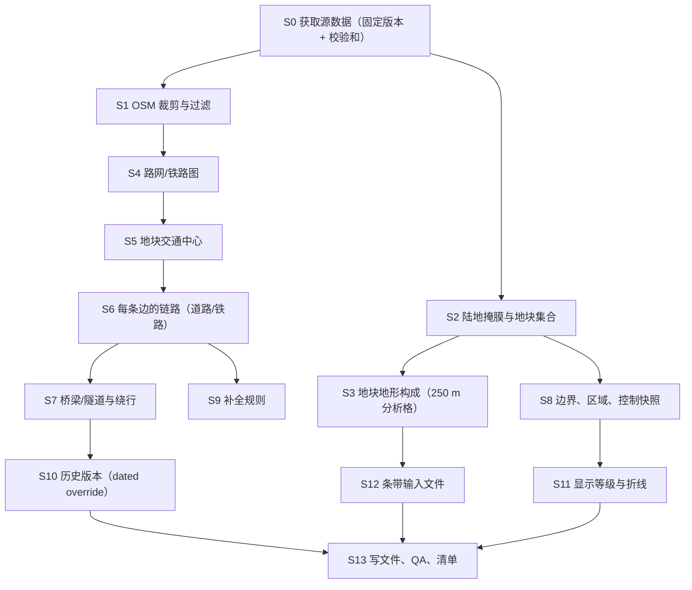

# 10 地图数据与离线流水线（Map Data Pipeline）

> 依据：总纲 §9.3（地块、全球地图、条带地形）、§11.1.2（过边）、§19.4（路网、铁路、桥梁）、§17.3（滩头，阶段 3）、§21-4（纳卡 MVP）。术语、单位、ID 以 [00_glossary.md](00_glossary.md) 为准（G-xx 按暂定采用）。
> 本文件定义：`Tile`、`Edge`、`Region`、`TerrainComposition`、`TerrainType`、`LinkCapacityClass`、`RailClass`、`BridgeNode`（本文件实现为 `CrossingNode`，见 §3.5）、边界与控制快照、条带地形**输入文件**格式、离线流水线和输出文件。
> 与已有规格的对齐：03/04/12 已使用的 `TerrainType` 成员（`Open, Mixed, Forest, Urban, Mountain, Marsh, Water`）、04 的条带格子尺寸（250 m）与局部平面公式（04 §4.1.1）、06 的 `LinkCapacityClass` 五级用法、09 需要的距离表、11 的 `TileClaimTable`、15 的 `dataHash`。
> 本文件的 🟡 编号为 `M-xx`，汇总在第 10 节。

---

## 1. 目标与范围

### 1.1 解决什么问题
1. 用全球公开数据（DEM、ESA WorldCover、OpenStreetMap、Natural Earth）**离线**生成游戏地图：哪些 H3 第 4 级地块存在、每格是什么地形、相邻格之间有什么路/铁路、哪里有可被打击的桥梁和隧道、国界和争议线。
2. 给运行时一组**只读、预计算、确定性**的表（00 §3.5：模拟运行时不调用 H3 库）。
3. 给 04 的条带提供真实地形输入（每条边一个文件）。
4. 给 06 的补给网络提供每条边的运力等级和桥梁/绕行数据；给 09 的行军提供道路等级和距离；给 05/12 提供地形构成。
5. 处理数据质量不均（补全规则）和历史年份差异（2010 / 2020 开局的路网不同）。

### 1.2 阶段划分

| 内容 | 阶段 0 | 阶段 1（纳卡） | 阶段 2+ |
|---|---|---|---|
| 标准地形的 `TerrainComposition` 预设（供 04 程序生成） | ✅ | ✅ | |
| 流水线全部步骤（只跑纳卡战区 + 外围 2 圈） | — | ✅ | 全球批处理（多进程、分块） |
| 条带输入文件 | — | 战区内部所有陆地边（约 170 条） | 只为前线附近的边按需生成 |
| 历史基础设施差异（dated override） | — | ✅（纳卡清单） | 俄乌清单 |
| 滩头属性 `BeachProfile` | — | — | 阶段 3 |
| 海港作为节点 | — | — | 阶段 2/3 |
| 季节通行（`winterFactor`） | — | 字段预留，恒为 1 | 阶段 2（总纲 §21-20） |

### 1.3 不包含
- 条带地形的**程序生成**算法（04 §4.1.3）。本文件只提供真实采样文件和地形构成。
- 后勤节点（仓库、机场、口岸）的数值：06 定 schema，14 填数。本文件只提供“哪里有铁路货运站、机场、港口”的候选与核对。
- 地块控制权的运行时变化（09）；de jure 归属表的运行时对象（11 `TileClaimTable`，由 14 用本文件的数据初始化）。

---

## 2. 玩家能做什么、看到什么

本系统是数据层，玩家**不直接操作**；但它决定了大量决策的依据，所以必须可见、可解释（总方针第 3 条）。

### 2.1 本数据支撑的决策
| 决策 | 依赖的地图数据 |
|---|---|
| 从哪条边进攻（山地还是河谷） | `TerrainComposition`、条带真实地形 |
| 仓库、前进后勤中心放哪（06 D5/D6） | 道路/铁路等级、铁路货运站、桥梁 |
| 优先打哪座桥、保护哪座桥（06 关键节点分析） | `CrossingNode` 与绕行路线 |
| 行军路线（09 A\*） | 道路等级、两格中心距离 |
| 战略方向怎么划（06 D4） | `Region` |

### 2.2 反馈清单
| # | 反馈 | 在哪看 | 数据 |
|---|---|---|---|
| F1 | 地块信息卡：各地形占比（饼图）、平均/最高海拔、起伏、道路密度、铁路货运站数、所属区域、法理归属 | 点地块（13） | `Tile`、`TerrainComposition` |
| F2 | 边信息：道路等级（最多 3 条路线，各自等级、长度、山地系数）、铁路类型与轨距、依赖的桥梁/隧道、桥断后的绕行等级 | 点交界边 | `Edge`、`RoadLink`、`RailLink`、`CrossingNode` |
| F3 | 地图上的道路按**相对等级**显示（每个区域只显示本区域最高等级的路，主干网连通） | 地图主视图 | `display_roads.bin` 的 `displayTier` |
| F4 | 桥梁/隧道图标（可被打击的节点） | 地图图层 | `CrossingNode` |
| F5 | 国界、法理边界、开局控制线（纳卡 1994 年停火线） | 地图图层 | 边界数据、控制快照 |
| F6 | 数据可信度：补全生成的道路用虚线、`confidence: estimated` 的数据在信息卡上标注 | 信息卡 | `synthetic` 标志 |
| F7 | 历史变化提示：“巴库—第比利斯—卡尔斯铁路于 2017-10-30 开通” | 通知（13） | dated override 生效事件 |

---

## 3. 数据结构

> 运行时类型在 `MoD.Sim.Map`（模拟核心，只读）；加载器在 `MoD.Data.MapLoader`；离线流水线是 Python（`tools/mappipe/`）。

### 3.1 枚举

```csharp
// 地形类型：条带格子与地块地形构成共用（00 §1.4）。成员与 03/04/12 已用的名字一致。
public enum TerrainType : byte {
    None = 0,
    Open = 1,      // 农田、草地、稀疏植被、裸地（坡度不大）
    Mixed = 2,     // 树/灌丛/零散建筑与开阔地交错（视距中等）
    Forest = 3,    // 郁闭林地
    Urban = 4,     // 建成区
    Mountain = 5,  // 陡坡（不论覆盖为草地/灌丛/裸岩），或高山冰雪
    Marsh = 6,     // 草本湿地、红树林
    Water = 7      // 永久水体（含海）
}
public const int TerrainTypeCount = 8;   // 数组下标 0..7，下标 0 恒为 0

// 道路运力等级（00：`LinkCapacityClass`，10 定义、06 使用）。数值越大越好。
public enum LinkCapacityClass : byte {
    None = 0, Track = 1, Tertiary = 2, Secondary = 3, Primary = 4, Motorway = 5
}

// 铁路类型（00：`RailClass`）。gaugeBreak 是 RailLink 上的布尔属性，不是枚举成员。
public enum RailClass : byte { None = 0, ConventionalSingle = 1, ConventionalDouble = 2, HighSpeed = 3 }

public enum CrossingKind : byte { None = 0, Bridge = 1, Tunnel = 2 }
public enum CrossingMode : byte { None = 0, Road = 1, Rail = 2 }

public enum EdgeBorderKind : byte {
    None = 0,            // 两格法理归属相同
    International = 1,   // 两格法理归属不同（国界）
    ContextBoundary = 2  // 一侧是战区格、另一侧是外围（不可进入）格
}

[Flags] public enum TileFlags : ushort {
    None = 0, IsCoastal = 1, IsPentagon = 2, IsTheater = 4, IsContext = 8,
    HasRailFreightTerminal = 16, HasAirfield = 32, HasPort = 64 /*阶段3用*/, HasMajorCity = 128,
    IsSplitByControlLine = 256   // 控制快照里少数一方占地 ≥ SplitMinorityFraction（仅提示）
}

[Flags] public enum EdgeFlags : byte {
    None = 0, CrossesMajorRiver = 1, IsTheaterInternal = 2, HasStripInput = 4, HasSyntheticRoad = 8
}
```

**给其他规格的等级映射**（同序、单调；🟡 M-06）：
```csharp
public static class RoadClassMap {
    // 04 StripCell.roadClass（0 无；1 小路；2 普通公路；3 干线）
    public static byte ToStripRoadClass(LinkCapacityClass c) => c switch {
        LinkCapacityClass.Motorway or LinkCapacityClass.Primary   => 3,
        LinkCapacityClass.Secondary or LinkCapacityClass.Tertiary => 2,
        LinkCapacityClass.Track                                   => 1,
        _ => 0 };
    // 09 RoadFactor 的键（Motorway / Trunk / Ordinary / None）
    public static MarchRoadClass ToMarchRoadClass(LinkCapacityClass c) => c switch {
        LinkCapacityClass.Motorway => MarchRoadClass.Motorway,
        LinkCapacityClass.Primary  => MarchRoadClass.Trunk,
        LinkCapacityClass.Secondary or LinkCapacityClass.Tertiary => MarchRoadClass.Ordinary,
        _ => MarchRoadClass.None };   // Track 按“无路”计（10 km/h 级）
}
public enum MarchRoadClass : byte { None = 0, Ordinary = 1, Trunk = 2, Motorway = 3 }   // 09 用
```

### 3.2 地块

```csharp
public readonly record struct LatLon(double latDeg, double lonDeg);
public readonly record struct RegionId(int value);     // 0 = 无
public readonly record struct CrossingId(int value);   // 0 = 无；静态数据，按 §4.8 的排序从 1 编号

public sealed class Tile                               // 00：`Tile`，归属 10
{
    public ulong h3;                    // H3 第 4 级索引（运行时 ID 即此值，00 §2.2）
    public LatLon center;               // H3 单元中心（h3.cell_to_latlng）
    public double areaM2;               // 单元总面积（h3.cell_area，m²）
    public double landAreaM2;           // 其中陆地面积（含内陆水体，不含海）
    public LatLon hub;                  // 地块“交通中心”（§4.6），路网路线的起止点
    public ulong[] neighbors;           // 存在的相邻地块，按 h3 数值升序；长度 0–6
    public string deJureIso3;           // 法理归属（Natural Earth，按陆地面积多数）："AZE"
    public RegionId region;
    public TileFlags flags;
    public TerrainComposition terrain;
    public int railFreightTerminalCount;// 0–3
    public int airfieldCount;           // OSM 候选机场数（≥ AirfieldMinRunwayM 的跑道）
}

public sealed class TerrainComposition                 // 00：`TerrainComposition`
{
    public double[] fraction;           // [TerrainTypeCount]，下标 0 恒 0；Σ = 1（按陆地+内陆水体分析格计）
    public double elevMeanM, elevMinM, elevMaxM;
    public double elevStdM;             // = 04 程序生成用的 σ；也作“起伏”
    public double elevP10M, elevP90M;
    public double meanSlopeDeg;         // 250 m 分析格坡度均值
    public double[] roadDensityKmPerKm2;// [6]，按 LinkCapacityClass（下标 0 恒 0）
    public double RoadDensityTotalKmPerKm2 => Σ roadDensityKmPerKm2;   // 04 §4.1.3 的 ρ
    public double railDensityKmPerKm2;
    public double UrbanFraction => fraction[(int)TerrainType.Urban];   // 12 用
}
```

### 3.3 交界边与链路

```csharp
public sealed class Edge                               // 00：`Edge`，无向
{
    public EdgeId id;                    // (tileA, tileB)，tileA < tileB（00 §2.2）
    public double lengthM;               // 两端点大圆距离
    public LatLon p0, p1;                // 规范端点：面朝 +y（tileA → tileB）时 p0 在左手边（00 §3.6、04 §4.1.1）
    public LatLon midpoint;              // p0、p1 的大圆中点（🟡 M-18）
    public double centerDistanceM;       // 两地块中心大圆距离（09 legLengthM）
    public double centerToMidAM;         // tileA 中心 → midpoint（09 edgeAtM）
    public double centerToMidBM;         // tileB 中心 → midpoint
    public double azimuthFromADeg;       // A 中心看 B 中心的方位（显示用）
    public EdgeBorderKind border;
    public EdgeFlags flags;
    public double riverWidthM;           // 沿边或穿边的大河宽度（OSM width 或按 §4.3 估），无则 0
    public RoadLink road;                // 基础版本（数据快照日的路网 + 永久覆盖）
    public RailLink rail;
    public LinkVariant[] variants;       // 历史版本（§4.10），按 validFromDay 升序
}

public sealed class RoadLink
{
    public RoadRoute[] routes;           // 0–3 条，互不共边；routes[0] 最好（等级最高，同级最短）
    public LinkCapacityClass Cls => routes.Length > 0 ? routes[0].cls : LinkCapacityClass.None;
}

public sealed class RoadRoute
{
    public LinkCapacityClass cls;        // 路线瓶颈等级（沿线最低等级）
    public double routeLengthM;          // 中心点（hub）到中心点的路线长度
    public double mountainFactor;        // [MountainFactorMin, 1]，§4.7.3
    public double maxElevM;              // 沿线最高海拔（季节通行预留）
    public double winterFactor;          // 阶段 1 恒 1.0
    public bool synthetic;               // 补全规则生成（§4.9）
    public CrossingId[] crossings;       // 本路线依赖的桥梁/隧道（升序）
}

public sealed class RailLink
{
    public RailClass cls;
    public double routeLengthM;
    public int gaugeAMm, gaugeBMm;       // tileA 侧、tileB 侧轨距（mm）
    public bool gaugeBreak;              // gaugeAMm != gaugeBMm（或沿线有轨距变化）
    public bool electrified;             // 信息用，阶段 1 不影响运力
    public CrossingId[] crossings;
}

public sealed class LinkVariant                        // 历史版本：在 [validFromDay, validToDay) 内替换 road 或 rail
{
    public int validFromDay;             // 自 1990-01-01 起的天数（与 SimTime 纪元一致，G-11）
    public int validToDay;               // 不含；int.MaxValue = 无期限
    public string requiresControlIso3;   // 非空：只有该国控制两端地块时才生效（§4.10）
    public CrossingMode mode;            // Road 或 Rail
    public RoadLink road;                // mode == Road 时
    public RailLink rail;                // mode == Rail 时
    public string overrideId;            // 来源 override 的 id（通知文案用）
}
```

### 3.4 区域

```csharp
public sealed class Region                             // 00：`Region`
{
    public RegionId id;                  // 按 dataId 排序后从 1 编号
    public string dataId;                // "reg_aze_ganja_gazakh"
    public string nameKey;               // 本地化键
    public string iso3;                  // 法理归属国
    public ulong[] tiles;                // 升序
}
```

### 3.5 桥梁 / 隧道（`BridgeNode` 的实现）

00 的 `BridgeNode` 在本文件实现为 `CrossingNode`（`kind = Bridge` 时即 `BridgeNode`；隧道同表，`kind = Tunnel`）。🟡 M-19

```csharp
public sealed class CrossingNode
{
    public CrossingId id;
    public CrossingKind kind;
    public CrossingMode mode;
    public LatLon location;              // 结构中点
    public ulong tile;                   // 所在地块
    public double lengthM;
    public string nameKey;               // OSM name（转成本地化键）；无名为 ""
    public long osmWayId;                // 最长那段 way 的 id（追溯用）
    public BypassRoute[] bypasses;       // 本 crossing 断掉时，每条受影响路线的替代
}

public sealed class BypassRoute
{
    public EdgeId edge;
    public CrossingMode mode;
    public int routeIndex;               // 被替代的是该边第几条路线（Rail 恒 0）
    public LinkCapacityClass roadCls;    // Road 用
    public RailClass railCls;            // Rail 用（通常 None：铁路很少有绕行）
    public double routeLengthM;
    public double mountainFactor;
    public CrossingId[] crossings;       // 绕行路线自己依赖的 crossing
}
```
crossing 的**运行时状态**（被打、修复）归 06（`CrossingState`，06 §4.10.2）。

### 3.6 边界与控制快照

```csharp
public sealed class ControlSnapshot                    // 数据：data/map/<theater>/control/<snapshotId>.yaml
{
    public string snapshotId;            // "nk_loc_1994", "nk_loc_2020_11"
    public string asOfDate;              // ISO 日期
    public SortedDictionary<ulong, string> controllerIso3;   // 战区地块 → 控制国
    public SortedDictionary<ulong, double> minorityFraction; // 少数一方占地比例（≥ SplitMinorityFraction 才记）
    public string confidence;            // stated / estimated
}
```
14 用快照初始化 09 的 `TileControl`；用 `Tile.deJureIso3` 初始化 11 的 `TileClaimTable`。

### 3.7 条带地形输入（每条边一个文件，04 读取）

```csharp
public sealed class StripTerrainInput                  // 文件 data/map/strips/<edgeId>.bin
{
    public EdgeId edge;
    public int nx;                       // = ceil(lengthM / StripCellM)（04：StripTerrain.nx）
    public int ny;                       // = 2 × StripHalfDepthM / StripCellM = 320
    public double cellM;                 // = 250（必须等于 04 StripTerrain.CellM）
    public int dataVersion;              // = map_manifest.dataVersion（04 StripTerrain.dataVersion）
    // 规范坐标（00 §3.6）。下标 i = iy * nx + ix；ix 沿 x（0 → L），iy 沿 y（−40 km → +40 km）
    public byte[] terrain;               // TerrainType
    public short[] elevationM;           // 格内 DEM 均值，四舍五入到米
    public byte[] slopeHalfDeg;          // 坡度 × 2（0.5° 精度，0–127.5°）
    public byte[] roadClass;             // LinkCapacityClass（0–5）；04 用 RoadClassMap.ToStripRoadClass 转换
    public byte[] cellFlags;             // bit0 有铁路；bit1 有大河；bit2 有桥；bit3 DEM 缺测补值
}
```
04 自己从 `terrain`、`slopeDeg`、`roadClass` 推出 `vehiclePassability`、`footPassability`、`losScaleM`（04 §4.1.3 第 5、7 步同一公式）。

### 3.8 运行时查询接口（模拟核心只通过它读地图）

```csharp
public interface IMapQuery
{
    bool TryGetTile(ulong h3, out Tile t);
    Tile GetTile(ulong h3);                            // 不存在 → 抛异常（调用方先 TryGet）
    IReadOnlyList<ulong> Neighbors(ulong h3);          // 升序
    bool TryGetEdge(ulong a, ulong b, out Edge e);     // a、b 任意顺序
    LatLon TileCenter(ulong h3);
    LatLon EdgeMidpoint(EdgeId e);
    double CenterDistanceM(ulong a, ulong b);          // 相邻 → 查表；不相邻 → GreatCircleM(中心, 中心)
    double CenterToEdgeMidM(ulong tile, EdgeId e);     // tile 必须是 e 的一端
    RoadLink ActiveRoad(EdgeId e);                     // 已按当前日期与控制权解析 variants（§4.10）
    RailLink ActiveRail(EdgeId e);
    LinkCapacityClass RoadClass(EdgeId e);             // = ActiveRoad(e).Cls
    CrossingNode GetCrossing(CrossingId id);
    IReadOnlyList<CrossingNode> CrossingsInTile(ulong h3);
    Region GetRegion(RegionId id);
    RegionId RegionOf(ulong h3);
    TerrainComposition Terrain(ulong h3);
    StripTerrainInput TryLoadStripInput(EdgeId e);     // 无文件 → null（04 改用程序生成）
    int TopologyVersion { get; }                       // 任何 ActiveRoad/ActiveRail 变化时 +1（06 据此重建图）
    double GreatCircleM(LatLon a, LatLon b);           // 半正矢公式，R = 6 371 008.8 m，用 DMath（15）
}
```

### 3.9 输出文件清单

| 文件 | 内容 | 格式 | MVP 大小 | 全球估计 |
|---|---|---|---|---|
| `data/map/map_manifest.yaml` | 流水线版本、`dataVersion`、来源与校验和、各文件 XxHash64、计数 | YAML | < 10 KB | 同 |
| `data/map/tiles.bin` | `TileRecord`（176 B） | 二进制 §3.10 | ~200 格 × 176 B ≈ 35 KB | ~10 万格 ≈ 17.6 MB |
| `data/map/edges.bin` | `EdgeRecord`（196 B） | 二进制 | ~550 边 ≈ 110 KB | ~28 万边 ≈ 55 MB |
| `data/map/crossing_refs.bin` | `u32` CrossingId 数组（路线/绕行引用的扁平表） | 二进制 | < 10 KB | ~2 MB |
| `data/map/crossings.bin` | `CrossingRecord`（64 B）+ `BypassRecord`（48 B） | 二进制 | ~150 个 ≈ 20 KB | ~10 MB |
| `data/map/link_variants.bin` | `VariantRecord`（120 B） | 二进制 | ~50 条 | 视清单 |
| `data/map/regions.yaml` | 区域 | YAML | ~5 KB | ~1 MB |
| `data/map/names.yaml` | 本地化键 → 原名（地名、桥名） | YAML | ~10 KB | |
| `data/map/display_roads.bin` | 显示用折线与 `displayTier` | 二进制 | ~300 KB | ~150 MB（阶段 3 再分块） |
| `data/map/<theater>/control/<snapshotId>.yaml` | 控制快照 | YAML | ~5 KB/个 | |
| `data/map/strips/<edgeId>.bin` | 条带输入（zstd 压缩） | 二进制 §3.10 | ~170 个 × ~60 KB ≈ 10 MB（未压缩 ~30 MB） | 按需生成 |
| `data/map/standard_terrains.yaml` | 阶段 0 的标准地形 `TerrainComposition` | YAML | 1 KB | |
| `build/qa/*.geojson` | 人工核查用（不进游戏） | GeoJSON | | |

`dataVersion`：每次流水线输出内容变化（任一文件哈希变化）时 +1，由 CI 维护；所有地图文件都计入 15 的 `dataHash`。

### 3.10 二进制格式

**通用文件头（32 B，小端序）**

| 偏移 | 大小 | 字段 |
|---|---|---|
| 0 | 8 | magic：ASCII `"MODMAP"` + 2 字节 0 |
| 8 | 2 | formatVersion（u16，本规格 = 1） |
| 10 | 2 | recordKind（u16：1 tile，2 edge，3 crossing，4 bypass，5 variant，6 crossingRef，7 strip，8 displayRoads） |
| 12 | 4 | recordSize（u32；变长文件为 0） |
| 16 | 4 | recordCount（u32） |
| 20 | 4 | dataVersion（u32） |
| 24 | 8 | payloadHash（u64，XxHash64，种子 0，对头之后的全部字节） |

**`TileRecord`（176 B），按 h3 升序**

| 偏移 | 大小 | 字段 |
|---|---|---|
| 0 | 8 | h3（u64） |
| 8 | 16 | centerLatDeg, centerLonDeg（f64 ×2） |
| 24 | 16 | areaM2, landAreaM2（f64 ×2） |
| 40 | 16 | hubLatDeg, hubLonDeg（f64 ×2） |
| 56 | 48 | neighbors（u64 ×6，升序，不足补 0） |
| 104 | 4 | deJureIso3（ASCII ×3 + 0） |
| 108 | 2 | regionIndex（u16，= RegionId；0 无） |
| 110 | 2 | flags（u16，`TileFlags`） |
| 112 | 16 | terrainFractionQ（u16 ×8，fraction × 65535 四舍五入；下标 0 为 0） |
| 128 | 12 | elevMean, elevMin, elevMax, elevStd, elevP10, elevP90（i16 ×6，米） |
| 140 | 4 | meanSlopeDeg（f32） |
| 144 | 20 | roadDensityKmPerKm2[1..5]（f32 ×5） |
| 164 | 4 | railDensityKmPerKm2（f32） |
| 168 | 1 | railFreightTerminalCount（u8） |
| 169 | 1 | airfieldCount（u8） |
| 170 | 2 | 保留 |
| 172 | 4 | populationK（f32，阶段 2+，现为 0） |

加载时：`fraction[t] = q[t] / Σq`（按 t = 1..7 顺序串行求和，00 §6.3 规则 5）；f32 一律转 `double`。

**`EdgeRecord`（196 B），按 (tileA, tileB) 升序**

| 偏移 | 大小 | 字段 |
|---|---|---|
| 0 | 16 | tileA, tileB（u64 ×2） |
| 16 | 8 | lengthM（f64） |
| 24 | 32 | p0Lat, p0Lon, p1Lat, p1Lon（f64 ×4） |
| 56 | 16 | midLat, midLon（f64 ×2） |
| 72 | 24 | centerDistanceM, centerToMidAM, centerToMidBM（f64 ×3） |
| 96 | 4 | azimuthFromADeg（f32） |
| 100 | 1 | border（u8） |
| 101 | 1 | flags（u8，`EdgeFlags`） |
| 102 | 2 | riverWidthM（u16） |
| 104 | 1 | roadRouteCount（u8，0–3） |
| 105 | 3 | 保留 |
| 108 | 60 | RoadRoute ×3（各 20 B，见下；未用的填 0） |
| 168 | 20 | RailLinkRec（见下） |
| 188 | 4 | variantOffset（u32，`link_variants.bin` 中的首条下标） |
| 192 | 2 | variantCount（u16） |
| 194 | 2 | 保留 |

`RoadRouteRec`（20 B）：`u8 cls; u8 flags(bit0 synthetic); u16 crossingCount; u32 crossingOffset(→crossing_refs.bin); f32 routeLengthM; f32 mountainFactor; f32 maxElevM`（`winterFactor` 阶段 1 不存，恒 1）。
`RailLinkRec`（20 B）：`u8 cls; u8 flags(bit0 gaugeBreak, bit1 electrified); u16 crossingCount; u32 crossingOffset; f32 routeLengthM; u16 gaugeAMm; u16 gaugeBMm; u32 保留`。

**`CrossingRecord`（64 B），按 CrossingId 升序**：`u32 id; u8 kind; u8 mode; u16 保留; f64 lat; f64 lon; u64 tile; f32 lengthM; u32 bypassOffset; u16 bypassCount; u16 保留; i64 osmWayId; u32 nameIndex(→names.yaml 序号); u32 保留; u64 保留`。
**`BypassRecord`（48 B）**：`u64 tileA; u64 tileB; u8 mode; u8 routeIndex; u8 roadCls; u8 railCls; f32 routeLengthM; f32 mountainFactor; u32 crossingOffset; u16 crossingCount; u16 保留; u64 保留; u32 保留`（凑足 48）。
**`VariantRecord`（120 B）**：`u64 tileA; u64 tileB; i32 validFromDay; i32 validToDay; char[4] requiresControlIso3; u8 mode; u8 roadRouteCount; u16 保留; RoadRouteRec ×3 (60); RailLinkRec (20); u32 overrideIndex(→names.yaml); u32 保留; u32 保留`。

**条带文件** `strips/<edgeId>.bin`：通用头（recordKind = 7，recordSize = 0，recordCount = nx × ny）之后：
```text
u64 tileA; u64 tileB; u16 nx; u16 ny; f32 cellM; u32 compressedSize;
zstd 压缩块（级别 19），解压后依次为 5 个平面：terrain[u8 × N], elevationM[i16 × N], slopeHalfDeg[u8 × N], roadClass[u8 × N], cellFlags[u8 × N]
```
每格 6 B：nx ≈ 91–92，ny = 320 → 约 29 440 格 ≈ 177 KB 未压缩。

---

## 4. 算法与公式（离线流水线，按执行顺序）

### 4.0 总览



**确定性规则**（流水线也必须可复现，CI 比对两次运行的哈希）：
- 所有集合输出前按键排序（h3 升序、EdgeId 升序、OSM id 升序）。
- 多进程只用于独立任务（每个地块、每条边），结果收集后排序再写。
- 浮点输出：坐标、长度在写二进制前不再做任何运算；YAML 中浮点用 `repr`（Python 最短往返表示）。
- 不使用随机数；需要“随机”的地方（无）一律禁止。
- 源数据按校验和锁定；换版本 = `dataVersion` +1。

工具链：Python 3.11；`h3`（4.x）、`osmium`（pyosmium 3.x）+ `osmium-tool` CLI、`rasterio`（1.3+）/GDAL 3.6+、`numpy`、`scipy`、`shapely` 2.x、`geopandas`、`pyproj`、`networkx`（MVP；全球改 `igraph`/`scipy.sparse.csgraph`）、`zstandard`、`xxhash`、`pyyaml`。包结构 `tools/mappipe/s00_fetch.py … s13_write.py`，配置 `tools/mappipe/configs/<theater>.yaml`。

### 4.1 S0 源数据

| 源 | 版本/产品 | 用途 | 许可 |
|---|---|---|---|
| OpenStreetMap | Geofabrik 国家提取（带日期快照），MVP：armenia、azerbaijan、georgia、iran、turkey | 道路、铁路、桥、隧道、地名、机场、河流 | ODbL（游戏内署名） |
| OSM 陆地多边形 | osmdata.openstreetmap.de `land-polygons-split-4326` | 陆/海（里海按海，🟡 M-15） | ODbL |
| DEM | **Copernicus DEM GLO-90**（主，🟡 M-04）；SRTM GL1 v3（备） | 高程、坡度、山地系数 | Copernicus 免费许可（署名） |
| 地表覆盖 | **ESA WorldCover 10 m 2021 v200**（🟡 M-05） | 地形类型 | CC BY 4.0 |
| 边界 | Natural Earth 10m `admin_0_countries`、`admin_1_states_provinces`、`admin_0_breakaway_disputed_areas`（锁定 5.1.x） | 法理归属、区域、争议区提示 | 公有领域 |
| 控制线 | 手工数字化 `data/map/sources/nk/loc_1994.geojson`、`loc_2020_11.geojson`（🟡 M-09） | 开局控制 | 自制，注明参考来源 |
| 历史基础设施覆盖 | 手工 `data/map/overrides/nk_infrastructure.yaml`（§4.10） | 2010/2020 路网差异 | 自制 |

> GLO-30 的公开版不含亚美尼亚、阿塞拜疆两国的 30 m 数据（这两国只有 GLO-90 公开；流水线 S0 必须核实）。250 m 的条带格子用 90 m DEM 足够，所以全球统一用 GLO-90，保证各地一致。

### 4.2 S2 陆地掩膜与地块集合

```python
def build_tile_set(cfg):
    land = load_land_polygons(cfg.bbox)                       # shapely, EPSG:4326
    # 候选：覆盖 bbox 的所有 res-4 单元（多边形填充后外扩 1 圈，保证部分落入的单元也在内）
    cand = set(h3.geo_to_cells(bbox_polygon(cfg.bbox).__geo_interface__, 4))
    cand |= {n for c in list(cand) for n in h3.grid_disk(c, 1)}
    tiles = []
    for c in sorted(cand, key=h3.str_to_int):
        poly = cell_polygon_densified(c, pts_per_edge=10)     # h3.cell_to_boundary 后每条边插 10 点
        laea = local_laea(h3.cell_to_latlng(c))               # pyproj 等面积投影，中心为单元中心
        land_km2 = area_km2(laea, poly.intersection(land))
        has_place = any_place_in(poly, ranks={"city", "town"})
        if land_km2 >= MinLandAreaKm2 or (land_km2 > 0 and has_place):
            sea_frac = 1 - land_km2 / area_km2(laea, poly)
            tiles.append(TileDraft(c, land_km2, is_coastal = sea_frac >= CoastalSeaFraction,
                                   is_pentagon = h3.is_pentagon(c)))
    return tiles
```
- **战区格**：`deJureIso3 ∈ cfg.theaterCountries`（MVP：ARM、AZE）→ `IsTheater`。
- **外围格**：与任一战区格的网格距离 ≤ `ContextRingK` 且不是战区格 → `IsContext`（不可进入，只用于显示和口岸参照，🟡 M-13）。其余候选丢弃。
- `areaM2 = h3.cell_area(c, unit='m^2')`；`center = h3.cell_to_latlng(c)`。
- 邻接：`neighbors = sorted(n for n in h3.grid_ring(c, 1) if n in tileset)`。

### 4.3 S3 地块地形构成

**250 m 分析格**：每个地块在自己的局部等面积投影（LAEA，中心 = 单元中心）里铺 250 m 规则网格，只保留格心落在地块多边形内的格（约 28 000 格/地块）。

```python
def tile_composition(tile):
    grid = laea_grid(tile, cell=AnalysisCellM)                      # 格心落在多边形内
    frac = worldcover_fractions(grid)       # 对 11 个 WorldCover 类各做一次 Resampling.average 重投影 → [N, 11]
    elev = dem_mean(grid)                   # DEM Resampling.average 重投影到同一网格 → [N]
    slope = sobel_slope_deg(elev, AnalysisCellM)                    # 3×3 Sobel，边界格用最近有效值
    ttype = [classify_cell(frac[i], slope[i]) for i in range(N)]
    is_sea = frac[:, WC_WATER] >= 0.5 & ~inland_water_mask(grid)    # 海面格不计入构成
    keep = ~is_sea
    fraction[t] = count(ttype == t & keep) / count(keep)
    elev stats over keep：mean, min, max, std（总体标准差）, p10, p90（numpy 'linear' 插值）
    meanSlopeDeg = mean(slope[keep])
```

**`classify_cell`（条带输入 §4.12 用同一个函数，🟡 M-03）** —— WorldCover 类：10 树、20 灌丛、30 草地、40 农田、50 建成区、60 裸地/稀疏、70 冰雪、80 永久水体、90 草本湿地、95 红树林、100 苔藓地衣。
```python
def classify_cell(f, slope_deg):
    # f: 各 WorldCover 类在格内的面积比例（和为 1；无数据当作 60 裸地）
    if f[80] >= 0.5:                                  return Water
    if f[50] >= UrbanBuiltMin:                        return Urban      # 0.30
    if f[90] + f[95] >= MarshMin:                     return Marsh      # 0.40
    if f[10] >= ForestTreeMin:                        return Forest     # 0.60
    if slope_deg >= MountainSlopeDeg or f[70] >= 0.5: return Mountain   # 15°
    if f[10] >= MixedTreeMin or f[20] >= MixedShrubMin or f[50] >= MixedBuiltMin:
                                                      return Mixed      # 0.20 / 0.40 / 0.10
    return Open
```
优先级理由：林地即使在陡坡上也按 `Forest`（视距由林冠决定，03 `LosScaleM` Forest 250 m ≪ Mountain 1200 m）；坡度对机动的影响由 04 用 `slopeDeg` 另算。

**道路/铁路密度**：S4 的分类后道路段与地块多边形求交，长度（`pyproj.Geod.geometry_length`）按等级累加 ÷ `landAreaM2`（km/km²）。

**大河宽度**（`Edge.riverWidthM`）：OSM `waterway=river` 与该边线段（p0–p1，缓冲 2 km）相交 → 取 `width` 标签最大值；无标签时：若有 `natural=water` + `water=river` 面状河道与边相交，取面宽估计（面积 ÷ 中心线长度）；否则 `DefaultRiverWidthM`。阿拉斯河（Araz）是纳卡南线的主要河流。

### 4.4 S1 OSM 过滤与标签规则

**道路分类（`highway=*` → `LinkCapacityClass`）**

| OSM 标签 | 基础等级 |
|---|---|
| `motorway`, `motorway_link` | Motorway |
| `trunk`, `trunk_link` | Primary；若 `lanes ≥ 4` 或 `motorroad=yes` 或 `dual_carriageway=yes` → Motorway |
| `primary`, `primary_link` | Primary |
| `secondary`, `secondary_link` | Secondary |
| `tertiary`, `tertiary_link`, `unclassified` | Tertiary |
| `track`（`tracktype=grade1`→Tertiary；其余/缺省→Track） | Track |
| `residential`, `living_street` | 只计入道路密度（Tertiary），**不**参与链路 |
| `service`, `footway`, `path`, `cycleway`, `bridleway`, `steps`, `pedestrian`, `construction`, `proposed`, `abandoned`, `raceway`, `busway`, `escape`, `corridor` | 排除 |

修正（顺序执行）：
1. `surface ∈ {unpaved, gravel, fine_gravel, compacted, dirt, earth, ground, mud, sand, grass}` → 降一级（最低 Track）。
2. `access ∈ {no, private}` 且无 `motor_vehicle=yes|designated` → 排除（军用道路常标 `access=military`/`private`，保留：`access=military` 不排除）。
3. `ford=yes` 的段 → 该段降为 Track。
4. `*_link` 继承主类，但长度不计入密度（避免互通立交膨胀）。

**铁路分类**

| 条件 | 结果 |
|---|---|
| `railway=rail` 且无 `service=*`（`siding/yard/spur/crossover` 排除）且 `usage ∈ {main, branch, 缺省}` | 参与链路 |
| `railway ∈ {disused, abandoned, razed, construction, proposed, dismantled}` 或有 `disused:railway` | 排除 |
| `highspeed=yes` 或 `maxspeed ≥ 200` | HighSpeed |
| `tracks ≥ 2` | ConventionalDouble；否则 ConventionalSingle（缺省按 Single） |
| `gauge` | 取数值（mm）；缺省按国家默认（`DefaultGaugeMm`：ARM/AZE/GEO/RUS 1520，TUR/IRN 1435） |
| `electrified ∈ {contact_line, rail, yes}` | electrified = true |
| `railway=narrow_gauge`、`light_rail`、`tram`、`subway` | 排除 |

**其他要素**：`place ∈ {city, town, village}`（含 `population`）；`railway ∈ {station, yard}`（点或面）；`aeroway=aerodrome` 与 `aeroway=runway`（`length` 或几何长度）；`waterway ∈ {river, canal}`；`bridge ∈ {yes, viaduct, cantilever, movable}`（`aqueduct` 排除）、`tunnel=yes`（`building_passage` 等其他值排除）；`natural=water`。

**命令（MVP 实际执行，见 §4.13）**：`osmium tags-filter` 先粗筛，再在 Python（pyosmium `SimpleHandler`，`locations=True`）里做上表的精确分类。

### 4.5 S4 路网图

```python
# 每种模式（road / rail）一张无向多重图
for way in filtered_ways (按 way.id 升序):
    cls = classify(way.tags)；if cls is None: continue
    nodes = way.node_ids
    # 切分点：被 ≥2 条已接受 way 共用的节点 + way 端点
    for seg in split_at_shared_nodes(nodes):
        G.add_edge(u=seg[0], v=seg[-1], key=(way.id, seg_index),
                   cls=cls, length_m=geod_length(seg), geom=LineString(seg),
                   bridge=is_bridge(way.tags), tunnel=is_tunnel(way.tags),
                   way_id=way.id, gauge=..., tracks=...)
# 清理：删除总长 < FragmentMinLengthM 且不与更高等级相连的孤立分量
```
节点坐标 = OSM 节点经纬度（double）。

### 4.6 S5 地块交通中心 `hub`

```text
道路 hub：
  1. 地块内（落在多边形内）的 place=city/town，按 population 降序（缺省 city 100000、town 10000），平局按 OSM id 升序 → 取第一个
  2. 在道路图里取离该地名点最近的、所连道路等级最高的节点（先按等级降序，再按距离升序，再按节点 id）
  3. 没有 city/town：取地块中心最近的、等级 ≥ Tertiary 的道路节点；仍没有：任意等级的最近节点
  4. 地块内没有道路：hub = 地块中心，链路全部 None（补全规则 §4.9 会处理）
铁路 hub：地块内 railway=station（有 name）中，连接的铁路段数最多的；平局按离道路 hub 最近；没有车站则取离道路 hub 最近的铁路节点
Tile.hub 存道路 hub 的经纬度
railFreightTerminalCount = min(3, 地块内 railway=yard 要素数 + 有 name 的 railway=station 数（只计位于参与链路的铁路上的）)
HasRailFreightTerminal = count ≥ 1
airfieldCount = 地块内 aeroway=aerodrome 中，最长跑道 ≥ AirfieldMinRunwayM 的个数
```

### 4.7 S6 每条边的链路

#### 4.7.1 道路：走廊内按等级阈值找最短路
```python
def road_link(tA, tB):
    corridor = (poly(tA) | poly(tB)).buffer_m(CorridorBufferM)
    H = G_road.subgraph_edges_intersecting(corridor)
    routes, used = [], set()
    for k in range(MaxParallelRoutes):
        best = None
        for thr in [Motorway, Primary, Secondary, Tertiary, Track]:        # 从高到低
            Hk = H.edges_where(cls >= thr and key not in used)
            p = dijkstra(Hk, hubA, hubB, weight="length_m")                 # 平局：networkx 按节点 id 稳定；见下
            if p: best = (thr, p); break
        if best is None: break
        thr, p = best
        if k > 0 and (thr < Tertiary or length(p) > ParallelMaxLengthRatio * routes[0].length): break
        routes.append(make_route(thr, p)); used |= edge_keys(p)            # 互不共边
    if not routes:                                                          # 走廊太窄：放宽一次
        retry with CorridorBufferFallbackM（只找 1 条）
    return routes
```
- 平局裁决：Dijkstra 用 `(累计长度, 节点 id)` 作为优先队列键，保证同长路径的选择确定。
- `make_route`：`cls = thr`（路径上所有段等级 ≥ thr，且至少一段 = thr 时即瓶颈等级；实现时直接取路径段等级最小值）；`routeLengthM = Σ 段长`；`crossings` 见 S7；`maxElevM` 与 `mountainFactor` 见 §4.7.3。
- 链路是**hub 到 hub** 的路线，所以地块内部的桥（例如 hub 和边界之间的桥）也会被计入该边依赖的 crossing。

#### 4.7.2 铁路
与道路相同，阈值顺序 `[ConventionalDouble, ConventionalSingle]`；HighSpeed 单独再找一次（只在 HighSpeed 子图里），若存在且无普速链路，则 `cls = HighSpeed`；两者都有时普速优先（06 用普速运货）。只找 1 条路线。
`gaugeAMm` = 路线上最靠近 hubA 的段的轨距；`gaugeBMm` 同理；路线上任意相邻两段轨距不同 → `gaugeBreak = true`。

#### 4.7.3 山地系数（🟡 M-17）
```text
沿路线每 RouteSampleM（100 m）取一点，DEM 双线性取高程 z_i（i = 0..n）
grade_i = |z_{i+1} − z_i| / RouteSampleM
meanAbsGradePct = 100 × mean(grade_i)
mountainFactor = clamp(1 − MountainGradeK × meanAbsGradePct, MountainFactorMin, 1.0)
maxElevM = max z_i
```
06 用它同时折减道路容量和车速；路线的曲折已经体现在 `routeLengthM` 里，不再另算。

### 4.8 S7 桥梁、隧道与绕行

```text
1. 候选结构：道路/铁路图中 bridge=true 的连续段（同一 way 链首尾相连的合并为一个结构），满足任一：
     长度 ≥ BridgeMinLengthM；或几何与 waterway=river|canal 相交；或所在道路等级 ≥ Primary 且跨越任何有 name 的 waterway
   隧道：tunnel=true 的连续段，长度 ≥ TunnelMinLengthM
2. 只保留出现在某条链路路线上的结构（不在任何路线上的不建节点）
3. 排序并编号：按 (tile, mode, osmWayId) 升序，CrossingId 从 1 开始
4. 每条路线的 crossings = 路线经过的结构 id（升序）
5. 绕行：对每个结构 x、每条依赖它的 (edge, mode, routeIndex)：
     在同一走廊子图中删去 x 的所有段，**不删除**该边其他路线占用的段，按 §4.7.1 只找 1 条（同样的阈值循环）
     找到 → BypassRoute（自己的 crossings 也记下）；找不到 → 不写（06 视为该路线容量随 x 降为 0）
```
`location` = 结构几何的中点（沿线长度一半处）；`tile` = 包含该点的地块（不在任何地块 → 取最近地块中心）。

### 4.9 S9 补全规则（🟡 M-14）

按顺序执行，所有补出来的路线 `synthetic = true`，边 `HasSyntheticRoad`：
1. **城市连通**：同一国家（法理）内，`population ≥ GapFillCityPopMin` 的两城，若大圆距离 ≤ `GapFillMaxDistM`，而道路图最短路长度 > `GapFillDetourRatio` × 大圆距离（或不连通）→ 在两城之间补一条 Tertiary 虚拟路：沿大圆线经过的每一对相邻地块，若该边 `road.Cls < Tertiary`，把 routes[0] 替换为 `{cls = Tertiary, routeLengthM = SyntheticRouteFactor × centerDistanceM, mountainFactor = 按大圆线 DEM 剖面 §4.7.3}`。
2. **地块连通**：每个战区格（非岛屿）至少要有一条 `road.Cls ≥ Track` 的边；没有时，对平均坡度最小的那个邻格补一条 Track 虚拟路（长度同上）。
3. **铁路不补**（铁路缺失通常是真实的；需要时用 override 手工加）。
4. 纳卡 MVP 预期：OSM 在南高加索的主干覆盖良好，规则 1 预计不触发；规则 2 可能在高山无路格触发（如大高加索南坡的个别格）。QA 报告列出所有补全。

### 4.10 S10 历史版本（dated override，🟡 M-08）

基础路网 = **OSM 当前快照**（🟡 M-20，不用 OSM 历史数据：2010 年南高加索的 OSM 覆盖很差）。历史差异由手工清单表达：

```yaml
# data/map/overrides/nk_infrastructure.yaml
overrides:
  - id: ovr_btk_railway
    mode: rail
    action: add_ways          # add_ways | remove_ways | set_class | close_crossing
    osm_way_ids: [ ... ]      # 由 QA 工具帮忙选取；或 geometry_wkt
    valid_from: 2017-10-30    # 含
    valid_to: null            # 不含；null = 无期限
    requires_control: null    # 例 "AZE"：只在该国控制两端地块时生效
    confidence: stated
    source_note: "Baku–Tbilisi–Kars railway opened 2017-10-30"
```
**处理**：
```text
1. 把所有 override 的 valid_from / valid_to 收集成有序日期集合 D（含 −∞），形成若干时间段（epoch）
2. 对每个 epoch：在基础图上按“该 epoch 内生效”的 override 修改图（remove_ways 删段；add_ways 加段——即使基础图里因 disused 被过滤，也从原始 OSM 数据取回；set_class 改等级）
3. 只对**几何上受影响**的边（override 段与其走廊相交）重算 §4.7 / §4.8 链路
4. 与基础版本不同的结果写成 LinkVariant{validFromDay, validToDay, requiresControlIso3, mode, road/rail}
   基础版本 = “数据快照日”所在 epoch 的结果（Edge.road / Edge.rail）
5. 同一边同一模式的多个 variant 时间段不得重叠（流水线断言）
```
**运行时解析**（10 的 `MapState`，`Calendar` 阶段每日一次，以及开局一次）：
```text
对每条有 variants 的边 e、每种模式 m：
   active = 基础版本
   对 variants（按 validFromDay 升序）：若 validFromDay ≤ today < validToDay 且
        (requiresControlIso3 为空 或 两端地块的 TileControl 都是该国)：active = 该 variant
   若 active 与昨天不同：TopologyVersion++，产生通知事件 InfraChanged(e, m, overrideId)
```
- 开局在 2010 年时，2017 年开通的设施会在游戏内 2017 年自动出现（不依赖战争结果的项目）；依赖战后控制的项目（阿塞拜疆 2020 年后在收复区新修的道路、机场）带 `requires_control: AZE`。
- 需要 override 的纳卡清单（S0 核实，`confidence` 按核实结果填写）：

| override | 处理 | 理由 |
|---|---|---|
| 巴库—第比利斯—卡尔斯铁路（格鲁吉亚段，含阿哈尔卡拉基轨距换装） | `valid_from: 2017-10-30` | 2010 开局不可用 |
| 瓦尔德尼斯—马尔塔克特（经克尔巴贾尔、索特克山口）公路升级 | 2017 年前 `set_class: Track/Tertiary`，之后按 OSM | 2017 年完成改建；影响“纳卡第二通道” |
| 拉钦走廊绕行新路（2022 年） | `valid_from: 2022-…` | 2020 开局不存在 |
| 阿塞拜疆 2020 年后在收复区新建公路（如富祖利—舒沙公路、霍拉迪兹—阿格班德公路）与机场（富祖利、赞吉兰、拉钦） | `valid_from` + `requires_control: AZE` | OSM 当前快照里有，但历史开局不应有 |
| 霍拉迪兹—阿格班德铁路（2020 年后） | 同上 | |
| 伊杰万—加扎赫铁路（亚阿跨境） | `remove_ways`，全时段 | 1990 年代起停运，OSM 可能仍标 `railway=rail` |
| 叶拉斯赫—纳希切万铁路（亚美尼亚—纳希切万） | `remove_ways`，全时段 | 同上 |
| 久姆里—卡尔斯铁路（亚土跨境） | `remove_ways`，全时段 | 1993 年起关闭 |
| 亚美尼亚—阿塞拜疆、亚美尼亚—土耳其的跨境公路口岸 | `close_crossing`（作为“边界关闭”标记，链路照常计算，由 06/11 的口岸开闭决定能否通行） | 物理道路存在，政治上关闭 |

### 4.11 S8 边界、区域、控制快照

**法理归属**：`deJureIso3` = 与地块多边形相交面积最大的 Natural Earth `admin_0_countries` 国家（`ADM0_A3`，纳卡地区在其中属 AZE；争议区图层只用于信息卡提示“争议地区”）。陆地为 0 的格不存在。

**边的 `border`**：两端 `deJureIso3` 不同 → International；一端战区格、一端外围格 → ContextBoundary（同时也是 International）。

**区域（🟡 M-12）**：
```text
1. 每个地块的 admin-1 = 包含地块中心的 Natural Earth admin_1 单元（中心不在任何单元：取相交面积最大者）；只在同一法理国家内合并
2. 初始区域 = 每个 admin-1 单元的地块集合
3. 合并：while 存在 tiles < RegionMinTiles 的区域 r：
       按 (tiles 数升序, dataId 升序) 取最小的 r；
       候选 = 与 r 有地块相邻的同国区域；选 tiles 数最小者（平局 dataId 升序）合并（名字取两者中 tiles 多的那个 + "_" + 另一个，见 names）
       没有候选（飞地，如纳希切万若不足）→ 保留
4. 拆分：tiles > RegionMaxTiles 的区域按地块中心经度（再纬度）排序，平均切成 ceil(n / RegionMaxTiles) 份
5. dataId = "reg_" + iso3 小写 + "_" + 名字的 snake_case（ASCII 转写）；RegionId 按 dataId 排序编号
```
纳卡预期：亚美尼亚约 2–3 个区域，阿塞拜疆（含纳希切万）约 6–8 个区域。

**控制快照**（纳卡）：
```text
输入：loc_*.geojson = 亚美尼亚一方实际控制的、法理属 AZE 的区域多边形（纳卡 + 周边地区）
对每个战区格：
   landA = 地块陆地 ∩ 控制多边形 的面积；landB = 地块陆地 − 控制多边形 的面积
   法理 AZE 的格：controller = (landA > landB) ? "ARM" : "AZE"    // 多数决（🟡 M-09；G-13：阿尔察赫部队归亚美尼亚一方）
   法理 ARM 的格：controller = "ARM"（阿塞拜疆控制的亚美尼亚小飞地、亚方控制的阿方小飞地均远小于一格，忽略）
   minority = min(landA, landB) / (landA + landB)；≥ SplitMinorityFraction → 标 IsSplitByControlLine
快照：nk_loc_1994（1994-05-12 停火线；2016 年四月冲突的变化 < 10 km²，远小于一格，所以 nk_2010 与 nk_2020_09 共用）
      nk_loc_2020_11（2020-11-10 停火后，供验证）
```

### 4.12 S12 条带输入文件

只为**战区内部陆地边**（两端都是战区格）生成（🟡 M-10；04 E-02 可再缩小到“可能交战的边”）。

```python
def strip_input(e):
    L = e.lengthM; nx = ceil(L / StripCellM); ny = 2 * StripHalfDepthM // StripCellM   # 320
    lat0, lon0 = e.midpoint
    # 04 §4.1.1 的局部平面：X = R·Δlon·cos(lat0)，Y = R·Δlat（Δ 为相对 midpoint 的弧度）
    def to_plane(ll):  return (R*rad(ll.lon-lon0)*cos(rad(lat0)), R*rad(ll.lat-lat0))
    def to_ll(X, Y):   return (lat0 + deg(Y/R), lon0 + deg(X/(R*cos(rad(lat0)))))
    P0, P1 = to_plane(e.p0), to_plane(e.p1)
    ex = unit(P1 - P0); ey = rot90ccw(ex)
    assert dot(ey, to_plane(center(e.tileB)) - P0) > 0          # 规范方向检查（00 §3.6）
    for iy in range(ny):
        for ix in range(nx):
            x = (ix + 0.5) * StripCellM; y = -StripHalfDepthM + (iy + 0.5) * StripCellM
            corners/center → 经纬度（to_ll(P0 + x·ex + y·ey)）
    # 栅格化：以格子为单元构造一个仿射变换不可行（旋转网格），所以：
    #   1) 用格心经纬度数组在 DEM、WorldCover 上采样：
    #      elevation = DEM 在 250 m × 250 m 旋转方格内的均值（在方格内 5×5 子点双线性取样后求均值）
    #      cover fractions = WorldCover 在方格内 25×25 子点（10 m 间距）取类别计数 / 625
    #   2) terrain = classify_cell(fractions, slope)，slope = 3×3 Sobel(elevation 网格, 250 m)
    #   3) roadClass = 与该方格相交的所有已分类道路段的最大等级（shapely STRtree 查询）
    #   4) flags：与铁路段相交 → bit0；与 waterway=river 相交 → bit1；与 S7 结构相交 → bit2；DEM 无数据 → bit3（用最近有效值补）
    write(e.id, nx, ny, planes)
```
- 采样方式说明：04 §4.1.2 写的“DEM 双线性、覆盖众数”在本文件细化为“方格内子点双线性取样再平均”“`classify_cell` 按比例分类”（与地块构成一致，🟡 M-21）。
- 条带纵深 ±40 km 会越过两地块中心伸到更远的地块甚至外围格、海面——一律按真实地理采样（海面：WorldCover 80 → `Water`，高程取 DEM 值）。

### 4.13 MVP 提取步骤（亚美尼亚/阿塞拜疆，含纳希切万）

```bash
# 0) 环境（锁定版本写入 tools/mappipe/requirements.lock）
python3.11 -m venv .venv && . .venv/bin/activate
pip install "h3>=4.1,<5" "osmium>=3.7" "rasterio>=1.3.9" "shapely>=2.0" geopandas pyproj numpy scipy networkx zstandard xxhash pyyaml
brew install osmium-tool gdal awscli          # macOS；Linux 用包管理器

# 1) OSM（Geofabrik 带日期的快照，记录文件名、日期与 sha256 到 build/raw/SOURCES.yaml）
mkdir -p build/raw/osm && cd build/raw/osm
curl -O https://download.geofabrik.de/asia/armenia-latest.osm.pbf
curl -O https://download.geofabrik.de/asia/azerbaijan-latest.osm.pbf
curl -O https://download.geofabrik.de/europe/georgia-latest.osm.pbf
curl -O https://download.geofabrik.de/asia/iran-latest.osm.pbf
curl -O https://download.geofabrik.de/europe/turkey-latest.osm.pbf
osmium merge armenia-latest.osm.pbf azerbaijan-latest.osm.pbf georgia-latest.osm.pbf \
             iran-latest.osm.pbf turkey-latest.osm.pbf -o merged.osm.pbf
#    提取范围（W,S,E,N）= 战区包围盒（43.4,38.3,50.7,41.95）外扩约 2 格（~1°）
osmium extract -b 42.3,37.4,51.2,42.9 --strategy=complete_ways merged.osm.pbf -o nk_bbox.osm.pbf
osmium tags-filter nk_bbox.osm.pbf \
  w/highway w/railway nw/railway=station,yard n/place=city,town,village \
  nw/aeroway=aerodrome w/aeroway=runway w/waterway=river,canal nwr/natural=water \
  -o nk_filtered.osm.pbf
#    说明：按国界切的提取（Geofabrik 用 OSM 行政边界）对纳卡地区的归属不确定，所以合并后再按包围盒切，避免缺块

# 2) 陆地多边形
curl -O https://osmdata.openstreetmap.de/download/land-polygons-split-4326.zip   # 全球，约 800 MB
ogr2ogr -clipsrc 42.3 37.4 51.2 42.9 land_nk.gpkg land-polygons-split-4326/land_polygons.shp

# 3) DEM：Copernicus GLO-90（1°×1° 瓦片，纬度 N37–N42，经度 E042–E051，共 60 个；海上瓦片不存在则跳过）
mkdir -p ../dem && cd ../dem
for lat in 37 38 39 40 41 42; do for lon in 042 043 044 045 046 047 048 049 050 051; do
  n="Copernicus_DSM_COG_30_N${lat}_00_E${lon}_00_DEM"
  aws s3 cp --no-sign-request "s3://copernicus-dem-90m/${n}/${n}.tif" . || true
done; done
gdalbuildvrt dem_nk.vrt *.tif

# 4) ESA WorldCover 2021 v200（3°×3° 瓦片：N36/N39/N42 × E042/E045/E048，共 9 个）
mkdir -p ../worldcover && cd ../worldcover
for t in N36E042 N36E045 N36E048 N39E042 N39E045 N39E048 N42E042 N42E045 N42E048; do
  aws s3 cp --no-sign-request "s3://esa-worldcover/v200/2021/map/ESA_WorldCover_10m_2021_v200_${t}_Map.tif" .
done
gdalbuildvrt wc_nk.vrt *.tif

# 5) Natural Earth（10m，锁定 5.1.x）
mkdir -p ../ne && cd ../ne
for f in cultural/ne_10m_admin_0_countries cultural/ne_10m_admin_1_states_provinces cultural/ne_10m_admin_0_breakaway_disputed_areas; do
  curl -O "https://naciscdn.org/naturalearth/10m/${f}.zip"; done

# 6) 跑流水线
cd ../../.. && python -m tools.mappipe.run --config tools/mappipe/configs/nk.yaml --out data/map
```

`tools/mappipe/configs/nk.yaml`：
```yaml
theater_id: nk
theater_countries: [ARM, AZE]
context_ring_k: 2
bbox_wsen: [42.3, 37.4, 51.2, 42.9]
osm_pbf: build/raw/osm/nk_filtered.osm.pbf
osm_pbf_raw: build/raw/osm/nk_bbox.osm.pbf          # add_ways override 需要从未过滤数据取回
land: build/raw/osm/land_nk.gpkg
dem: build/raw/dem/dem_nk.vrt
worldcover: build/raw/worldcover/wc_nk.vrt
natural_earth_dir: build/raw/ne
control_sources:
  nk_loc_1994:    data/map/sources/nk/loc_1994.geojson
  nk_loc_2020_11: data/map/sources/nk/loc_2020_11.geojson
overrides: data/map/overrides/nk_infrastructure.yaml
default_gauge_mm: { ARM: 1520, AZE: 1520, GEO: 1520, RUS: 1520, TUR: 1435, IRN: 1435 }
strip_edges: theater_internal
```

**预期规模**（QA 断言的区间，见 §9）：战区格约 66（ARM 约 17、AZE 约 49，按面积 29 743 + 86 600 km² ÷ 1770 km² 估计）；外围格约 100–150；战区内部陆地边约 160–190；条带文件同数；1994 停火线两侧的交界边约 8–12 条。

### 4.14 S11 显示等级与折线（🟡 M-16）

```text
对每个区域 r（只看两端都在 r 内的边，模式 Road）：
  maxCls_r = max(e.road.Cls)
  tier0 = {e | e.road.Cls == maxCls_r}
  连通增补：把 r 的地块当作图，tier0 为已选边；对其余边按 (Cls 降序, routeLengthM 升序, EdgeId 升序) 做 Kruskal，
            凡连接两个不同连通分量的边加入 tier0
  tier1 = {e | e.road.Cls == maxCls_r − 1 且 不在 tier0}
  其余 tier2（只在放大到地块级时显示）
跨区域边：两区域 maxCls 的较小值作为该边的 maxCls 判断；另外保证每对相邻区域之间至少有 1 条 tier0（取 Cls 最高、最短的那条）
铁路：所有普速/高铁链路 tier0
折线：每条边 routes[0] 的 OSM 几何拼接，Douglas–Peucker 简化（容差 DisplaySimplifyM），f32 经纬度
```

### 4.15 S13 写文件、QA、清单
1. 按 §3.10 写二进制；`payloadHash` 用 `xxhash.xxh64(payload, seed=0)`。
2. 写 `map_manifest.yaml`：`pipeline_version`、`data_version`、`sources`（名称、URL、日期、sha256）、`files`（名称、xxh64、记录数）、`counts`。
3. QA：输出 `build/qa/tiles.geojson`、`edges.geojson`（含等级、山地系数）、`crossings.geojson`、`strips_preview/*.png`（每个条带文件的地形类型图），以及 `qa_report.md`（§9 的断言结果、补全清单、override 生效清单）。
4. 确定性：CI 在两台机器（x64、ARM64）各跑一次，比较全部文件的 xxh64。

### 4.16 加载（运行时，`MoD.Data.MapLoader`）
```text
1. 读 manifest，校验每个文件头 magic/formatVersion/dataVersion/payloadHash；不符 → 报错退出
2. tiles.bin → Tile[]（按 h3 升序的数组），建 h3 → 下标的有序数组二分查找（不用 Dictionary 遍历）
3. edges.bin → Edge[]；为每个地块建邻接边表（按邻居 h3 升序）
4. crossings / bypass / crossing_refs / link_variants → 对应对象
5. regions.yaml、names.yaml
6. 条带文件：04 首次需要时懒加载（TryLoadStripInput）；解压后缓存
7. 全部文件内容计入 15 的 dataHash
```

### 4.17 阶段 0 标准地形预设
`data/map/standard_terrains.yaml`：给 03 的 5 类标准地形 `TerrainClassPg` 各一份 `TerrainComposition`，供 04 §4.1.3 程序生成：

| 预设 | Open | Mixed | Forest | Urban | Mountain | Marsh | Water | elevMeanM | elevStdM | 道路密度 km/km² | 理由 |
|---|---|---|---|---|---|---|---|---|---|---|---|
| `pg_open` | 0.78 | 0.12 | 0.04 | 0.03 | 0 | 0.01 | 0.02 | 150 | 25 | 0.5 | 草原/农田平原 |
| `pg_mixed` | 0.40 | 0.35 | 0.15 | 0.06 | 0 | 0.02 | 0.02 | 300 | 60 | 0.7 | 欧洲式交错地形 |
| `pg_forest` | 0.15 | 0.20 | 0.60 | 0.02 | 0 | 0.02 | 0.01 | 300 | 50 | 0.3 | |
| `pg_urban` | 0.20 | 0.25 | 0.05 | 0.48 | 0 | 0 | 0.02 | 200 | 30 | 3.0 | 城区及近郊 |
| `pg_mountain` | 0.10 | 0.15 | 0.20 | 0.02 | 0.53 | 0 | 0 | 1300 | 400 | 0.25 | 以舒沙—拉钦一带为原型（03 §5：起伏 300–600 m） |

（全部 `confidence: estimated`；阶段 1 跑出纳卡真实构成后，用真实格的典型值校准。）

---

## 5. 常数表

> 流水线常数在 `tools/mappipe/configs/constants.yaml`；运行时无调参常数（地图是静态数据）。改动任何一项 → 重跑流水线、`dataVersion` +1。

| 名称 | 初始值 | 单位 | 调参范围 | 来源/理由 |
|---|---|---|---|---|
| `H3Resolution` | 4 | — | 固定 | ✅ 总纲 §9.3 |
| `MinLandAreaKm2` | 10 | km² | 1–100 | 太小的陆地碎片不成格；有城镇时例外 |
| `CoastalSeaFraction` | 0.05 | — | 0.01–0.2 | 海面占 5% 以上算沿海 |
| `ContextRingK` | 2 | 格 | 1–3 | 外围显示 + 口岸参照 |
| `AnalysisCellM` | 250 | m | 100–500 | 与条带格子一致，地块构成与条带同口径 |
| `StripCellM` | 250 | m | 必须 = 04 `StripTerrain.CellM` | 04 §3.2 |
| `StripHalfDepthM` | 40000 | m | 固定 | ✅ 总纲 §9.3 |
| `UrbanBuiltMin` | 0.30 | — | 0.15–0.5 | 建成区占 30% 以上为城市格 |
| `MarshMin` | 0.40 | — | 0.2–0.6 | |
| `ForestTreeMin` | 0.60 | — | 0.4–0.8 | 郁闭度 |
| `MountainSlopeDeg` | 15 | ° | 10–25 | 250 m 尺度坡度；纳卡高原（舒沙）应判为 Mountain，米利草原（阿格达姆以东）为 Open（QA 校准） |
| `MixedTreeMin` / `MixedShrubMin` / `MixedBuiltMin` | 0.20 / 0.40 / 0.10 | — | ±50% | |
| `CorridorBufferM` | 3000 | m | 1000–10000 | |
| `CorridorBufferFallbackM` | 10000 | m | 5000–20000 | |
| `MaxParallelRoutes` | 3 | 条 | 1–5 | 06 容量求和 |
| `ParallelMaxLengthRatio` | 2.0 | — | 1.3–3 | 太绕的平行路不算 |
| `RouteSampleM` | 100 | m | 50–250 | 剖面采样（DEM 90 m） |
| `MountainGradeK` | 0.06 | 1/% | 0.03–0.1 | 平均坡度 5% → 系数 0.7（估计） |
| `MountainFactorMin` | 0.3 | — | 0.2–0.5 | |
| `FragmentMinLengthM` | 2000 | m | 500–5000 | 删孤立碎路 |
| `BridgeMinLengthM` | 100 | m | 50–300 | §19.4“跨大河” |
| `TunnelMinLengthM` | 500 | m | 200–1000 | |
| `DefaultRiverWidthM` | 50 | m | 20–200 | 无 width 标签的 river |
| `AirfieldMinRunwayM` | 1800 | m | 1200–2500 | 战斗机/运输机可用 |
| `GapFillCityPopMin` | 50000 | 人 | 10000–200000 | |
| `GapFillMaxDistM` | 80000 | m | 40000–150000 | |
| `GapFillDetourRatio` | 3.0 | — | 2–5 | |
| `SyntheticRouteFactor` | 1.4 | — | 1.2–1.8 | 典型道路曲折系数 |
| `RegionMinTiles` / `RegionMaxTiles` | 6 / 40 | 格 | 3–15 / 20–80 | 总纲“几十个地块组成”；小国用下限 |
| `SplitMinorityFraction` | 0.2 | — | 0.1–0.4 | 控制线切格提示 |
| `DisplaySimplifyM` | 250 | m | 100–1000 | |
| `DefaultGaugeMm` | 见 §4.13 配置 | mm | — | 各国实际轨距（stated） |
| `EarthRadiusM` | 6 371 008.8 | m | 固定 | 00 §3.4 |

---

## 6. 与其他系统的接口

| 使用方 | 读什么 | 何时 |
|---|---|---|
| 04 | `Edge.p0/p1/midpoint/lengthM`、地块中心、`TerrainComposition`、`StripTerrainInput`（`TryLoadStripInput`）、`RoadClassMap.ToStripRoadClass` | 创建条带时（§4.1） |
| 05 | `TerrainComposition.fraction`（`terrainMult`）、邻接、地块中心 | 加载时 |
| 06 | `ActiveRoad/ActiveRail`（routes、mountainFactor、crossings）、`CrossingNode` 与 `BypassRoute`、`HasRailFreightTerminal`、`railFreightTerminalCount`、`RegionOf`、`TopologyVersion` | 构图（拓扑变化时）、每小时刷新 |
| 09 | 邻接、`CenterDistanceM`（= `legLengthM`）、`CenterToEdgeMidM`（= `edgeAtM`）、`RoadClass` + `RoadClassMap.ToMarchRoadClass`、`TileCenter`、`EdgeMidpoint`（昼夜） | 行军、寻路、昼夜 |
| 11 | `Tile.deJureIso3`（经 14 初始化 `TileClaimTable`） | 开局 |
| 12 | 邻接、`TerrainComposition`、`UrbanFraction`、边中点、地块中心、`Region` | 影响力图、寻路 |
| 13 | 全部（信息卡、显示等级、折线、桥梁图标、边界、控制快照） | 界面 |
| 14 | 战区地块集合、控制快照、`airfieldCount` 与铁路货运站（核对节点种子位置）、区域（战略方向预设） | 剧本制作与开局 |
| 15 | 所有地图文件计入 `dataHash`；地图本身不存档 | 存档/读档 |

**运行时阶段**：10 的 `MapState.UpdateInfrastructure` 在 `TickPhase 30 Calendar`（日）执行，位于 11/02/07/12 的日任务之前（🟡 M-08，需在 00 §5.2 的 `Calendar` 行登记 10）。产生的 `InfraChanged` 事件交给 13 通知、06 重建图（06 在同刻 40 阶段检查 `TopologyVersion`）。

**06 的 `LinkCapacityClass` 与 04/09 的对齐**：06 直接用五级；04 与 09 现有的四级/三级写法通过 §3.1 的映射函数使用，不需要另起枚举（🟡 M-06）。

---

## 7. 边界情况

1. **五边形**：全在海上；若某个外围/战区格是五边形（理论上不会），按普通格处理（邻居 5 个），流水线记警告。
2. **飞地**：纳希切万与阿塞拜疆本土不相邻 → 地块图不连通，正常；06 的补给网络只能经伊朗/土耳其口岸或空运（阶段 1 由 06/11 的口岸规则处理）。区域合并不跨不连通部分。
3. **一格多国**：法理按面积多数；国界附近的格会把少量他国领土“并入”，信息卡注明“含 X 国领土 12%”（从 S2 交集面积得到，写入 names.yaml 的附注）。
4. **H3 网格与停火线不对齐**：多数决会让游戏内的前线与真实停火线有最多约 20 km 的偏差；接受（总纲已承认“小地区显得很粗”）。
5. **走廊内无路**：`road.routes` 为空 → `Cls = None`；09 用 `RoadFactor[None]`，06 不建弧。
6. **同一条路被多条边共用**（例如沿边界走的公路）：各边各算一次，不去重（抽象层可接受；06 容量按边计）。
7. **桥同时影响多条边**：一个 `CrossingNode` 可被多条路线引用；06 被打一次，所有引用它的路线同时受影响（正确的“关键节点”效果）。
8. **绕行路线本身依赖已断的桥**：06 §4.2.3 规则处理（按最小 capFactor）。
9. **DEM 无数据**（海面、极少数空洞）：用最近有效值补，`cellFlags bit3`；地块构成统计排除海面格。
10. **WorldCover 无数据**：按 60（裸地）处理并计数；> 1% 时 QA 报警。
11. **条带越界**：±40 km 超出地块集合（进入外围或包围盒外）→ 照样按真实数据采样；超出 DEM/WorldCover 瓦片范围 → 用最近有效值并置 bit3（MVP 包围盒已外扩 ~1°，不会发生）。
12. **override 时间段重叠**：流水线报错终止。
13. **数据快照日早于某 override 的 valid_from**（例如未来的工程）：基础版本按快照日，variant 照常生效。
14. **边长异常**（< 15 km 或 > 30 km）：H3 第 4 级边长 18–27 km 正常；超出 → 断言失败，检查投影。

---

## 8. 测试用例

**T1 规范方向（手算）**
边中点 (40.0°N, 46.0°E)；tileA 中心 (39.8, 46.0)，tileB 中心 (40.2, 46.0)；两端点 E1 = (40.0, 45.87)，E2 = (40.0, 46.13)。
- 面朝 +y（A→B = 向北），左手边是西 → `p0 = E1`（经度 45.87），`p1 = E2`。
- 平面：`ex = (1, 0)`（向东），`ey = (0, 1)`（向北），`dot(ey, B − P0) > 0` ✓。

**T2 平面 ↔ 经纬度（手算，04 §4.1.1 公式）**
lat0 = 40°，lon0 = 46°；`P0 = (−11 175 − 125, 0)` 即 (−11 300, 0) m，`ex = (1,0)`，`ey = (0,1)`。格 (ix=0, iy=0) 中心：x = 125，y = −39 875 → `P = (−11 175, −39 875)`。
- Δlat = −39 875 / 6 371 008.8 = −0.00625882 rad = **−0.358604°** → lat = 39.641396°
- Δlon = −11 175 / (6 371 008.8 × cos 40° = 4 880 505.6) = −0.00228972 rad = **−0.131192°** → lon = 45.868808°

**T3 `classify_cell`**

| 输入 | 期望 |
|---|---|
| f80 = 0.6 | Water |
| f50 = 0.35, f10 = 0.65 | Urban（Urban 先于 Forest） |
| f10 = 0.7, slope = 25° | Forest（Forest 先于 Mountain） |
| f30 = 0.9, f10 = 0.1, slope = 18° | Mountain |
| f30 = 0.9, f10 = 0.1, slope = 5° | Open |
| f40 = 0.55, f10 = 0.25, slope = 3° | Mixed |
| f90 = 0.45, f30 = 0.55 | Marsh |

**T4 链路等级与平行路线**
小图：hubA→hubB 有路线 R1（Primary 29 km + 中间 1 km Track，总 30 km）和 R2（全程 Secondary 40 km），都在走廊内。
- 阈值循环：Motorway 无；Primary 无（R1 被 Track 截断）；Secondary → R2。`routes[0] = {Secondary, 40 km}`。
- 第 2 条：删去 R2 的段后，Secondary 及以上无路；Tertiary 无；Track → R1，但 `Track < Tertiary` → 不保留。`routeCount = 1`。

**T5 山地系数（手算）**
剖面高程（100 m 间距）：1000, 1005, 1010, 1005, 1000 → |坡度| 各 5 m/100 m = 5% → 平均 5% → `mountainFactor = 1 − 0.06 × 5 = 0.70`；`maxElevM = 1010`。
剖面全为 1000 → 1.0；平均坡度 15% → 1 − 0.9 = 0.1 → 夹到 **0.3**。

**T6 地块入选**
- 陆地 8 km²、无城镇 → 不入选；陆地 8 km²、有 town → 入选；陆地 1000 km²、海面占 44% → 入选，`IsCoastal`。

**T7 控制快照多数决**
法理 AZE 的格，陆地 1800 km²，其中 1100 km² 在 `loc_1994` 多边形内 → controller = **ARM**；minority = 700/1800 = 0.389 ≥ 0.2 → `IsSplitByControlLine`。

**T8 标签规则**

| 标签 | 期望 |
|---|---|
| `highway=trunk, lanes=4` | Motorway |
| `highway=primary, surface=gravel` | Secondary |
| `highway=track, tracktype=grade1` | Tertiary |
| `highway=track`（无 tracktype） | Track |
| `highway=service` | 排除 |
| `highway=secondary, access=military` | Secondary（保留） |
| `railway=rail, usage=main, tracks=2` | ConventionalDouble |
| `railway=rail, service=siding` | 排除 |
| `railway=disused` | 排除 |
| `railway=rail, highspeed=yes` | HighSpeed |

**T9 历史版本解析**
override `ovr_btk_railway`：`valid_from 2017-10-30`。某边基础版本 `rail = ConventionalSingle, gaugeBreak = true`（快照 2026 年），variant：`[−∞, day(2017-10-30)) → rail None`。
- 日期 2010-01-01 → `ActiveRail.cls = None`；2020-09-27 → `ConventionalSingle`；在 2017-10-29 → 2017-10-30 跨日时 `TopologyVersion` +1，并发出 `InfraChanged`。
- `day(2017-10-30)` = 自 1990-01-01 的天数 = **10 164**（1990–2016 共 27 年 × 365 + 7 个闰日 = 9862；2017-01-01 → 10-30 为第 302 天（0 起算）→ 9862 + 302 = 10 164）。

**T10 区域合并**
同国 admin-1：a（2 格）、b（3 格）、c（9 格），相邻关系 a–b、b–c、a–c；`RegionMinTiles = 6`。
- 取最小 a（2）→ 候选 b（3）、c（9）→ 并入 b → b'（5）；仍 < 6 → b' 并入 c → c'（14）。结果 1 个区域 14 格。

**T11 文件头与哈希**
写一个 2 条记录的 `tiles.bin`，读回：magic、recordSize = 176、recordCount = 2、`payloadHash` 与重新计算一致；篡改 1 字节 → 加载报错。

**T12 确定性**
同一输入跑两次流水线（一次 1 进程、一次 8 进程）→ 所有输出文件 xxh64 相同。

**T13 映射函数**
`ToStripRoadClass`：Motorway→3，Primary→3，Secondary→2，Tertiary→2，Track→1，None→0。`ToMarchRoadClass`：Motorway→Motorway，Primary→Trunk，Secondary→Ordinary，Tertiary→Ordinary，Track→None。

---

## 9. 验证建议（Python）

**V3（后勤，06 主导）需要本文件提供并先通过的地图检查** —— `tools/validation/v3_map_checks.py`，读 `data/map/` 与 QA GeoJSON：

1. **规模**：战区格 ARM 17 ± 4、AZE 49 ± 6；战区内部陆地边 160–190；条带文件数 = 战区内部陆地边数。1994 快照下 ARM/AZE 控制分界上的交界边 8–12 条（04/总纲预期 2020 年 8–10 条交战边）。
2. **拉钦走廊**（1994 快照、2020-09-27 日期）：在只允许 ARM 控制地块的道路图上，戈里斯所在格 → 斯捷潘纳克特所在格的最短路径必须存在，且（2017 年改建前、即 2010-01-01 日期下）只能经过拉钦地区的格；路线总长 70–110 km；沿线 `mountainFactor` 0.5–0.9；拉钦走廊上至少识别出 1 个 crossing（哈卡里河桥，若 OSM 有 `bridge=yes`），否则 QA 列出原因（桥太短且未与 `waterway=river` 相交 → 检查 river 数据）。
3. **第二通道**：2020-09-27 日期下瓦尔德尼斯—马尔塔克特方向的链路等级 ≥ Tertiary；2010-01-01 日期下等级更低（override 生效）。
4. **铁路**：亚美尼亚——久姆里—埃里温连通；经艾鲁姆与格鲁吉亚连通；与阿塞拜疆、土耳其、纳希切万之间所有跨境铁路链路 = None。阿塞拜疆——巴库—甘贾—格鲁吉亚边境为 `ConventionalDouble`（或至少大部分边）；巴库—阿斯塔拉连通；纳希切万内部铁路与伊朗朱尔法方向连通且 `gaugeBreak = true`。2017-10-30 前后 BTK 链路按 T9 变化。
5. **地形合理性**：舒沙所在格 `Mountain ≥ 0.4`；阿格达姆以东（米利草原）的格 `Open + Mixed ≥ 0.7`；巴库所在格 `Urban ≥ 0.2`；塞凡湖所在格 `Water ≥ 0.3`；各格 `Σ fraction = 1 ± 1e-4`。
6. **道路总量对比**：各国（战区格内）`Σ 道路长度` 与公开统计同量级（亚美尼亚约 7 700 km、阿塞拜疆约 2.5 万 km 的公路总里程；OSM 含更多小路，期望比值 0.7–2.5）。超出 → 检查标签规则。
7. **条带文件抽查**：为 5 条代表边（南线阿拉斯河谷、舒沙、穆罗夫山、塔利什、阿格达姆）生成 PNG 预览，人工对照卫星图；地形类型面积占比与两地块构成的平均差 < 0.1。
8. **06 联动**：把本文件的输出交给 06 的 V3 脚本，检查关键节点分析中亚美尼亚方第 1 名位于拉钦路线上（06 §9）。

---

## 10. 待确认决策

| 编号 | 决策 | 🟡 建议 | 理由 | 备选 |
|---|---|---|---|---|
| M-01 | 地块入选门槛 | 陆地 ≥ 10 km²，或有陆地且有城镇 | 去掉碎片，保留小岛上的城镇 | 按 H3 单元中心是否在陆地上 |
| M-02 | `TerrainType` 成员 | 7 类：Open, Mixed, Forest, Urban, Mountain, Marsh, Water | 与 03/04/12 已用名字一致；05 的 `Wetland` 请改为 `Marsh`，`Hills` 删除（起伏用 `elevStdM` 表达） | 增加 `Hills`（03/04/12 需补常数） |
| M-03 | 分析格分类规则 | 250 m 方格按 WorldCover 比例 + 坡度阈值分类，优先级 Water > Urban > Marsh > Forest > Mountain > Mixed > Open；地块构成与条带共用 | 同口径；林地视距优先于坡度 | 众数分类（04 原文），坡度单独成一维 |
| M-04 | DEM | 全球统一 Copernicus GLO-90，SRTM 备用 | GLO-30 公开版不含亚、阿两国；250 m 格用 90 m 足够；全球一致 | 战区用 SRTM 30 m |
| M-05 | 地表覆盖年份 | 所有开局都用 WorldCover 2021 | 2010–2020 年变化在 250 m 尺度上可忽略 | 2010 开局用 ESA CCI 300 m 年度产品 |
| M-06 | 道路等级 | `LinkCapacityClass` 六档（None + 五级，06 已采用）；04 的 0–3、09 的三档通过映射函数使用 | 一个权威枚举；06 需要区分 Secondary/Tertiary 的容量 | 统一成三档（高速/国道/普通）+ 小路 |
| M-07 | 边链路的求法 | 两格走廊内 hub→hub，按等级阈值从高到低求最短路；最多 3 条互不共边的平行路线 | 简单、可解释；平行路线体现冗余 | 统计“穿过边界的道路数量与等级” |
| M-08 | 历史基础设施 | OSM 当前快照 + 手工 dated override；游戏内到期自动生效，战后项目带 `requires_control`；`Calendar` 日任务里由 10 解析（需在 00 §5.2 登记） | 2010 开局的 OSM 历史数据不可用；与总纲 §21-10“历史事件”未定问题相容 | 只按开局日期一次性确定，游戏内不再变化 |
| M-09 | 纳卡控制线 | 手工数字化 1994 停火线；地块按陆地面积多数决；2010 与 2020-09 共用 | 无权威开放数据；2016 年变化远小于一格 | 2020-09 单独做一版 |
| M-10 | 条带输入 | 250 m、每格 6 B、zstd；只为战区内部陆地边预生成（约 170 条，~10 MB） | 与 04 一致；全球按需 | 只为前线 ±1 格的边生成（04 E-02） |
| M-11 | 二进制格式 | 定长小端记录；坐标 f64，长度/系数 f32（加载转 double）；XxHash64 校验 | 读快、跨平台逐位一致、易于 15 计入 `dataHash` | FlatBuffers / MessagePack |
| M-12 | 区域划分 | Natural Earth admin-1 合并到 6–40 格，超大的按经度切分 | 名字有意义（省/州），便于战略方向设置 | 纯几何聚类（k-means） |
| M-13 | 外围格 | 战区外 2 圈作为不可进入的外围格（显示、口岸参照），不生成条带 | 地图边缘不突兀；06 的口岸在战区格内 | 不要外围格 |
| M-14 | 补全规则 | 城市连通（≥5 万人、≤80 km、绕行 > 3 倍）补 Tertiary；孤立地块补 Track；铁路不补 | 总纲 §19.4 要求；纳卡预计很少触发 | 不补，缺路就是缺路 |
| M-15 | 里海与内陆湖 | 里海按海（OSM 海岸线）；塞凡湖等按地块内 `Water` 占比 | 与 OSM 一致；里海港口留给阶段 2 | 里海也按湖 |
| M-16 | 道路显示等级 | 每区域最高等级为 tier0，加 Kruskal 连通增补；次一级 tier1 | §19.4“相对等级、主干网连通” | 全局绝对等级 |
| M-17 | 山地系数 | `1 − 0.06 × 平均绝对坡度%`，下限 0.3 | 简单、单调；坡度直接来自 DEM | 用海拔增益/公里 + 弯曲度两项 |
| M-18 | 边中点定义 | 两端点的大圆中点（04 的局部平面原点）；09 文中“两地块中心平均”请改用此值（差别 < 1 km） | 全项目一个定义 | 两地块中心平均 |
| M-19 | 桥梁/隧道 | 统一为 `CrossingNode`（`kind` 区分）；桥：≥ 100 m 或跨 river/canal 或高等级道路跨有名水道；隧道 ≥ 500 m；预计算单点失效绕行 | 00 的 `BridgeNode` 只覆盖桥；隧道同机制更省 | 只做桥 |
| M-20 | 基础路网快照 | 用最新 OSM，靠 override 回退历史 | 历史 OSM 覆盖差 | ohsome 历史提取 |
| M-21 | 条带格采样 | 高程 = 方格内子点双线性取样的均值；覆盖 = 方格内比例 → `classify_cell` | 比格心点采样更稳、与地块构成同口径；请 04 §4.1.2 的措辞对齐 | 格心双线性 + 众数 |

---

## 11. 新增术语

| 中文 | 英文标识 | 定义 | 归属 |
|---|---|---|---|
| 交通中心 | `Tile.hub` | 地块内道路网的代表点（最大城镇附近的高等级道路节点）；边链路的起止点 | 10 |
| 道路链路 / 路线 | `RoadLink` / `RoadRoute` | 两相邻地块 hub 之间最多 3 条互不共边的道路路线，各有瓶颈等级、长度、山地系数、依赖的 crossing | 10 |
| 铁路链路 | `RailLink` | 两相邻地块之间的铁路连接：类型、长度、两侧轨距、轨距断点、电气化 | 10 |
| 山地系数 | `mountainFactor` | [0.3, 1]，由路线平均坡度算出；06 用来折减容量和车速 | 10 |
| 桥隧节点 | `CrossingNode` / `CrossingKind` / `CrossingId` | 可被打击的桥梁或隧道；`BridgeNode`（00）的实现 | 10（数据）/ 06（状态） |
| 绕行路线 | `BypassRoute` | 某 crossing 断掉时某条路线的替代路线（预计算） | 10 |
| 历史版本 | `LinkVariant` | 在某日期区间内（可附控制条件）替换某边道路/铁路链路的版本 | 10 |
| 基础设施覆盖清单 | dated override（`data/map/overrides/*.yaml`） | 手工维护的历史路网差异 | 10 |
| 控制快照 | `ControlSnapshot` | 某日期的地块控制归属（由手工控制线多数决得到），供 14 初始化 `TileControl` | 10 |
| 外围格 | `TileFlags.IsContext` | 战区外的不可进入显示格 | 10 |
| 边界类型 | `EdgeBorderKind` | `None, International, ContextBoundary` | 10 |
| 条带地形输入 | `StripTerrainInput` | 每条边的真实地形采样文件（250 m × 320 行） | 10（04 读取） |
| 分析格 | `AnalysisCellM`（250 m） | 地块构成统计与条带采样共用的分类单元 | 10 |
| 地图查询接口 | `IMapQuery` | 模拟核心读地图的唯一入口 | 10 |
| 行军道路档 | `MarchRoadClass` | `None, Ordinary, Trunk, Motorway`：`LinkCapacityClass` 到 09 `RoadFactor` 键的映射结果 | 10（映射）/ 09（使用） |
| 地图数据版本 | `dataVersion` | 流水线输出内容的版本号；写入每个地图文件头与条带输入 | 10 |
