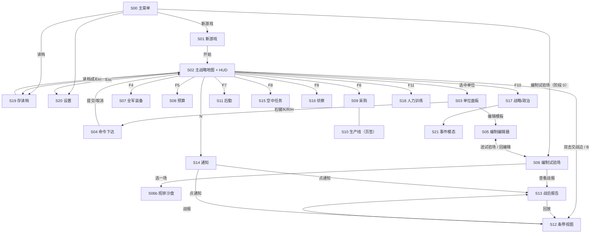
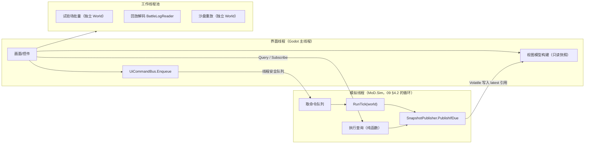

# 13 界面与交互（UI/UX）

> 本文件定义：画面清单与导航、每个画面的线框/字段/交互/空态/快捷键、视图模型（view model）、模拟核心与 Godot 界面之间的数据绑定契约（快照/读模型、线程边界、命令 API）、提示框（“为什么”解释）系统、北约军标用法、配色与无障碍、本地化、新手引导钩子，以及界面验收用例。
> 归属（00 §4.2）：视图模型、`AutoPauseFilter`、AAR 呈现、星标设置归 13。**本文件不定义任何模拟规则**；界面上显示的每个数字都来自别的规格的数据，本文件只规定“从哪里取、怎么显示、怎么解释”。
> 第 3 节写视图模型数据结构；第 4 节先写横向机制（4.1–4.8），再逐个画面（4.9 起）。
> 08（空中）与 14（纳卡剧本）在本文件完稿前已可读：S15、空中图层已按 08 对齐；S01、目标面板与结局页已按 14 §2 对齐。国家配色、战区投影参数、时区、地名双语规则、引导步骤等呈现数据统一取自 14 §3.9 `ScenarioPresentation`（数据文件 `data/scenarios/nk_common/presentation.yaml`）。

---

## 1. 目标与范围

### 1.1 这个系统解决什么问题
总方针（总纲 §0）把本作定位为“大地图即时策略里的 Wargame”：**硬核在选择，不在操作；数字要透明**。界面是这两条落地的地方：
1. **决策要好下**：每个决策（编制、采购、配属、后勤配置、命令）都有一个明确的入口、一个预览（“这样做会怎样”）和一个确认，不需要手动微操。
2. **数字要看得懂**：每个派生数字都能悬停看到“为什么”（由哪些输入、按什么公式得出），像 Wargame 单位卡那样把射程、命中、穿深、装甲、价格直接写出来（总方针第 3 条）。
3. **输了能知道为什么**：战后报告（AAR）把损失按阶段、按武器、按班模板拆开，并给出可读的结论句（总纲 §9.8、§9.3①、§9.10(7)）。
4. **上手可以慢，但每一步有人引导**（总方针第 6 条）：渐进展示（progressive disclosure）、预设接近最优、一键恢复预设、规则化的顾问提示。

### 1.2 阶段 0（编制试验场）包含
| 模块 | 内容 |
|---|---|
| 主菜单、设置、存读档（试验场工程文件） | S00、S19、S20 |
| 编制编辑器（班 → 旅，含自动检查、向上传导提示、五渠道即时反馈、能力衰减曲线） | S05 |
| 编制试验场：片段模式（排/连/营对抗，03）与条带模式（营/旅对抗，04）的批量模拟、分布图、A/B 对比 | S06 |
| 班排沙盘：任选一场试验重放到班（重新模拟，确定性） | S06b |
| 条带视图（只读，回放时间轴） | S12（试验场条带模式） |
| 战后报告（单场与批量汇总） | S13 |
| 数据绑定契约、提示框系统、军标、配色、本地化 zh/en | 4.1–4.8 |

### 1.3 阶段 1（纳卡 MVP）追加
| 模块 | 内容 |
|---|---|
| 新游戏：剧本 `nk_2010` / `nk_2020`、国家（ARM / AZE）、难度、历史模式 | S01（14 `ListScenarios()` → §3.9 `ScenarioListEntry`） |
| 主战略地图（H3 地块）与图层：控制权、敌情（按暴露等级）、我方暴露度估算、后勤流量、空中、地形、补给状态、瓶颈 | S02 |
| 单位面板：Wargame 式营卡、编组面板（含编组 AI 分配理由）、敌方情报卡 | S03 |
| 命令下达：移动/进攻、跨地块打击、跨地块侦察、就地防御；命令延迟预览 | S04 |
| 全军装备与分配、预算、采购、生产线 | S07–S10 |
| 后勤：流量图、节点面板、关键节点分析、储备目标、进口、运力 | S11 |
| 通知列表与自动暂停过滤器 | S14 |
| 空中任务规划（任务包） | S15（按 08） |
| 侦察：区域侦察任务、特种部队任务、我方暴露度估算 | S16 |
| 战略/政治（阶段 1 子集）：信任度、紧张度、议题与游说、边境行动、作战方案、动员、危机事件、停火、年度《国防评估》 | S17 |
| 人力与训练 | S18 |
| 新手引导钩子 | 4.8 |

### 1.4 不包含（留扩展点）
- 海军画面（舰载机配置、摆机、VLS 装填、舰队阵型）**[阶段 3]**：`ScreenId` 预留 `NavyFleet = 40`…；地图层预留 `LayerId.Naval`。
- 全球地图（球面渲染、10 万格 LOD）**[阶段 3]**：阶段 1 用战区局部投影（4.9.3），渲染接口按“地块集合”抽象，留好 LOD 钩子。
- 军火出口、联合演习、同盟、核风险面板 **[阶段 2+]**（11 §1.3）：S17 预留页签，阶段 1 不显示。
- 多人、模组管理器、LLM 运行时顾问 **[阶段 2+]**（总纲 §20.4）。
- 本文件不规定美术风格（图标绘制、字体授权、音效），只规定信息结构与规则。

### 1.5 技术前提
- Godot 4（.NET 版，C#）。界面代码在命名空间 `MoD.Game.Ui.*`（00 G-14）。模拟核心 `MoD.Sim.*` **不引用 Godot**。
- 平台 PC，鼠标 + 键盘；基准分辨率 1920×1080，可缩放到 3840×2160（4.6）。
- 界面**只能**通过本文件 §3.6 的命令 API 改变模拟；**只能**通过快照/读模型读取模拟（4.1）。

---

## 2. 玩家能做什么、看到什么

### 2.1 界面原则（从总方针推导；所有画面都要遵守）

| # | 原则 | 落到界面上的硬规则 | 对应总方针 |
|---|---|---|---|
| UP-1 | **Wargame 级透明** | 任何派生数字（命中率、延迟、批准概率、特征值、满编率…）必须能悬停看到 `WhyNode` 分解（4.2）。禁止“隐藏修正”：如果某个乘子影响了结果但没显示，就是 bug。数据 `confidence` 为 `estimated`/`uncertain` 的数字旁加可信度图标并可点开来源（14 R3、10 F6）。 | 3 |
| UP-2 | **决策优先于操作** | 每个决策入口都有：①当前值 ②预览（改了会怎样，数字）③确认。界面不提供任何“微操”入口（条带视图、片段只读，总纲 §9.3）。 | 1、2 |
| UP-3 | **预览就是模拟的同一套函数** | 预览只调用各规格提供的纯函数（如 09 `PreviewDelay`、11 `Quote`、01 `BuildImpact`），不在界面里另写近似公式。 | 4 |
| UP-4 | **可预期、不随机** | 界面显示期望值时同时显示区间（如“成功率 70% ± 15%”，总纲 §21-1）；随机结果的战报要能追溯到原因。 | 4 |
| UP-5 | **渐进展示** | 每个画面有 Basic / Standard / Expert 三档展示密度（`DisclosureLevel`，4.8）；高档只“多显示”，不改变规则。 | 6 |
| UP-6 | **预设接近最优、随时可回退** | 编辑类画面都有“恢复预设”和“与预设的差异”标记；新游戏默认配置 = 剧本给定或预设。 | 6 |
| UP-7 | **情报即画面** | 敌方信息只按我方暴露度（05）显示；界面不得泄露真值（包括通过排序、计数、缺省值间接泄露）。 | 3（透明的是“我知道什么”） |
| UP-8 | **颜色不是唯一编码** | 每种颜色编码同时有形状、图案或文字（4.4）。 | 可玩性 |
| UP-9 | **双语从第一天起** | 界面里不允许硬编码可见字符串；全部走本地化键（4.5）。 | 可玩性 |

### 2.2 信息密度分级

| 档 | 名称 | 载体 | 内容上限 | 例 |
|---|---|---|---|---|
| T0 | 一瞥 | 地图图标、条带元素 | 军标 + 最多 2 条状态条 + 1 个角标 | 营图标：军标、兵力条、补给条、星标角标 |
| T1 | 悬停 | 提示框（4.2） | ≤ 10 行；数字 ≤ 3 位有效数字 | “命令延迟 39 分钟 = 45 × 0.86 × …” |
| T2 | 面板 | 侧面板 / 底部抽屉 | 一屏内；分节可折叠 | 营卡 S03 |
| T3 | 报告 | 全屏画面 | 表格、图表、可导出 CSV | AAR S13、试验场 S06 |

- 数字格式：T0/T1 最多 3 位有效数字（`1.23k`、`38.7 分钟`→`39 分钟`）；T2 按字段格式表；T3 显示到数据精度。
- 每个带单位的数一律显示单位（用 00 §3 的单位；界面把内部单位换算成人类单位：m→km、ms→分钟/小时、`Musd`→“百万美元 / $M”）。
- 内部 [0,1] 的归一化量（练度、满编率、压制…）界面显示为 0–100（00 G-09），百分比字段显示为 `%`。概率显示为 `%`（00 §3.1）。

### 2.3 决策清单（每个决策在哪个画面、调用哪个 API）

> 这是给实现者的总索引：所有别的规格 §2 列出的玩家决策，都必须在下表里有入口。API 名见 §3.6 `IUiCommands`。

| 来源 | 决策 | 画面 | `IUiCommands` 方法 → 底层 API（输入日志种类，15 §3.4） |
|---|---|---|---|
| 01 D1–D4 | 新建/修改班、排、连、营、编组模板；只设计到连（自动生成） | S05 | `TemplateDraft*` → `CommitTemplateEdits` → 01 §4.5.1 写时复制 + `ApplyTemplateEdit(TemplateEdit)` + `RetargetBattalion(bn, now)`（★01 §6.1 尚未导出，待 01 补，见审查 UR-08）；`OrgEdit` |
| 01 D5 | 编组默认型号 / 营覆盖型号 | S03、S07 | `SetModelBinding` → 01 `Formation.defaultBindings` / `OrgUnit.modelOverrides`（★写接口待 01 补，见审查 UR-08）；`OrgEdit` |
| 01 D6、D7 | 分配策略、优先顺序、允许替代装备、执行分配 | S07 | 分配策略：`SubmitOrder(UnitConfig{field = AllocationPolicy (= 6), newValue = (int)p}, recipient = Country)` → 09 → 01 `CountryOrgSettings.policy`；`SetPriorityList`、`SetAllowSubstitution` → 01 `CountryOrgSettings.priorityList`、`Formation.allowSubstitution`（★写接口待 01 补，见审查 UR-08）；`ApplyAllocation` → 01 `AllocateEquipment(玩家国家, 全部营)`；后三者为 `UnitAdmin` |
| 01 D8、02 D7 | 营战备等级 | S03、S07 | `SetReadinessTier` → 01 §4.9（★写接口待 01 补，见审查 UR-08）；`UnitAdmin` |
| 01 D9 | 组建建制/临时编组 | S03 | `CreateOrganicFormation`、`CreateAdHoc` → 01 §4.12；`OrgEdit` |
| 01 D10 | 配属 / 解除配属 | S03 | `SubmitOrder(UnitConfig{field = AttachTo, newValue = FormationId.value，0 = 解除})` → 09（`Planned`，有命令延迟，`F_attach`）→ 01 `Attach` / `Detach`（01 §4.12） |
| 01 D12 | 装填模板 | — | 阶段 3，预留 |
| 02 D1–D2 | 全军训练强度、编组覆盖 | S08、S18 | `Strategic.SetAllocation`（11 `BudgetAllocation.defaultTraining` / `trainingOverride`）；`StrategicAction` |
| 02 D3–D5、D8 | 扩建学校、招训优先、速成班、志愿者 | S18 | 扩建：`Strategic.ExpandSchool(school, Δ)` → 11 `IStrategicActions.ExpandSchool`（`StrategicAction`）；`SetSchoolPriority`、`SetCrashCourse`、`SetAcceptVolunteers` → 02 `SchoolState.priorityWeight` / `.accelerated`、`CountryManpowerState.allowVolunteers`（★写接口待 02 补，见审查 UR-10；`UnitAdmin`） |
| 02 D6 | 合同兵比例 | S17 | 经 11 议题/改革（`Strategic.*`，11） |
| 02 D9 | 换装人员代价 | S03、S07 | `Query(SkillChangePreview)`（只读预览） |
| 03 | 无片段内决策（只读） | S12 | — |
| 04 | 旅火力支援优先 `FireSupportPriority` | S03（编组面板） | `SubmitOrder(UnitConfig{field = FireSupportPriority (= 9), newValue = (int)p}, recipient = Formation)` → 09 → 04 `SetFireSupportPriority`（09 §3.2） |
| 05 D2–D4 | 行军方式、电磁管控、布设假目标 | S03、S04、S16 | `SubmitOrder(UnitConfig{MarchMode (= 1) / Emcon (= 2) / DeployDecoys (= 7)})` → 09；姿态没有单独命令，由移动/就地防御（`Move` / Halt）和战斗决定（09 §3.3） |
| 05 D5、D6 | 区域侦察任务、特种部队任务 | S16、S04 | `SubmitOrder(CrossTileRecon)` → 09 → 05 |
| 05 D7、09 | 跨地块打击 | S04 | `SubmitOrder(CrossTileStrike)` → 09 → 04/08 |
| 06 D1 | 旅基数配比 | S03（补给页） | `SetAmmoComposition` → 06 `AmmoComposition`（★06 尚无写接口/`LogisticsConfigKind`，待 06 补，见审查 UR-16）；`UnitAdmin` |
| 06 D2–D4、D10、D12 | 储备目标、战略方向比例、进口渠道、空陆运力优先 | S11 | `SubmitOrder(LogisticsConfig{LogisticsConfigChange{kind = StockTargets / DirectionWeights}})` → 09 → 06 `ApplyConfig`（06 §3.10） |
| 06 D5 | 新建仓库、加固 | S10、S11 | `Strategic.OrderInfrastructure(kind, node, tile, capacityT)` → 11 `IStrategicActions.OrderInfrastructure`（费用与工期 = 06 `QuoteInfrastructure`，06 §4.17）；`StrategicAction` |
| 06 D7、D9、D14 | 分散度、库存上限、手动调拨 | S11 | `SubmitOrder(LogisticsConfig{kind = Dispersion / StockCap / Transfer})` → 06 `ApplyConfig` |
| 06 D6、D8、D11、D13 | 展开/前推后勤中心、前置弹药、补给优先、前沿补给方式 | S11、S03 | `SubmitOrder(LogisticsConfig{kind = MoveHub / … / PriorityFlag / …})`（首次展开 ★`DeployHub` 待 06 补，见审查 UR-18） |
| 07 | 重组策略、补充方式 | S03、S07 | `SubmitOrder(UnitConfig{ReorgPolicy (= 5) / ReplacementMode (= 4)})`（纯配置开关，0 延迟，DC-041） |
| 07 | 拆东补西 | S03 | `SubmitOrder(UnitConfig{AllowCannibalization (= 10)})`（07 `BrigadeSustainSettings.allowCannibalization`；纯配置开关，0 延迟） |
| 07 | 缴获装备使用（国家级开关） | S07 | ★写接口待 07/11 补（见审查 UR-19） |
| 07 | 合并营/合并连/撤编（编制操作） | S03、S07 | `MergeBattalions`、`MergeCompanies`、`DisbandBattalion` → 07 §4.6.3；`UnitAdmin`；有命令延迟、营不在战斗中才执行（DC-041，见 4.9.4） |
| 08 | 空中任务、任务包、剖面 | S15 | `SubmitOrder(AirMission)` → 09 → 08 `StartMission`（任务包 🟡 U-24） |
| 08 D6–D8 | 拦截策略、防空电磁管控、发射后转移 | S15 | `SubmitOrder(UnitConfig{InterceptPolicy (= 3) / Emcon (= 2) / RelocateAfterFiring (= 8)})` → 09 |
| 09 | 暂停/调速、移动、就地防御、取消命令、标星、精度档 | HUD、S04、S20 | `SetPaused`、`SetSpeed`（不进输入日志）、`SubmitOrder`、`CancelOrder`（`CancelOrder`）、`ToggleStar`（`StarToggle`）、`SetFidelityProfile`（`FidelityProfile`） |
| 11 D1–D6、D8 | 预算、进口、二手、升级、退役、生产线、贷款（`Submit(q, useCredit)`） | S08–S10 | `Strategic.*` → 11 `IStrategicActions`；`StrategicAction` |
| 11 D7 | 基建项目 | S10 | `Strategic.OrderInfrastructure`（同上） |
| 11 D9–D14 | 边境行动、游说、作战方案、动员、事件选项、停火 | S17、S21 | `Strategic.*`；`AnswerEvent`（`EventAnswer`）、`AnswerCeasefire`（`CeasefireAnswer`） |
| 12 | 条令预设、独立营保障旅、编组整体命令 | S03 | `SetDoctrine`（`DoctrineChange`）、`SetSupportBrigade`（`UnitAdmin`）（★两者的写接口待 12 补，见审查 UR-27）、`SubmitOrder(recipient = Formation)` |
| 12 | AI 难度 | S01 | `SetAiDifficulty`（只在新游戏初始化时，`AiDifficulty`） |
| 13 | 自动暂停过滤、图层、展示密度、语言、配色 | S14、S02、S20 | 纯界面设置（不进模拟，4.1.6） |
| 15 | 存档/读档、自动存档、回放保留数、单存档模式、bug 报告 | S19、S20 | `SaveGame`、`LoadGame` → 15 `Save` / `Load`；`DeleteSave` 是 `MoD.Game` 的文件操作；`ExportBugReport`（★15 §6.1 尚无该接口，见审查 UR-27） |

### 2.4 反馈覆盖表（别的规格的反馈 → 画面）

| 来源反馈 | 画面 / 位置 | 视图模型 |
|---|---|---|
| 01 F1–F4、F7 模板合计、传导提示、自动检查、五渠道、指挥负荷 | S05 右栏 | `TemplateEditorVm` |
| 01 F5、F8、F9 全军需求、多样性、分配预览 | S07 | `ForceEquipmentVm` |
| 01 F6 型号来源标签 | S03 装备页 | `UnitCardVm.equipment[].bindingSource` |
| 02 F1–F9 练度、趋势、训练消耗、换装预估、学校、预备役、动员 | S18；F4 也在 S03/S07 改型号时弹出 | `PersonnelVm` |
| 03 武器统计、闲置原因、响应时间、威胁窗口、发现距离、电台招炮、班模板贡献 | S13 | `AarVm` |
| 03 能力衰减曲线 | S05 | `TemplateEditorVm.resilience` |
| 03 班级回放 | S12 展开 / S06b | `SquadReplayVm` |
| 04 条带视图、五条线状态条、瓶颈提示、阶段损失、24h 战报 | S12、S13 | `StripViewVm`、`AarVm` |
| 05 F1–F8 敌方卡、情报年龄、特征值分解、来源分解、我方暴露估算、假目标、区域任务、SOF | S03、S02 图层、S16 | `IntelCardVm`、`OwnExposureVm`、`ReconVm` |
| 06 F1–F11 基数、储备缺口、流量图、节点、关键节点、补给状态、车队、运力、保质期、进口、AAR 后勤项 | S11、S03、S12、S13 | `LogisticsVm` 等 |
| 07 名册钻取、满编率、损失拆分、修理/医疗队列、补充需求、待编池、结论句 | S03、S13 | `UnitCardVm`、`AarVm` |
| 09 命令卡、状态栏、地图控制权、时钟、昼夜、精度档、通知 | S04、S03、S02、HUD、S14 | `OrderCardVm`、`HudVm`、`NotificationVm` |
| 10 F1–F7 地块/边信息卡、道路、桥梁、边界、可信度、历史变化 | S02 | `TileInfoVm`、`EdgeInfoVm` |
| 11 F1–F9 预算、采购单、生产线、信任度、紧张度、方案审批、疲劳、年报、事件简报 | S08–S10、S17 | `BudgetVm`、`ProcurementVm`、`PoliticalVm` |
| 12 分配理由、条令日志、炮兵分配饼图、方案评估区间、AI 决策列表 | S03、S12、S17、S13 | 同上 |
| 15 存档列表、版本提示、回放列表、去同步错误 | S19 | `SaveLoadVm` |

### 2.5 画面清单

| ID | `ScreenId` | 名称 | 阶段 | 形态 | 打开方式 |
|---|---|---|---|---|---|
| S00 | `Title` | 主菜单 | 0 | 全屏 | 启动 |
| S01 | `NewGame` | 新游戏（剧本/国家/选项） | 1 | 全屏 | S00 |
| S02 | `StrategicMap` | 主战略地图 + HUD | 1 | 全屏（基底） | 读档/开局；F2 |
| S03 | `UnitPanel` | 单位面板（营卡/编组/敌情卡） | 1 | 右侧面板 | 选中单位；Enter 展开全屏卡 |
| S04 | `OrderMode` | 命令下达（地图上的模式 + 命令卡） | 1 | 地图叠加 | 右键 / K / R / H |
| S05 | `TemplateEditor` | 编制编辑器 | 0 | 全屏 | F3；S06；S03“编辑模板” |
| S06 | `ProvingGround` | 编制试验场 | 0 | 全屏 | S00（阶段 0 入口）；S05 |
| S06b | `SquadSandbox` | 班排沙盘回放 | 0 | 全屏 | S06 选中一场 |
| S07 | `ForceEquipment` | 全军装备与分配 | 1 | 全屏 | F4 |
| S08 | `Budget` | 预算 | 1 | 全屏 | F5 |
| S09 | `Procurement` | 采购（进口/二手/升级/退役） | 1 | 全屏 | F6 |
| S10 | `Production` | 生产线与基建 | 1 | S09 页签 | F6 → 页签 |
| S11 | `Logistics` | 后勤 | 1 | 地图图层 + 左侧面板 | F7 |
| S12 | `StripView` | 条带/连级视图（只读，回放） | 0 | 全屏 | 双击交战边；B；通知；AAR |
| S13 | `AfterAction` | 战后报告 | 0 | 全屏 | 通知；S12；S06；F12 |
| S14 | `Notifications` | 通知列表 + 自动暂停过滤器 | 1 | 右侧抽屉 | N；HUD 铃铛 |
| S15 | `AirOps` | 空中任务规划 | 1 | 地图图层 + 左侧面板 | F8 |
| S16 | `Recon` | 侦察任务与我方暴露度 | 1 | 地图图层 + 左侧面板 | F9 |
| S17 | `Political` | 战略/政治 | 1 | 全屏 | F10 |
| S18 | `Personnel` | 人力与训练 | 1 | 全屏 | F11 |
| S19 | `SaveLoad` | 存档/读档/回放库 | 0 | 模态 | Esc 菜单；Ctrl+S / Ctrl+L |
| S20 | `Settings` | 设置 | 0 | 模态 | Esc 菜单 |
| S21 | `EventModal` | 危机事件/停火提议/作战方案批复 | 1 | 模态（暂停） | 11 事件触发 |
| — | `TutorialOverlay` | 新手引导浮层 | 0 | 叠加 | 4.8 |

### 2.6 导航图



- **返回规则**：全屏画面按 Esc 回到上一个画面（栈，`ScreenStack`，最多 8 层）；栈底是 S02（阶段 1）或 S06（阶段 0）。在 S02 按 Esc：若有选中/命令模式则先取消；否则打开 Esc 菜单（继续 / 存档 / 读档 / 设置 / 退出到主菜单 / 退出游戏）。
- **全屏画面不暂停模拟**（HOI4 式）；只有模态（S19、S20、S21、确认框）设置 `PauseReasons.Modal`（09）。设置项 `pauseOnFullscreenScreens`（默认关）可让 S05/S07–S10/S17/S18 打开时自动暂停（🟡 U-07）。

### 2.7 全局布局（S02 为例，1920×1080 基准）

```text
┌──────────────────────────────────────────────────────────────────────────────────────────────┐
│ [国旗] 阿塞拜疆  预算 $1.79B(剩 $0.41B)  信任度 62 ▲  紧张度: 危机  疲劳 18%  │ 2020-09-27 06:10 │
│ [F3编制][F4装备][F5预算][F6采购][F7后勤][F8空中][F9侦察][F10政治][F11人力]   │ ❚❚ ▶ ▶▶ ▶▶▶ (x20)│
│                                                                     实际 20/20 分/秒  🔔 3   │ ← HUD 顶栏 64px
├────────┬───────────────────────────────────────────────────────────────────┬─────────────────┤
│图层    │                                                                   │                 │
│☑控制 1 │                                                                   │  S03 单位面板   │
│☐敌情 2 │                        地 图 视 口                                 │  （选中时出现，   │
│☐暴露 3 │              （H3 六角格、军标、交战边、箭头）                       │   宽 420px）    │
│☐后勤 4 │                                                                   │                 │
│☐空中 5 │                                                                   │                 │
│☐地形 6 │                                                                   │                 │
│☐瓶颈 7 │                                                                   │                 │
│☐补给 8 │                                                                   │                 │
│ 56px   │                                                                   │                 │
├────────┴───────────────────────────────────────────────────────────────────┴─────────────────┤
│ 提示条：选中“第 3 机步营” · 右键=移动 · K=打击 · R=侦察 · H=就地防御 · F=星标         [小地图 ]│ ← 底栏 40px
└──────────────────────────────────────────────────────────────────────────────────────────────┘
```

- 顶栏字段全部来自 `HudVm`（§3.4.1）；悬停每个字段都有 `WhyNode`（如预算 = 基础 + 危机追加 + 战时追加 + 议题增量，11 `DefenseBudget`）。
- 左侧图层栏 56px（折叠）/ 200px（展开）；右侧面板 420px，可拖动 360–640px。
- Toast（短通知）从右上角弹出，最多 `ToastMax` 条，见 S14。

---

## 3. 数据结构（视图模型与绑定契约）

> 命名空间：`MoD.Sim.Interface`（放在模拟核心程序集里、但只包含**只读快照类型和命令 DTO**，不引用 Godot）；`MoD.Game.Ui`（Godot 层，引用前者）。
> 所有快照类型都是**不可变**的（构造后不再修改；集合用 `ImmutableArray<T>` 或只读数组）。界面线程只持有快照对象，**永远不持有 `World` 或任何模拟实体的引用**。

### 3.1 枚举

```csharp
public enum ScreenId : int {
    None = 0, Title = 1, NewGame = 2, StrategicMap = 3, UnitPanel = 4, OrderMode = 5,
    TemplateEditor = 6, ProvingGround = 7, SquadSandbox = 8, ForceEquipment = 9, Budget = 10,
    Procurement = 11, Production = 12, Logistics = 13, StripView = 14, AfterAction = 15,
    Notifications = 16, AirOps = 17, Recon = 18, Political = 19, Personnel = 20,
    SaveLoad = 21, Settings = 22, EventModal = 23
    // 40+ 预留给海军 [阶段 3]
}

public enum LayerId : int {          // S02 图层；Ctrl+数字 = 值
    None = 0, Control = 1, EnemyIntel = 2, OwnExposure = 3, LogisticsFlow = 4,
    Air = 5, Terrain = 6, Bottleneck = 7, SupplyStatus = 8,
    Naval = 20                       // [阶段 3]
}

public enum DisclosureLevel : int { Basic = 1, Standard = 2, Expert = 3 }   // 4.8

public enum UiSeverity : int { None = 0, Info = 1, Warning = 2, Error = 3, Critical = 4 }  // Info↔01 CheckSeverity.Info…

public enum WhyOp : int {            // WhyNode 的组合方式（4.2）
    Leaf = 0, Sum = 1, Product = 2, Min = 3, Max = 4, Clamp = 5, Ratio = 6, Lookup = 7, Text = 8
}

public enum UnitKindTag : int { None = 0, Battalion = 1, Formation = 2, Flight = 3, EnemyContact = 4, Node = 5 }

public enum ColorPalette : int { Standard = 1, DeuteranopiaProtanopia = 2, Tritanopia = 3, HighContrast = 4 }

public enum QueryStatus : int { Pending = 0, Done = 1, Failed = 2, Cancelled = 3 }
```

### 3.2 通用类型

```csharp
// 本地化文本：键 + 参数。界面在显示时才解析（4.5），切换语言不需要重建快照。
public readonly record struct LocText(string key, ImmutableArray<LocArg> args);
public readonly record struct LocArg(string name, LocArgKind kind, double number, string text, string unitKey);
public enum LocArgKind : int { Number = 1, Percent = 2, Text = 3, LocKey = 4, Duration = 5, Money = 6, Distance = 7, Mass = 8 }
//  Number/Percent/Duration/Money/Distance/Mass 的数值一律是内部单位（00 §3：ms、m、kg、t、Musd、[0,1]），
//  由 UiFormat（4.5.4）按当前语言与单位换算显示。

// “为什么”树：每个派生数字的解释（4.2）
public sealed class WhyNode {
    public LocText label;                  // 例：“指挥部质量乘子 F_hq”
    public double value;                   // 本节点的值（内部单位）
    public LocArgKind valueKind;           // 显示格式
    public WhyOp op;                       // 子节点如何组合成本节点
    public ImmutableArray<WhyNode> children;   // 叶子为空
    public LocText formula;                // 可空；例：“1.5 − 0.8 × q”
    public UiRef source;                   // 可空：点击跳转的对象（单位、节点、模板、规格常数）
    public string specRef;                 // 调试/Expert 档显示：“09 §4.3.3”
}

// 带解释的数值
public readonly record struct ExplainedValue(double value, LocArgKind kind, WhyNode why);

// 界面里对任何对象的引用（只是 ID，不是对象引用）
public readonly record struct UiRef(UiRefKind kind, long id, long id2);
public enum UiRefKind : int {
    None = 0, Battalion = 1, Formation = 2, Company = 3, Squad = 4, Tile = 5, Edge = 6,
    EdgeBattle = 7, Engagement = 8, Node = 9, Template = 10, Model = 11, Order = 12,
    Notification = 13, Flight = 14, AirMission = 15, Contract = 16, ProductionLine = 17,
    ExposureTarget = 18, Specialty = 19, Spec = 20 /* 规格常数：id = 常数名哈希，仅 Expert 档 */, StripElement = 21 /* 04 StripElementId */
}
```

### 3.3 绑定契约类型（模拟线程 ↔ 界面线程）

```csharp
// 每次发布的不可变快照（4.1.2）
public sealed class WorldSnapshot {
    public long tick;                       // 快照对应的刻号（世界处于时刻 tick 分，09 GameClock.currentTick）
    public SimTime simTime;
    public long publishSeq;                 // 发布序号，单调递增
    public ClockSnapshot clock;
    public CountryId playerCountry;
    public HudVm hud;
    public MapSnapshot map;                 // 阶段 0 试验场模式为 null
    public ImmutableArray<Notification> newNotifications;   // seq > 上次快照已含的最大 seq（09 Notification 原样）
    public ImmutableDictionary<SubscriptionId, object> focused;  // 订阅的聚焦投影（4.1.3），值为对应 *Vm
    public ImmutableArray<QueryResult> queryResults;              // 本次随附返回的查询结果（4.1.4）
}

public sealed class ClockSnapshot {
    public bool isPaused; public PauseReasons pauseReasons;   // 09
    public GameSpeed speed; public double achievedGameMinPerRealS;
    public LightCondition lightAtCamera;    // 09 GetLightCondition（相机中心地块）
}

public readonly record struct SubscriptionId(int value);

public sealed class ViewSubscription {      // 界面 → 模拟线程：我正在看什么（不影响模拟、不进输入日志）
    public SubscriptionId id;
    public ProjectionKind kind;             // 见下
    public UiRef target;                    // 例：营、编组、EdgeBattle、节点
    public int everyNTicks;                 // 最低刷新间隔（刻）；0 = 每次发布都带
}
public enum ProjectionKind : int {
    None = 0, UnitCard = 1, FormationPanel = 2, IntelCard = 3, StripLive = 4, NodePanel = 5,
    TileInfo = 6, EdgeInfo = 7, OrderList = 8, ForceEquipment = 9, Budget = 10, Procurement = 11,
    Production = 12, LogisticsOverview = 13, KeyNodes = 14, AirOps = 15, Recon = 16,
    Political = 17, Personnel = 18, FlowMap = 19, OwnExposureLayer = 20, AirLayer = 21
}

// 查询：调用各规格的纯函数（预览/报价/影响分析）。在模拟线程的两刻之间执行（4.1.4）。
public sealed class QueryRequest {
    public int queryId;                     // 界面线程分配，单调递增
    public QueryKind kind;
    public object args;                     // 每种 kind 的参数 DTO，见 §3.6
}
public enum QueryKind : int {
    None = 0, PreviewOrderDelay = 1, StrikeRangeCheck = 2, ProcurementQuote = 3,
    TemplateImpact = 4, TemplateChecks = 5, ResilienceCurve = 6, AmmoBasisForTemplate = 7,
    PlanAssessment = 8, KeyNodeAnalysis = 9, MovePathPreview = 10, SkillChangePreview = 11,
    EdgeOddsEstimate = 12, AirMissionPreview = 13,  /* 08 §4.2 预览纯函数，🟡 U-24/§6.2 ★ */
    InterceptPolicyPreview = 14                     /* 08 F8 拦截策略预览，§6.2 ★ */
}
public sealed class QueryResult { public int queryId; public QueryStatus status; public object value; public LocText error; }
```

### 3.4 画面视图模型

> 字段旁注“← 来源”给出数据出处（规格 + 类型/字段）。“派生”表示界面构建器按给出的公式计算（只做格式化级别的运算：求和、比例、排序）。

#### 3.4.1 HUD
```csharp
public sealed class HudVm {
    public string countryIso3;                       // ← 11 Country
    public ExplainedValue budgetTotalMusd;           // ← 11 DefenseBudget.totalMusd；why = base + crisis + war + issue
    public ExplainedValue budgetRemainingMusd;       // 派生：total − Σ spentMusd − Σ obligationsMusd（11 §3.2）
    public ExplainedValue trust;                     // ← 11 信任度（0–100），why = 近 90 天变化明细（11 F4）
    public double trustDelta30d;                     // ← 11 F4
    public TensionLevel tensionWithMainRival;        // ← 11 TensionState(玩家国家, 对手).level；对手 = 14 §3.9 ScenarioPresentation.mainRival[玩家国家]
    public ExplainedValue warFatigue;                // ← 11 WarSideState.fatigue + FatigueBreakdown；无战争时 null
    public MobilizationLevel mobilization;           // ← 11 Country.mobilization（国家级，= IStrategicQuery.GetMobilization）
    public int unreadNotifications;                  // 派生：S14 未读数
    public int pendingModalEvents;                   // ← 11 待答复事件/停火提议数
}
```

#### 3.4.2 地图
```csharp
public sealed class MapSnapshot {
    public ImmutableArray<TileVm> tiles;             // 战区内全部地块，按 H3Index 升序（阶段 1 约 65 格）
    public ImmutableArray<MapUnitVm> ownUnits;       // 我方营（展开时）与编组（默认显示旅，总纲 §13.3）
    public ImmutableArray<IntelMarkerVm> enemyMarkers;   // 只来自 05 ExposureRecord（UP-7）
    public ImmutableArray<EdgeBattleMarkerVm> battles;   // 活跃交界边战斗
    public ImmutableArray<MoveArrowVm> arrows;       // 我方移动命令（Pending 虚线、Active 实线）
    public ImmutableArray<NodeMarkerVm> nodes;       // 我方后勤节点 + 已知敌方节点（≥ L1）
    public ImmutableArray<MissileTrackVm> missiles;  // 只有远程弹药（总纲 §12.2 ✅）← 08 MissileInFlight，弹药 08 AirMunitionFields.rangeMaxM ≥ 13 MapMissileMinRangeM（§5）
    public ImmutableArray<FlightMarkerVm> flights;   // 我方 08 FlightElement + 我方 08 AirTrack 中的敌机
}

public sealed class TileVm {
    public ulong h3;                                 // ← 10 Tile
    public CountryId controller; public bool isUndefended; // ← 09 TileControl
    public LightCondition light;                     // ← 09 GetLightCondition(tile, now)
    public TerrainType dominantTerrain;              // ← 10 TerrainComposition（占比最大的 TerrainType）
    public bool isKeyTile;                           // ← 14 §3.9 ScenarioPresentation.keyTiles（引用 theater.yaml key_tiles）
    public bool inPocket;                            // ← 06 PocketInfo（我方被包围的地块；★结构待 06 补，见审查 UR-17）
}

public sealed class MapUnitVm {
    public UiRef unit;                               // Battalion 或 Formation
    public ulong tile;                               // ← 09 GetMoveState(bn).currentTile（编组：其营的众数地块）
    public double crossFraction;                     // ← 09 (headProgressM − edgeAtM)/columnLengthM，过边中时用于把图标画在边上
    public ulong crossToTile;                        // ← 09 legToTile（过边中）
    public App6Symbol symbol;                        // 4.3
    public double strength01;                        // ← 03 §4.13 CombatStrength 按营汇总（= 04 §4.13.1 CS_bn；★营级读取函数待 03 导出，见审查 UR-24）
    public double supplyDays;                        // 派生：min(06 UnitSupplyView.carriedDays[Ammunition], carriedDays[Fuel])（★视图字段待 06 补，UR-17）
    public Posture posture;                          // ← 09 BattalionMoveState.posture
    public bool isStarred;                           // ← 13 StarredSet（§3.5）
    public bool inBattle;                            // ← 04 InActiveBattle
    public bool hasPendingOrder;                     // ← 09 GetOrders 有 Pending
    public bool isReorganizing;                      // ← 01 OrgUnit.reorganizingUntil > now
    public bool isEncircled;                         // ← 06 PocketInfo（我方被包围；09 UnitEncircled 只是通知种类，不是状态）
}

public sealed class IntelMarkerVm {                  // 敌方单位：一律只按我方情报（05）
    public ExposureTargetId target;                  // ← 05 ExposureRecord.target（运行时句柄；界面不得反查真实营）
    public ulong lastKnownTile;                      // ← 05 ExposureRecord.lastKnownTile
    public ExposureLevel level;                      // ← 05 IntelEstimate.level
    public long ageMs;                               // 派生：now − lastObservedTime
    public bool isStale;                             // 派生：level ≥ Targetable 且 !05 PrecisionStrikeAllowed(level, ageMs, IntelEstimate.observedPosture)（半衰期 = 05 FixHalfLifeMs[observedPosture]）
    public bool isKnownDecoy;                        // ← 05 ExposureRecord.isKnownDecoy
    public App6Symbol symbol;                        // 4.3.3 的分级规则
    public double estPersonnel, estVehicleEquivalent;// ← 05 IntelEstimate（L2+）
    public IntelTypeGuess typeGuess; public double typeConfidence;   // ← 05（L3+）
}

public sealed class EdgeBattleMarkerVm {
    public EdgeBattleId battle; public EdgeId edge;  // ← 04 EdgeBattle
    public int ownSideIndex;                         // 0 进攻 / 1 防守（从玩家视角）
    public double penetration01, breach01;           // ← 04 EdgeBattle.penetrationProgress / breachProgress
    public FidelityTier tier; public FidelityReason tierReason;   // ← 09 FidelityAssignment
    public bool involvesStarred;                     // 派生
    public int hintCount;                            // ← 04 BottleneckHint 当前条数（我方）
}
```

#### 3.4.3 单位面板（营卡 / 编组面板 / 敌情卡）
```csharp
public sealed class UnitCardVm {                     // 营卡（Wargame 式，4.9.4 / S03）
    public OrgUnitId battalion;
    public LocText name; public App6Symbol symbol;
    public TemplateHandle template; public LocText templateName;    // ← 01 OrgUnit.template
    public FormationId organicFormation, currentFormation;          // ← 01（配属时两者不同 → 显示“配属于…”）
    public ReadinessTier tier;                                       // ← 01
    public Posture posture; public MovePhase movePhase;              // ← 09 BattalionMoveState
    public bool isStarred;
    // —— 兵力与能力 ——
    public ExplainedValue personnelFill;             // ← 07 FillRateReport（人员）
    public ImmutableArray<CapabilityRowVm> capabilities;   // ← 03 BattalionSummary.capability + fillRate；07 “反装甲能力 40%”
    public ExplainedValue reconRangeDayM, reconRangeNightM; // ← 03 BattalionSummary.reconRangeM（昼）/ reconRangeNightM
    public ExplainedValue commsDelayS;               // ← 03 BattalionSummary.commsDelayS
    public ExplainedValue avgLoadKg;                 // ← 03 BattalionSummary.avgLoadKgDismounted
    public ExplainedValue protectionIndex;           // ← 03 BattalionSummary.protectionIndex
    // —— 装备（按型号）——
    public ImmutableArray<EquipmentRowVm> equipment;
    // —— 人员与练度 ——
    public ImmutableArray<SkillRowVm> skills;        // ← 02 GetSkillForBattalion（按专业：人数/在编/通用/专有）
    // —— 指挥 ——
    public ExplainedValue commandRatio;              // ← 01 CommandState.Ratio，why = loadEq / capacity
    public bool isHeadless;                          // ← 01 CommandState.isHeadless
    // —— 补给 ——
    public UnitSupplyVm supply;                      // ← 06 UnitSupplyView
    // —— 情报（我方被敌掌握程度）——
    public SignatureVm signature;                    // ← 05 SignatureState（F3 分解）
    public OwnExposureVm ownExposure;                // ← 05 OwnExposureEstimate
    public EmconState emcon; public MarchMode marchMode;   // ← 05 / 09
    // —— 命令 ——
    public ImmutableArray<OrderRowVm> orders;        // ← 09 GetOrders(recipient)
    // —— 损伤与恢复 ——
    public RecoveryVm recovery;                      // ← 07 RepairQueue / DepotRepairOrder / PersonCasualtyState / UnassignedPool 摘要
    public FidelityTier? currentBattleTier;          // ← 09（在战斗中时）
}

public enum CapabilityRowKey : int {                 // 13 自定义：一一对应 03 CapabilityVector 分量（01 CapabilityKind 没有压制、人数）
    AntiPersonnel = 1, AntiLightArmor = 2, AntiHeavyArmor = 3, AntiFortification = 4, AntiAir = 5,
    Suppression = 6, Recon = 7, PersonnelEffective = 8
}
public sealed class CapabilityRowVm {
    public CapabilityRowKey kind;                    // ← 03 CapabilityVector 同名分量（4.9.4 表）
    public double current;                           // ← 03 BattalionSummary.capability.<分量>；单位按分量：反X = 期望杀伤/分钟，压制 = 期望压制增量/分钟，侦察 = Σ 观察能力，人数 = 人
    public double fill01;                            // ← 03 BattalionSummary.fillRate.<分量>
    public WhyNode why;                              // 由哪些武器贡献（前 5 件，03 CapIndex）
}

public sealed class EquipmentRowVm {
    public CategoryHandle category; public ModelHandle model;
    public LocText modelName;
    public BindingSource bindingSource; public FormationId bindingFrom;  // ← 01 ResolveModel（F6 标签）
    public int held, required;                       // ← 01 Σ ItemsOf(SquadsOf(bn)) / TargetTotals(bn).slotsByCategory（合成直属队营无模板，01 §4.7；★TargetTotals 待 01 导出，见审查 UR-08）
    public int operational, fieldRepair, depotRepair, lost;   // ← 07 VehicleDamageState 计数
    public int substitutesHeld;                      // ← 01 替代装备（W91）
    public WeaponStatBlockVm weapon;                 // 可空：武器型号 ← 03 WeaponProfile + MunitionProfile
    public ArmorStatBlockVm armor;                   // 可空：车辆 ← 03 ArmorProfile
    public double unitCostMusd;                      // ← 11 ProcurementProfile.costMusd
}

public sealed class WeaponStatBlockVm {              // Wargame 式数字卡（总方针第 3 条）
    public FireMode fireMode;                        // ← 03
    public double rangeMinM, rangeMaxM;              // ← 03 WeaponProfile
    public ImmutableArray<(double rangeM, double p)> accuracyVsVehicle;   // ← 03 AccuracyPoint[]
    public ImmutableArray<(double rangeM, double p)> accuracyVsPersonnel;
    public double rofSustainedRpm; public double aimTimeS; public double setupTimeS;   // ← 03
    public double penetrationMm; public double penDropPerKmMm; public bool isTopAttack; // ← 03 MunitionProfile（默认首选弹）
    public LocText munitionName;
    public double skillReq01;                        // ← 03 WeaponProfile.skillReq
    public int carriedRounds;                        // ← Σ_营内各班 06 GetAvailable(SquadId, ItemKey(Ammunition, 该弹药型号))（06 SquadCarriedState，向下取整）
    public int basisRounds;                          // ← 06 §4.1：held × 每件的基数发数（06 AmmoComposition.perWeaponModel[型号] ?? 03 WeaponProfile.defaultLoad），= 06 SquadCarriedState.fullQty 之和
}

public sealed class ArmorStatBlockVm {
    public double frontKeMm, frontHeatMm, sideKeMm, sideHeatMm, topMm, eraHeatBonusMm; // ← 03 ArmorProfile
    public int passengerCapacity;                    // ← 03
    public double roadSpeedMps;                      // ← 06 MobilityProfile.roadSpeedMps（UiFormat 显示为 km/h）
}

public sealed class SkillRowVm {
    public SpecialtyHandle specialty;
    public int present;                              // ← 02 名册按专业计在位人数（02 RosterState + PersonnelRecord.specialty，在位口径同 02 PresentCount）
    public int required;                             // ← 01 PersonnelRequirement(bn)
    public double general01, type01;                 // ← 02 GetSkillForBattalion
    public ModelHandle typeModel;                    // 专有练度对应的型号
}

public sealed class UnitSupplyVm {                   // ← 06 UnitSupplyView（★字段待 06 补，见审查 UR-17；🟡 U-15）
    public ImmutableArray<double> carriedDays;       // 下标 = SupplyClass（Ammunition / Fuel / SpareParts / General）
    public double bsaStockDays;
    public bool isCut;                               // ← 06 BrigadeSupportArea.isCutOff（营级 ★UnitSupplyView.isCutOff，06 §4.9）
    public ImmutableArray<double> pocketEnduranceDays;      // ← 06 EnduranceDays(pocket, SupplyClass)（06 PocketInfo）；下标 = SupplyClass
    public ForwardResupplyPolicy forwardResupply;           // ← 06 BrigadeSupportArea.policy（D13：Auto / Continuous / NightOnly）
    public bool priorityFlag;                               // ← 06 BrigadeSupportArea.priorityFlag（D11）
}

public sealed class SignatureVm {                    // ← 05 SignatureState
    public ExplainedValue physical;                  // why = sizeTerm × postureMult × terrainMult × camoMult × fortMult × densityMult
    public ExplainedValue emitter;
    public double counterRecon01;
}

public sealed class OwnExposureVm {                  // ← 05 OwnExposureEstimate
    public ExposureLevel levelLow, levelHigh;        // “敌方大约掌握 L2–L4”
    public ImmutableArray<(ReconMeans means, double share)> topContributors;
    public ImmutableArray<string> hintKeys;          // ← 05 hintKeys，界面加前缀 "recon." 查表（4.5.2）
}

public sealed class OrderRowVm {                     // ← 09 Order
    public OrderId id; public LandOrderType landType; public OrderDomain domain;
    public OrderStatus status; public SimTime issuedAt, effectiveAt;
    public long remainingMs;                         // 派生：max(0, effectiveAt − now)
    public WhyNode delayWhy;                         // ← 09 OrderDelayBreakdown（4.2.3）
    public LocText summary;                          // “移动 → 842a1…（进攻）”
    public bool canCancel;                           // status == Pending 且 orderClass ≠ Forced
}

public sealed class RecoveryVm {                     // ← 07
    public int inRepairField;                        // ← 07 RepairQueue.items.Count（野战修理）
    public int inRepairDepot;                        // ← 07 VehicleDamageState.level == DepotRepair 的件数（07 DepotRepairOrder）
    public int waitingParts;                         // ← 07 recovery == AwaitingParts（红标，07 F）
    public int medicalReturningN; public double medicalReturnMeanDays;  // ← 07 PersonCasualtyState（stage ∈ Role1/Role2/Hospital 且 willReturn；stageUntil 求均值）
    public int awaitingEvacN;                        // ← 07 MedicalQueue.awaitingEvac.Count
    public int unassignedPersons, unassignedItems;   // ← 07 UnassignedPool
}

public sealed class FormationPanelVm {               // 编组面板
    public FormationId formation; public LocText name; public FormationKind kind; public OrgLevel echelon;
    public ImmutableArray<FormationBattalionRowVm> battalions;
    public ImmutableArray<CategoryModelRowVm> defaultBindings;   // ← 01 Formation.defaultBindings
    public FireSupportPriority firePriority;          // ← ★04 GetFireSupportPriority(FormationId)（缺省 = DoctrineProfile.defaultFirePriority，归属见 DC-101；待 04 补，见审查 UR-25）
    public string doctrineId;                         // ← 12 GetDoctrine(f).id（预设见 12 §5.1）
    public ReorgPolicy reorgPolicy; public ReplacementMode replacementMode;   // ← 07
    public bool allowCannibalization;                 // ← 07 BrigadeSustainSettings.allowCannibalization
    public TrainingIntensity trainingOverride;        // ← 11 BudgetAllocation.trainingOverride
    public ExplainedValue commandRatio;               // ← 01 FormationCommandState
}
public sealed class FormationBattalionRowVm {
    public OrgUnitId battalion; public LocText name; public double strength01; public ulong tile;
    public EdgeAssignmentVm assignment;               // ← 12 GetEdgeAssignment（分配理由，12 F）
    public bool isAttached;                           // currentFormation ≠ organicFormation
}
public sealed class EdgeAssignmentVm {               // ← 12 EdgeAssignment
    public EdgeId edge; public bool isTileReserve;    // isTileReserve = (role == EdgeRole.TileReserve)
    public EdgeId pendingEdge;                        // ← 12 EdgeAssignment.pendingEdge / pendingRole
    public double threatValue, terrainFit;            // ← 12 GetTrace(AiLayer.Formation, formationId) 中该营选项的 considerationValues
    public SimTime lastMovedAt;                       // = SimTime.FromTick(EdgeAssignment.lastChangeTick)
    public LocText whyNotMoved;                       // ← 12 GetTrace(AiLayer.Formation, formationId)（AiDecisionTrace，“收益 +12% < 门槛 20%”）
}

public sealed class IntelCardVm {                    // 敌方情报卡（05 F1、F2、F4、F6）
    public IntelMarkerVm marker;
    public ImmutableArray<(ReconMeans means, double gain)> lastGainByMeans;  // ← 05 ExposureRecord.lastGainByMeans（F4；最近一个 10 分钟暴露步）
    public double estStrength01, estAmmo01, estFatigue01;                     // ← 05 IntelEstimate.estStrengthFraction / estAmmoFraction / estFatigue（L5）
    public bool precisionStrikeAllowed; public LocText strikeBlockReason;    // ← 05 PrecisionStrikeAllowed
    public double locationErrorM;                                             // ← 05 TargetLocationErrorM
}
```

#### 3.4.4 命令卡
```csharp
public sealed class OrderCardVm {                    // S04：提交前的预览
    public OrderDraft draft;                         // §3.6
    public QueryStatus previewStatus;
    public WhyNode delayWhy;                         // ← 09 PreviewDelay → OrderDelayBreakdown
    public SimTime estimatedEffectiveAt;             // 派生：now + totalMs
    public ImmutableArray<ulong> path;               // ← 09 寻路（MovePathPreview）
    public bool entersEnemyTile;                     // 派生：路径末格 controller ≠ 我方 → 显示“进攻”
    public bool supersedesPending; public long supersededPreparedMs;   // 派生：同槽位 Pending 命令已准备的时间
    public ImmutableArray<LocText> blockers;         // 不能提交的原因（09 Validate 的同一套条件，4.9.5.3）
    public ImmutableArray<LocText> warnings;         // 可提交但需要知道：如“离开旅炮覆盖”“过边约 18 分钟”
    public StrikePreviewVm strike;                   // 打击命令时
}
public sealed class StrikePreviewVm {
    public ExposureLevel intelLevel; public long intelAgeMs;          // ← 05（下令时快照，09 IntelSnapshot）
    public bool precision; public double areaAmmoMultiplier;          // ← 05 PrecisionStrikeAllowed / AreaStrikeAmmoMultiplier
    public int suggestedRounds;                                        // ← ★04 PreviewCrossTileStrike(shooter, payload, effectiveAt).rounds（04 §4.4.2 同一算法；待 04 导出，见审查 UR-25）
    public long prepMs, flightMs;                                      // ← ★04 PreviewCrossTileStrike(...).prepMs / flightMs（同上）
    public bool inRange; public bool endUseRestricted;                 // ← 04 IsInStrikeRange、11 DependencyList.endUseRestricted
}
```

#### 3.4.5 编制编辑器
```csharp
public sealed class TemplateEditorVm {
    public TemplateHandle editing; public OrgLevel level; public bool isPreset;   // ← 01 Template
    public TemplateDraftId draft;                    // 草稿会话（§3.6）
    public TemplateTreeNodeVm tree;                  // 本模板展开树（班为叶）
    public TemplateTotalsVm totalsBefore, totalsAfter;   // ← 01 GetTotals（草稿前/后）
    public FiveChannelVm channelsBefore, channelsAfter;  // ← 01 F4 / 03（五渠道）
    public ImpactReportVm impact;                    // ← 01 BuildImpact（§4.5.3）
    public ImmutableArray<CheckRowVm> checks;        // ← 01 RunChecks（CheckResult）
    public ResilienceCurveVm resilience;             // ← 03 ComputeResilienceCurve（连及以上）
    public AmmoBasisVm ammoBasis;                    // ← 06 BasisForTemplate（营/旅）
    public SignatureVm signatureEstimate;            // ← 05 特征值分解（编辑器内估算，05 F3）
    public ExplainedValue unitCostMusd;              // 派生：Σ 槽位 × 绑定型号单价（11）
    public DiffVsPresetVm diffVsPreset;              // UP-6
}
public sealed class TemplateTotalsVm {               // ← 01 TemplateTotals
    public int personnelTotal;
    public ImmutableArray<(SpecialtyHandle s, int n)> bySpecialty;
    public ImmutableArray<(CategoryHandle c, int n)> byCategory;
    public bool isComplete, usedFallback;
}
public sealed class FiveChannelVm {                  // 总纲 §9.11(2) 五渠道（数值由 03 提供，🟡 U-16）
    public ExplainedValue selfSufficiency;           // 自给能力：班/排自带对各类目标的手段
    public ExplainedValue resilience50;              // 减员韧性：减员 50% 时主战能力剩余比例（取自衰减曲线）
    public ExplainedValue avgLoadKg;                 // 负重
    public ExplainedValue mountFit;                  // 乘车适配：下车步兵完整率
    public ExplainedValue ammoEnduranceMin;          // 弹药：不补给的预计战斗分钟数
}
public sealed class ImpactReportVm {                 // ← 01 ImpactReport（§4.5.3 五项）
    public ImmutableArray<(TemplateHandle t, int dPersonnel, ImmutableArray<(CategoryHandle c, int d)> dSlots)> ancestors;
    public int battalionsAffected;
    public ImmutableArray<(SpecialtyHandle s, int dPersonnel, int toTrain)> personnel;
    public ImmutableArray<(CategoryHandle c, ModelHandle m, int dEquip, int toBuy, double costMusd)> equipment;
    public ImmutableArray<CheckRowVm> checksAdded, checksRemoved;
}
public sealed class CheckRowVm {                     // ← 01 CheckResult
    public string code; public UiSeverity severity; public LocText message; public LocText suggestion;
    public UiRef where;                              // 模板或实例
}
public sealed class ResilienceCurveVm {              // ← 03：各能力分量均值 vs 减员比例
    public ImmutableArray<double> casualtyFraction;  // x 轴
    public ImmutableDictionary<CapabilityRowKey, ImmutableArray<double>> capabilityMean01;   // ← 03 ComputeResilienceCurve 各 CapabilityVector 分量均值（★返回类型待 03 补，见审查 UR-24）
}
```

#### 3.4.6 编制试验场
```csharp
public enum PgMode : int { Engagement = 1, Strip = 2 }    // 03 §4.15 / 04（🟡 U-11）

public sealed class ProvingGroundVm {
    public PgMode mode;
    public PgSideSpecVm own, enemy;                  // ← 03 PgSideSpec（模板 + 型号绑定 + 练度）
    public ImmutableArray<TerrainClassPg> terrains;  // 03 标准地形
    public EngagementType engagementType; public int supportLevel; public LightCondition light;   // ← 03 ProvingGroundSpec.type / supportLevel（0–3）/ light（09 LightCondition）
    public bool ownIsAttacker;                       // ← 03 ProvingGroundSpec.ownIsAttacker
    public int runs;                                 // N，默认 PgDefaultRuns
    public PgProgressVm progress;
    public PgReportVm reportA, reportB;              // A/B 对比（B 可空）
}
public sealed class PgReportVm {                     // ← 03 ProvingGroundReport（03 §3.7）
    public ImmutableDictionary<EngagementOutcome, int> outcomeCounts;   // ← .outcomeCounts
    public DistributionVm ownCasualtyFrac, enemyCasualtyFrac, ownVehicleLossFrac, seizedDepthM, durationMin;   // ← 同名 DistributionSummary；histogram 由界面从 .runs 计算
    public ImmutableArray<WeaponAarRowVm> weapons;   // ← .ownWeaponsByModel + .ownItemsByModel（同 AAR）
    public ImmutableArray<IdleBarVm> idle;           // ← .ownWeaponsByModel[*].idleS
    public DistributionVm supportResponseS;          // ← .supportResponseS；四段均值 ← .responseSegmentMeanS
    public ImmutableArray<ThreatSummaryVm> threats;  // ← .threats（03 ThreatSummary）
    public ImmutableArray<ulong> runSeeds;           // ← .runs[i].seed（= Mix(spec.hash) ^ i），沙盘重放用
    public int runsCompleted, runsRequested, runsFailed;   // ← 同名字段；completed < requested 时标“部分（n/N）”
}
public sealed class DistributionVm { public double mean, p10, p50, p90, min, max; public ImmutableArray<int> histogram; public double binMin, binWidth; }
public sealed class PgProgressVm { public int done, total; public bool running; public long etaRealMs; }
```

#### 3.4.7 条带视图
```csharp
public sealed class StripViewVm {                    // ← 04 StripView（类型由本文件定义，数据来自 04 §3.3–3.6）
    public EdgeBattleId battle; public double edgeLengthM; public int orientation;   // ← 04 EdgeBattle / Strip
    public int viewerSideIndex;                      // 玩家所在方；敌方元素按暴露度过滤（UP-7）
    public long tick; public SimTime simTime;
    public ImmutableArray<StripElementVm> elements;  // ← 04 StripElement（敌方：过滤后）
    public ImmutableArray<double> contactYM;         // ← 04 ContactLine.yM（战斗坐标，界面统一转成“玩家在下方”）
    public ImmutableArray<SectorVm> sectors;         // ← 04 SectorState
    public ImmutableArray<FireLineVm> fireLines;     // ← 04 FireMission（本条带步内 fireAt…impactAt 的）
    public LineStatusVm lines;                       // 五条线状态条（4.9.13）
    public ImmutableArray<HintVm> hints;             // ← 04 BottleneckHint（我方）
    public ImmutableArray<ConvoyVm> convoys;         // ← 06 ConvoyView
    public ImmutableArray<DoctrineLogRowVm> doctrineLog;   // ← 12 StripDirective 原因码（12 F）
    public FidelityTier tier; public FidelityReason tierReason;   // ← 09
    public StripTerrainImageRef terrain;             // ← 04 StripTerrain（栅格贴图，静态，按 edge 缓存）
}
public sealed class StripElementVm {
    public long id; public StripElementKind kind; public App6Symbol symbol;
    public Vec2D posM; public StripTask task; public EchelonRole echelon; public ElementState state;
    public double strength01;                        // 我方：真值（03 CombatStrength 比例）；敌方：仅 L5 估计，否则 NaN
    public ExposureLevel enemyLevel;                 // 敌方元素：我方对其所属营的等级；我方元素 = None
    public double rangeMaxM;                         // 火力单位：← 04 FireUnitState.rangeMaxM（射程圈）
    public EngagementId activeEngagement;            // 0 = 无
}
public sealed class LineStatusVm {                   // 4.9.13
    public int aMissionsHour, aHitsHour;             // ← 04 LineCounters.missionsByKind[DeepStrike] 本小时差分（界面与上一整点快照求差）；命中 ★04 尚无 hitsByKind（见审查 UR-25），之前不显示
    public ExposureLevel bOwnOnEnemy, bEnemyOnOwnEst;// ← 05（我方对敌）/ 05 OwnExposureEstimate（敌对我，估算）
    public int cMissionsHour, cLmLaunched, cLmIntercepted;   // ← 04 LineCounters：missionsByKind[CounterBattery + Interdiction + Loitering] 本小时差分、lmLaunched、lmIntercepted（FireMissionKind→线的映射 ★待 04 明确，UR-25）
    public ImmutableArray<double> dBreachBySector;   // ← 04 SectorState.breach
    public int eActiveEngagements, eFrontageSlots;   // ← 04 activeEngagements.Count / Strip.sectorCount
}
public sealed class HintVm { public string rule; public LocText text; public UiRef subject; public Vec2D? posM; }  // ← 04 BottleneckHint(int rule, StripElementId subject, double[] numbers)：rule = "H" + hint.rule；subject = UiRef(StripElement, subject)；numbers 各规则含义 ★待 04 补（见审查 UR-25）
```

#### 3.4.8 战后报告
```csharp
public sealed class AfterActionReport {              // 不可变；生成后存入 AarArchive（§3.5）
    public AarId id; public EdgeBattleId battle; public int periodIndex;   // periodIndex = −1 表示整场
    public SimTime from, to; public BattleEndReason endReason;   // ← 09/04
    public FidelityTier tierAtEnd; public bool hasSquadReplay;    // ← 09；Full 才有班级回放
    public ImmutableArray<AarSideVm> sides;          // [0] 我方，[1] 敌方（敌方只含我方可知的部分，4.9.14）
    public ImmutableArray<AarConclusionVm> conclusions;   // 4.9.14 规则 C1–C14，按影响分降序，≤ AarConclusionMax
    public ImmutableArray<WeaponAarRowVm> weapons;   // 我方
    public ImmutableArray<IdleBarVm> idle;           // 我方，按型号
    public DistributionVm supportResponseS;          // ← 03 FireSupportResponse.totalS（我方，经 04 累积的 EngagementResult.stats.responses）
    public ImmutableArray<(ResponseSegment seg, double meanS)> responseSegments;   // ← 03 FireSupportResponse.segmentS 均值（四段：反应/通信/排队与调炮/飞行）
    public ImmutableArray<ThreatSummaryVm> threats;  // ← 03 SummarizeThreats(我方受到的 ThreatRecord)
    public ImmutableArray<DetectionVm> detection;    // ← 03 DetectionStats（敌我 × 光照）
    public ImmutableArray<ExposureStrikeVm> exposureStrikes;   // ← 03 ExposureCausedStrike（我方被打的，按连汇总）
    public ImmutableArray<SquadTemplateShareVm> squadTemplateShares;   // ← 03 SquadTemplateStats（我方）
    public LossStatusVm lossStatus;                  // ← 07 LossStatusSummary
    public LogisticsAarVm logistics;                 // ← 06 统计计数器 §4.14
    public ImmutableArray<AiDecisionRowVm> aiDecisions;   // ← 12 AiDecisionTrace（只我方）
}
public sealed class AarSideVm {
    public CountryId country; public int personnelCommitted, vehiclesCommitted;
    public ImmutableArray<LineLossVm> byLine;        // ← 04 LossBreakdown.byLine（A–E）
    public ImmutableArray<(CategoryHandle c, int vehicles, int persons)> bySourceCategory;
    public double breachHours;                       // ← 04 LossBreakdown.breachHours
    public double combatPowerFractionEnd;            // ← 04 PeriodicBattleReportData.combatPowerFraction
}
public sealed class LineLossVm {
    public BattleLine line;
    public int killed, severe, light, missing;       // 人员
    public int destroyed, depotRepair, fieldRepair, abandoned, captured;   // 车辆
    public double valueMusd;
    public double vehicleShare01;                    // ← 04 shareOfVehicleLossByLine
}
public sealed class WeaponAarRowVm {                 // ← 03 WeaponStats 按型号汇总
    public ModelHandle model; public int items; public int shotEvents, roundsFired, hits;
    public double kills, suppressionDelivered; public bool isEstimated;   // suppressionDelivered = Σ Δs（03 WeaponStats，无时间量纲）；isEstimated：缓存片段（03 §4.14.3）——03 OutcomeSample 目前无武器级字段，缓存片段不产生本行（★见审查 UR-24）
}
public sealed class IdleBarVm {                      // ← 03 WeaponStats.idleS[IdleReason]
    public ModelHandle model; public double activeS; public ImmutableArray<double> idleSByReason;  // 下标 = (int)IdleReason − 1（03 §3.7）
}
public sealed class ThreatSummaryVm {                // ← 03 ThreatSummary（字段同名）
    public TargetClass cls; public int count, engagedByOrganicCount, unengagedCount;
    public double meanWaitS, lossesWhileWaiting;
}
public sealed class DetectionVm {                    // ← 03 DetectionStats，按 (observerSide, light) 求和
    public bool ownIsObserver; public LightCondition light; public int detections; public double meanRangeM;   // meanRangeM = Σ sumRangeM / Σ detections
}
public sealed class ExposureStrikeVm {               // ← 03 ExposureCausedStrike，按 victimCompany 计数
    public OrgUnitId company; public StrikeExposureCause cause; public int strikes;
}
public sealed class SquadTemplateShareVm {           // ← 03 SquadTemplateStats（我方各片段求和后算份额）
    public TemplateHandle squadTemplate; public int squads;
    public double suppressionShare01, killShare01;   // 本模板值 / 我方全部模板之和
    public CategoryHandle topSuppressionCategory; public double topCategoryShareOfSide01;   // suppressionByCategory 最大的类别及其占我方总压制的份额（C13）
}
public sealed class AarConclusionVm { public string ruleId; public double impact; public LocText text; public UiRef drillDown; }
```

#### 3.4.9 通知与自动暂停
```csharp
public sealed class NotificationVm {
    public long seq; public NotificationKind kind; public SimTime at;   // ← 09 Notification
    public LocText title, body;                      // 4.9.15 模板表
    public UiSeverity severity;
    public UiRef primary;                            // 点击跳转：战斗 → S12/S13，地块 → 地图，事件 → S21
    public bool involvesStarred; public bool isRead;
    public bool causedAutoPause;
}

// 归 13（00 §4.2；09 §4.9 接口需求）。属于界面设置：不进模拟、不进输入日志。
public sealed class AutoPauseFilter {
    public ImmutableArray<AutoPauseRule> rules;      // 任一启用规则命中 → Matches = true
    public bool Matches(Notification n);             // 见 4.9.15
}
public sealed class AutoPauseRule {
    public string id;                                // "battle_starred" 等，见 4.9.15 默认表
    public bool enabled;
    public NotificationKind kind;
    public bool requireStarred;                      // n.involvesStarred 必须为 true
    public int minCompaniesTotal;                    // 0 = 不限；比较 n.stats.companiesTotal ≥
    public double minOwnLossFraction;                // 0 = 不限；比较 n.stats.ownLossFraction ≥
    public bool playerCountryOnly = true;            // n.audience == 玩家国家
}
```

#### 3.4.10 其他画面视图模型（字段在各画面小节给出）
`ForceEquipmentVm`（S07）、`BudgetVm`（S08）、`ProcurementVm`、`QuoteVm`（S09）、`ProductionVm`（S10）、`LogisticsVm`、`NodePanelVm`、`KeyNodeVm`、`FlowEdgeVm`（S11）、`AirOpsVm`（S15）、`ReconVm`（S16）、`PoliticalVm`、`PlanVm`、`EventVm`（S17）、`PersonnelVm`（S18）、`SaveLoadVm`（S19）、`UiSettings`（S20）。每个画面小节的“字段表”就是该视图模型的字段定义（字段名 = 表中第一列的英文标识）。

### 3.5 界面持有的状态

```csharp
// (1) 模拟侧、进状态哈希：星标（09 调度读取，是模拟输入）
public sealed class StarredSet {                     // 位于 World（MoD.Sim.Interface 定义类型；🟡 U-03）
    public SortedSet<int> battalions;                // OrgUnitId.value
    public SortedSet<int> formations;                // FormationId.value
}   // 只能经 IUiCommands.ToggleStar 修改 → InputLog(StarToggle)（15 InputKind.StarToggle）
    // 存档：15 SectionId.Scheduler（= 51，与 09 SimBudgetScheduler 同段，进状态哈希；15 §3.2）

// (2) 存档里、不进状态哈希：界面状态（15 SectionId.UiState = 110，不进状态哈希；15 §3.2 已采纳 🟡 U-04）
public sealed class UiSaveState {
    public double cameraLatDeg, cameraLonDeg, cameraZoom;
    public SortedSet<LayerId> activeLayers;
    public AutoPauseFilter autoPause;
    public long lastReadNotificationSeq; public SortedSet<long> pinnedNotifications;
    public AarArchive aars;                          // 最近 AarArchiveMax 份 AAR（🟡 U-05）
    public SortedDictionary<ScreenId, DisclosureLevel> disclosure;
    public SortedSet<string> tutorialStepsDone;
}
public sealed class AarArchive { public List<AfterActionReport> items; }   // 按 AarId 升序，超出上限删最旧（未固定的）

// (3) 用户设置文件 user://settings.cfg（Godot ConfigFile，不在存档里）：见 S20 UiSettings
```

### 3.6 命令 API（界面 → 模拟的唯一写入通道）

```csharp
// 界面线程调用；实现只做一件事：把 UiCommand 放进线程安全队列 UiCommandBus（4.1.5）。
// 全部方法立即返回；结果（成功/失败原因）经下一次快照的通知或 QueryResult 返回。
// 注释格式：→ 落到的规格 API；[InputKind] = 15 §3.4 输入日志种类（09 SubmitOrder/CancelOrder 自己写日志）。
public interface IUiCommands {
    // —— 时间（09）——不进输入日志（15 §4.8）
    void SetPaused(bool paused);                         // 写 09 GameClock.pauseReasons 的 Player 位（继续时同时清 AutoPause*，09 §4.2）（★09 §6.1 未列 setter，待 09 补，见审查 UR-27）
    void SetSpeed(GameSpeed s);                          // 写 09 GameClock.speed（同上）
    // —— 命令（09 SubmitOrder / CancelOrder）——
    void SubmitOrder(OrderDraft d);                      // → 09 SubmitOrder（issuer = 玩家国家，source = Player）[Order]
                                                         //   配置类全部走这里：UnitConfig{MarchMode/Emcon/InterceptPolicy/ReplacementMode/ReorgPolicy/
                                                         //   AllocationPolicy（recipient = Country）/DeployDecoys/RelocateAfterFiring/FireSupportPriority/
                                                         //   AllowCannibalization/AttachTo}（09 §3.2）；LogisticsConfig{06 LogisticsConfigChange}（06 §3.10）
    void CancelOrder(OrderId id);                        // → 09 CancelOrder [CancelOrder]
    void ToggleStar(UiRef unit);                         // → StarredSet [StarToggle]
    void SetFidelityProfile(FidelityProfile p);          // → 09 SimBudgetScheduler.profile，下一个小时窗口生效 [FidelityProfile]（★09 §6.1 未列 setter，见审查 UR-27）
    void SetAiDifficulty(AiDifficulty d);                // → 12 §4.8；只在新游戏初始化（tick 0）调用 [AiDifficulty]
    // —— 编制（01）——
    TemplateDraftId BeginTemplateDraft(TemplateHandle t);// 复制到沙盒草稿；预设的写时复制（01 §4.5.1，新 id p_<小写iso3>_NNNN）在 CommitTemplateEdits 时才执行
    void TemplateDraftEdit(TemplateDraftId d, TemplateEdit e);   // 01 TemplateEdit（★字段待 01 补，见审查 UR-08）；只改草稿，触发 TemplateImpact 查询
    void CommitTemplateEdits(TemplateDraftId d, RetargetScope scope);   // → 01 §4.5.1 + ApplyTemplateEdit + RetargetBattalion（★待 01 §6.1 导出，UR-08）[OrgEdit]
    void DiscardTemplateDraft(TemplateDraftId d);        // 只动沙盒，不进输入日志
    void SetModelBinding(UiRef formationOrBattalion, CategoryHandle c, ModelHandle m);  // m = 0 清除覆盖；→ 01 Formation.defaultBindings / OrgUnit.modelOverrides（★写接口待 01 补，UR-08）[OrgEdit]
    void SetPriorityList(ImmutableArray<NodeRef> order);          // → 01 CountryOrgSettings.priorityList（★UR-08）[UnitAdmin]
    void SetAllowSubstitution(FormationId f, bool allow);         // → 01 Formation.allowSubstitution（★UR-08）[UnitAdmin]
    void ApplyAllocation();                                       // → 01 AllocateEquipment(玩家国家, 全部营)，在 OrderIntake 执行（01 §6.3）[UnitAdmin]
    void SetReadinessTier(OrgUnitId bn, ReadinessTier t);         // → 01 §4.9（★写接口待 01 补，UR-08）[UnitAdmin]
    void CreateOrganicFormation(OrgLevel echelon, OrgUnitId hqBn, ImmutableArray<NodeRef> members);   // → 01 §4.12 [OrgEdit]
    void CreateAdHoc(ImmutableArray<NodeRef> members);                                                  // → 01 §4.12 [OrgEdit]
    // —— 编制操作（07 §4.6.3）——有命令延迟、营不在战斗中才执行（DC-041，见 4.9.4）[UnitAdmin]
    void MergeBattalions(OrgUnitId keep, OrgUnitId absorb);
    void MergeCompanies(OrgUnitId bn, OrgUnitId keepCompany, OrgUnitId absorbCompany);
    void DisbandBattalion(OrgUnitId bn);
    // —— 条令与保障（12）——
    void SetDoctrine(FormationId f, string doctrineId);           // → 12 FormationAiState.doctrineId（★setter 待 12 补，见审查 UR-27）[DoctrineChange]
    void SetSupportBrigade(OrgUnitId bn, FormationId bde);        // → 12 SupportBrigade 的玩家覆盖（★setter 与存储待 12 补，UR-27）[UnitAdmin]
    // —— 后勤（06）——
    void SetAmmoComposition(FormationId f, AmmoComposition c);    // → 06 AmmoComposition（★06 尚无写接口，待 06 补，见审查 UR-16）[UnitAdmin]
    // —— 人员（02）——
    // 扩建学校不在这里：用 Strategic.ExpandSchool(school, Δ)（11 IStrategicActions，[StrategicAction]）
    void SetSchoolPriority(SpecialtyHandle s, double weight);     // → 02 SchoolState.priorityWeight（★setter 待 02 补，见审查 UR-10）[UnitAdmin]
    void SetCrashCourse(SchoolHandle school, bool on);            // → 02 SchoolState.accelerated（★UR-10）[UnitAdmin]
    void SetAcceptVolunteers(bool on);                            // → 02 CountryManpowerState.allowVolunteers（★UR-10）[UnitAdmin]
    // —— 战略（11）：直接转发到 IStrategicActions，Bus 填 owner = 玩家国家 [StrategicAction]——
    IStrategicActionsProxy Strategic { get; }            // Quote 除外：Quote 是只读报价，走 Query(ProcurementQuote)，不进输入日志
    void AnswerEvent(EventInstanceId e, string optionId);               // → 11 AnswerEvent [EventAnswer]
    void AnswerCeasefire(WarId w, bool accept);                          // → 11 AnswerCeasefire(w, 玩家国家, accept) [CeasefireAnswer]
    // —— 存档（15 / MoD.Game）——
    void SaveGame(string slotName, byte[] thumbnailPng); // → 15 Save（保存期间 PauseReasons.Modal）
    void LoadGame(string path);                          // → 15 Load（读档完成后为 Player 暂停，15 §4.7）
    void DeleteSave(string path);                        // MoD.Game 文件操作，不经模拟
    void ExportBugReport(string path);                   // → 15（★15 §6.1 尚无导出接口，见审查 UR-27）
    // —— 查询（纯函数，不改状态，不进输入日志）——
    int Query(QueryKind kind, object args);              // 返回 queryId；结果在快照 queryResults 中
    // —— 界面设置交给模拟线程的只读副本（不改状态，不进输入日志）——
    void SetAutoPauseFilter(AutoPauseFilter f);          // 09 §4.9 在 Reporting 末尾读取它的最新副本
    // —— 订阅（不改状态，不进输入日志）——
    SubscriptionId Subscribe(ProjectionKind kind, UiRef target, int everyNTicks);
    void Unsubscribe(SubscriptionId id);
}

public sealed class OrderDraft {                         // 界面填写，Bus 在模拟线程转成 09 Order
    public OrderRecipient recipient;                     // 09
    public OrderDomain domain; public LandOrderType landType; public OrderClass orderClass; public OrderSlot slot;
    public IOrderPayload payload;                        // 09 的 MoveOrderPayload / CrossTileStrikePayload / UnitConfigPayload / LogisticsConfigPayload / AirMissionOrderPayload 原样
}
public enum RetargetScope : int { OnlyThis = 1, AllCountryReferences = 2 }
public readonly record struct TemplateDraftId(int value);
```

- `IUiCommands` 的实现类 `UiCommandBus` 在 `MoD.Game.Ui`；它把调用序列化成 `UiCommand { kind, payload, uiSeq }` 入队。**模拟线程**在两刻之间按 `uiSeq` 升序取出并调用对应的模拟 API（09 `SubmitOrder` 会自己写输入日志；其余按上表写）。
- 草稿（`TemplateDraft`）存在模拟线程的一个**独立于 `World` 的沙盒**里（复制的模板表），只有 `CommitTemplateEdits` 才写入 `World`。草稿不进存档；读档时丢弃并提示（7 节）。

---

## 4. 横向机制与画面逐一规格

### 4.0 每个画面小节的固定格式
每个画面（4.9 起）按以下顺序写：**目的 → 线框（ASCII）→ 字段表（字段 | 来源 | 格式）→ 交互表（操作 | 输入 | 调用 | 结果）→ 空态/错误态 → 快捷键**。字段表的“来源”写成“规格 + 类型.字段”；“调用”写 §3.6 的 `IUiCommands` 方法（括号里是最终落到的规格 API）。

---

### 4.1 数据绑定契约：模拟核心 ↔ Godot 界面

#### 4.1.1 线程模型



| 线程 | 可以做 | 禁止 |
|---|---|---|
| 界面线程 | 读最新 `WorldSnapshot`；构建/缓存视图模型；渲染；入队命令、查询、订阅；向工作池提交试验场与回放任务 | 读写 `World`；调用任何 `MoD.Sim` 的非静态模拟方法；阻塞等待模拟线程 |
| 模拟线程 | 唯一能写 `World` 的线程：执行命令、`RunTick`、构建快照、执行查询 | 调用 Godot API；读真实时间来影响模拟（09 §4.1） |
| 工作线程 | 在**独立的** `World` 实例里跑试验场、沙盘重放；解码回放日志（只读 15 的数据） | 访问战役 `World` |

#### 4.1.2 快照发布（读模型）

```csharp
// 模拟线程：09 §4.2 循环中每刻之后调用；暂停中被唤醒执行命令/查询后也调用
void PublishIfDue(World w, bool force) {
    long nowRealMs = MonotonicNowMs();                       // 真实时间只用于“多久发一次”，不影响模拟
    bool due = force
            || w.clock.isPaused != lastPublishedPaused
            || (w.clock.currentTick != lastPublishedTick && nowRealMs - lastPublishRealMs >= C.SnapshotMinIntervalMs)
            || (w.clock.currentTick % 60 == 0 && w.clock.currentTick != lastPublishedTick)   // 每个整点必发
            || pendingQueryResults.Count > 0;
    if (!due) return;
    var snap = new WorldSnapshot {
        tick = w.clock.currentTick, simTime = SimTime.FromTick(w.clock.currentTick), publishSeq = ++seq,
        clock = BuildClock(w), playerCountry = w.playerCountry, hud = BuildHud(w),
        map = w.hasMap ? BuildMap(w) : null,                 // 增量复用：未变的 TileVm 复用上一份实例
        newNotifications = w.notificationsFor(w.playerCountry).Where(n => n.seq > lastNotifSeq).ToImmutableArray(),
        focused = BuildFocused(w),                           // 4.1.3
        queryResults = DrainQueryResults()
    };
    Volatile.Write(ref latest, snap);                        // 界面线程 Volatile.Read(ref latest)
    lastPublishedTick = w.clock.currentTick; lastPublishRealMs = nowRealMs; lastPublishedPaused = w.clock.isPaused;
}
```

规则（🟡 U-01）：
1. **快照只在两刻之间构建**，所以同一份快照里的所有数字来自同一刻（一致性）。界面在 Expert 档显示“数据时刻 = 快照 tick”。
2. 构建函数（`Build*`）必须是**纯读**：不写 `World`、不抽随机数、不推进任何缓存的“世界状态”。允许读各规格声明的只读缓存（如 01 `GetTotals` 的缓存）——这些缓存**不得进状态哈希**，且其内容只取决于世界状态（00 §6）。
3. 构建预算：核心部分（HUD + 地图 + 通知）≤ `SnapshotCoreBudgetMs`；聚焦投影每个 ≤ `SnapshotFocusBudgetMs`。超出只记性能日志，**不得**跳过或改变模拟。
4. 界面在两次快照之间做**纯显示插值**：时钟（09 §4.2：显示时间 = 快照刻 + 插值）、行军图标位置（按 `speedMps` 外推，最多外推到下一个 `LandMoveStepMinutes`）、条带元素位置（在两次条带步快照之间线性插值）。插值不回写。

#### 4.1.3 订阅与聚焦投影
- 地图核心数据每次发布都带；**重的数据只为“正在看的东西”构建**：界面打开 S03 时 `Subscribe(UnitCard, 营)`，关闭时 `Unsubscribe`。
- 每种 `ProjectionKind` 的构建函数与刷新间隔：

| ProjectionKind | 构建内容 | `everyNTicks` 默认 | 依据 |
|---|---|---|---|
| `UnitCard` | `UnitCardVm` | 1 | 营状态可能每刻变（片段） |
| `FormationPanel` | `FormationPanelVm` | 5 | 编组 AI 每条带步（G-23） |
| `IntelCard` | `IntelCardVm` | 10 | 暴露度每 10 分钟（G-02） |
| `StripLive` | `StripViewVm` | 5 | 条带步 5 分钟（G-04）；片段内元素状态按 1 刻 |
| `NodePanel`、`LogisticsOverview`、`FlowMap` | 06 视图 | 60 | 网络流每小时（00 §5.2 阶段 40） |
| `KeyNodes` | 06 `KeyNodeReport` | 1440 | 06 每日计算（06 §4.0） |
| `OwnExposureLayer` | 05 `OwnExposureEstimate`（全部我方营） | 60 | 05 每 60 分钟 |
| `AirLayer`、`AirOps` | 08 视图 | 1 | 空中层每分钟（08 `AirStepMinutes` = 1） |
| `Budget`、`Procurement`、`Production`、`Political`、`Personnel`、`ForceEquipment` | 11/02/01 视图 | 60 | 战略层每小时 |
| `TileInfo`、`EdgeInfo` | 10 静态 + 09 控制权 | 60 | — |
| `OrderList` | 09 `GetOrders`（玩家全部命令） | 1 | — |

- 订阅**不影响模拟**（09 T-13）：打开某场战斗的条带视图不会让它变成 `Full`；界面提示“标星以实时模拟”（🟡 U-14 沿用 09 T-13）。

#### 4.1.4 查询（预览、报价、影响分析）
- 查询调用各规格提供的纯函数（UP-3）：

| `QueryKind` | 调用 | 参数 DTO | 结果 |
|---|---|---|---|
| `PreviewOrderDelay` | 09 `PreviewDelay(Order)` | `OrderDraft` | `OrderDelayBreakdown` |
| `MovePathPreview` | 09 §6.3 寻路（A\*，与 `SubmitOrder` 同一实现）；★需 09 §6.1 导出纯函数 `List<ulong> FindPath(OrderRecipient r, ulong destTile)`（待 09 补，见审查 UR-27） | `(OrderRecipient, ulong destTile)` | `List<ulong>` 或失败原因 |
| `StrikeRangeCheck` | 04 `IsInStrikeRange(OrgUnitId, TargetRef)`；05 `PrecisionStrikeAllowed(level, ageMs, posture)` / `AreaStrikeAmmoMultiplier(level, ageMs, posture)`（参数取自 `payload.intelAtIssue`：09 `IntelSnapshot.level`、`now − intelTimestamp`、`observedPosture`）；11 `DependencyList.endUseRestricted`；建议弹数/准备/飞行时间 ★需 04 导出 `PreviewCrossTileStrike`（待 04 补，见审查 UR-25） | `CrossTileStrikePayload` + 发射单位 | `StrikePreviewVm` |
| `ProcurementQuote` | 11 `IStrategicActions.Quote(buyer = 玩家国家, ModelHandle model, CountryId seller, ProcurementMode mode, int qty)`（纯查询，立即返回、不记输入，11 §6.3） | `(ModelHandle model, CountryId seller, ProcurementMode mode, int qty)`（界面把 id 转成句柄） | 11 `ProcurementQuote` |
| `TemplateImpact`、`TemplateChecks` | 01 `BuildImpact(TemplateEdit)`、`RunChecks(草稿内 TemplateHandle, Ancestors)`（★01 需支持草稿模板表；`ImpactReport` 字段待 01 补，见审查 UR-08） | `TemplateDraftId` | `ImpactReport`、`CheckResult[]` |
| `ResilienceCurve` | 03 `ComputeResilienceCurve(companyTemplate)`（03 §4.13：只对连模板；★返回类型与营及以上的支持待 03 补，见审查 UR-24） | 连模板句柄（草稿） | 曲线 |
| `AmmoBasisForTemplate` | 06 `BasisForTemplate` | `(templateId, bindings, composition)` | `AmmoBasisView` |
| `PlanAssessment` | 12 `ProxyModel.EvaluatePlan` + 11 §4.7 领导层评分（★评分分项类型与纯函数待 11 补，见审查 UR-27） | `OperationPlan` 草稿 | `PlanAssessment` + 评分分项 |
| `KeyNodeAnalysis` | 06 `AnalyzeKeyNodes(CountryId owner, NetworkView view)`（★`NetworkView` 未定义，待 06 补，见审查 UR-21） | — | `KeyNodeReport`（若当天已算过，直接返回缓存） |
| `SkillChangePreview` | 02 `Similarity` + §4.4.3 换装公式 | `(battalion, category, newModel)` | 换装练度预估（02 F4） |
| `EdgeOddsEstimate` | 12 `ProxyModel.EstimateEdge(SideForceInput att, SideForceInput def, EdgeId edge, ctx)`（可选；敌方一侧只用我方情报估计，UP-7） | `(SideForceInput att, SideForceInput def, EdgeId edge)` | low/mid/high |
| `AirMissionPreview` | 08 §4.2.1–4.2.4 的同一实现（作战半径校验、`ChooseLoadout`、任务包 TOT、航线与绕行）的只读版（★需 08 暴露） | 08 `AirMission` 草稿 | 半径是否足够、挂载方案与满足度、`plannedLaunchAt`/`plannedTotAt`、航线点 |
| `InterceptPolicyPreview` | ★08 `PreviewIntercept(AdRegistrationId, AirTargetClass[])`（08 §4.7 同一公式，待 08 补，见审查 UR-20） | 防空单位 + 典型目标类别 | 每种策略的预计拦截率 / 每目标耗弹 |

- 执行时机：模拟线程**每刻之后**检查查询队列，最多执行 `QueryMaxPerGap` 个（按 `queryId` 升序）再继续下一刻；暂停时被唤醒立即执行。结果随下一次快照返回。
- 界面在发出查询 `QuerySpinnerDelayMs` 后仍未拿到结果时显示“计算中…”；同一控件发出新查询时，旧查询的结果到达后丢弃（按 `queryId` 比较）。
- 查询函数**不得**修改 `World`、不得抽随机数（除了 03 `ComputeResilienceCurve`，它用 `RngDomain.Cache` 的独立流，结果只取决于模板，00 G-21 已允许）。

#### 4.1.5 命令执行
- `UiCommandBus` 的队列是无锁 MPSC 队列；模拟线程在**每刻开始前**（即 `OrderIntake` 之前）把队列全部取出，按 `uiSeq` 执行；暂停时被唤醒执行后 `PublishIfDue(force: true)`。
- 命令落到哪一刻：与 09 §4.2 一致——`issuedAt = SimTime.FromTick(currentTick)`。
- 失败反馈：09 `Validate` 失败会产生 `OrderFailed` 通知（09 §4.3.2）；01/06/11 的同步校验失败由 Bus 生成一条界面本地的错误 Toast（不进模拟通知列表），文本用各规格的错误码键。
- **界面在提交前就做同样的校验**（4.9.5.3 的 blockers），所以正常情况下玩家看不到失败；提交后失败只发生在“提交到生效之间世界变了”。

#### 4.1.6 什么进输入日志、什么不进
| 操作 | 进模拟 | 进输入日志（15） |
|---|---|---|
| 命令（含 `UnitConfig`、`LogisticsConfig`：行军方式、管控、拦截策略、补充方式、重组策略、分配策略、假目标、发射后转移、火力优先、拆东补西、配属） | 是 | 是（09 自己写 `Order`） |
| 取消命令 | 是 | 是（09 自己写 `CancelOrder`） |
| 星标 | 是（09 调度） | 是（`StarToggle`） |
| 精度档 | 是 | 是（`FidelityProfile`） |
| AI 难度（新游戏） | 是 | 是（`AiDifficulty`） |
| 战略动作、事件/停火答复 | 是 | 是（`StrategicAction` / `EventAnswer` / `CeasefireAnswer`） |
| 条令预设 | 是 | 是（`DoctrineChange`） |
| 编制提交、型号绑定、组建编组 | 是 | 是（`OrgEdit = 10`，15 §3.4 已采纳 🟡 U-02） |
| 优先顺序、允许替代、执行分配、战备等级、合并/撤编、基数配比、学校设置、保障旅 | 是 | 是（`UnitAdmin = 11`） |
| 暂停/调速 | 否（不影响结果） | 否 |
| 订阅、查询、图层、相机、展示密度、语言、配色、自动暂停过滤器 | 否 | 否 |

#### 4.1.7 性能预算（目标机：6 核 / 16GB / GTX 1060 级，1080p 60fps）
| 项 | 预算 | 手段 |
|---|---|---|
| 界面帧时间 | ≤ 16.6 ms（60 fps）；≤ 33 ms 底线 | 视图模型只在新快照到达时重建；控件按需刷新（`PanelRefreshHz`） |
| 地图绘制 | 阶段 1 约 65 格 + ≤ 300 图标：≤ 3 ms | 地块网格一次性生成 `ArrayMesh`；图标用 `MultiMeshInstance2D`；控制权着色用每格顶点色更新 |
| 条带视图 | ≤ 400 元素 + ≤ 200 火力连线：≤ 5 ms | 元素 `MultiMesh`；连线批量 `ImmediateMesh`；地形一张预烘焙贴图（每条边缓存一次） |
| 快照核心构建 | ≤ `SnapshotCoreBudgetMs`（2 ms） | `TileVm` 复用；只重建变化的 `MapUnitVm` |
| 通知列表 | 虚拟化列表（只实例化可见行） | Godot `ItemList` 或自建虚拟滚动 |
| 阶段 3 扩展点 | 10 万格 | `IMapRenderer` 接口按 LOD 分块；本阶段只实现 `TheaterMapRenderer` |

---

### 4.2 提示框系统：“为什么”解释

#### 4.2.1 规则
- 每个显示 `ExplainedValue` 的控件都挂 `WhyTooltip`。悬停 `TooltipDelayMs` 后出现；鼠标静止 `TooltipLockMs` 后提示框**锁定**（边框变实线），此时可以把鼠标移进提示框，悬停其中带下划线的子项打开**嵌套提示框**（CK3 式）。嵌套最多 `TooltipMaxDepth` 层。
- 锁定后按 `Shift` 或中键单击可**钉住**（Pin）为浮动小窗，最多 `PinnedTooltipMax` 个；钉住的窗口随快照刷新数值。
- 提示框内容 = 渲染 `WhyNode` 树：

```text
命令延迟  39 分钟                         ← label + value
= 基础 45 分钟（营级）                    ← children[0]（Leaf）
× 指挥部质量 0.86   [1.5 − 0.8 × q, q = 0.80]   ← formula 显示在灰字
× 指挥负荷 1.00     [负荷 3.2 / 能力 4.0 → 取下限 1]
× 干扰 1.00 × 状态 1.00 × 配属 1.00 × 距离 1.00 × 失能 1.00 × 电磁管控 1.00 × 整编 1.00
→ 38.7 → 向上取整 39 分钟（夹在 [10, 480] 分钟：09 MinDelayMs[Planned] / MaxDelayMs）
来源：09 §4.3.3                            ← specRef（Expert 档才显示）
```

- 叶子节点若有 `source`，单击跳转（例如“指挥部质量”跳到营部班的营卡）。
- 每个 `WhyNode` 的 `op` 决定连接符：`Sum` 用 “+”，`Product` 用 “×”，`Min/Max` 写“取较小/较大”，`Clamp` 写“夹在 [a, b]”，`Lookup` 写“查表：键 → 值”，`Text` 只显示一句说明。
- **一致性自检**（调试版）：渲染时按 `op` 重新计算子节点组合值，与 `value` 的相对误差 > 1e-6 时在提示框底部显示红字“解释与数值不一致”并写日志——用来抓“隐藏修正”（UP-1）。

#### 4.2.2 `WhyBuilder`（每种来源一个；界面线程或快照构建时调用）
| 构建器 | 输入 | 树结构 |
|---|---|---|
| `FromOrderDelay` | 09 `OrderDelayBreakdown` | `Clamp(Product(base, classMult, fHq, fLoad, fJam, fState, fAttach, fDist, fHeadless, fEmcon, fReorg))`，夹在 `[MinDelayMs[class], MaxDelayMs]`（09 §5） |
| `FromSignature` | 05 `SignatureState` | `Product(sizeTerm, postureMult, terrainMult, camoMult, fortMult, densityMult)`；emitter 单列 |
| `FromExposureGain` | 05 `lastGainByMeans`（只含最近一个暴露步，10 分钟） | `Sum(各手段)`，叶子标百分比 |
| `FromApproval` | 11 `ApprovalBreakdown` | `Lookup(logistic, Sum(logitBase, relationTerm, blocTerm, historyTerm, willingnessTerm, sensitivityTerm, warTerm, rivalTerm))`；`embargoed` 为真时整树换成 Text “禁运：概率 0” |
| `FromFatigue` | 11 `FatigueBreakdown` | `Clamp(Sum(time, casualties, territory, cost, gains), 0, 1)`（11 疲劳公式：`gains` 本身 ≤ 0，不再取负） |
| `FromBudget` | 11 `DefenseBudget` | `Sum(baseMusd, crisisBonusMusd, warSupplementMusd, issueBonusMusd)` |
| `FromCommandRatio` | 01 `CommandState` | `Ratio(loadEq, capacity)` |
| `FromCapability` | 03 `CapIndex` 明细 | `Sum(前 5 件武器 + “其余”)` |
| `FromPlanScore` | 11 §4.7 评分分项（★类型待 11 补，见审查 UR-27） | `Sum(分项)` 与门槛 `PlanApprovalThreshold` 对比（11 的评分是约 1 量级的无量纲数，界面 ×100 显示：“差 6.2 分” = 差 0.062） |
| `FromFillRate` | 07 `FillRateReport` | `Ratio(实际, 模板)` |
| `FromTextOnly` | 任意 `LocText` | `Text` |

- 规则：**新加任何派生数字，必须同时加 WhyBuilder**；代码评审清单项。

#### 4.2.3 “为什么不能”提示
- 灰掉的按钮必须有提示框说明原因（`blockers`，4.9.5.3），格式：“不能下达：{原因}。{怎么解决}”。例：“不能精确打击：目标定位已过时（情报 150 分钟前，半衰期 2 小时）。派侦察或改为面积打击（弹药 × 2.4）。”（半衰期 = 05 `FixHalfLifeMs[observedPosture]`，倍率 = 05 `AreaStrikeAmmoMultiplier`）

---

### 4.3 北约军标（APP-6）用法

#### 4.3.1 采用范围
- 采用 APP-6（D 版）的**框形 + 填色 + 主图标 + 层级修饰符**的子集；渲染用矢量图集（SVG 预栅格化为 MSDF 字体式贴图，便于缩放）。🟡 U-08（符号库来源：自绘子集 vs 开源 milsymbol 移植）。
- `App6Symbol` 结构：
```csharp
public readonly record struct App6Symbol(
    App6Identity identity,      // Friend / Hostile / Neutral / Unknown
    App6Icon icon,              // 主图标（下表）
    OrgLevel echelon,           // 层级修饰符；None = 不显示
    App6Mobility mobility,      // None / Tracked / Wheeled / TowedOrFoot（装甲/机步区分）
    App6Status status,          // Present / Damaged(兵力 < 50%) / Destroyed
    bool isHq, bool isDecoyMarked, bool isUncertainType);
public enum App6Identity : int { Friend = 1, Hostile = 2, Neutral = 3, Unknown = 4 }
```

#### 4.3.2 主图标映射（`Branch`（01）→ `App6Icon`）
| `Branch` | 图标 | | `Branch` | 图标 |
|---|---|---|---|---|
| `Armor` | 椭圆（履带） | | `AirDefense` | 弧顶 |
| `MechInfantry` | 交叉 + 椭圆 | | `AntiTank` | 倒 V |
| `MotorInfantry` | 交叉 + 轮 | | `Engineer` | 凹字形 |
| `LightInfantry` | 交叉 | | `Signal` | 闪电 |
| `CombinedArms` | 交叉 + 椭圆（加“CA”文字修饰） | | `Logistics` / `Maintenance` / `Medical` | 补给符 / 扳手 / 十字 |
| `Recon` | 斜线 | | `Headquarters` | 旗杆（HQ 修饰） |
| `FireSupport` / `Artillery` | 实心圆点 | | `SpecialForces` | “SF”文字 |
| `Aviation` | 螺旋桨 | | 其他 | 空框 |
- 层级修饰符：班 •、排 ••、连 |、营 ||、旅 X、师 XX、集团军 XXX（APP-6 标准）。
- 后勤节点：`NodeRole` → 补给点符号（仓库：方框内 “D”；前进后勤中心：“FH”；机场：飞机；口岸：“IG”；工厂：齿轮），这些是本作扩展，按 APP-6 “installation” 框形绘制。

#### 4.3.3 敌方单位按暴露等级显示（05；总纲 §9.3 连级视图 🟡）
| 等级 | 地图/条带上显示 | 情报卡显示（05 F1） |
|---|---|---|
| L0（无记录或衰减到 < 1） | 不显示；若过去有记录，显示**淡化幽灵**（最后已知地块，虚线框，标“{age} 前”）05 `GhostIconHours` 小时后消失（🟡 U-09） | — |
| L1 存在 | 敌方菱形框，主图标位置显示“?”，无层级修饰符，无兵力条 | “该地块有敌军”；情报年龄 |
| L2 规模 | + 层级修饰符（按 `estVehicleEquivalent` 估算营/旅，见下）；框内“?”保留 | “约 1 个营（约 420 人，281–627）”：数值 = `estPersonnel`，区间 = `[est × e^−σ, est × e^+σ]`，σ = 05 `SizeErrorSigma[level]`（L2 = 0.4） |
| L3 类型 | + 主图标（`typeGuess`）；`typeConfidence < UncertainTypeConf` 时图标后加“?”（`isUncertainType`） | 类型 + 置信度“机步（72%）” |
| L4 目标级定位 | + 定位针（条带上画到精确位置）；`isStale` 时整个符号灰化 + 斜线 | “精确位置，情报 {x} 分钟前”；过时显示“定位已过时，不能精确打击” |
| L5 状态 | + 兵力条（`estStrength01`）、弹药/疲劳小条 | 剩余兵力/弹药/疲劳估计（带“估计”字样） |
| 已识破假目标 | 原符号上盖“假”/“DECOY”印章，50% 透明 | “已识破的假目标” |

- 规模估算的层级修饰符：`estVehicleEquivalent < 15` → 连，`< 60` → 营，`≥ 60` → 旅（显示用阈值，`IntelEchelonVeThresholds`）；只影响图标，不影响任何模拟。
- **防泄露规则**（UP-7）：敌方标记的列表顺序按 `ExposureTargetId` 升序（不是真实营 ID）；地块内多个敌方标记合并为“堆叠”图标，堆叠数 = 我方已知的记录数（不是真实数量）；条带视图中我方未发现的敌方元素**完全不画**，接触线由 04 给（双方都知道接触线位置）。

#### 4.3.4 我方单位
- 友方蓝色矩形框；兵力条在框下方（绿→黄→红按 `strength01`，同时显示数字，UP-8）；星标在右上角；过边中的营画在边上（09 F 地图）；配属的营加“A”角标；整编中加旋转小齿轮；被包围加红色锁链角标。

---

### 4.4 配色与无障碍

#### 4.4.1 色板（语义色 token；所有控件只用 token，不写死颜色）
| Token | Standard | DeuteranopiaProtanopia | Tritanopia | HighContrast | 冗余编码 |
|---|---|---|---|---|---|
| `id.friend` | #4A90D9 蓝 | #0072B2 | #0072B2 | #00A0FF | 矩形框 |
| `id.hostile` | #D94A4A 红 | #D55E00 橙红 | #D55E00 | #FF3030 | 菱形框 |
| `id.neutral` | #5CB85C 绿 | #009E73 | #009E73 | #00FF7F | 方框 |
| `id.unknown` | #E6C229 黄 | #F0E442 | #CC79A7 | #FFFF00 | 四叶框 |
| `sev.info/warning/error/critical` | 灰/琥珀/红/品红 | 灰/#E69F00/#D55E00/#CC79A7 | 灰/#E69F00/#D55E00/#000 描边 | 白/黄/红/品红 | 图标 ℹ ⚠ ⛔ ‼ |
| `util.low/mid/high/sat/cut` | 流量图利用率 5 档 | viridis 5 档 | cividis 5 档 | 白→黄→红 + 粗细 | 线宽 + 饱和段红色虚线标注“≥90%”；切断 = 黑色虚线 + ✕ |
| `exposure.L1…L5` | 由浅到深的单色阶 | 同（亮度阶，色盲安全） | 同 | 同 | 数字“L3” |
| `control.<国家>` | 剧本配色（14 §3.9 `ScenarioPresentation.countryColors[国家].primaryHex`；无主地块 `neutralHex`）| 自动选 Okabe–Ito 中对比最大的两色 | 同 | 黑白 + 斜线 | 我方控制地块无图案，敌方控制地块加 45° 细斜线，“无人防守”加点状图案（09 F 地图） |

- 默认色板基于 Okabe–Ito（色盲安全）（🟡 U-12）；APP-6 身份色在 Standard 档保持北约惯例蓝/红，色盲档换成同样能区分的蓝/橙，但**框形**永远是主要区分手段。
- 对比度：正文与背景 ≥ 4.5:1，大字/图标 ≥ 3:1（WCAG 2.1 AA）。

#### 4.4.2 其他无障碍设置（S20）
- 字体大小：80%–150%（在 UI 缩放之上再乘）；最小正文 `MinBodyFontPx`（1080p 下）。
- 减少动态：关闭闪烁、脉冲；火力连线不动画（静态线 + 时间标签）。
- 提示框延迟可调（`TooltipDelayMs` 200–1500）；可关闭“悬停锁定”改为“按住 Alt 锁定”。
- 所有操作都能用键盘完成（4.7）；焦点框明显可见（2px，`focus` token）。
- 音效提示（自动暂停、关键通知）可开关，并始终伴随视觉提示。

---

### 4.5 本地化（zh / en 从第一天起）

#### 4.5.1 语言与文件
- 首发语言：简体中文 `zh_CN`、英文 `en`。后加语言只需新增翻译文件。
- 格式：Godot `TranslationServer` + gettext PO 文件（`msgid` = 本文件的**键**，不是英文原文）：`res://locale/<lang>/<domain>.po`。一个 domain 一个文件（`ui`、`org`、`recon`、`log`、`strat`、`aar`、`tut`、`data`）。
- 缺键行为：显示 `⟦key⟧`（Expert/调试）或回退到 `en`（发布版），并写一次日志；CI 校验脚本（第 9 节 V-UI-2）保证发布版 0 缺键。

#### 4.5.2 键命名规则
```text
<domain>.<screen 或模块>.<元素>[.<变体>]     全部小写 snake_case，用 “.” 分段
例：
ui.hud.budget.label              ui.map.layer.enemy_intel           ui.order.blocker.out_of_range
org.check.w40_vehicle_capacity   org.check.w40_vehicle_capacity.suggestion
recon.hint_emcon_partial         recon.level.l3                     aar.conclusion.c01
strat.event.<eventId>.title      data.model.<modelId>.name          data.place.<placeId>.name
```
- **来自模拟的键**（别的规格给出的 `messageKey`、`hintKeys`、错误码）按来源加前缀后查表：

| 来源字段 | 界面查找的键 |
|---|---|
| 01 `CheckResult.messageKey` / `suggestionKey`（如 `W40_vehicle_capacity`） | `org.check.` + 小写(key)；建议加后缀 `.suggestion` |
| 05 `OwnExposureEstimate.hintKeys`（如 `hint_emcon_partial`） | `recon.` + key |
| 04 `BottleneckHint` 规则 H1–H6 | `strip.hint.h1` … `strip.hint.h6` |
| 09 `NotificationKind` | `ui.notify.<kind snake_case>.title` / `.body` |
| 09 `Validate` 失败原因 | `ui.order.blocker.<reason>` |
| 11 事件、议题、停火模板 id | `strat.event.<id>.*`、`strat.issue.<id>.*`、`strat.ceasefire.<id>.*` |
| 12 `StripDirective`/`AiDecisionTrace` 原因码 | `ai.reason.<code>` |
| 枚举值 | `enum.<EnumType snake_case>.<member snake_case>`（如 `enum.posture.entrenched`） |
| 静态数据名称（型号、模板、地名、国家） | `data.model.<id>.name`、`data.template.<id>.name`、`data.place.<id>.name`、`data.country.<iso3 小写>.name`；**没有翻译时回退到数据文件的 `name` 字段**（🟡 U-10） |

- 文案参数用命名占位：`{veh}`、`{share:P0}`、`{hours:F0}`（与 04/07 的模板句写法一致）；格式说明符：`P0/P1` 百分比、`F0/F1` 小数位、`D` 时长、`M` 金额、`K` 距离（UiFormat 解释）。
- 翻译者注释：每个键在 PO 里带 `#.` 注释，写明出现位置与数字含义。

#### 4.5.3 文风
- 战报、事件、简报：冷静、克制、客观的简报/调查报告语气（总纲 §18.2-7 ✅）；不调侃。叙事中立（总纲 §21-4 ✅）：两国名称、地名按各自官方名称并列显示，规则取自 14 §3.9 `ScenarioPresentation.placeNamePolicy` 与 `placeNames`（`PlaceName.nameHy / nameAz / nameEn / disputed`；争议地名显示双名，并列顺序 `disputedOrder` 见 14 🟡 N-22）。

#### 4.5.4 数字、单位、时间格式（`UiFormat`）
| 量 | zh_CN | en |
|---|---|---|
| 千分位 | `12,345`（🟡 U-13：不用“万”） | `12,345` |
| 小数点 | `.` | `.` |
| 百分比 | `42%` | `42%` |
| 金额（内部 `Musd`） | `$1.79B` / `$412M` / `$0.8M`（统一美元，00 G-10 2020 不变价） | 同 |
| 距离（内部 m） | `< 1000 m` 显示 `850 m`；否则 `12.4 km` | 同 |
| 时长（内部 ms） | `< 120 分钟` 显示 `39 分钟`；`< 48 小时` 显示 `5.2 小时`；否则 `3.4 天` | `39 min`/`5.2 h`/`3.4 d` |
| 质量 | `kg` / `t` | 同 |
| 日期时间 | `2020-09-27 06:10` 24 小时制 | 同 |
| 时区 | 默认**战区当地时间**（偏移取自 14 §3.9 `ScenarioPresentation.displayUtcOffsetMin`，纳卡 = +240），可切 UTC（🟡 U-17）；模拟内部一律 UTC（00 §3.3） | 同 |
- 格式化只在界面线程；**禁止**用于任何模拟逻辑。用 `CultureInfo(<lang>)`，但千分位、小数点按上表强制（防止系统区域设置干扰）。

#### 4.5.5 字体与排版
- 字体：Noto Sans SC（中文）+ Noto Sans（拉丁）+ Noto Sans Mono（数字表格，等宽对齐）；字体回退链在 Godot `FontVariation` 里配置。
- 英文通常比中文长 30–60%：所有固定宽度控件按英文最长字符串设计并允许省略号 + 悬停全称；布局测试用伪本地化（9 节 V-UI-3）。

---

### 4.6 分辨率、缩放、窗口
- 基准 1920×1080；Godot 项目设置 `display/window/stretch/mode = canvas_items`，`aspect = expand`。
- 界面缩放 `UiScale` = 自动（`min(窗口高 / 1080, 窗口宽 / 1920)`，向下取到 0.25 的倍数）或手动 75%–200%。3840×2160 自动 = 2.0。
- 支持 16:9、16:10、21:9（超宽时地图视口变宽，面板不拉伸）。最低支持 1280×720（`UiScale` 0.75，部分 T3 画面出现横向滚动）。
- 地图和条带视图的线宽、图标大小按 `UiScale` 缩放，与地图缩放级别解耦（图标屏幕尺寸恒定，`MapIconPx`）。
- 窗口模式：窗口 / 无边框全屏 / 独占全屏；`Alt+Enter` 切换。

---

### 4.7 输入与快捷键总表（全部可在 S20 改绑；🟡 U-06）

| 范围 | 键 | 作用 |
|---|---|---|
| 全局 | `Space` | 暂停/继续（09 `SetPaused`） |
| 全局 | `1`–`5` | 速度档 Speed1–Speed5（09 T-15：1/5/20/60/240 分钟/秒） |
| 全局 | `+` / `-` | 速度加/减一档 |
| 全局 | `Esc` | 取消当前模式 → 关闭面板 → 返回上一画面 → Esc 菜单 |
| 全局 | `F1` | 当前画面帮助/教程 |
| 全局 | `F2`…`F12` | 画面：F2 地图、F3 编制编辑器、F4 全军装备、F5 预算、F6 采购与生产、F7 后勤、F8 空中、F9 侦察、F10 政治、F11 人力训练、F12 战报库 |
| 全局 | `N` | 通知抽屉 |
| 全局 | `Ctrl+S` / `Ctrl+L` | 快速存档 / 读档界面 |
| 全局 | `Alt+Enter` | 全屏切换 |
| 全局 | `Ctrl+Shift+D` | 切换展示密度 Basic→Standard→Expert |
| 地图 | `W A S D` / 方向键 / 屏幕边缘 / 中键拖动 | 平移 |
| 地图 | 滚轮 / `PgUp` `PgDn` | 缩放 |
| 地图 | `Ctrl+1`…`Ctrl+8` | 图层：控制、敌情、我方暴露、后勤流量、空中、地形、瓶颈、补给状态 |
| 地图 | 左键 / `Shift+左键` / 框选 | 选择 / 追加 / 框选（框选只选我方营或编组） |
| 地图 | 双击编组 | 展开编组显示其营（总纲 §13.3） |
| 地图 | 右键（按住出预览，松开提交） | 移动命令（S04）；移进敌方地块 = 进攻 |
| 地图 | `K` 然后左键目标 | 跨地块打击模式 |
| 地图 | `R` 然后刷选地块 | 区域侦察任务模式 |
| 地图 | `H` | 就地防御（Halt，`UrgentSimple`） |
| 地图 | `Delete` | 取消选中单位最近一条 Pending 命令 |
| 地图 | `F` | 星标切换 |
| 地图 | `Enter` | 打开全屏单位卡 |
| 地图 | `B` | 打开选中交战边/选中营所在战斗的条带视图 |
| 地图 | `Tab` / `Shift+Tab` | 在选中编组的营之间循环 |
| 条带视图 | `Space` | 暂停/继续**回放**（实时模式下 = 全局暂停） |
| 条带视图 | `←` `→` | 回放后退/前进一个条带步；`Shift+←/→` 一小时 |
| 条带视图 | `[` `]` | 回放速度档（`ReplaySpeeds`） |
| 条带视图 | `L` | 回到实时 |
| 编辑器 | `Ctrl+Z` / `Ctrl+Y` | 草稿撤销/重做（草稿内，最多 `UndoDepth` 步） |
| 编辑器 | `Ctrl+Enter` | 提交草稿 |
| 列表 | `↑` `↓` `Enter` | 选择/打开 |

- 冲突检测：改绑时同一范围内重复的键直接拒绝并提示。
- 命令确认：右键松开即提交；若新命令会**替换**一条 Pending 命令，且 `confirmSupersede`（默认开，🟡 U-07）→ 弹出行内确认“这会取消正在准备中的命令（已准备 42 分钟，09 §4.3.4 延迟重新计算）”，`Enter` 确认 / `Esc` 取消。

---

### 4.8 新手引导与渐进展示（总方针第 6 条）

#### 4.8.1 展示密度 `DisclosureLevel`
| 画面 | Basic | Standard（默认，🟡 U-18） | Expert |
|---|---|---|---|
| S05 编制编辑器 | 只到连：选连类型 + 风格 + 主要车辆，排/班自动生成（01 D3）；检查只显示 Warning 以上 | 班→旅全部；检查全部；五渠道 | + `WhyNode.specRef`、常数名、`W80` 数据作者检查隐藏仍隐藏 |
| S03 营卡 | 兵力、补给、当前命令、主要装备数量 | + 能力行、练度、指挥负荷、特征值、我方暴露估算 | + 武器数字卡全字段、命中曲线、班级名册钻取 |
| S13 AAR | 结论句 + 阶段损失图 | + 武器表、闲置原因、响应时间 | + 威胁窗口明细、班模板贡献、AI 决策列表、CSV 导出 |
| S11 后勤 | 流量图 + 缺口提醒 | + 节点面板、关键节点、储备目标 | + 运力明细、保质期、进口口岸 |
| S12 条带视图 | 连与接触线、瓶颈提示 | + 火力连线、射程圈、五条线状态条 | + 条令日志、扇区数值、片段列表 |
- 密度只改变“显示多少”，不改变任何规则或默认值（UP-5）。新游戏首次进入时询问一次（“我是新手 / 熟悉 Wargame/HOI / 专家”）。

#### 4.8.2 引导钩子
- 界面在关键动作发出 `TutorialHook` 事件（只在界面线程，不进模拟）：
```csharp
public readonly record struct TutorialHook(string id, UiRef subject);   // id 例："ui.event.first_battle_started"
```
- 引导步骤由数据文件驱动 `data/tutorial/<scenario>.yaml`（文本走 `tut.*` 键）：
```yaml
steps:
  - id: tut_nk2020_select_brigade
    trigger: {hook: ui.event.campaign_started}
    highlight: {control: map.unit, filter: "own_formation_first"}   # 控件 id（每个控件有稳定 id，见 4.8.3）
    text_key: tut.nk2020.select_brigade
    complete_on: {hook: ui.event.unit_selected}
    pause: true                                                    # 显示时设置 PauseReasons.Modal
  - id: tut_nk2020_move_order
    trigger: {after: tut_nk2020_select_brigade}
    highlight: {control: map.viewport}
    text_key: tut.nk2020.right_click_move
    complete_on: {hook: ui.event.order_submitted, where: {landType: move}}
```
- 必须发出的钩子（最小集）：`campaign_started`、`unit_selected`、`order_preview_shown`、`order_submitted`、`order_superseded`、`first_battle_started`、`strip_view_opened`、`aar_opened`、`template_editor_opened`、`template_committed`、`proving_ground_run_finished`、`notification_clicked`、`auto_pause_triggered`、`budget_opened`、`procurement_quote_viewed`、`logistics_layer_on`、`key_node_analysis_viewed`、`intel_card_opened`、`strike_blocked_low_exposure`、`crisis_event_shown`。
- 引导可随时关闭（S20），已完成步骤记入 `UiSaveState.tutorialStepsDone`。

#### 4.8.3 控件稳定 ID
- 每个可被引导高亮或自动化测试点击的控件有稳定字符串 ID（`<screen>.<area>.<element>`，如 `s05.right.checks`、`hud.speed.3`）；Godot 节点用 `SetMeta("ui_id", …)` 记录。第 8 节测试用例按这些 ID 定位控件。

#### 4.8.4 顾问提示（规则化，不用 LLM）
- 战役开始和每年预算窗口，S02 右下角出现“参谋建议”卡（最多 3 条），每条来自已有的规则输出，**只引用已有的数字**：01 `RunChecks` 的 Warning 以上（全军实例）、06 `ReserveGapReport` 最小天数、02 学校缺口、05 `OwnExposureEstimate.levelHigh ≥ L4` 的营数。卡片点击跳到对应画面。可关闭（🟡 U-19）。

---

### 4.9 画面逐一规格

#### 4.9.1 S00 主菜单（`Title`）
**目的**：入口。阶段 0 只有“编制试验场 / 读取试验场工程 / 设置 / 退出”。

```text
┌──────────────────────────────────────────────┐
│            国防部长（暂名）  v0.x.y           │
│                                              │
│   [ 继续（最近存档：AZE 2020-10-03 14:20）]   │
│   [ 新游戏 ]                     （阶段 1）   │
│   [ 读取存档 ]                               │
│   [ 编制试验场 ]                             │
│   [ 设置 ]   [ 制作人员 ]   [ 退出 ]          │
│                                  语言: 中文 ▾│
└──────────────────────────────────────────────┘
```
| 字段 | 来源 | 格式 |
|---|---|---|
| `continueSave` | 15 `ReadMeta` 最近修改的存档 | 国家 ISO3 + 游戏日期；无存档则隐藏按钮 |
| `version` | 构建信息 | `v主.次.补` |
| `language` | `UiSettings.language` | 下拉：中文 / English，切换立即生效 |

| 操作 | 调用 | 结果 |
|---|---|---|
| 继续 | `LoadGame(continueSave.path)` | 成功 → S02；失败 → 错误框（15 版本提示文本） |
| 新游戏 | — | S01 |
| 编制试验场 | — | S06（独立模式，不需要地图/剧本） |
| 读取存档 | — | S19（读档页） |

- 空态：没有任何存档 → 隐藏“继续”。错误态：数据文件加载失败（01 §4.1 Error）→ 显示错误列表（文件、行、代码）和“退出”。
- 快捷键：`Enter` = 继续；`Esc` = 退出确认。

#### 4.9.2 S01 新游戏（`NewGame`，阶段 1；数据：14 §3.9 `ScenarioPresentation.scenarioListEntries`）
```text
┌───────────────────────────────────────────────────────────────────────┐
│ 剧本                    │ 国家                 │ 选项                  │
│ ◉ 纳卡 2010（十年备战）  │ ◉ 阿塞拜疆           │ AI 难度: 标准 ▾        │
│ ○ 纳卡 2020-09（开战）   │ ○ 亚美尼亚（挑战）   │ 历史模式: 历史倾向 ▾   │
│                          │                      │ 沙盒（自由宣战）: ☐    │
│ 简介（14 文本）          │ 国家概况：预算、兵力 │ 精度档: 标准 ▾         │
│                          │ 目标（14）           │ 展示密度: 标准 ▾       │
│                          │                      │ 世界种子: 随机 [ ]     │
│                                         [ 返回 ]   [ 开始 ]           │
└───────────────────────────────────────────────────────────────────────┘
```
| 字段 | 来源 | 格式 |
|---|---|---|
| `scenarios[]` | 14 `IScenarioService.ListScenarios()`（剧本加载前读取，§6）→ `ScenarioListEntry`（14 §3.9；`ScenarioListEntry{id, titleKey, blurbKey, startUtc, playable, difficultyNoteKey}`；id 为 `nk_2010`、`nk_2020`，00 §2.1 示例写作 `nk_2020_09`，以 14 为准） | 名称 `titleKey` + 简介 `blurbKey` |
| `countries[]` | 14 §3.9 `ScenarioListEntry.playable` | 国旗 + 名称；“挑战”标记 = `difficultyNoteKey` |
| `countrySummary` | 14 R1 剧本简报：双方军费（2020 不变价）、主要装备数量对比表（带 confidence 图标）、接触线态势 | T2 卡片，冷静简报文风 |
| `objectives` | 14 / 11 剧本挑战目标（11 S-13） | 列表 |
| `aiDifficulty` | 12 §4.8 难度枚举 | 下拉 |
| `historyMode` | 11 §4.12 / 14 P2：Historical / Plausible / Free（缺省按剧本） | 下拉 |
| `sandbox` | 11 D15 | 复选 |
| `fidelityProfile` | 09 `FidelityProfile`（Low/Standard/High） | 下拉，默认 Standard |
| `worldSeed` | 15：留空 = 随机生成（显示出来，可复制） | 十六进制 |

| 操作 | 调用 | 结果 |
|---|---|---|
| 开始 | 14 `IScenarioService.Load(scenarioId)` → `Initialize(def, ScenarioInitOptions{scenarioId, playerIso3, mode, sandboxSupremeLeader, worldSeed})`；随后在 tick 0 提交 `SetAiDifficulty`（`AiDifficulty`）与 `SetFidelityProfile`（`FidelityProfile`）两条输入；默认展示密度 = 14 §3.9 `ScenarioPresentation.defaultDisclosure` | 加载进度条 → S02，暂停状态；若开启引导则进入 4.8 第一步 |

- 错误态：剧本数据校验失败 → 列出缺失项，“开始”灰掉。

#### 4.9.3 S02 主战略地图（`StrategicMap`）
**目的**：战区态势一览与命令入口。玩家在这里决定“哪个旅/营去哪个地块”（总纲 §9.3 ✅）。

##### (1) 地图投影与几何
- 阶段 1：战区局部**兰伯特等角圆锥投影**（参数取自 14 §3.9 `ScenarioPresentation.projection`：`TheaterProjection{kind = MapProjectionKind.LambertConformalConic, stdParallel1Deg, stdParallel2Deg, centralMeridianDeg, originLatDeg}`，纳卡取值见 14 §3.9：标准纬线 38.9°N / 41.35°N，中央经线 47.05°E，原点 40.1°N），地块多边形由 H3 库 `cellToBoundary(h3)` 在 `MoD.Game` 内求出顶点后投影生成（10 运行时不提供顶点，★如需由 10 提供见审查 UR-27）；距离标尺按真实大圆距离（00 §3.4）标注，与投影无关（🟡 U-20）。
- 缩放级别：`MapZoomLevels`（战区全图 / 区域 / 地块），图标屏幕尺寸恒定。
- 交界边：两地块公共边画细线；有活跃 `EdgeBattle` 的边画粗线 + 交叉剑图标（颜色：我方进攻 / 我方防守 / 第三方），图标旁两个小条：推进度、破障进度（04）。

##### (2) 线框（见 2.7）
##### (3) 图层（`LayerId`；可多选叠加，`Control` 默认开）

| 图层 | 显示 | 来源 | 刷新 |
|---|---|---|---|
| `Control` 控制权 | 每格按控制国着色 + 图案（4.4.1）；无人防守点状；开局控制线（10 F5）细虚线 | 09 `TileControl`；10 边界 | 每次快照 |
| `EnemyIntel` 敌情 | 敌方标记按 4.3.3；每格角落显示我方对该格敌军的最高等级“L3”；过时情报灰化 | 05 `ExposureRecord`/`IntelEstimate` | 10 分钟 |
| `OwnExposure` 我方暴露估算 | 每个我方营图标外圈色环：`levelHigh`（L1–L5 色阶 + 数字），悬停显示 `topContributors` 与建议 | 05 `OwnExposureEstimate` | 60 分钟 |
| `LogisticsFlow` 后勤流量 | 见 S11 流量图（线宽 = 日运量，颜色 = 利用率） | 06 `FlowMapView` | 60 分钟 |
| `Air` 空中 | 我方飞行编组、已探测敌机、远程弹药航迹、已知防空包线（敌方 ≥ L3 的防空营，按 08 交战包线画圈）、CAP 区 | 08 `FlightElement`/`AirTrack`/`MissileInFlight`/`AirDefenseRegistration`、05 | 每分钟 |
| `Terrain` 地形 | 每格主地形底纹 + 高程晕渲；道路按 10 相对等级；桥梁/隧道图标（可打击节点） | 10 `TerrainComposition`、`display_roads`、`CrossingNode` | 静态 + 日（`InfraChanged`） |
| `Bottleneck` 瓶颈 | 在交战边上显示 04 瓶颈提示数（徽章）；在我方营上显示补给/指挥问题徽章（`isCut`、`commandRatio > 1`、`isHeadless`） | 04 `BottleneckHint`、06、01 | 条带步 / 60 分钟 |
| `SupplyStatus` 补给状态 | 我方营下方补给条（随行携带量天数，色阶 + 数字）；包围圈地块红色描边 + “还能撑 x 天” | 06 `UnitSupplyView`、`PocketInfo` | 60 分钟 |

##### (4) 地块 / 交界边信息卡（悬停 T1，单击空地块 T2）
| 字段 | 来源 | 格式 |
|---|---|---|
| `terrainPie` | 10 `TerrainComposition.fraction` | 饼图 + 百分比 |
| `elevMeanM`, `elevMaxM`, `elevStdM`（起伏） | 10 `TerrainComposition` | `m` |
| `roadDensityKmPerKm2`, `railFreightTerminalCount` | 10 `TerrainComposition.RoadDensityTotalKmPerKm2`（km/km²）、`Tile.railFreightTerminalCount` | 数字 |
| `region`, `deJure` | 10 `Region`、`Tile.deJureIso3` | 文本 |
| `controller`, `controlSince`, `isUndefended` | 09 `TileControl` | 国旗 + 日期 |
| `light` | 09 `GetLightCondition` | 昼/晨昏/夜图标 |
| `confidenceNote` | 10 `synthetic` 标志 / `confidence: estimated` | “部分道路为补全生成”灰字（10 F6） |
| 边：`routes[]`（≤ 3） | 10 `IMapQuery.ActiveRoad(e).routes`（等级、长度、山地系数；按当前日期取历史变体） | 表 |
| 边：`rail` | 10 `IMapQuery.ActiveRail(e)`（类型、轨距） | 文本 |
| 边：`crossings[]`, `bypassClass` | 10 `CrossingNode`、`BypassRoute` | “依赖桥梁 X；断后绕行：普通公路” |
| 边：`battle` | 04 `EdgeBattle`（若有） | “交战中：推进 34%，破障 61%” + [打开条带视图] |

##### (5) 交互
| 操作 | 输入 | 调用 | 结果 |
|---|---|---|---|
| 选择单位 | 左键我方图标 | `Subscribe(UnitCard/FormationPanel)` | 打开 S03；旧订阅取消 |
| 选择敌方标记 | 左键敌方标记 | `Subscribe(IntelCard)` | S03 敌情卡 |
| 展开编组 | 双击旅图标 | — | 显示其营（界面状态，不影响模拟） |
| 移动/进攻 | 右键地块 | `Query(MovePathPreview)`+`Query(PreviewOrderDelay)` → 松开 `SubmitOrder` | 见 S04 |
| 打开条带视图 | 双击交战边 / `B` | — | S12 |
| 切换图层 | 图层栏 / `Ctrl+数字` | 订阅/退订对应投影 | 图层显隐 |
| 星标 | `F` / 卡片星形按钮 | `ToggleStar` | 图标角标；09 调度在下一个小时窗口生效（09 §4.8.2：窗口内新建战斗立即按星标） |
| 暂停/调速 | HUD 按钮 / 键 | `SetPaused` / `SetSpeed` | HUD 显示目标速度与实际 `achievedGameMinPerRealS` |

- HUD 时钟：显示快照刻 + 插值；若 `achievedGameMinPerRealS < 0.8 × 目标`，速度按钮旁显示“实际 x 分/秒”黄色（09 F 时钟）。暂停时时钟旁显示原因（`PauseReasons` 各位：玩家 / 自动暂停-战斗 / 自动暂停-事件 / 模态 / 加载）。
- 空态：战区内没有我方部队（全灭）→ 地图正常，HUD 显示“没有可指挥的部队”。错误态：快照超过 `SnapshotStaleWarnMs` 未更新且未暂停 → 右上角“模拟线程无响应”提示（调试信息可展开）。

#### 4.9.4 S03 单位面板（`UnitPanel`）

##### (1) 营卡（Wargame 式；Standard 档）
```text
┌ [★] ║║ 第 3 机步营  (aze_mr_bn_bmp2)          [编辑模板] [✕] ┐
│ 第 1 机步旅 · 常备 · 防御(挖壕 72%) · 地块 842a1…         配属:—│
│ 兵力 ███████░░ 81%   补给 弹药 2.4天 油 3.1天   指挥 0.80 ✓    │
├ 能力 ─────────────────────────────────────────────────────────┤
│ 反重装甲   ██████░░ 62%  12.4    反轻装甲 ████████ 95%  30.1   │
│ 反工事     ███░░░░░ 40%   3.2    对空     ██████░░ 70%   2.1   │
│ 压制       ███████░ 88%  41.0    侦察距离 昼 3.2km / 夜 1.1km  │
│ 通信延迟 班→营 2.6分钟   平均负重 31kg   防护指数 0.74          │
├ 装备 ─────────────────────────────── 型号来源 ─────────────────┤
│ BMP-2        27/31  修3 大修1 损0  继承自第1旅   $0.9M         │
│ 9K111 Fagot  14/18                  模板默认     射程 75–2500m │
│ PKM          31/31                  国家默认     …            │
├ 人员与练度 ───────────────────────────────────────────────────┤
│ 步枪手  198/243  通用 55  专有 —   │ 车长 27/31 通用 61 专有 48 │
├ 命令 ──────────────────────────────────────────────────────────┤
│ ▶ 执行中：防守                                                 │
│ ⏳ 待生效：移动 → 842a3…（进攻）  还有 27 分钟  [取消]          │
├ 情报 ──────────────────────────────────────────────────────────┤
│ 特征值 0.31 (物理)  0.12 (电磁)   敌方大约掌握 L2–L4            │
│ 主要来源：TB2 级无人机 55%，电台 30%  → 建议：电磁管控“部分”    │
│ 电磁管控 [主动|部分|静默]   行军方式 [密集|疏散]                │
├ 恢复 ──────────────────────────────────────────────────────────┤
│ 野战修理 3（等备件 1）  后方大修 1   7 天内归队 12 人  待编池 4 人│
└────────────────────────────────────────────────────────────────┘
```

**字段表**（`UnitCardVm`，§3.4.3）：
| 字段 | 来源 | 格式 / 规则 |
|---|---|---|
| 标题 `name`、`symbol`、`template` | 01 `OrgUnit`、模板 | 军标 + 名称；模板 id 灰字（Expert） |
| `organicFormation` / `currentFormation` | 01 | 配属时显示“配属于 X（建制 Y）”，悬停：请求链变长、命令延迟 × `AttachFactor`（09） |
| `tier` | 01 `ReadinessTier` | 常备 / 简编 / 骨干 |
| `posture`、挖壕进度 | 09 `BattalionMoveState.posture`；09 `GetEntrenchProgress(bn)`（04 §6.2 要求 09 提供，09 §6.1 尚未列出，见审查 UR-27）；战斗中 04 `fortLevel01(bn)` | “防御（挖壕 72%）”；过边中显示“过边 46%” |
| `personnelFill` | 07 `FillRateReport` | 条 + %，why = 实际/模板（按专业展开） |
| 能力行 | 03 `BattalionSummary.capability.*` 与 `.fillRate.*` | 条（fill）+ 数值（current，悬停解释“参考条件”）；行键 13 `CapabilityRowKey` 与 03 `CapabilityVector` 同名分量一一对应（反重装甲 `antiHeavyArmor`、反轻装甲 `antiLightArmor`、反工事 `antiFortification`、对空 `antiAir`、压制 `suppression`、侦察 `recon`）；单位按分量：反 X = 期望杀伤/分钟，压制 = 期望压制增量/分钟，侦察 = Σ 观察能力 |
| `reconRangeDayM/NightM`、`commsDelayS`、`avgLoadKg`、`protectionIndex` | 03 `BattalionSummary` | km / 分钟 / kg / 0–1 |
| 装备行 | 01 `ResolveModel`+计数；07 损伤计数；11 单价 | `held/required`；损伤分类数；`bindingSource` → “营覆盖 / 继承自{编组} / 模板默认 / 国家默认”（01 F6）；替代装备行加“替”角标（W91） |
| 武器数字卡（展开装备行） | 03 `WeaponProfile` + 首选 `MunitionProfile`；06 携弹 | 射程 min–max、命中曲线（小折线图：对车辆/对人员 vs 距离）、射速、瞄准/架设时间、穿深（KE 按距离递减：显示 1km/2km 值 = `penetrationMm − penDropPerKmMm × km`）、攻顶、练度要求、携弹 x/基数 y |
| 装甲数字卡 | 03 `ArmorProfile`；06 `MobilityProfile` | 正面 KE/HEAT、侧后、顶部、ERA、载员、公路速度 |
| 练度行 | 02 | 人数 present/required；通用、专有 0–100；专有练度对应型号 |
| `commandRatio` | 01 `CommandState` | “0.80 ✓”（≤1 绿勾）/“1.30 ⚠ 命令延迟 ×1.30”；`isHeadless` 时红字“指挥部失能：延迟 × HeadlessFactor”（09） |
| `supply` | 06 `UnitSupplyView`、`PocketInfo` | 弹药/油/给养天数；被切断时红框“补给切断，随行携带量还够 x 天” |
| `signature` | 05 `SignatureState` | 物理/电磁两数；why = 乘子分解（05 F3） |
| `ownExposure` | 05 `OwnExposureEstimate` | “敌方大约掌握 L2–L4”；主要来源；建议（`recon.<hintKey>`） |
| `emcon`、`marchMode` | 05、09 | 三段/两段开关，悬停显示代价：静默 → 命令延迟 ×1.5（09 F_emcon）、防空雷达不能开（08） |
| `orders` | 09 `GetOrders` | 执行中/待生效（倒计时 = `effectiveAt − now`）；悬停 = `OrderDelayBreakdown` 分解 |
| `recovery` | 07 队列 | 数字；“等备件”红字（07 F） |
| `currentBattleTier` | 09 `FidelityAssignment` | 在战斗中时显示“实时（可回放到班）/ 缓存（只到连）”+ 原因（星标/预算内/超预算） |

**交互**：
| 操作 | 调用 | 结果 / 校验 |
|---|---|---|
| 星标 | `ToggleStar(营)` | 立即更新角标 |
| 取消待生效命令 | `CancelOrder(id)` | 只对 `Pending` 且非 `Forced` 可用（09 §4.3.4） |
| 电磁管控 / 行军方式 | `SubmitOrder(UnitConfig{Emcon/MarchMode})`（`UrgentSimple`，有短延迟） | 卡片显示“待生效”；行军方式在下一段开始时才生效（09 §4.3.6），悬停说明 |
| 改型号（装备行“更换型号”） | 先 `Query(SkillChangePreview)` 显示 02 F4 预估，确认后 `SetModelBinding(营, c, m)` | 弹窗：“T-72B → T-90S：坦克炮长专有练度 0.62 → 0.37（相似度 0.6，02 `explicitRules` 示例；02 F4 文字写 0.5，以 02 数据为准）；需要 31 辆，库存 12，缺 19（$76M）” |
| 战备等级 | `SetReadinessTier` | 弹窗显示人员在编比例变化（02）、维护费变化（11） |
| 编辑模板 | — | 打开 S05（定位到该营模板；提交范围默认“改本国全部引用”） |
| 合并营 / 合并连 / 撤编（编制操作） | `MergeBattalions(keep, absorb)` / `MergeCompanies(bn, keep, absorb)` / `DisbandBattalion` | 确认框：人员/装备去向（07 §4.6.3）。**依赖 DC-041**：编制操作有命令延迟（按 09 §4.3 营级公式计算并在确认框显示），且所涉营都不在战斗中才执行（07 H-11）；09 `OrderClass.Administrative` 细分落实前，界面按此规则预览并禁用战斗中的营 |
| 钻取名册（Expert） | `Subscribe(UnitCard)` 已含；展开 连→排→班 | 每班：人员（专业、伤情）、装备（损伤状态），来自 02 名册 + 07 |

##### (2) 编组面板（选中旅/师）
```text
┌ [★] X 第 1 机步旅（建制）  营 6  兵力 78%  指挥 1.10 ⚠   [✕] ┐
│ 默认型号: MBT=T-72B  IFV=BMP-2  ATGM=9K111  [编辑]              │
│ 火力支援优先 [近距支援|均衡|反炮兵]   条令: 苏式 ▾              │
│ 重组策略 [保持建制|集中]   补充方式 [单兵|整建制轮换]  训练 正常▾│
├ 营 ─────────── 地块 ───── 任务（编组 AI）────── 理由 ──────────┤
│ 1 机步营  82%  842a1…   边 842a1|842a3 一线   威胁 0.71 地形 0.6 │
│ 2 机步营  64%  842a1…   地块预备            “收益 +12% < 20%”   │
│ 坦克营    91%  842a5…   边 842a5|842b0      上次调动 47 分钟前   │
└─────────────────────────────────────────────────────────────────┘
```
| 字段 | 来源 |
|---|---|
| `battalions[].assignment` | 12 `GetEdgeAssignment` + `AiDecisionTrace`（12 F“分配理由”） |
| `firePriority` | 04 `FireSupportPriority`（🟡 04 E-05）；读取 ★04 `GetFireSupportPriority(FormationId)`（见审查 UR-25） |
| `doctrineId` | 12 `GetDoctrine(f).id`（预设列表 12 I-02） |
| `reorgPolicy`、`replacementMode` | 07 |
| `trainingOverride` | 11 `BudgetAllocation.trainingOverride`（02 D2） |
| `defaultBindings` | 01 `Formation.defaultBindings` |

| 操作 | 调用 |
|---|---|
| 编组整体移动 | 右键地块 → `SubmitOrder(recipient = Formation)`（09 §4.3.5 分解） |
| 火力优先 | `SubmitOrder(UnitConfig{FireSupportPriority, (int)p}, recipient = Formation)` → 09 → 04 `SetFireSupportPriority`（纯配置开关，0 延迟，DC-041） |
| 条令 | `SetDoctrine` |
| 重组策略/补充方式/拆东补西 | `SubmitOrder(UnitConfig{ReorgPolicy/ReplacementMode/AllowCannibalization})`（纯配置开关：`Administrative`，0 延迟；DC-041） |
| 配属 / 解除配属 | `SubmitOrder(UnitConfig{AttachTo, FormationId.value 或 0}, recipient = 营)`（`Planned`，有命令延迟，01 §4.12） |
| 默认型号 | `SetModelBinding(编组, c, m)`（弹窗列出受影响的营与练度预估） |

##### (3) 敌情卡（`IntelCardVm`）
```text
┌ ◇? ║║ 敌军（L3 类型）  情报 14 分钟前                    [✕] ┐
│ 地块 842a3…   规模: 约 1 个营（约 420 人，281–627，VE 38）     │
│ 类型: 机步（置信 72%）                                        │
│ 本步来源 +0.42：TB2 组 68% · 电子侦察 22% · 地面侦察 10%       │
│ 精确打击: ✕ 需要 L4（当前 L3）  面积打击弹药 ×2.9              │
│ [派侦察（区域任务）]  [打击（面积）]                            │
└────────────────────────────────────────────────────────────────┘
```
- 字段按 4.3.3 表逐级出现；低于该级的字段**不渲染**（不是显示“未知”占位，避免泄露“有字段”）。
- 按钮：派侦察 → S16 预填该地块；打击 → S04 打击模式预填目标（目标类型 `KnownUnit`，L4 以下自动改 `Tile` 面积打击并提示）。

- S03 空态：选中的营被歼灭 → 卡片变灰，标题“已失去战斗力 / 已歼灭”，保留最后数据与“查看战报”。

#### 4.9.5 S04 命令下达（`OrderMode`）

##### (1) 移动 / 进攻
```text
          ┌────────────────────────────────────┐
  ○──○──● │ 移动 → 842a3…  （进攻：目标地块有敌）│
  路径预览 │ 预计生效 10:47（+39 分钟） ⓘ        │
          │ 过边约 18 分钟；纵队 3.0km（密集）   │
          │ ⚠ 离开第 1 旅炮兵覆盖（距离 31km）   │
          │ ⚠ 替换待生效命令（已准备 22 分钟）   │
          │ [松开右键提交]   Esc 取消            │
          └────────────────────────────────────┘
```
| 字段 | 来源 | 规则 |
|---|---|---|
| `path` | 09 寻路（`MovePathPreview`） | 地块中心连线；进入敌方控制地块的段画红色 |
| `entersEnemyTile` | 09 `TileControl` + 我方已知敌情 | 显示“进攻”（09：移动进有敌军的地块就是进攻） |
| `estimatedEffectiveAt`、`delayWhy` | 09 `PreviewDelay` | 4.2 提示框 |
| 过边时长、纵队长度 | 09 §4.4.1–4.4.2 公式的同一实现（`columnLengthM / speedMps`） | 分钟、km |
| `warnings` | 见下表 | 黄色 |
| `blockers` | 见下表 | 红色，有任何一条则不能提交 |
| `supersedesPending` | 09 `GetOrders` 同槽位 Pending | 4.7 确认框 |

**blockers**（与 09 §4.3.2 `Validate` 同一套条件，界面先查一遍）：
| 代码（`ui.order.blocker.*`） | 条件 | 来源 |
|---|---|---|
| `recipient_gone` | 接收者不存在/已歼灭 | 01/07 |
| `not_owned` | 接收者不属于玩家国家 | 01 |
| `no_path` | 寻路失败 | 09 |
| `out_of_range` | 打击目标超出射程 | 04 `IsInStrikeRange` |
| `not_independent_fire_unit` | 打击单位是旅属远程兵器（总纲 §9.3 编制提醒） | 09 / 01 W60 |
| `end_use_restricted` | 依赖清单禁止对该地块打击 | 11 `CanCrossOrStrike == EndUseRestricted`（11 `DependencyList`） |
| `peacetime_border` | 和平时跨国界移动/打击 | 11 `IStrategicQuery.CanCrossOrStrike(...) == OrderBlockReason.PeacetimeBorder` |
| `ceasefire` | 停火中 | 11 `CanCrossOrStrike == Ceasefire` |
| `peacekeeping_zone` | 目标地块在维和区内 | 11 `CanCrossOrStrike == PeacekeepingZone` |
| `disengage_in_progress` | 正在脱离接触（撤退途中不能取消，09 §4.5） | 09 |

**warnings**：
| 代码（`ui.order.warning.*`） | 条件 | 来源 |
|---|---|---|
| `leaves_brigade_fire_cover` | 目标地块不在旅炮兵营的射程内：`!04 IsInStrikeRange(旅炮兵营, TargetRef.Tile(dest))`（战斗外也可用；03 `GetMaxRangeM`） | 04 |
| `attached_longer_chain` | 营已配属 | 01 |
| `crossing_time` | 过边 > 15 分钟 | 09 |
| `disengage_cost` | 营在交战中，命令将触发脱离接触（组织 30 分钟，有连在片段中 × 1.5 = 45 分钟，途中挨打） | 09 §4.5 / 04 |
| `low_supply` | 随行携带量 < 1 天 | 06 |
| `reorganizing` | 整编中（延迟 × `ReorganizingDelayMult`） | 01 |
| `night_march` / `dispersed_slower` | 信息性 | 09 |

- 交互：右键按下 → 发查询；拖动换目标地块 → 新查询（旧结果丢弃）；松开 → 若无 blocker 且无需确认 → `SubmitOrder(MoveOrderPayload{destinationTiles=[t], path, marchMode})`。编组：可 `Shift+右键` 追加最多 `MaxFormationSectorTiles` 个目标地块（09 T-04）。
- `H`：`SubmitOrder(MoveOrderPayload{path = []}, orderClass = UrgentSimple)`；卡片说明“过边中不能中途停止，会走完本边”（09 §4.3.6）。

##### (2) 跨地块打击（`K`）
```text
┌ 打击：第 5 火箭炮营（BM-30） → 敌机步营（L4，情报 8 分钟前） ┐
│ 精确打击 ✓   定位误差 σ 120m   建议 1 个齐射（12 发）           │
│ 弹药：9M55K ▾  库存 48 发（机场/营：营随行）                     │
│ 响应 = 命令延迟 52 分钟 + 准备 15 分钟 + 飞行 2 分钟 = 69 分钟 ⓘ │
│ ⚠ 目标若在机动，情报越旧命中越低（打击用下令时的情报）           │
│ 重复：[一次 | 直到摧毁 | N 次]          [提交]  [取消]           │
└────────────────────────────────────────────────────────────────┘
```
| 字段 | 来源 |
|---|---|
| 目标与情报等级/年龄 | 05 `GetLevel`/`GetAgeMs`（下令时快照 = 09 `IntelSnapshot`） |
| 精确/面积、弹药倍率、定位误差 | 05 `PrecisionStrikeAllowed`、`AreaStrikeAmmoMultiplier`、`TargetLocationErrorM` |
| 建议弹数、准备/飞行时间 | 04 §4.4.2 |
| 命令延迟 | 09 `PreviewDelay` |
| 弹药与库存 | 03 `WeaponProfile.munitions`、06 `GetAvailable` |
- 目标类型：点敌方标记 = `KnownUnit`；点空地块 = `Tile`（按暴露度自动选目标）；点节点/桥梁 = `LogisticsNode`/`Bridge`（需该节点我方情报 ≥ L4，06/05）。
- 提交：`SubmitOrder(CrossTileStrikePayload{…, intelAtIssue})`。

##### (3) 跨地块侦察（`R`）→ 见 S16（区域刷选后弹出任务卡）。

#### 4.9.5.3 命令卡共用规则
- 任何 blocker 存在时提交按钮灰掉，悬停显示“不能下达：原因 + 怎么解决”（4.2.3）。
- 命令提交后，S03 的命令区立即显示一条“已提交（等待模拟确认）”占位，下一次快照里出现真正的 `Order` 后替换；`QueryTimeout` 内没出现 → 显示“提交失败”并查看通知。


#### 4.9.6 S05 编制编辑器（`TemplateEditor`，阶段 0 核心）
**目的**：设计班 → 旅模板；**不用打仗就能看到改动的影响**（总纲 §9.11(3)）：即时数值、向上传导提示、自动检查、五渠道、能力衰减曲线。

```text
┌──────────────────────────────────────────────────────────────────────────────────────────────┐
│ 编制编辑器   模板库: [国家: AZE ▾][层级: 全部 ▾][风格: 苏式 ▾] 🔍        草稿●未提交  [撤销][重做]│
├───────────────┬───────────────────────────────────────────┬──────────────────────────────────┤
│ 模板库         │ 当前: BMP-2 摩步班 (p_aze_0007) 班  预设改▾│ 合计（前 → 后）                   │
│ ▸ 班 (42)      │ ┌ 人员 ─────────────── 槽位 ─────────────┐ │ 人数 9 → 10   单价 $1.02M → $1.03M│
│   BMP-2 摩步班 │ │ 班长        1 [-][+] │ IFV        1      │ │ 步枪 6 → 7                       │
│   …            │ │ 炮长        1        │ 步枪       6→7    │ ├ 五渠道（连级影响）───────────────┤
│ ▸ 排 (18)      │ │ 驾驶员      1        │ 通用机枪   1      │ │ 自给能力    0.62 → 0.62          │
│ ▸ 连 (15)      │ │ 机枪手      1        │ 火箭筒(复) 1      │ │ 减员韧性    0.48 → 0.53 ▲        │
│ ▸ 营 (12)      │ │ 火箭筒手    1        │ 不占编: 一次性×2  │ │ 平均负重    28kg → 28kg          │
│ ▸ 旅 (6)       │ │ 副射手      1        │ [+ 添加类别]      │ │ 乘车适配    1.00 → 0.86 ▼        │
│ [+ 新建]       │ │ 步枪手      3→4      │                   │ │ 弹药续航    34 → 33 分钟         │
│ [从预设复制]   │ └────────────────────────────────────────┘ │ ├ 自动检查 (2) ────────────────────┤
│               │ 树视图（排/连/营：子模板 × 数量，可跨级）   │ │ ⚠ W40 乘车不匹配：班 10 人，      │
│               │                                           │ │   BMP-2 载员 7+乘员 3=10，无余座 │
│               │ [能力衰减曲线]  [弹药基数]  [特征值估算]    │ │   建议：减 1 人或排部换车         │
│               │  ┌ 曲线：反装甲/压制/人数 vs 减员% ─────┐   │ │ ℹ W20 职能重复：RPG-7 与 …       │
│               │  │ ╲___                                 │   │ ├ 向上传导 ────────────────────────┤
│               │  │     ╲____                            │   │ │ 影响 3 个上级模板、27 个营        │
│               │  └──────────────────────────────────────┘   │ │ 步枪手在编目标 +243（+11.1%）     │
│               │                                           │ │ 需多训练 243 人（训练池 0）       │
│               │                                           │ │ 需多采购 AK-74M 243（$0.2M）      │
│               │                                           │ │ 新增 27 条 W40 警告               │
├───────────────┴───────────────────────────────────────────┴──────────────────────────────────┤
│ [恢复预设]  与预设差异: 2 处      [送试验场 ▶]       提交范围: (●)改本国全部引用 ( )只改这一处  [提交 Ctrl+Enter]│
└──────────────────────────────────────────────────────────────────────────────────────────────┘
```

**字段表**（`TemplateEditorVm`）：
| 字段 | 来源 | 格式 / 规则 |
|---|---|---|
| 模板库列表 | 01 模板表（预设 `isPreset` + 玩家模板），按层级分组 | 预设带锁图标；玩家模板带“改”标；`generator` 非空显示“自动生成” |
| 人员表 | 01 `SquadTemplate.personnel`（专业 → 人数） | 专业名 `data.specialty.<id>.name`；`[-][+]` 改数 |
| 槽位表 | 01 `SquadTemplate.slots`、`slotsUnassigned` | 类别名；**只定类别不定型号**（总纲 §3.1）；悬停显示该类别在当前国家默认绑定的型号与关键数字 |
| 树视图（上级模板） | 01 `UnitTemplate.children`（文件顺序）、`attached` | 每行：子模板名 × count；`attached` 灰字“战时加强，不计入合计” |
| `totalsBefore/After` | 01 `GetTotals`（草稿前/后） | 变化用 ▲▼ 和颜色 + 数字差 |
| `channelsBefore/After` | 01 F4 → 03（五渠道；★03 `ComputeFiveChannels` 待补，🟡 U-16；可先用 03 `ComputeDismountLoadKg`（负重）与 `ComputeResilienceCurve`（韧性）） | 5 行，各带 why；变化 ▲▼（方向好坏按渠道：韧性、适配、续航高好；负重低好） |
| `checks` | 01 `RunChecks`（`scope: Ancestors`） | 按严重度排序；每条：代码、文本（`org.check.*`）、数字（`numbers` 填入）、建议；点击定位到出问题的模板/行 |
| `impact` | 01 `BuildImpact`（§4.5.3 五项） | 按 01 示例格式；可展开到每个祖先模板、每个营 |
| `resilience` | 03 `ComputeResilienceCurve`（连及以上） | 折线图：x = 减员比例 0–100%，y = 各能力分量 0–100%；悬停点显示数值；图例可切分量 |
| `ammoBasis` | 06 `BasisForTemplate`（营/旅） | 总吨位、各弹药发数、需要几辆卡车运一个基数（06 F1） |
| `signatureEstimate` | ★05 `EstimateSignature(template, bindings, posture = Defending, terrain = Open)`（05 F3 承诺但未给函数，待 05 补，见审查 UR-26） | 05 F3 分解 |
| `unitCostMusd` | 派生：Σ 槽位数 × 绑定型号单价（11 `ProcurementProfile.costMusd`） | `$M` |
| `diffVsPreset` | 派生：与 `variant_of` 指向的预设逐项比较 | “与预设差异：2 处”，点击高亮 |

**交互**：
| 操作 | 调用 | 结果 |
|---|---|---|
| 打开模板 | `BeginTemplateDraft(t)` | 复制到沙盒草稿；预设的写时复制（01 §4.5.1，新 id `p_<小写iso3>_NNNN`，名字加“（改）”）在提交时才执行，放弃草稿不消耗 id |
| 改人数/槽位数/子模板数 | `TemplateDraftEdit(d, TemplateEdit)` → 自动 `Query(TemplateImpact)`、`Query(TemplateChecks)`、`Query(ResilienceCurve)`（节流 `EditorQueryDebounceMs`） | 右栏刷新；查询未返回时右栏显示上次结果 + “更新中” |
| 添加类别/专业/子模板 | 同上；选择器只列合法项（子模板 level 严格更低，01 E02） | — |
| 只设计到连（Basic 档/按钮“自动生成排班”） | `TemplateDraftEdit(d, GenerateFromStyle{GenerateParams(style, archetype, carrierModel, platoons, squadsPerPlatoon, maxDismounts)})`（→ 01 `Generate(country, p)`，01 §4.13.2–4.13.3，在草稿沙盒中执行） | 生成排、班模板；`generator` 写入 |
| 撤销/重做 | 草稿内的编辑栈（≤ `UndoDepth`） | — |
| 恢复预设 | `DiscardTemplateDraft` 后 `BeginTemplateDraft(预设)`；若玩家模板已提交，提供“把引用改回预设”（= 新草稿 + 提交） | 确认框 |
| 送试验场 | — | S06，己方预填为本草稿（**草稿可直接试验，不需要提交**） |
| 提交 | `CommitTemplateEdits(d, scope)` | Error 级检查存在 → 提交按钮灰掉（01 §7：E01/E02 拒绝保存）；成功 → 通知“已提交：27 个营将在离开战斗后整编”（01 §4.5.4、O-05） |
| 导出 YAML | 01 §4.5.1 导出 | 文件对话框 |

- 空态：库为空（数据错误）→ 错误态，显示 01 加载错误。新建模板 → 空人员/槽位表 + 提示“从预设复制通常更好”（UP-6）。
- 错误态：草稿含 Error（E01/E02/E03）→ 右栏顶部红条“有 n 个错误，不能提交”，点击跳转。
- 阶段 1 附加：提交会触发营整编（`reorganizingUntil`），确认框显示“整编期间命令延迟 ×{ReorganizingDelayMult}、协同 ×{ReorganizingCoordinationMult}；在战斗中的营将排队到离开战斗后”（01 §4.5.4）。
- 快捷键：`Ctrl+Z/Y`、`Ctrl+Enter` 提交、`Ctrl+F` 搜索库、`Ctrl+D` 复制当前模板为新模板、`Ctrl+T` 送试验场。

#### 4.9.7 S06 编制试验场（`ProvingGround`，阶段 0 核心）
**目的**：拿模板在标准地形上批量对战看结果分布（总纲 §9.9）；A/B 对比两个方案；也是开发调平衡的工具。

```text
┌──────────────────────────────────────────────────────────────────────────────────────────────┐
│ 编制试验场   模式 (●)片段：排/连/营  ( )条带：营/旅                                               │
├───────────────────────────────┬──────────────────────────────────────────────────────────────┤
│ 方案 A（我方）                 │ 结果  A vs 参考对手  N=100  ✔ 完成 41 秒                        │
│  模板: 摩步连(p_aze_0011) ▾    │  结局: 攻方夺取 58% · 守方守住 31% · 击退 9% · 僵持 2%          │
│  型号: IFV=BMP-2 ATGM=9K111 ▾  │  我方伤亡比例  P10 6%  P50 13%  P90 24%   ▁▃▆█▆▃▁              │
│  练度: Regular ▾               │  敌方伤亡比例  P10 18% P50 31%  P90 47%                         │
│ 方案 B（对比，可选）           │  车辆损失      P50 2/10   推进 P50 640m   时长 P50 22 分钟       │
│  [复制 A 为 B]                │ ┌ A/B 对比 ───────────────────────────────────────────────┐   │
│ 对手                           │ │ 夺取率 58% → 66% (+8, 95% 区间 ±13) 差异不显著           │   │
│  参考: 亚美尼亚摩步连 ▾        │ │ 我方伤亡 P50 13% → 12%                                  │   │
│ 条件                           │ └──────────────────────────────────────────────────────────┘   │
│  地形 ☑开阔 ☑混合 ☐森林 ☑城市 ☑山地│ 页签: [武器] [闲置原因] [响应时间] [威胁窗口] [衰减曲线] [单场列表] │
│  交战类型: 攻击阵地 ▾           │  闲置原因（按型号，% 时间）                                     │
│  支援等级: 2 营迫+旅炮 ▾        │  9K111  ██开火 8% ░░无目标 61% ▒▒超射程 3% ▓▓无视线 22% …        │
│  昼夜: 昼 ▾   场数 N: [100]     │  PKM    …                                                       │
│  [▶ 运行]  [■ 停止]            │                                                                 │
└───────────────────────────────┴──────────────────────────────────────────────────────────────┘
```

**字段表**（`ProvingGroundVm`）：
| 字段 | 来源 | 格式 |
|---|---|---|
| 方案 A/B：模板、型号绑定、练度 | 03 `PgSideSpec`：01 模板（含 S05 草稿）、01 型号表（`bindings`）、02 `SkillPreset`（Green/Regular/Veteran/Elite，02 §4.9.3，经 01 `InstantiateFull`） | 下拉 |
| 对手 | 14/预设库的参考模板（12 `RefBattalionTemplate`）；也可选任意模板 | 下拉 |
| 地形 | 03 `TerrainClassPg` 5 类 → `ProvingGroundSpec.terrains` | 复选；多选时 N 场按选中地形均分（余数给序号小的地形，03 §3.7） |
| 交战类型、支援等级、昼夜、我方攻守 | 03 `ProvingGroundSpec.type`（`EngagementType`）、`supportLevel` 0–3、`light`（09 `LightCondition`）、`ownIsAttacker` | 下拉 |
| N | `PgDefaultRuns`（100），范围 `[PgMinRuns, PgMaxRuns]` → `ProvingGroundSpec.runs` | 数字框 |
| 结局分布 | 03 `ProvingGroundReport.outcomeCounts` | 百分比条 |
| 分布字段 | 03 `ProvingGroundReport` 的 `DistributionSummary`（均值、P10/P50/P90、最小/最大）→ `DistributionVm`；直方图由界面从 `runs[]` 计算 | 数字 + 迷你直方图（`PgHistogramBins` 个柱） |
| A/B 差异区间 | 派生：二项比例差的正态近似 `±1.96·sqrt(pA(1−pA)/nA + pB(1−pB)/nB)` | “+8（±13）”；区间跨 0 时灰字“差异不显著” |
| 武器、闲置、响应、威胁页签 | 同 AAR 组件（4.9.14），数据来自 03 `ProvingGroundReport`（`ownWeaponsByModel`、`supportResponseS`、`responseSegmentMeanS`、`threats`、`detection`、`squadTemplates`） | — |
| 衰减曲线 | 03 `ComputeResilienceCurve` | 同 S05 |
| 单场列表 | 03 `ProvingGroundRun`：`index`、`seed`、`terrain`、`outcome`、`ownCasualtyFrac`/`enemyCasualtyFrac`；`failed` 的场标“错误” | 可排序表；双击 → S06b |

**交互与线程**：
| 操作 | 调用 | 结果 |
|---|---|---|
| 运行 | 在**工作线程池**提交 N 个任务；第 i 场 = 03 `ProvingGround.RunSingle(spec, i, out stats)`（种子 `Mix(spec.hash) ^ i`，03 §4.15），每个任务用独立 `World`；全部完成（或停止）后 03 `ProvingGround.Aggregate(spec, results)` | 进度条 `done/total` + 预计剩余；结果按场序号合并（与完成顺序无关 → 确定性） |
| 停止 | 取消未开始任务；已完成的保留，报告标“部分（n/N）” | — |
| 复制 A 为 B / 交换 | 界面操作 | — |
| 回到编辑器 | — | S05（带着当前方案） |
| 导出 CSV | 单场列表与分布 | 文件 |

- 条带模式（营/旅对抗，总纲 §9.9 原文“旅模板”）：需要 04 提供无地图的标准条带批量接口（🟡 U-11）；界面相同，额外显示五条线页签（阶段损失、破障时长）与“打开第 i 场条带回放”（S12）。
- 线程数 = `max(1, 逻辑核数 − 1)`；试验场运行时战役模拟（阶段 1 若在战役中打开）不暂停但会变慢，HUD 显示实际速度（00 G-21、09 T-12：不改变模拟行为）。
- 空态：未选模板 → 运行按钮灰，提示“选择方案 A 的模板”。错误态：模板含 Error 检查 → 不能运行（显示检查）；某场模拟抛异常 → 该场标“错误”，报告排除并显示计数，提供“导出 bug 报告”（15）。
- 快捷键：`Ctrl+R` 运行、`Esc` 停止（运行中）/返回、`Ctrl+B` 复制 A 为 B。

#### 4.9.8 S06b 班排沙盘回放（`SquadSandbox`）
**目的**：给爱好者看到班一级细节（总纲 §9.11(5)）。
- **实现：重新模拟**。选中第 i 场 → 在工作线程用同一 spec、同一种子重跑一遍，并打开 15 `BattleLogWriter` 记录事件，然后用 `BattleLogReader` 播放（🟡 U-21：不为每场保存日志，节省内存；确定性保证重跑结果与列表中一致——第 8 节 UT-17 验证）。

```text
┌──────────────────────────────────────────────────────────────────────────────┐
│ 沙盘：第 37 场  种子 0x9f3a…  城市  攻击阵地     结局: 攻方夺取   时长 24 分钟  │
├──────────────────────────────────────────────────────────────┬───────────────┤
│  纵深带 Far 1–4km │ Medium 300m–1km │ Close 0–300m            │ 选中: 1排2班   │
│  ┌─────┬─────┬─────┬─────┐ ← 正面槽位（03 FrontSlotWidthM 250m）  │ 人员 9: 健7 轻1 │
│  │ ▭A  │     │  ◇  │     │   ▭=我方班 ◇=敌方班  ───=射击线    │  阵亡1          │
│  │ 2班 │     │ 压制│     │   黄色光晕=被压制                   │ 武器: PKM(射手 │
│  └─────┴─────┴─────┴─────┘                                    │  阵亡→副射手接) │
│ 时间轴 |◀ ◀ ▶ ▶▶|  00:00 ━━━━━━━●━━━━━ 24:00   速度 ×4         │ 压制 0.62      │
│ 事件流: 06:12 2班 PKM 对敌1班开火 命中 → 敌1班 压制+0.18 …      │ 负重 31kg 疲劳0.3│
└──────────────────────────────────────────────────────────────┴───────────────┘
```
| 字段 | 来源 |
|---|---|
| 网格：槽位 × 纵深带、格子地形 | 03 §4.1 片段格子；03 `DepthBand` |
| 空间单元位置、乘车/下车、压制、疲劳 | 03 `SpatialElement`（`slot`、`yM`、`mount`）+ `SquadCombatState`（`suppression`、`fatigue`）+ `PersonLoadState.loadKg`；回放事件重建（移动/压制/疲劳事件待 03/15 补，见审查 UR-24） |
| 名册：每人角色、伤情；每车损伤 | 02 `PersonnelRecord`、07 `CasualtyState`/`VehicleDamageState` |
| 事件流 | 15 `BattleEventLog`（发现、开火、命中、伤亡、下车、请求时间戳，03 §6.2） |
| 火力请求排队 | 03 `FireSupportRequest` 时间戳 → 03 `FireSupportResponse.segmentS`：反应/通信/排队与调炮/飞行四段（03 §3.7 `ResponseSegment`） |
- 交互：时间轴拖动（按事件重建状态到该刻，算法：从最近的关键帧（每 `ReplayKeyframeEveryMin` 分钟）向前应用事件）；点班看名册；事件流点击跳到该时刻。
- 空态：重跑中显示进度；重跑结果与列表摘要不一致（不应发生）→ 红条“确定性错误”，提供 bug 报告导出（15）。

#### 4.9.9 S07 全军装备与分配（`ForceEquipment`）
```text
┌──────────────────────────────────────────────────────────────────────────────────────────┐
│ 全军装备   分配策略 (●)平均 ( )优先整编 ( )一线优先   [编辑优先顺序]  [预览分配] [应用分配] │
├─────────────┬─────────┬────────┬────────┬───────┬───────┬───────┬───────────────────────┤
│ 类别         │ 型号     │ 满编需求│ 平时目标│ 在编正确│ 替代中 │ 库存   │ 缺口      操作         │
│ 主战坦克     │ T-72B   │   248  │  212   │  190  │   6   │  18   │  40  [采购] [改绑定]   │
│ 步战车       │ BMP-2   │   310  │  280   │  301  │   0   │   4   │   5                    │
├─────────────┴─────────┴────────┴────────┴───────┴───────┴───────┴───────────────────────┤
│ 多样性（每个维护组织）：第 1 旅  维护组 7  工具组 需 9/有 7  备件线 23  年维护 $14.2M  ℹ W90 │
│ 分配预览：第 3 机步营 T-72B 62% → 81% …                                                      │
└──────────────────────────────────────────────────────────────────────────────────────────┘
```
| 字段 | 来源 |
|---|---|
| 表格行 | 01 `ForceRequirementRow`（`requiredFull`、`requiredPeacetime`、`heldExact`、`heldAsSubstitute`、`depotStock`、`Shortfall`） |
| 多样性 | 01 F8（§4.15） |
| 分配预览 | 01 F9：按当前策略分配后各营各类别件数/满编率（07 满编率口径） |
| 分配策略、优先顺序 | 01 `CountryOrgSettings.policy`、`priorityList` |

| 操作 | 调用 |
|---|---|
| 改策略 | `SetAllocationPolicy` |
| 编辑优先顺序 | 拖拽列表 → `SetPriorityList` |
| 预览分配 | `Query`（01 `AllocateEquipment` 的预览版，需 01 提供 dry-run；🟡 U-15） |
| 应用分配 | `ApplyAllocation` → 01 `AllocateEquipment(玩家国家, 全部营)`（在 `OrderIntake` 执行，01 §6.3；`UnitAdmin`） |
| 采购 | 跳 S09，预填型号与缺口数量 |
| 改绑定 | 弹窗选编组/营 → `SetModelBinding`，附 02 换装练度预估 |
- 空态：没有缺口 → 表头显示“全军满编”。

#### 4.9.10 S08 预算（`Budget`）
```text
┌──────────────────────────────────────────────────────────────────────────────────────────┐
│ 2021 年度国防预算  合计 $2.27B = 基础 $2.17B + 危机追加 $0.10B ⓘ     编制窗口: 12 月（剩 9 天）│
├──────────────────────────────────────┬───────────────────────────────────────────────────┤
│ 固定部分                              │ 预测（按当前分配）                                 │
│  人员     $0.92B (40.5%)  按人头 ⓘ    │  3 年后可交付: T-72B3 ×36、TB2 组 ×2               │
│  义务     $0.11B  债务 $0.04B 合同 $0.07B│  O&M 需求 $0.41B  拨款 $0.41B（资金率 1.00）        │
│  O&M 资金率 [====|====] 1.00 (0.5–1.2)│  训练消耗（02 F3）: 弹药 0.3 基数/旅/年 …           │
│  训练强度   [低|正常|高|最低] 正常      │  储备缺口（06）: 155mm 只够 9 天                   │
│ 可支配 $0.81B 分配（和 = 100%）        │                                                   │
│  采购   ██████████░░ 55% $446M  🔒    │ 编组训练覆盖: 第 1 旅 高 · 第 4 旅 低  [编辑]       │
│  基建   ███░░░░░░░░░ 15% $122M        │                                                   │
│  储备   ████░░░░░░░░ 25% $203M        │                                                   │
│  游说   █░░░░░░░░░░░  5%  $41M (上限 x%)│                                       [应用]     │
└──────────────────────────────────────┴───────────────────────────────────────────────────┘
```
| 字段 | 来源 |
|---|---|
| 合计与分项 | 11 `DefenseBudget`（`baseMusd`、`crisisBonusMusd`、`warSupplementMusd`、`issueBonusMusd`）；why = `FromBudget` |
| 人员、义务 | 11 `spentMusd[Personnel]` 预测、`obligationsMusd`；人员费、O&M 需求、可支配额 ★11 `DefenseBudget` 只有公式没有字段（待 11 补 `BudgetView`，见审查 UR-27） |
| O&M 资金率、训练强度、四条线比例、训练覆盖 | 11 `BudgetAllocation` |
| 预测 | 11 F1（“按当前分配，3 年后可交付 X”；★11 尚无预测函数，见审查 UR-27）；02 F3；06 `ReserveGapReport` |
| 编制窗口 | 11 D1（每年 12 月；年内可在可支配线之间调整） |

**交互**：
- 四条线滑块**联动归一**：拖动线 k 到新值 `v`，其他未锁定线按原比例缩放使和 = 1：`s_j' = s_j × (1 − v − Σ锁定) / Σ_{未锁定 j≠k} s_j`；若分母 = 0，则剩余平均分给未锁定线。锁定（🔒）的线不动。游说线上限 `lobbyingShare ≤ LobbyingCapShare × B_total / Rest`（11：游说额 = min(Rest × lobbyingShare, B_total × LobbyingCapShare)；滑块到上限停住，提示原因）。
- “应用” → `Strategic.SetAllocation(玩家国家, BudgetAllocation)`（11：在 `OrderIntake` 后、下一次 `Calendar` 生效）。未应用的改动在离开画面时提示“放弃改动？”。
- 空态：阶段 0 不显示本画面。错误态：`shortfallMusd > 0` → 顶部红条“本年义务无法覆盖：缺 $x（11 §4.2.4 后果）”。
- 快捷键：`F5` 打开；`Ctrl+Enter` 应用。

#### 4.9.11 S09 采购 / S10 生产线（`Procurement` / `Production`）
页签：**进口 | 二手市场 | 升级改装 | 退役 | 国内生产线 | 基建项目 | 合同**。

```text
┌ 采购 · 进口 ──────────────────────────────────────────────────────────────────────────────┐
│ 目录: [类别 ▾][卖方 ▾][服役年 ≤ 2010 ✔] 🔍          │ 报价：T-90S ×31  卖方 RUS  方式 [纯外购|组装|本地化]│
│ 型号        类别   单价    服役  卖方        敏感度  │ 单价 $4.1M  总价 $127M  前期 $0               │
│ T-90S       MBT    $4.1M   1992  RUS         1      │ 批准概率 64% ⓘ                                │
│ TB2 组      UAV    $69M    2014  TUR         2      │  基础 +0.3  关系 +0.8  同阵营 +0.5             │
│ …                                                 │  敏感度 −0.4  战时 −0.6  对手 −0.2              │
│                                                    │ 预计裁决: 2010-11-14   首批交付: 2011-09        │
│                                                    │ 交付: 4 批 × 8（间隔 90 天）                    │
│                                                    │ 付款: 首付 30% …                               │
│                                                    │ 依赖: 成品 RUS 1.0 · 备件 RUS 1.0 · 弹药 RUS 1.0│
│                                                    │       软件 RUS 1.0  ⚠ 使用限制: 无              │
│                                                    │ 本年采购线剩余 $446M → $319M   ☐ 用贷款         │
│                                                    │                         [提交申请]             │
└──────────────────────────────────────────────────────────────────────────────────────────┘
```
| 字段 | 来源 |
|---|---|
| 目录 | 11 `ProcurementProfile`（单价、服役年 `serviceYear`、`producers`、`sensitivity`、`endProductionYear`）；只列 `serviceYear ≤ 当前年` 的型号（总纲 §18.3）；已停产只在二手页 |
| 报价 | 11 `Quote(...)` → `ProcurementQuote`（11 §6.3）：`unitPriceMusd`、`upfrontMusd`、`totalMusd`、`approvalProbability`、`breakdown`（`ApprovalBreakdown`）、`schedule`、`payments`；预计裁决时刻与依赖清单不在 `ProcurementQuote` 里（★`decisionDueMs`、`DependencyList` 的报价期读取待 11 补，见审查 UR-27），之前不显示 |
| 批准概率分解 | `FromApproval`（4.2.2）；禁运时整卡显示“禁运：不可申请” |
| 预算影响 | 11 `DefenseBudget` 采购线剩余 − 今年应付 |
| 合同页 | 11 `ProcurementContract`（状态、已交付、下一批、下一笔付款） |
| 二手页 | 11 `MarketLot`（卖方、数量、`grade`、`condition`、单价、有效期） |
| 升级页 | 11 `UpgradePath`（每车费用、在厂天数、提供方、产能、`typeSkillRetention`）+ `UpgradeProject` 进度 |
| 退役页 | 01 库存与在编；11 退役节省的 O&M |
| 生产线页 | 11 `ProductionLine`（产能、开工率、闲置天数、“再闲置 N 天开始萎缩”（11 F3）、单价、状态） |
| 基建页 | 11 `Project`（类型、进度、花费、工期）；新建仓库/加固 = 11 `OrderInfrastructure`（06 `QuoteInfrastructure` 报价，06 §4.17） |

| 操作 | 调用 |
|---|---|
| 改型号/卖方/方式/数量 | `Query(ProcurementQuote)`（节流 `QuoteDebounceMs`） |
| 提交申请 | `Strategic.Submit(quote, useCredit)` |
| 买二手批次 | `Strategic.BuyMarketLot(lot)` |
| 下升级订单 | `Strategic.OrderUpgrade(upgradePathId, provider, qty, refurbishModel)`（非整修路径 `refurbishModel = 0`；确认框附 02 练度保留预估） |
| 退役 | `Strategic.Retire(ModelHandle model, qty)`（确认框：在编会被抽走吗？只退库存：库存定义 01 §3.5，退役删除 11 §4.5.4） |
| 开工率 | `Strategic.SetLineUtilization(line, u)`（滑块 0–100%） |
| 扩产 | `Strategic.ExpandLine(line, delta, newSite, rush)`（弹窗：费用、工期、选址后方安全 vs 慢贵，06/11） |
- 空态：没有符合条件的型号 → “当前年份没有可采购的型号；放宽筛选”。错误态：报价失败（卖方不出售/敏感度超限，11 `ExportPolicy.maxSensitivity`）→ 卡片显示原因，提交灰掉。
- 快捷键：`F6`；`Ctrl+Enter` 提交。

#### 4.9.12 S11 后勤（`Logistics`）
**形态**：地图上自动打开 `LogisticsFlow` 图层 + 左侧 460px 面板（页签：概览 | 节点 | 关键节点 | 储备目标 | 进口 | 运力 | 后勤中心）。玩家**不调度车队**（总纲 §19.1），只做配置。

##### (1) 流量图（地图图层，06 F3，总纲 §19.10）
| 元素 | 编码 | 来源 |
|---|---|---|
| 每条地块连接（边）上的流 | 线宽 = 日运量（t/天），按 `FlowWidthPx(t) = clamp(1 + 2·log10(1 + t/100), 1, 8)`；颜色 = 利用率 `u = flow / capacity` 五档：`< 0.5`、`0.5–0.7`、`0.7–0.9`、`≥ 0.9`（红，并标注“≥90%”）、切断（黑虚线 + ✕） | 06 `FlowMapView`（每边：`flowTPerDay`、`capacityTPerDay`、`isCut`） |
| 方向 | 沿线的小箭头（流向） | 06 |
| 节点 | 4.3.2 节点符号；圆环 = 库存可撑天数色阶 | 06 `NodePanelView` 摘要 |
| 桥梁/隧道 | 10 `CrossingNode`；被打断的标 ✕ | 10、06 |
| 包围圈 | 红色描边 | 06 `PocketInfo` |

##### (2) 节点面板（点节点，06 F4）
```text
┌ 前进后勤中心 FH-2（第 2 后勤旅展开）  地块 842a5…  加固 0  分散度 0.3 ┐
│ 每日 收到 / 需求 / 库存 / 可撑天数                                    │
│ 弹药   420t / 510t / 1,830t / 3.6 天   ⚠ 需求 > 收到                │
│ 燃油   …                                                            │
│ 关键型号: 122mm HE 4.1 天 · 9M55K 1.2 天 ⚠                           │
│ 分散度 [====|------] 0.3（改变需 24h）  库存上限 [5] 天  ☐ 补给优先   │
│ [前推到…]  [转移]  （转移期间吞吐为 0）                               │
└──────────────────────────────────────────────────────────────────────┘
```
| 字段 | 来源 |
|---|---|
| 收到/需求/库存/天数（按 `SupplyClass` 与关键型号） | 06 `NodePanelView` |
| 加固、分散度、容量、吞吐 | 06 `LogisticsNode` |
| 库存上限 | 06 D9 |

| 操作 | 调用 |
|---|---|
| 分散度 | `SubmitOrder(LogisticsConfig{kind = Dispersion, node, value = 目标分散度})`（06 D7；实际值每小时向目标移动 1/`DispersionChangeH`，界面显示“→ 目标，最迟 24 小时到位”的渐变而不是倒计时） |
| 库存上限 | `SubmitOrder(LogisticsConfig{kind = StockCap, node, value = maxDaysOfSupply})`（06 D9；机场为 `maxCountByMunition`） |
| 补给优先 | 只对机场节点（`role == Airbase`）显示：`SubmitOrder(LogisticsConfig{kind = PriorityFlag, node, flag})`（06 D11）；旅的补给优先在 S03 补给页：`{kind = PriorityFlag, formation, flag}` |
| 前推/转移后勤中心 | 进入地图选点模式：只允许我方控制、且有铁路货运站或 Primary 及以上公路接入的地块（06 §4.16，总纲 §19.5；非法地块灰掉并提示原因）→ `SubmitOrder(LogisticsConfig{kind = MoveHub, formation = 该中心的后勤旅, targetTile})`（06 D6） |
| 手动调拨 | 节点对 + 物资 + 数量（物资自身单位：弹药按发、燃油/一般物资按 t；旁边用 06 `ItemMass.MassT(item, qty)` 显示吨数）→ `SubmitOrder(LogisticsConfig{kind = Transfer, node, toNode, item, qty})`（06 D14） |

##### (3) 关键节点分析（06 F5）
```text
┌ 关键节点（逐个删去重算，06 每日 00:00 UTC 更新；上次 2020-10-02）[立即分析] ┐
│ #  节点                        影响                            [在地图上显示]│
│ 1  哈卡里河桥（842b1…）        前线 3 个旅补给 −45%             ◎           │
│ 2  FH-2 前进中心               2 个旅 −31%                      ◎           │
│ …                                                                          │
│ 说明：这也是敌人最可能打击的目标（总纲 §19.10）。                            │
└────────────────────────────────────────────────────────────────────────────┘
```
- 来源：06 `KeyNodeReport`（前 06 `KeyNodeTopN` 名；每项：候选节点（桥/节点/地块枢纽）、按吨位计的总下降 `dropTotal`、各顶层编组的下降，计数 n = 下降 ≥ `KeyNodeGroupThreshold` 的编组数；06 不按物资大类拆分，★如需拆分见审查 UR-21）。“在地图上显示”高亮节点并把受影响的营描边。
- “立即分析”：`Query(KeyNodeAnalysis)`；若当天已有结果直接显示；否则在模拟线程计算（阶段 1 规模小）。

##### (4) 储备目标（06 D2–D4、D12）
| 控件 | 来源 / 调用 |
|---|---|
| 陆军按物资大类“N 天”（弹药/燃油/备件/一般） | 06 `StockTargetSettings.landDays`；滑块 0–180 天；旁边显示“当前”年仓储费（06 `GetAnnualStorageCostMusd(玩家国家)`）与明年保质期报废（06 `ShelfLifeReport`）；滑块值对应的所需吨位/采购费用需要 ★06 预览纯函数 `PreviewStockTargets`（见审查 UR-21），之前不显示 |
| 精确弹药“按枚”（海空军） | 06 `airMunitionCount`；同时显示“按当前作战强度约够 x 天”（总纲 §5.2） |
| 重点战略方向比例 | 06 `StrategicDirection.weight`；多滑块联动归一（算法同 S08） |
| 空陆运力优先 | 06 `AirLandPriority` |
| 缺口提醒 | 06 `ReserveGapReport`：“按当前编制，155mm 制导炮弹储备只够 9 天”（06 F2） |
| 应用 | 两条命令：`SubmitOrder(LogisticsConfig{kind = StockTargets, country, stockTargets})` 与 `{kind = DirectionWeights, country, directions}`（纯配置开关：`Administrative`，0 延迟，DC-041） |

##### (5) 进口、运力、后勤中心页签
| 页签 | 字段（来源） | 操作 |
|---|---|---|
| 进口 | 各口岸利用率、在途批次、关闭原因（06 `ImportView`） | 渠道策略按物资/弹药型号：分散/最快/最安全（06 D10） |
| 运力 | 每类卡车运多远、往返小时、需要/持有、“缺 23 辆卡车”（06 `CarrierView`） | 跳 S05 编辑后勤编制 |
| 后勤中心 | 后勤旅列表（01 `isLogisticsBrigade`）、已展开中心、可展开数 = 后勤旅数 | 展开新中心（选点模式；06 `DeployHub(logBrigade, tile)` 尚无 `LogisticsConfigKind`，★待 06 补，见审查 UR-18） |

- 空态：没有后勤旅 → “无法展开前进后勤中心：需要后勤旅（在编制编辑器中组建）”。
- 快捷键：`F7`；`Ctrl+4` 只开图层不开面板。

#### 4.9.13 S12 条带 / 连级视图（`StripView`，只读 + 回放）
**目的**：看一场交界边战斗里连和炮兵连怎么动、谁在打谁、卡在哪一环（总纲 §9.3 连级可视化视图 ✅🟡）。**玩家不能在这里操作任何单位**。

```text
┌──────────────────────────────────────────────────────────────────────────────────────────────┐
│ 交界边 842a1…|842a3…  我方进攻  第 1 机步旅 vs 敌（L3）  开始 09-27 07:00  ● 实时（★星标）  [战报]│
│ A纵深 任务3/命中2 │ B侦察 我→敌 L3 · 敌→我≈L2–L4 │ C反炮 任务11 巡飞 14/拦截5 │ D破障 扇区 ▇▇▅▂▁ │ E片段 4/6 │
├──────────────────────────────────────────────────────────────────────────────┬───────────────┤
│ +40km 敌纵深                                                                   │ 瓶颈提示 (3)   │
│        ◇?          ◇║║机步(72%)                                                │ ⚠ H1 第2炮兵连 │
│  ─ ─ ─ ─ ─ ─ ─ ─ ─ 敌前沿 ─ ─ ─ ─ ─ ─ ─ ─ ─                                     │  够不到敌炮兵  │
│ ━━━━━━━━━━━━━━━━━ 接触线 c(x) ━━━━━━━┓━━━━━━━━━━━━  ▒▒雷场(扇区3 破障 61%)       │  阵地（差4.2km)│
│                 ▭|2连 ⚔片段#41       ┃                                          │ ⚠ H2 2连等迫击 │
│        ▭|1连              ▭|3连(二梯队)                                         │  炮已6分钟     │
│                                                                                │ ⚠ H3 扇区3破障 │
│   ● 炮兵连1 ╌╌╌╌╌╌╌╌╌╌╌╌ 火力线 → ◇                                            │  停滞:敌火力80%│
│   ◯ 射程圈 22km                                                                │───────────────│
│ −35km  BSA ▣   车队 ▸▸ (等待夜间)                                               │ 条令日志       │
│ 0 ───── x (沿边 22.6km) ─────────────────────────────────────────────────────▶ │ 07:35 2连轮换下│
├──────────────────────────────────────────────────────────────────────────────┴───────────────┤
│ 时间轴 |◀ ◀ ▶ ▶▶|  07:00 ━━━━━━━━━━━━━━━━━━━━━━━━●━━━━━━━━━━━━━━ 现在 13:25   [实时 L]  回放速度 ×16 │
│ 标记: ▲片段开始 ✕连失去战斗力 ⚑扇区突破 ✦大规模打击                                            │
└──────────────────────────────────────────────────────────────────────────────────────────────┘
```

**坐标与绘制规则**
- 条带坐标（00 §3.6）：x 沿边 0…`edgeLengthM`，y −40…+40 km。**界面统一把玩家一方画在下方**：若玩家是战斗坐标的负侧（进攻方），屏幕 y = −y_battle；否则屏幕 y = +y_battle 再整体翻转——实现：`screenY = (viewerSideIndex == 0 ? -y : y)`，x 方向同时按右手系保持（4.3 手性：玩家面朝敌方时 +x 在右）。
- 地形底图：04 `StripTerrain` 栅格（250m 格，04 E-02）烘焙成贴图（地形类型色 + 高程晕渲 + 道路），每条边缓存一次（条带地形固定，总纲 §9.3）。
- 接触线：04 `ContactLine.yM`（分段常数，每扇区一段）画粗线；扇区边界细虚线；扇区内雷场按 `obstacleDensity` 画网纹密度，`breach` 画“通道”宽度比例。
- 元素：04 `StripElement`；军标按 4.3（连 |、炮兵连 实心点 |、营直属分队、HQ、防空、巡飞弹分队、后勤标记）。状态：`Moving` 画运动拖尾；`Locked`（在片段中）画交叉剑并标片段号；`Relocating` 虚线框；`Gone` 不画。
- 火力连线：04 `FireMission`，从火力单位到 `aimPointM`，在 `fireAt…impactAt` 间显示；颜色按 `FireMissionKind`（EngagementSupport / CounterBattery / Interdiction / PrepFire / BreachSuppression / DeepStrike / Loitering / Smoke），同时用线型区分（UP-8）。
- 射程圈：选中火力单位时显示 `FireUnitState.rangeMaxM` 圆（Standard 档显示全部我方火力单位的淡圈）。
- 敌方元素：只画我方暴露等级 ≥ L1 的敌方营的元素，按 4.3.3 分级；L4 以下位置用该营的“已知位置 + 误差圈”（05 `TargetLocationErrorM`）画模糊圈，而不是精确点。
- 车队：06 `ConvoyView`（位置、损失、“等待夜间”）。

**字段表**（`StripViewVm`，§3.4.7）：
| 字段 | 来源 | 格式 |
|---|---|---|
| 标题：边、双方、开始时刻 | 04 `EdgeBattle`（`edgeId`、`sides`、`startTime`） | — |
| 精度档 | 09 `FidelityAssignment.tier/reason` | “● 实时（星标）”/“○ 缓存（超出预算）”；缓存时悬停：“只能回放到连；标星以实时模拟”（09 T-13） |
| 五条线状态条 `LineStatusVm` | A：04 `LineCounters.missionsByKind[DeepStrike]` 本小时差分（命中 ★待 04 补）；B：05 我方对敌营最高等级 + 05 `OwnExposureEstimate` 敌对我区间；C：任务数、巡飞弹出动/被拦截；D：每扇区 `SectorState.breach` 迷你柱；E：`activeEngagements.Count / sectorCount` | 每条可点开明细 |
| 瓶颈提示 | 04 `BottleneckHint` H1–H6（04 §4.14.3） | 文本 `strip.hint.h*`；点击在条带上闪烁相关元素 |
| 条令日志 | 12 `StripDirective` 原因码与数值（12 F） | “07:35 2 连轮换下：战斗力 0.42 < 0.50；由 5 连（0.81）接替” |
| 炮兵分配饼图（Expert） | 12 F：各炮兵连在 C/E/遮断/破障支援的分配 | 饼图 + 理由 |
| 选中连的悬停 | 07/03：各排各班剩余人员与能力（总纲 §9.11(4)） | “1 排：22/27 人，反装甲 ✓ 压制 ✓；2 排：14/27，反装甲 ✕” |

**时间轴与回放**
- 数据：15 `BattleLogReader`（只存事件）；条带层始终实时计算，所以**缓存精度的战斗也能回放到连**；只有 `Full` 片段能展开到班（总纲 §11.4）。
- 回放模式：拖动时间轴或按 `←/→` 进入回放；画面顶部变为“回放 08:40（实时 13:25）”琥珀色条；回放不影响模拟（模拟继续在后台按全局速度运行，除非玩家暂停）。
- 回放速度 `ReplaySpeeds`（游戏分钟/真实秒）；回放状态重建：从最近关键帧（每 `ReplayKeyframeEveryMin` 分钟一个，打开视图时在工作线程预建）向前应用事件。
- 时间轴标记：片段开始/结束、连失去战斗力（04 `UnitCombatIneffective`）、扇区突破、大规模打击（同一条带步落弹 ≥ `TimelineBigStrikeRounds`）。
- 点片段标记或 `Locked` 元素 → 片段面板：参与班、结局、时长、请求排队；若 `Full` → [展开到班] 打开与 S06b 同一组件（数据来自战役的 `BattleEventLog`）。

**交互**
| 操作 | 结果 |
|---|---|
| 点击元素 | 右侧显示元素卡（我方：连卡 = S03 的连级子集；敌方：情报卡） |
| 悬停接触线/扇区 | 扇区数值：`obstacleDensity`、`breach`、`defFireOnBreach`、破障耗时（04 `SectorState`） |
| `[战报]` | S13（本场或最近一期 24h 报告） |
| 星标本战斗任一营 | `ToggleStar`（下一个小时窗口生效；窗口内新片段立即按星标判定，09 §4.8.2） |
- 空态：战斗刚创建、还没有条带步 → “部署中”。战斗已结束且回放数据被淘汰（超过 15 保留数）→ “回放已不可用（只保留最近 50 场），战报仍可查看”。
- 快捷键：见 4.7 条带视图；`Esc` 返回地图。

#### 4.9.14 S13 战后报告（`AfterAction`）
**目的**：编制系统最重要的反馈（总纲 §9.8）：玩家能从战报看懂“为什么输”。

**生成**：在 `Reporting`（阶段 150）中，对玩家参与的每个 `BattleEnded` 和 `PeriodicBattleReport` 通知，由模拟线程调用 `AarBuilder.Build(battleId, periodIndex)` 读取 04/03/07/06/12 的数据，生成不可变 `AfterActionReport`，放入 `AarArchive`（🟡 U-05）；`AarBuilder` 是纯读（4.1.2 规则 2）。试验场批量报告用同一组件，数据来自 03 `ProvingGroundReport`。

```text
┌──────────────────────────────────────────────────────────────────────────────────────────────┐
│ 战后报告 · 交界边 842a1|842a3 · 09-27 07:00 – 09-28 07:00（第 1 期）· 结束原因: 进行中  [回放] [导出]│
├ 结论（按影响排序）──────────────────────────────────────────────────────────────────────────┤
│ 1. 本旅 60% 的装备损失发生在 C 线（敌巡飞弹），破障用了 14 小时，直瞄交战只占损失的 25%。      │
│ 2. 本营遇到的重装甲目标里，42% 要等支援火力来打，平均要等 3.5 分钟，期间我方损失 6（人+车）。 │
│ 3. 夜间交战中，我方平均发现距离只有敌方的 60%。                                               │
│ 4. 第 2 连开火暴露位置后，招来 3 次炮击。                                                    │
│ 5. 本旅损失 23 辆装甲车辆：永久 14（其中遗弃/被俘 5），可修 7，已修复 2。                      │
├ 阶段损失 ─────────────────────────────┬ 损失状态（07）──────────────────────────────────────┤
│ 车辆 [人员|价值]                        │ 永久 14 · 可修 7 · 已修复 2 · 遗弃 5 · 被俘 0          │
│ A 纵深   ██ 9%                          │ 修理队列 7（等备件 2）  7 天内归队 31 人                 │
│ B 侦察   ─ 0%                           │ 需补充 212 人（步枪手、BMP 驾驶员、炮长）、19 件装备    │
│ C 反炮兵 ████████████ 60%（巡飞弹 41%） │ 估计 $38.4M                                            │
│ D 破障   █ 6%                           │                                                        │
│ E 直瞄   █████ 25%                      │                                                        │
├ 页签: [武器] [闲置原因] [支援响应] [威胁窗口] [发现距离] [班模板] [后勤] [AI 决策] ─────────────────┤
│ 闲置原因（% 时间）  9K111: 开火 8 │无目标 61 │超射程 3 │无视线 22 │无弹 0 │压制 4 │待命令 2       │
└──────────────────────────────────────────────────────────────────────────────────────────────┘
```

**数据来源与组件**
| 组件 | 来源 | 呈现 |
|---|---|---|
| 阶段损失 | 04 `BattleLossLedger` → `LossBreakdown.byLine`（04 §4.14.1 归因规则）、`bySourceCategory`、`shareOfVehicleLossByLine` | 横向堆叠柱：A–E 五行；切换 车辆/人员/价值；每行悬停：来源类别前 3 |
| 损失状态 | 07 `LossStatusSummary`（永久/可修/已修复/遗弃/被俘、医疗归队曲线）、`ReplacementNeeds` | 数字 + 归队曲线小图 |
| 武器表 | 03 `WeaponStats` 按型号汇总（经 03 `EngagementResult.stats.weapons`，04 按战斗累积，见 §6.2 ★）：开火次数、发数、命中、杀伤、压制量（Σ Δs，03 `WeaponStats.suppressionDelivered`） | 可排序表；缓存片段来源的行标“（估计）”（03 §4.14.3） |
| 闲置原因 | 03 `WeaponStats.idleS[(int)IdleReason − 1]`（03 §3.7）；“开火时间” = 片段总时长 × 件数 − Σ idle | 每型号一条 100% 堆叠条；六类 + 开火，颜色 + 图案 + 图例数字（分钟与 %） |
| 支援响应 | 03 `FireSupportResponse`（`totalS`、`segmentS[ResponseSegment]`，03 §3.7）；`totalS` 与 04 `LineCounters.supportResponseS` 同口径 | 直方图 + P50/P90 + 四段（反应/通信/排队与调炮/飞行）均值堆叠 |
| 威胁窗口 | 03 `SummarizeThreats`（`ThreatSummary`：按目标类别的条数、`engagedByOrganicCount`、`unengagedCount`、`meanWaitS`、`lossesWhileWaiting`） | 表 + 结论句 C2 |
| 发现距离 | 03 `DetectionStats`（按观察者方 × `light` 求和：Σ`sumRangeM` / Σ`detections`） | 双柱 |
| 暴露招致的打击 | 03 `ExposureCausedStrike`（我方被打的，按 `victimCompany` 计数；`cause = FireReveal`） | 表 + 结论句 C4 |
| 班模板贡献 | 03 `SquadTemplateStats`（我方；份额 = 本模板 / 我方合计；`suppressionByCategory` 给“机枪贡献”） | “A 型班机枪贡献全连 40% 压制”（总纲 §9.11(4)） |
| 后勤 | 06 §4.14 旅计数器（`noAmmoIdleHours`、`immobileHours`、`trucksLost`、`cargoLostT`）在 [from, to] 内的增量：`AarBuilder` 在战斗开始与每期边界记录参战旅的计数器快照，取差 | 数字 + 结论句 C8 |
| AI 决策 | 12 `AiDecisionTrace`（只我方，12 F） | 时间线 |
| 敌方一侧 | 只显示我方可知的：我方造成的击毁（我方 `WeaponStats.kills` 与 07 对敌方车辆的 `Destroyed` 记录**中我方能观察到的部分** = 发生在我方情报 ≥ L3 的元素上），标“估计” | 不显示敌方阶段损失真值（UP-7）🟡 U-22 |

**结论句规则 `ConclusionRule`**（数字全部来自上表；按 `impact` 降序取前 `AarConclusionMax` 条；`impact` 越大越重要）

| ID | 触发条件 | `impact` | 模板键（zh 示例） | 来源 |
|---|---|---|---|---|
| C1 | 我方车辆损失 ≥ 1 | `max_line share` | `aar.conclusion.c01`：“本旅 {share:P0} 的装备损失发生在 {line}（{topSource}），破障用了 {breachHours:F0} 小时，直瞄交战只占损失的 {shareE:P0}。” | 04 §4.14.2 |
| C2 | 某目标类别 `ThreatSummary.count ≥ 5` 且 `waitShare = 1 − engagedByOrganicCount / count ≥ 0.3` | `waitShare × lossesWhileWaiting` 归一 | c02：“本营遇到的{cls}目标里，{waitShare:P0} 要等支援火力来打，平均要等 {meanWait:F1} 分钟，期间我方损失 {lost:F0}（人+车）。” | 03 `ThreatSummary` |
| C3 | 夜间（`light = Night`）我方平均发现距离 / 敌方 ≤ 0.8 | `1 − ratio` | c03：“夜间交战中，我方平均发现距离只有敌方的 {ratio:P0}。” | 03 `DetectionStats` |
| C4 | 某连 `ExposureCausedStrike`（`cause = FireReveal`）≥ 2 | `strikes / 10` | c04：“{company}开火暴露位置后，招来 {n} 次炮击。”（“电台被定位招来打击”需要 04/05 记录，🟡 U-26） | 03 `ExposureCausedStrike` |
| C5 | 某武器型号 `NoSuitableTarget` 闲置 ≥ 50% 且件数 ≥ 4 | `share × items / totalItems` | c05：“{model} 有 {share:P0} 的时间没有合适目标：职能可能与 {other} 重复。” | 03 WeaponStats + 01 W20 |
| C6 | 某武器型号 `OutOfRange` ≥ 30% | 同上 | c06：“{model} 有 {share:P0} 的时间目标超出射程。” | 03 |
| C7 | 支援响应 P90 ≥ `AarSlowSupportP90S` | `P90 / 600` | c07：“火力支援 P90 响应 {p90:F1} 分钟，主要耗在{seg}（{segShare:P0}）。”（`seg` = `ResponseSegment` 中均值最大的一段） | 03 `FireSupportResponse` |
| C8 | 参战旅 `noAmmoIdleHours` 在本期的增量合计 ≥ 4 小时 | `hours / 24` | c08：“本旅因补给不足闲置 {hours:F0} 小时（无弹药），损失卡车 {trucks} 辆。” | 06 §4.14（06 F11） |
| C9 | 07 遗弃数 ≥ 1 | `abd / veh` | c09：07 §4.10 模板句 1（损失分类 + 抢救车不足遗弃数） | 07 |
| C10 | 07 死于伤 > 理论下限 + 2 | `(dow − floor)/max(1,dow)` | c10：07 模板句 2 | 07 |
| C11 | 补充需求非空 | 0.2（固定，信息性） | c11：07 模板句 3 | 07 |
| C12 | 04 H6 正面饱和在本期出现 ≥ 1 小时 | `hours / 24` | c12：“正面宽度已满：平均 {n} 个连在第二梯队等待 {hours:F0} 小时。” | 04 |
| C13 | 某班模板压制份额 ≥ 35% | `share` | c13：“{template}的{category}贡献了全连 {share:P0} 的压制。”（`category` = 该模板 `suppressionByCategory` 最大的类别，份额为该类别占我方总压制） | 03 `SquadTemplateStats` |
| C14 | 我方编组 AI 有“未调动”决策 ≥ 3 次且该边被突破 | 0.5 | c14：“{formation}的编组 AI 多次未调整（{reason}），该边最终被突破。” | 12 |
- 平局：`impact` 相同按 ID 升序。每条结论的 `drillDown` 跳到对应页签或回放时刻。
- 页签空态：没有 `Full` 片段 → 武器/闲置/威胁/发现页显示“本战斗使用缓存结算，无武器级统计”（03 `OutcomeSample` 无这些字段）；没有任何片段 → 只显示阶段损失与损失状态。
- 导出：CSV（每个表一个文件）与 PNG（Expert 档）。
- 快捷键：`F12` 打开战报库（`AarArchive` 列表：时间、边、结果、我方损失、固定标记）；`R` 回放；`1`–`8` 切页签。

#### 4.9.15 S14 通知列表与自动暂停过滤器（`Notifications`）
```text
┌ 通知 (3 未读)   [全部|战斗|地块|补给|情报|政治]  [仅星标]  [过滤器设置 ⚙] ┐
│ ● 09-28 07:00 ⚔ 交界边 842a1|842a3 第 1 期战报：我方损失 6%           │
│ ● 09-28 06:12 ⛔ 地块 842a3… 失守                     ⏸ 已自动暂停     │
│   09-28 05:40 ⚠ 第 3 机步旅补给被切断（各营随行携带量最少够 2.1 天）     │
│   09-28 04:02 ℹ 首次发现敌方新部队类型：TOS-1A（L3）   ⏸               │
│   …                                                [更早的 482 条 ▾] │
└──────────────────────────────────────────────────────────────────────┘
```
| 字段 | 来源 | 规则 |
|---|---|---|
| 列表 | 09 `Notification`（`seq`、`kind`、`at`、`battleId`、`tile`、`unitIds`、`stats`、`involvesStarred`） | 按 `seq` 降序；未读加圆点；保留全部（存档里），界面最多实例化可见行 |
| 标题/正文 | 模板表（下） | `ui.notify.<kind>.*` |
| 严重度 | 按 kind：`TileLost`、`UnitEncircled`、`SupplyCut`、`UnitCombatIneffective` = Error；`BattleEnded` 按 `ownLossFraction ≥ AutoPauseLossFracMin` → Warning 否则 Info；其余 Info | 4.4 图标 |
| ⏸ 标记 | 本条触发了自动暂停 | — |

**通知模板（kind → 文本参数与跳转）**
| `NotificationKind` | 参数 | 点击跳转 |
|---|---|---|
| `BattleStarted` | 边、双方、我方角色 | S12 |
| `BattleEnded` | 边、`endReason`、`ownPersonnelLost`、`ownVehiclesLost`、`ownLossFraction` | S13（整场） |
| `TileCaptured` / `TileLost` | 地块名（`data.place.*` 或 H3 短码） | 地图定位 |
| `PeriodicBattleReport` | 边、期号 | S13（该期） |
| `UnitCombatIneffective` | 营名 | S03 |
| `NewEnemyTypeObserved` | 类型（`IntelTypeGuess`）、等级 | 敌情卡 |
| `OrderFailed` | 命令摘要、失败原因（`ui.order.blocker.*`） | S03 命令区 |
| `UnitEncircled` | 营名、可撑天数（06 `PocketInfo`） | 地图定位 + 补给图层 |
| `AirMissionResult` | 任务、`AirResultReason`（`ui.air.result.<reason>`） | S15 任务页 |
| `SupplyCut` | 旅（BSA 切断，06 §4.9）、其各营随行携带量天数最小值（★06 需填 `Notification.unitIds`/`tile`，见审查 UR-22） | S11 |
| `ReserveGap` | 物资、可撑天数（06 `ReserveGapReport`） | S11 储备目标页 |
| `CrisisEvent` | 事件标题 | S21 |
| `WarStateChanged` | 战争、新状态 | S17 |
- Toast：新通知中严重度 ≥ Warning 的弹出 Toast（`ToastDurationS`，最多 `ToastMax`，多出的合并为“还有 n 条”）。
- 点击后标为已读；“全部已读”按钮；右键“固定”（不被清理）。

**自动暂停过滤器**（归 13；09 §4.9 调用 `AutoPauseFilter.Matches(Notification)`）
```csharp
public bool Matches(Notification n) {
    foreach (var r in rules) {                                  // rules 按 id 升序
        if (!r.enabled || r.kind != n.kind) continue;
        if (r.playerCountryOnly && n.audience != PlayerCountry) continue;
        if (r.requireStarred && !n.involvesStarred) continue;
        if (r.minCompaniesTotal > 0 && (n.stats == null || n.stats.companiesTotal < r.minCompaniesTotal)) continue;
        if (r.minOwnLossFraction > 0 && (n.stats == null || n.stats.ownLossFraction < r.minOwnLossFraction)) continue;
        return true;
    }
    return false;
}
```
默认规则（与 09 §4.9 表一一对应；门槛取 09 常数）：
| `id` | kind | 条件 | 默认 |
|---|---|---|---|
| `battle_starred` | `BattleEnded` | `requireStarred` | 开 |
| `battle_big` | `BattleEnded` | `minCompaniesTotal = AutoPauseCompaniesMin`（12） | 开 |
| `battle_costly` | `BattleEnded` | `minOwnLossFraction = AutoPauseLossFracMin`（0.15） | 开 |
| `tile_captured` | `TileCaptured` | — | 开 |
| `tile_lost` | `TileLost` | — | 开 |
| `new_enemy_type` | `NewEnemyTypeObserved` | — | 开 |
| `encircled` | `UnitEncircled` | — | 开（13 追加；🟡 U-23） |
| `crisis_event` | `CrisisEvent` | — | 开（事件本身需答复；S21 模态由 13 设置 `PauseReasons.Modal`） |
| `battle_started_starred` | `BattleStarted` | `requireStarred` | 关 |
| `supply_cut` | `SupplyCut` | — | 关 |
| `periodic_report` | `PeriodicBattleReport` | — | 关 |
- 过滤器设置画面：上表的开关 + 门槛数字框；“恢复默认”。设置存 `UiSaveState.autoPause`（随存档）并作为新游戏默认存入用户设置。**不进模拟、不进输入日志**（09 §4.9）。
- 自动暂停发生时：HUD 暂停原因显示“自动暂停：{规则名}”，并打开对应通知的跳转目标（设置项 `autoOpenOnAutoPause`，默认开：战斗结束 → S13）。
- 快捷键：`N` 开关抽屉；`Shift+N` 全部已读；`↑↓ Enter` 浏览。

#### 4.9.16 S15 空中任务规划（`AirOps`；数据按 08）
**形态**：地图自动打开 `Air` 图层 + 左侧 480px 面板（页签：编组 | 任务 | 防空 | 出动率）。空中命令**无命令延迟**，但有出动准备时间（08 D1、09 T-02）。

```text
┌ 新任务 ─────────────────────────────────────────────┐   地图：航线预览（去程/IP/目标/回程），
│ 类型 [截击|CAP|CAS|打击|SEAD|护航|支援盘旋|侦察|转场]  │   已知敌防空包线（按所选剖面的高度档），
│ 编组: Su-25 第 2 组（4/4 可用，基地 AZE_AB_KURDAMIR）▾│   航线穿越包线的段标红
│ 目标: 地块 842a3…  /  已知单位 L4 / 节点 / 桥 / 防空营 │
│ 剖面 [高-高-高|高-低-高|低-低-低]  作战半径 410km ✓     │
│ 挂载（自动，机场库存）: KAB-500L ×2/机  库存 4 ⚠ 降级  │
│   → 用次优方案 OFAB-250 ×4（满足度 0.75）             │
│ 后备 [中止|面积攻击|自主获取]                         │
│ 任务包: ☑护航 MiG-29 第1组  ☑SEAD —(无可用)  ☐诱饵     │
│ 预计: 起飞 07:45（准备 45 分钟） TOT 08:20  返航 09:05  │
│ ☑ 绕开已知防空（航程 +62km）                           │
│ 情报: L4（9 分钟前）· 精确打击 ✓                        │
│                                   [提交]   [取消]     │
└─────────────────────────────────────────────────────┘
```

**字段表**（`AirOpsVm`）：
| 字段 | 来源 | 规则 |
|---|---|---|
| 编组列表 | 08 `Flight`（机型、`airframes`、`homeBase`、`currentMission`、`isQra`）、`AirframeState.status/availableAt` | “可用 x/y”= status == Ready 的数量；不足 `MinAircraftForMission` 时警告“将排队等待（最长 6 小时）” |
| 编组卡（08 F1） | 08 `FlightElement`（燃油 `fuelFrac`、`state`、剖面）、`AirframeState.loaded`、02 `GetSkill(中队 FormationId, 飞行员专业, 机型 ModelHandle)` | 机型、架数、燃油、挂载剩余、任务、预计返航、飞行员练度 |
| 无人机组卡（08 F2） | 08 `FlightElement`（每架一个元素）、数据链覆盖圈 | 空中/总数、轨道剩余续航、本日损失 |
| 作战半径检查 | 08 §4.13.1（按剖面，`HiLoHiRadiusFrac`/`LoLoLoRadiusFrac`） | ✓ / ✕（blocker `ui.air.blocker.out_of_range`）；无人机加数据链半径检查 |
| 挂载预览 | 08 `ChooseLoadout` 的同一实现（预览版，`Query(AirMissionPreview)`）+ 06 机场节点库存 | 降级时显示次优方案与满足度；`null` → blocker `no_munitions`（侦察/转场/诱饵允许空挂） |
| 任务包时间线 | 08 §4.2.3：各成员 `plannedLaunchAt`、统一 `tot`、诱饵/SEAD 提前量 | 甘特小图 |
| 航线与包线 | 08 §4.2.4 航线；敌防空包线 = 我方 05 等级 ≥ Type 的敌防空营登记的 `rangeMaxM`（按航段高度） | 地图；`avoidKnownAd` 勾选后显示绕行航线与增加航程；两侧都不可行 → “航线穿越已知防空”警告 |
| 情报 | 05 `GetLevel`/`GetAgeMs`/`PrecisionStrikeAllowed` | 同 S04 打击 |

**交互**：
| 操作 | 调用 |
|---|---|
| 改任何参数 | `Query(AirMissionPreview)`（节流）→ 预览刷新 |
| 提交 | `SubmitOrder(AirMissionOrderPayload{ missionSpec = 08 AirMission })`；任务包：各成员都经 09 `AirMissionOrderPayload` 提交，再在同一刻调用 08 `CreatePackage(...)`（成员顺序 = 勾选顺序）；Bus 直接调用 08 绕过了 09 与输入日志，在 🟡 U-24 落实（09 `AirPackageOrderPayload`）之前，Bus 必须把这次调用记为 `UnitAdmin` 输入 |
| 取消任务 | Pending：09 `CancelOrder`；已生效的空中任务：08 `CancelMission(id)`（★09 `CancelOrder` 只取消 Pending，Active 空中任务转 08 的路径待 09 补，见审查 UR-27） |
| 防空页：拦截策略、电磁管控、打完就转移（08 D6–D8） | `SubmitOrder(UnitConfig{InterceptPolicy (= 3) / Emcon (= 2) / RelocateAfterFiring (= 8)})`（09 §3.2；纯配置开关） |
| 拦截策略预览（08 F8） | 对选中防空单位显示三种策略下对典型目标的“预计拦截率 / 每目标耗弹”（08 §4.7 的公式；查询） |

**防空页**（08 F3、F4）：每个防空单位：交战包线（射程/射高，08 §5.5 表或数据）、雷达开机状态与 `radarOnFraction`、待发弹 `readyRounds`/库存、策略、本日拦截记录（“发射 7 枚，击落 3 个：2 架 Orbiter、1 架 An-2（诱饵）”）、成本交换比（08 §4.16）。地图包线覆盖图按高度档 Low/Medium/High 切换。
**出动率页**（08 F6）：每机场、每中队：每日架次、可用率、等待原因（缺飞行员/维护/缺弹/跑道受损）。

- `Air` 图层内容：我方 `FlightElement`（图标 + 航线）、我方 `AirTrack` 中的敌机（分类 `AirTargetClass`；诱饵被分成 SlowAircraft 时照样显示为慢速目标——界面不得纠正）、远程弹药 `MissileInFlight`（只显示弹药 08 `AirMunitionFields.rangeMaxM ≥ MapMissileMinRangeM` 的，13 §5；总纲 §12.2 ✅）、已知防空包线、CAP/盘旋区。
- 通知 `AirMissionResult`：标题按 `AirResultReason`（`ui.air.result.<reason>`），如“中止：目标情报只有 L3”“降级：机场 KAB-500 库存 0”（08 F5）。
- 空态：没有空军编组 → “没有可用的飞行编组”。错误态：基地跑道关闭（08 `RunwayClosed`）→ 编组灰掉并显示原因。
- 快捷键：`F8`；`Ctrl+5` 只开图层。

#### 4.9.17 S16 侦察（`Recon`）
**形态**：地图打开 `EnemyIntel` + `OwnExposure` 图层 + 左侧面板（页签：区域任务 | 特种部队 | 我方暴露 | 假目标）。
| 页签 | 字段（来源） | 操作 |
|---|---|---|
| 区域任务（05 F7） | 每个 `AreaReconTask`：地块列表与优先级、分配的资产（`ReconAssetRef`：飞行编组或中型无人机营）、`desiredLevel`、`risk`、每地块 `dwellShare`、当前最高等级、预计损失率 | 新建：`R` 后在地图上刷选地块（左键加、右键减；`1/2/3` 设优先级）→ 选资产、期望等级（缺省 L4）、风险容忍度 → `SubmitOrder(CrossTileReconPayload{kind = AreaRecon, areaTiles})` |
| 特种部队（05 F8） | `SofMission`：阶段、剩余补给天数、累计情报（未回报 `pendingGain` 只显示“有待回报情报”不显示内容）、被发现风险等级、下次回报时间 | 新建：选 SF 连 → 目标地块、进入/撤出方式、天数、回报间隔（2/6/12/24 h，提示“越勤越易暴露”）→ `SubmitOrder(CrossTileReconPayload{kind = SofMission, …})` |
| 我方暴露（05 F5） | 每个我方营：`levelLow–levelHigh`、主要来源、建议（`recon.<hintKey>`）；按 `levelHigh` 降序 | 行内按钮直接下电磁管控/行军方式命令（`SubmitOrder(UnitConfig{Emcon/MarchMode})`，S03 同款；姿态没有单独命令） |
| 假目标（05 F6） | 我方 `DecoyGroup`；“还在骗 / 已被识破”需要我方估计（★05 `DecoyGroup` 无此字段，`isKnownDecoy` 是敌方记录上的真值，不得读取；待 05 补，见审查 UR-26） | 布设：`SubmitOrder(UnitConfig{DeployDecoys (= 7), 1})`（05 D4） |
- 空态：没有侦察资产 → “没有可分配的侦察资产（采购无人机组或组建侦察营）”。

#### 4.9.18 S17 战略 / 政治（`Political`，阶段 1 子集）与 S21 事件模态
页签：**概览 | 领导层与议题 | 紧张度与边境行动 | 作战方案 | 战争 | 国防评估**（出口/演习/同盟页签阶段 2+ 隐藏）。

```text
┌ 概览 ─────────────────────────────────────────────────────────────────────────────────┐
│ 信任度 62 ▲3（90 天） 解职门槛 15 ⓘ        │ 紧张度（AZE–ARM）0.58 危机 ⓘ   驱动: 边境演习 +0.06…│
│ 议题支持度: 对亚强硬 71 ▲ │ 增加国防预算 48 │ 兵役改革 22                                  │
│ 腐败值 低 · 曝光风险 3%/年 ⓘ                │ 外部大国: 俄罗斯 立场 −0.2 · 红线: 亚本土 ⚠       │
├ 作战方案 ─────────────────────────────────────────────────────────────────────────────┤
│ 目标地块: [在地图上选择 8 格]  投入: 第 1、3、5 旅                                      │
│ 军方评估（代理模型）: 成功率 70% ± 15% · 预计阵亡 1,900 · 天数 38 · 装备损失 210         │
│ 领导层评分 93.8 / 批准门槛 100.0（差 6.2）ⓘ  信任度消耗 −8                              │
│                                                         [提交方案]（紧张度 ≥ 危机）     │
└───────────────────────────────────────────────────────────────────────────────────────┘
```
| 字段 | 来源 |
|---|---|
| 信任度、近 90 天明细、解职门槛 | 11 F4 |
| 紧张度、等级、驱动因素 | 11 `TensionState`、F5 |
| 议题支持度 | 11 `PoliticalState.issueSupport[IssueId]`（[0,1]，×100 显示；阶段 1 三个议题） |
| 腐败值、曝光风险 | 11 腐败值；年曝光风险 = 1 − (1 − pExpose)^365（11 的 `pExpose` 是每日概率） |
| 外部大国立场、红线 | 11 `ExternalActorPolicy.stance`、`RedLine`（触发区域在地图上以描边显示，悬停显示 `graceHours`） |
| 作战方案评估 | 12 `ProxyModel.EvaluatePlan` → 11 `PlanAssessment`（`successP ± successPHalfWidth`、`expectedKilled`、`expectedDays`、`expectedEquipmentLost`）；区间宽度随情报等级变化（12 F） |
| 领导层评分与门槛 | 11 §4.7（确定性评分 + 公开门槛，11 §1.1 第 3 条）；`FromPlanScore` |
| 战争页 | 11 `War`、`WarSideState`（疲劳 + `FatigueBreakdown`、动员等级、阵亡累计、失地/得地、目标地块持有、追加预算）、停火提议 |
| 国防评估 | 11 F8 年报（战备评分、对手净评估 12 §4.6.8、威慑值、预算执行率、挑战目标进度） |

| 操作 | 调用 |
|---|---|
| 边境行动（抵近巡逻/边境演习） | `Strategic.BorderAction(target, Patrol/Exercise)`；确认框显示紧张度、议题变化与擦枪走火风险（11） |
| 游说 | `Strategic.Lobby(issue, musd)`；滑块旁显示边际效果递减曲线与腐败值增量 |
| 方案评估 | `Query(PlanAssessment)`（每次改目标/兵力） |
| 提交方案 | `Strategic.SubmitPlan(plan)`（信任度消耗在按钮上写明） |
| 申请动员 / 追加预算 | `Strategic.RequestMobilization(lvl)` / `RequestBudgetSupplement()` |
- **S21 事件模态**：11 危机事件 / 停火提议 / 方案批复 → 模态（设置 `PauseReasons.Modal`）。内容：简报文本（`strat.event.<id>.body`，冷静文风）、选项列表（每项列出已知的数值后果：紧张度、信任度、关系变化；不确定的写“可能”而不给数，取决于 11 是否公开）、截止时刻。选择 → `AnswerEvent(e, optionId)` / `AnswerCeasefire(w, accept)`（Bus 填 `c` = 玩家国家）。停火提议附地图预览（停火线、移交地块、维和区，取自 14 §4.7 停火模板，不新增数据）。疲劳过高时领导层强制接受（11 D14）→ 模态只有“知道了”。
- 空态：和平时期“战争”页签显示“当前没有战争”。
- **目标面板与结局页**（14 R2、R4）：概览页右下角常驻本国挑战目标与进度（11 `DefenseReview.challengeProgress`）；停火生效或到达剧本 `deadline` 时弹出结局页：目标结算 + 与史实对照（nk_2020：天数、阵亡、装备损失、领土与史实区间并排，数据来自 14 `CalibrationDef`）。

#### 4.9.19 S18 人力与训练（`Personnel`）
| 区域 | 字段（来源） | 操作 |
|---|---|---|
| 练度表 | 每个练度归属（旅 × 专业，00 G-07；02 §3.5 `SkillHolderKey`）：人数、通用、各型号专有（02 F1）；趋势预测“180 天后 0.48 → 0.55，平衡点 0.53”（02 F2） | 按编组设训练覆盖 → 11 `SetAllocation`（trainingOverride） |
| 训练消耗 | 02 F3：每年弹药基数、燃油、车辆小时、训练费；“实际训练强度”与原因 | — |
| 学校 | 02 F5：每个训练体系产能、在训、本年毕业、各专业缺口、补齐需要几天 | 扩建 `Strategic.ExpandSchool`；招训优先 `SetSchoolPriority`；速成班 `SetCrashCourse(school, on)`（02 D5） |
| 义务兵 | 02 F6：服役期与每年新训人数、对平均练度的拉低 | 改革走 S17 议题 |
| 预备役与动员 | 02 F7、F8：预备役池、平均练度、可满足的动员规模；动员时间线 | 志愿者开关 `SetAcceptVolunteers` |
| 伤员归队 | 02 F9 | — |

#### 4.9.20 S19 存档 / 读档 / 回放库（`SaveLoad`）
```text
┌ 存档 | 读档 | 回放库 ───────────────────────────────────────────────────────────────┐
│ [缩略图] AZE · 纳卡 2020-09 · 游戏时间 2020-10-03 14:20 · 保存于 2026-10-16 19:02 · v0.4.1 │
│          ⚠ 存档来自旧版本 0.3.9，已自动升级                                              │
│ [缩略图] 自动存档 3/5 · …                                                               │
│ 名称: [____________]                                  [保存] [读取] [删除] [导出 bug 报告]│
└────────────────────────────────────────────────────────────────────────────────────────┘
```
| 字段 | 来源 |
|---|---|
| 存档列表 | 15 `ReadMeta`：`SaveMeta`（国家、显示名、真实保存时间、缩略图）+ 头部（剧本、游戏日期、版本） |
| 版本提示 | 15 F：旧版本已升级 / 新版本无法读取 / AI 模型已更新 / 数据文件变化（N 重映射、M 删除） |
| 回放库 | 15 F：每场：边、双方、起止、结果、精度档（实时 = 可回放到班；缓存 = 只到连）→ 打开 S12 回放模式 |

| 操作 | 调用 | 规则 |
|---|---|---|
| 保存 | `SaveGame(name, thumbnailPng)` | 缩略图 = 当前地图视口截图缩到 `ThumbnailPx`；15 在两刻之间保存（模拟先暂停一刻边界） |
| 读取 | `LoadGame(path)` | 未保存的模板草稿会丢失 → 确认框；读档期间 `PauseReasons.Loading` |
| 删除 | `DeleteSave(path)` | 确认 |
| 导出 bug 报告 | `ExportBugReport(path)` | 15：存档 + 输入日志 + 校验和 + 版本 |
- 单存档模式（15 D-15）开启时：只显示一个槽，“保存”覆盖，退出时自动保存；读档页只有“继续”。
- 阶段 0：存的是“试验场工程”（方案 A/B、条件、最近报告），格式 `user://proving/*.mpg`（🟡 U-25：是否复用 15 存档格式）。
- 错误态：读档失败 → 显示 15 的错误原因与“导出 bug 报告”。去同步/确定性错误（调试）→ “第 1234 刻状态哈希不一致：分段 Strip 不同”（15 F）。

#### 4.9.21 S20 设置（`Settings`）
| 页签 | 设置项（`UiSettings` 字段） | 默认 | 存放 |
|---|---|---|---|
| 显示 | `resolution`、`windowMode`、`vsync`、`fpsCap`、`uiScale`（自动/75–200%） | 自动 | 用户设置 |
| 语言 | `language`（`zh_CN`/`en`）、`timeDisplay`（战区当地/UTC） | 系统语言（不支持则 en）；当地时间 | 用户设置 |
| 无障碍 | `palette`、`fontScale`（80–150%）、`reduceMotion`、`tooltipDelayMs`、`tooltipLockMode`（悬停/Alt）、`soundCues` | Standard / 100% / 关 / 400 / 悬停 / 开 | 用户设置 |
| 游戏 | `disclosureDefault`、`confirmSupersede`、`pauseOnFullscreenScreens`、`autoOpenOnAutoPause`、`tutorialEnabled`、`advisorCards` | Standard / 开 / 关 / 开 / 开 / 开 | 用户设置 |
| 游戏（影响模拟） | `fidelityProfile`（09：Low/Standard/High） | Standard | **存档**，改动 = `SetFidelityProfile`（输入日志），下一个小时窗口生效（09 §4.8.3）；界面标注“会影响结果的一致性：同一存档改了精度档后结果会不同” |
| 存档 | `autosaveIntervalGameH`（默认 24）、`autosaveKeep`（5）、`replayKeepBattles`（50，0 = 不保留）、`singleSaveMode` | 15 默认 | 用户设置（单存档模式在新游戏时决定，写入存档） |
| 自动暂停 | 跳到 S14 过滤器设置 | 09 默认 | 存档 + 用户默认 |
| 按键 | 4.7 全部改绑；冲突检测；恢复默认 | — | 用户设置 |
| 音频 | 主音量、音效、音乐 | — | 用户设置 |
- 修改立即预览，`应用`后写 `user://settings.cfg`；分辨率改动 15 秒内不确认自动回退。

---

## 5. 常数表

> 存放 `data/tuning/13_ui.yaml`（00 G-15）。界面常数**全部不影响模拟结果**（除非另注）。`confidence: estimated`（可用性经验值，需要试玩调整）。

| 名称 | 初始值 | 单位 | 调参范围 | 来源 / 理由 |
|---|---|---|---|---|
| `SnapshotMinIntervalMs` | 33 | ms | 16–100 | ≈30 Hz 发布足够让图标平滑（其余靠插值）；更高只增加 GC |
| `SnapshotCoreBudgetMs` | 2 | ms | 1–5 | 模拟线程每刻预算的一小部分；超出只记日志 |
| `SnapshotFocusBudgetMs` | 1 | ms | 0.5–3 | 每个聚焦投影 |
| `SnapshotStaleWarnMs` | 3000 | ms | 1000–10000 | 未暂停且 3 秒无新快照 → 提示无响应 |
| `QueryMaxPerGap` | 4 | 个 | 1–16 | 两刻之间最多执行的查询数，避免高速档拖慢模拟 |
| `QuerySpinnerDelayMs` | 150 | ms | 50–500 | 低于此延迟不显示“计算中”，避免闪烁 |
| `QueryTimeoutMs` | 5000 | ms | 1000–30000 | 提交/查询超时提示 |
| `PanelRefreshHz` | 4 | Hz | 2–10 | 面板数字刷新上限；更快人眼读不过来 |
| `TooltipDelayMs` | 400 | ms | 200–1500 | 常见桌面应用 300–500 ms |
| `TooltipLockMs` | 900 | ms | 500–2000 | CK3 式嵌套提示的锁定时长量级 |
| `TooltipMaxDepth` | 4 | 层 | 2–6 | 再深就迷路了 |
| `PinnedTooltipMax` | 4 | 个 | 1–8 | |
| `ToastMax` / `ToastDurationS` | 5 / 6 | 条 / s | 3–8 / 3–15 | |
| `ScreenStackMax` | 8 | 层 | 4–16 | |
| `MinBodyFontPx` / `MinDenseFontPx` | 16 / 13 | px（1080p, UiScale 1） | 14–18 / 12–14 | 中文正文 16px 下可读；密表 13px 用等宽数字 |
| `UiScaleMin` / `UiScaleMax` / `UiScaleStep` | 0.75 / 2.0 / 0.25 | — | — | 720p–4K |
| `MapIconPx` | 28 | px | 20–40 | 军标在 1080p 下可辨认的最小尺寸量级 |
| `MapZoomLevels` | 3 | 档 | 2–5 | 战区 / 区域 / 地块 |
| `EdgePanMarginPx` / `DragThresholdPx` / `DoubleClickMs` | 8 / 6 / 400 | px / px / ms | — | 系统惯例 |
| （删除 `GhostMaxAgeH`） | — | — | — | 幽灵时长改用 05 `GhostIconHours`（避免两个规格各有一个常数，🟡 U-09） |
| `MapMissileMinRangeM` | 20 000 | m | 10 000–100 000 | 地图/空中图层只画射程不小于此值的弹药航迹（总纲 §12.2“只显示远程弹药”）；比较 08 `AirMunitionFields.rangeMaxM`。不要用 08 `LongRangeThresholdM`（那是距离公式切换门槛） |
| `UncertainTypeConf` | 0.6 | — | 0.4–0.8 | `typeConfidence` 低于它时图标加“?” |
| `IntelEchelonVeThresholds` | 15 / 60 | VE | — | 连/营/旅显示阈值（车辆当量；营约 30–60 辆车） |
| `EditorQueryDebounceMs` | 250 | ms | 100–1000 | 连续点 +/- 时不每次都算 |
| `QuoteDebounceMs` | 300 | ms | 100–1000 | |
| `UndoDepth` | 50 | 步 | 10–200 | |
| `PgDefaultRuns` / `PgMinRuns` / `PgMaxRuns` | 100 / 10 / 1000 | 场 | — | 总纲 §9.9“比如 100 场” |
| `PgHistogramBins` | 20 | 柱 | 10–40 | |
| `ReplaySpeeds` | 1 / 5 / 20 / 60 | 游戏分钟/真实秒 | — | 与 09 速度档前四档一致 |
| `ReplayKeyframeEveryMin` | 30 | 游戏分钟 | 10–120 | 拖动时间轴的重建代价 vs 内存 |
| `TimelineBigStrikeRounds` | 24 | 发 | 8–100 | 时间轴“大规模打击”标记门槛 |
| `AarConclusionMax` | 5 | 条 | 3–8 | 一屏读完 |
| `AarArchiveMax` | 50 | 份 | 0–200 | 与 15 回放保留默认 50 一致（🟡 U-05） |
| `AarSlowSupportP90S` | 600 | s | 300–1200 | 结论 C7 门槛：10 分钟 |
| （删除 `KeyNodeTopN`） | — | — | — | 用 06 `KeyNodeTopN` |
| `FlowWidthPx(t)` | `clamp(1 + 2·log10(1 + t/100), 1, 8)` | px，t = t/天 | 系数 1–3 | 对数宽度：100 t/天 ≈ 1.6 px，1000 ≈ 3.1 px，10000 ≈ 5 px |
| `UtilizationBands` | 0.5 / 0.7 / 06 `SaturationWarn` | — | — | 06 F3“≥ 90% 标红”；红档直接用 06 `isSaturated` |
| `ThumbnailPx` | 320×180 | px | — | 15 `SaveMeta.thumbnailPng` |
| `SettingsRevertS` | 15 | s | 10–30 | 分辨率改动自动回退 |
| `PgWorkerThreads` | `max(1, 逻辑核数 − 1)` | 线程 | — | 不影响结果（每场独立种子，按序号合并） |

---

## 6. 与其他系统的接口

### 6.1 本文件提供
| 接口 / 数据 | 使用者 | 时机 |
|---|---|---|
| `AutoPauseFilter.Matches(Notification)` | 09（`Reporting` 末尾） | 每刻（有新通知时） |
| `StarredSet`（模拟侧组件，只经 `ToggleStar` 修改；存档 15 `SectionId.Scheduler` = 51） | 09 调度（`Priority`、`involvesStarred`）、12（星标单位决策进通知：★09 尚无对应 `NotificationKind`，见审查 UR-27） | 任意读 |
| `InputLog` 条目：`StarToggle`、`FidelityProfile`、`AiDifficulty`、`OrgEdit`、`UnitAdmin`（15 §3.4）；`StrategicAction`/`EventAnswer`/`CeasefireAnswer`（经 11 代理）；`DoctrineChange`（经 12）；`Order`/`CancelOrder` 由 09 自己写 | 15 | 命令执行时 |
| `SaveMeta.thumbnailPng` | 15 | 存档时 |
| 存档段 `SectionId.UiState`（= 110，`UiSaveState`，不进状态哈希；15 §3.2） | 15 | 存/读档 |
| `IUiCommands`（玩家输入唯一通道） | `MoD.Game` | — |
| `TutorialHook` 事件 | 引导系统（13 内部）、遥测（可选） | 界面事件 |

### 6.2 本文件需要（按规格；★ = 现有规格里尚未写明、需要对方补充）
| 来源 | 需要 | 用途 |
|---|---|---|
| 01 | `GetTotals`、`RunChecks(TemplateHandle, scope)`、`BuildImpact(TemplateEdit)`（**★可在草稿沙盒上调用**）、`ResolveModel`、`GetForceRequirement` → `ForceRequirementRow[]`、`CommandState`/`FormationCommandState`、`SquadsOf`/`ItemsOf`、`PersonnelRequirement`、`GetBattalionKind`、`Generate(GenerateParams)`、`InstantiateFull`、`CreateOrganicFormation`/`CreateAdHoc`、`Attach`/`Detach`（经 09 `AttachTo`）、`AllocateEquipment`、F8 多样性；★`ApplyTemplateEdit`/`RetargetBattalion`/`TargetTotals` 导出；★`TemplateEdit`、`ImpactReport`、`AllocationResult` 字段；★`AllocateEquipment` dry-run；★写接口 `SetModelOverride`/`SetFormationDefaultBinding`/`SetPriorityList`/`SetAllowSubstitution`/`SetReadinessTier`；★实例检查（W06/W41/W91）查询；★09 `AllocationPolicy` 命令生效时写 `CountryOrgSettings.policy`（见审查 UR-08） | S05、S07、S03 |
| 02 | `GetSkillForBattalion`、`GetSkill(FormationId, SpecialtyHandle, ModelHandle)`、名册 `RosterState`/`PersonnelRecord`、`PresentCount`、`Similarity` + §4.4.3 换装预估、`TierPersonnelFill`、`SkillPreset`/`FillRosterFull`、学校/预备役/动员视图；★写接口 `SetSchoolPriority`、`SetCrashCourse(school, on)`、`SetAcceptVolunteers`（见审查 UR-10） | S03、S18、S06 |
| 03 | `BattalionSummary`、`CapabilityVector`、`WeaponProfile`/`MunitionProfile`/`ArmorProfile`、`WeaponStats`、`ThreatRecord`、§3.7 `IdleReason`/`EngagementStats`/`DetectionStats`/`ExposureCausedStrike`/`FireSupportResponse`/`SquadTemplateStats`/`ThreatSummary`/`ProvingGroundSpec`/`ProvingGroundReport`、`ProvingGround.RunSingle`/`Aggregate`、`SummarizeThreats`、`ComputeResilienceCurve`、`ComputeDismountLoadKg`、`GetMaxRangeM`；★五渠道 `ComputeFiveChannels`（🟡 U-16）；★`ComputeResilienceCurve` 返回类型与营及以上；★营级 `CombatStrength` 读取；★`OutcomeSample` 武器级期望值；★回放所需的移动/压制/疲劳事件（见审查 UR-24） | S03、S05、S06、S06b、S13 |
| 04 | `EdgeBattle`、`StripElement`、`FireUnitState`、`SectorState`、`ContactLine`、`FireMission`、`LineCounters`、`BattleLossLedger`/`LossBreakdown`、`PeriodicBattleReportData`、`BottleneckHint(int rule, StripElementId subject, double[] numbers)`、`IsInStrikeRange`、`fortLevel01`、`SetFireSupportPriority`（经 09）；★按战斗累积 03 `EngagementResult.stats` 供 AAR；★`numbers[]` 各规则含义；★`GetFireSupportPriority(FormationId)`；★`PreviewCrossTileStrike`；★`LineCounters.hitsByKind`、正面饱和计数、`FireMissionKind`→线映射；★整场报告 `MakeFinalReport`；★无地图条带批量接口（U-11）（见审查 UR-25） | S12、S13、S06、S03、S04 |
| 05 | `ExposureRecord`、`IntelEstimate`（`SizeErrorSigma[level]` 给规模区间）、`FixHalfLifeMs`、`PrecisionMinAgeFactor`、`GhostIconHours`、`SignatureState`、`OwnExposureEstimate`、`AreaReconTask`、`SofMission`、`DecoyGroup`、`PrecisionStrikeAllowed`、`AreaStrikeAmmoMultiplier`、`TargetLocationErrorM`；★`EstimateSignature`（编辑器）、`AreaReconTask` 逐格状态、`SofMission` 已回报情报与我方风险估计、`DecoyGroup` 我方估计状态（见审查 UR-26） | S02、S03、S04、S05、S16 |
| 06 | `UnitSupplyView`、`FlowMapView`、`NodePanelView`、`KeyNodeReport`、`ReserveGapReport`、`ShelfLifeReport`、`ImportView`、`CarrierView`、`ConvoyView`、`LogisticsConfigChange`/`ApplyConfig`（06 §3.10）、`GetAvailable`、`SquadCarriedState`、`AmmoComposition`、`MobilityProfile`、`BasisForTemplate`、`ItemMass.MassT`、`GetAnnualStorageCostMusd`、§4.14 旅计数器、`KeyNodeTopN`、`SaturationWarn`；★视图字段（按 §3.4、4.9.12 所列，`FlowMapView` 按 (tileA→tileB) 汇总各模式弧，🟡 U-15）；★`PocketInfo`；★`AmmoComposition` 写接口；★`LogisticsConfigKind.DeployHub`；★`NetworkView`；★`PreviewStockTargets`；★`SupplyCut` 通知填 `unitIds`/`tile`（见审查 UR-16/17/18/21/22） | S11、S03、S05、S13 |
| 07 | `FillRateReport`、`LossStatusSummary`、`ReplacementNeeds`、`RepairQueue`、`DepotRepairOrder`、`PersonCasualtyState`、`MedicalQueue`、`UnassignedPool`、`BrigadeSustainSettings`、`MergeBattalions`/`MergeCompanies`/`DisbandBattalion`；★缴获使用开关的写接口（见审查 UR-19） | S03、S13 |
| 08 | `Flight`、`AirframeState`、`FlightElement`、`AirMission`、`MissionPackage`、`MissileInFlight`、`AirMunitionFields.rangeMaxM`、`AirTrack`、`AirDefenseRegistration`、`CreatePackage`、`CancelMission`、F1–F8 视图；★`AirMissionPreview` 预览纯函数；★`PreviewIntercept`（F8）（见审查 UR-20） | S15、S02 |
| 09 | `GameClock`、`SubmitOrder`、`CancelOrder`、`GetOrders`、`PreviewDelay`、`GetMoveState`、`TileControl`、`FidelityAssignment`、`Notification`、`GetLightCondition`、`UnitConfigField`（含 `RelocateAfterFiring = 8`、`FireSupportPriority = 9`、`AllowCannibalization = 10`、`AttachTo = 11`）；★任务包一次提交的 payload（U-24）；★`FindPath`；★`SetPlayerPause`/`SetSpeed`/`SetFidelityProfile`；★公开 `ValidateOrder` 失败原因枚举与 `Notification.orderId`/`failReason`；★取消 Active 空中任务 → 08 `CancelMission`；★`GetEntrenchProgress`；★`OrderClass.Administrative` 按 DC-041 细分；★`InfraChanged`/星标 AI 决策通知种类（见审查 UR-27） | 全部 |
| 10 | 地块中心/邻接、`TerrainComposition`、`IMapQuery.ActiveRoad`/`ActiveRail`、道路显示等级、`CrossingNode`、边界、`synthetic` 标志（地块顶点由界面用 H3 库求出） | S02 |
| 11 | `IStrategicActions`（含 `OrderInfrastructure`、`ExpandSchool`）、`IStrategicQuery`（`GetMobilization`、`CanCrossOrStrike` → `OrderBlockReason`）、`DefenseBudget`、`BudgetAllocation`、`ProcurementQuote`/`ApprovalBreakdown`、`ProductionLine`、`MarketLot`、`UpgradePath`、`TensionState`、`War`/`WarSideState`、`Country.mobilization`、`PoliticalState.issueSupport`；★领导层评分分项类型与纯函数；★`BudgetView`（人员费、O&M 需求、可支配额）；★F1 交付预测；★报价期的裁决时刻与依赖清单；★事件选项的后果是否公开（见审查 UR-27） | S08–S10、S17、S21 |
| 12 | `GetEdgeAssignment`、`GetTrace(AiLayer, actorId)`（`AiDecisionTrace`；★原因码表，供 `ai.reason.*` 本地化）、`GetDoctrine`、`DoctrineProfile` 预设列表、`SupportBrigade`、`ProxyModel.EvaluatePlan`/`EstimateEdge`、AI 难度枚举；★`SetDoctrine` 写接口；★`SetSupportBrigade` 写接口与覆盖存储（见审查 UR-27） | S03、S12、S17、S01 |
| 14 | §3.9 `ScenarioPresentation`：`scenarioListEntries`、`countryColors`/`neutralHex`、`projection`（`TheaterProjection`，枚举 `MapProjectionKind`）、`displayUtcOffsetMin`、`placeNamePolicy`/`placeNames`、`keyTiles`、`mainRival`、`tutorialFile`、`defaultDisclosure`（`DisclosureLevel`）；`ListScenarios()`；§4.7 停火模板；`IScenarioService.Load/Initialize`、`ScenarioInitOptions`；R1/R2/R4 简报、目标与结局、`CalibrationDef` | S01、S02、S17、S21 |
| 15 | `Save`/`Load`/`ReadMeta`、`BattleLogReader`/`BattleLogWriter`、`InputLog`、`InputKind`（`OrgEdit = 10`、`UnitAdmin = 11`、`CancelOrder = 12` 已采纳）、`SectionId.UiState`（= 110，不进状态哈希）、`SectionId.Scheduler`（= 51，含 `StarredSet`）；★`ExportBugReport` 接口；试验场工程文件格式（U-25） | S19、4.1.6 |

### 6.3 调用时机小结
- 界面线程：每帧读 `latest` 快照；新快照到达时重建受影响的视图模型；用户操作 → `IUiCommands`。
- 模拟线程：每刻前执行命令队列（`OrderIntake` 之前）；每刻后执行最多 `QueryMaxPerGap` 个查询；按 4.1.2 规则发布快照。
- `AarBuilder.Build`：`Reporting`（150）阶段，在 09 的通知排序之后、自动暂停判定之前执行（这样自动暂停打开 S13 时报告已就绪）。
- 自动暂停：09 在 `Reporting` 末尾调用 `AutoPauseFilter.Matches`（纯函数，读界面设置的不可变副本：每次快照发布时界面把当前过滤器的不可变副本经命令队列交给模拟线程，`SetAutoPauseFilter`，不进输入日志）。

---

## 7. 边界情况

| 情况 | 处理 |
|---|---|
| 面板打开时单位被歼灭 / 被删除（合并、撤编） | 订阅投影返回 `null` → 面板变灰并显示“已失去战斗力/已不存在”，保留最后一份数据；5 秒后不自动关闭，玩家手动关闭 |
| 命令提交后、生效前接收者被歼灭 | 09 `Validate` 在 `OrderIntake` 失败 → `OrderFailed` 通知；S03 占位行变为“失败：接收者已不存在” |
| 同一刻多个通知命中自动暂停 | 只暂停一次；全部标 ⏸；`autoOpenOnAutoPause` 只打开 `seq` 最小的那条 |
| 自动暂停与模态同时发生 | 模态优先显示；关闭模态后若 `AutoPause*` 位仍在，保持暂停 |
| 多个模态排队（事件 + 停火 + 存档框） | 模态队列，按出现顺序；事件模态不可被 Esc 关闭（必须答复或“稍后”——仅当 11 允许延迟答复时有“稍后”） |
| 情报等级在卡片打开期间下降（如 L4 → L2） | 低于新等级的字段立即移除；卡片顶部提示“情报已降级（L4→L2）”3 秒 |
| 敌方单位被我方识破为假目标 | 标记盖“假”印章；若有针对它的待生效打击命令，命令卡显示警告“目标已识破为假目标”（不自动取消——取消是玩家决策） |
| 读档时有未提交的模板草稿 / 试验场在运行 | 确认框“草稿将丢失 / 试验将停止”；试验场的 `World` 不在战役存档里 |
| 语言切换时提示框打开 | 关闭所有提示框和 Toast，重建可见文本；快照不变 |
| 缺本地化键 | 发布版回退 `en`，再缺 → 显示键名并记日志；调试版显示 `⟦key⟧` |
| 数值为 NaN / ∞ / 未知（如型号 `crew = 0` 未知） | 显示“—”，提示框写“数据缺失（confidence: unknown）”；调试版记日志。禁止显示 0 冒充未知 |
| 数值极大（预算 > $1000B）或极小（< 0.001） | `UiFormat` 用科学计数的友好形式：`$1.2T`、`< 0.1%` |
| 比例分母为 0（如开火时间总长 0、无损失时的阶段占比） | 该组件显示空态（“无数据”），不显示 0% 条 |
| 百分比四舍五入后和不为 100 | 堆叠条与滑块显示用最大余数法分配整数百分比，保证和 = 100 |
| 预算剩余为负 | 红色负数 + 原因（义务超出），见 S08 错误态 |
| 回放数据已被淘汰 | S12 显示“回放已不可用”，AAR 仍可看（`AarArchive` 与回放保留数独立配置时，以各自上限为准） |
| 模拟线程落后（实际速度 < 目标） | HUD 黄色显示实际速度；不丢弃快照一致性；不跳刻（09 §4.2） |
| 21:9 / 32:9 超宽屏 | 地图视口拉宽；T3 画面内容区最大宽度 2400px（基准像素）居中 |
| 输入框获得焦点 | 地图与全局单键快捷键失效（`Esc`、`Ctrl+…` 组合除外），防止打字触发命令 |
| 星标对象是敌方或已不存在 | `ToggleStar` 只接受玩家国家的营/编组；否则按钮不显示 |
| 编组内营分布在多个地块 | 编组图标画在众数地块，其余营在编组展开前以小点标在各自地块（总纲 §11.1.2 旅可分布多格） |
| 战区内地块数为 0（阶段 0） | `map = null`，地图相关画面与快捷键禁用；S06 是栈底 |
| 同一条边先后两场战斗 | S12 标题带战斗 ID 与起止时间；回放库按 `EdgeBattleId` 区分 |

---

## 8. 测试用例（界面验收；弱 agent 可直接核对）

> 格式：**给定**（快照/数据）→ **操作** → **期望**（控件 ID 与显示文本/数值）。控件 ID 按 4.8.3。语言 = `zh_CN`，`UiScale` = 1，`DisclosureLevel` = Standard，除非另注。所有期望数字可手算。

| ID | 给定 | 操作 | 期望 |
|---|---|---|---|
| UT-01 命令延迟预览 | 营，09 `OrderDelayBreakdown{echelon=Battalion, baseMs=2,700,000, classMult=1, fHq=0.86, 其余=1, totalMs=2,322,000}`；当前时刻 10:08:00 | 右键相邻地块 | `s04.card.eta` 显示“预计生效 10:47（+39 分钟）”；提示框第一行“命令延迟 38.7 分钟”，含“× 指挥部质量 0.86”。（2,322,000 ms = 38.7 分；10:08 + 38.7 = 10:46:42，`effectiveTick` 向上取整 → 10:47；卡片分钟数向上取整为 39） |
| UT-02 预算滑块归一 | 采购 .55、基建 .15、储备 .25、游说 .05，均未锁定 | 把采购拖到 .60 | 基建 .1333、储备 .2222、游说 .0444（因子 0.40/0.45）；显示整数（最大余数法）：60% / 13% / 22% / 5%，和 = 100 |
| UT-03 预算滑块锁定 | 同上，游说锁定 | 采购拖到 .60 | 基建 .13125、储备 .21875、游说 .05（因子 0.35/0.40） |
| UT-04 A/B 差异区间 | A 夺取 58/100，B 66/100 | 打开 A/B 对比 | 显示“+8（±13）差异不显著”：`1.96·sqrt(.58·.42/100 + .66·.34/100) = 1.96 × 0.0684 = 0.134` |
| UT-05 自动暂停（默认规则） | `BattleEnded`，`companiesTotal = 12`，`ownLossFraction = 0.05`，不涉星标 | `Matches` | true（`battle_big`）→ HUD 显示“自动暂停：大规模战斗结束” |
| UT-06 自动暂停不触发 | `BattleEnded`，`companiesTotal = 11`，`ownLossFraction = 0.149`，不涉星标 | `Matches` | false；通知进入列表，无 ⏸ |
| UT-07 自动暂停边界 | 同 UT-06 但 `ownLossFraction = 0.15` | `Matches` | true（`≥`，`battle_costly`） |
| UT-08 流量图编码 | 06 边：`flowTPerDay = 920`，`capacityTPerDay = 1000`，未切断 | 打开后勤图层 | 利用率 0.92 → `util.sat` 色 + 标注“≥90%”；线宽 `1 + 2·log10(10.2) = 3.02` → 3.0 px（×UiScale）。另一边 `flow = 0` → 线宽 1 px，`util.low` |
| UT-09 阶段损失与结论 C1 | 我方车辆损失（Destroyed+DepotRepair+Abandoned+Captured）按线：A 2、B 0、C 13（来源最大类别：巡飞弹）、D 1、E 6；`breachHours = 14.2` | 打开 AAR | 阶段条：A 9%、B 0%、C 59%、D 5%、E 27%（2/22, 13/22, 1/22, 6/22，最大余数法和 = 100）；结论第 1 条：“本旅 59% 的装备损失发生在 C 线（巡飞弹），破障用了 14 小时，直瞄交战只占损失的 27%。” |
| UT-10 闲置原因条 | 9K111 14 件，片段总时长 20 分钟 → 16,800 s；`idleS` = 无目标 10,248、超射程 504、无视线 3,696、无弹 0、压制 672、待命令 336 | AAR 闲置页 | 开火 8%、无目标 61%、超射程 3%、无视线 22%、无弹 0%、压制 4%、待命令 2%（开火 = 16,800 − 15,456 = 1,344 s）；悬停“无视线”显示“61.6 分钟（22%）” |
| UT-11 L1 敌方标记 | 05：`level = Presence`，`ageMs = 720,000` | 打开敌情图层 | 菱形敌方框、主图标“?”、无层级修饰符、无兵力条；敌情卡只显示“该地块有敌军”“情报 12 分钟前”，**不存在**规模/类型字段节点 |
| UT-12 L2 规模显示 | `level = Size`，`estPersonnel = 420`，`estVehicleEquivalent = 38`，05 `SizeErrorSigma[Size] = 0.4` | 打开敌情卡 | 层级修饰符 = 营（15 ≤ 38 < 60）；文本“约 1 个营（约 420 人，281–627）”（420 × e^∓0.4）；主图标仍为“?” |
| UT-13 L4 过时 | `level = Targetable`，`observedPosture = Assembling`（05 `FixHalfLifeMs` = 2 h），`ageMs = 150 分钟` | 选中我方火箭炮营，按 K 点该目标 | AgeFactor = 0.5^(150/120) = 0.420 < 05 `PrecisionMinAgeFactor` 0.5 → 敌方符号灰化；打击卡“精确打击 ✕”，提示“定位已过时，不能精确打击（情报 150 分钟前，半衰期 2 小时）”；目标类型自动改为“地块面积打击”，弹药倍率 = 1 / max(0.1, 1.0 × 0.420) = 2.38 → 显示“×2.4” |
| UT-14 不泄露真值 | 同一地块真实有 2 个敌营，我方只有 1 条 `ExposureRecord` | 打开地图 | 该格堆叠数 = 1；地块信息卡无任何“2” |
| UT-15 KE 穿深随距离 | `MunitionProfile{penetrationMm = 500, penDropPerKmMm = 30, kind = Apfsds}` | 营卡展开 MBT 武器卡 | “穿深 500 mm（1 km 470 / 2 km 440）” |
| UT-16 型号来源标签 | 营的 MBT 由第 3 旅 `defaultBindings` 解析（01 `BindingSource.Formation`, `fromFormation = 3 旅`） | 打开营卡装备页 | 该行来源列 = “继承自第 3 旅” |
| UT-17 沙盘重放一致 | 试验场第 37 场摘要：攻方夺取、我方伤亡 13%、时长 24 分钟 | 双击第 37 场 | S06b 重跑后标题显示同样结局与时长；我方伤亡由名册统计 = 13%；不一致则出现红条“确定性错误”（本用例期望不出现） |
| UT-18 试验场多线程确定性 | 同一 spec，N = 100 | 分别以 `PgWorkerThreads = 1` 和 8 运行 | 两份报告的结局计数、P10/P50/P90 完全相同（按场序号合并） |
| UT-19 替换命令确认 | 营有一条 Pending 移动命令，`issuedAt = 10:00`，当前 10:22，`confirmSupersede = 开` | 右键另一地块 | 出现确认“这会取消正在准备中的命令（已准备 22 分钟）”；按 Esc → 不提交，原命令仍 Pending |
| UT-20 缓存战斗的条带视图 | `FidelityAssignment{tier = Cached, reason = OverBudget}` | 打开 S12，点一个 `Locked` 元素 | 标题“○ 缓存（超出预算）”；片段面板无“展开到班”按钮，提示“只能回放到连；标星以实时模拟” |
| UT-21 瓶颈提示 H2 | 04 提示：H2，subject = 2 连，火力类型 = 迫击炮，等待 6.4 分钟 | 打开 S12 | 右栏出现“⚠ 2 连等迫击炮支援已 6 分钟”（`t:F0`） |
| UT-22 使用限制挡住打击 | 11 `DependencyList{endUseRestricted = true, restrictedTiles ∋ 目标格}` | 按 K 点该格 | 提交按钮灰；悬停“不能下达：合同使用限制禁止打击该地块（供应国 X）” |
| UT-23 自动检查渲染 | 01 `CheckResult{code = "W40_vehicle_capacity", severity = Warning, numbers = {persons: 9, seats: 7}}`，本地化 `org.check.w40_vehicle_capacity` = “乘车不匹配：班 {persons} 人，车只能载 {seats} 人” | 打开 S05 | 检查列表第一行 ⚠ “乘车不匹配：班 9 人，车只能载 7 人”；英文界面同一行“Mount mismatch: squad of 9, vehicle seats 7” |
| UT-24 方案评分差距 | 11 评分 0.938，`PlanApprovalThreshold` = 1.00；评估 `successP = 0.70, halfWidth = 0.15` | 打开作战方案页 | “成功率 70% ± 15%”；“领导层评分 93.8 / 批准门槛 100.0（差 6.2）”（界面 ×100） |
| UT-25 解释一致性自检 | 构造 `WhyNode{op = Product, value = 0.90, children = [0.86, 1.00]}`（缺一个乘子） | 调试版悬停 | 提示框底部红字“解释与数值不一致”（0.86 ≠ 0.90），日志 1 条 |
| UT-26 挂载降级预览 | 08：Su-25 ×4，首选方案每机 KAB-500L ×2，机场库存 4（满足度 4/8 = 0.5）；次优方案 OFAB-250 ×4/机，满足度 0.75；两方案都不完全满足，`MinLoadoutFill` = 0.5 | 新建打击任务 | 08 `ChooseLoadout` 取满足度最高者 → 挂载行“⚠ 降级”，显示“OFAB-250 ×4（满足度 0.75）”；提交可用 |
| UT-27 储备缺口提示 | 06 `ReserveGapReport`：155mm 制导炮弹 9 天 | 打开 S11 概览 | “按当前编制，155mm 制导炮弹储备只够 9 天”，点击跳到储备目标页对应行 |
| UT-28 关键节点 | 06 `KeyNodeReport` 第一项：桥 X，`dropTotal` = 0.45，3 个顶层编组下降 ≥ `KeyNodeGroupThreshold` | 打开关键节点页 | 第 1 行“哈卡里河桥 前线 3 个旅补给 −45%”；点 ◎ 后地图高亮该桥与 3 个旅 |
| UT-29 UI 缩放 | 窗口 3840×2160 / 2560×1080 / 1280×720 | 自动缩放 | `UiScale` = 2.0 / 1.0 / 0.75（0.667 向下取 0.5 后夹到下限 0.75） |
| UT-30 缺键回退 | 删除 `zh_CN` 中 `ui.hud.budget.label` | 发布版启动 | 显示英文“Budget”；日志一条缺键；调试版显示“⟦ui.hud.budget.label⟧” |
| UT-31 和平时期跨境 | 11 战争状态 = 和平；目标地块属于敌国 | 右键该地块 | 卡片红色 blocker“和平时期不能越过国界”；松开右键不提交 |
| UT-32 快照一致性 | Speed5 运行中 | 打开营卡，连续读 10 帧 | 卡片底部（Expert）“数据时刻 = tick N”；同一帧内所有字段来自同一 tick（自动化测试：每个字段附带 tick 元数据，断言相等） |
| UT-33 界面不写模拟（架构） | 编译后的 `MoD.Game.dll` | 反射扫描 | 不引用 `MoD.Sim.World` 及任何实体类型的可写成员；只引用 `MoD.Sim.Interface` 的快照类型与 `IUiCommands` |
| UT-34 自动暂停打开战报 | UT-05 的通知，`autoOpenOnAutoPause = 开` | 自动暂停发生 | S13 打开，报告 `id` 对应该战斗；报告已在同一刻生成（6.3 时序） |

---

## 9. 验证建议

| 编号 | 内容 | 方法 |
|---|---|---|
| V-UI-1 | 架构约束：界面不写模拟 | 程序集引用检查 + Roslyn 分析器规则：`MoD.Game` 禁止引用 `MoD.Sim` 的非 `Interface` 命名空间；`World` 设为 `internal` 且不对 `MoD.Game` 开 `InternalsVisibleTo` |
| V-UI-2 | 本地化完整性 | Python 脚本：扫描 C# 与 `.tscn` 中的键字面量、各规格产出的键（`messageKey`、`hintKeys`、原因码、枚举表）→ 对比 `locale/*/` PO 文件；检查每个键在 zh/en 都存在、占位符集合相同、格式说明符合法 |
| V-UI-3 | 布局抗长文本 | 伪本地化语言 `xx`：每条文本加长 40% 并包上 `[…]`；自动截图所有画面，检测溢出（控件 `get_minimum_size` > 实际尺寸） |
| V-UI-4 | 色盲安全与对比度 | Python：对每个色板 token 用 Machado 2009 矩阵模拟三种色觉缺陷，计算同组 token 两两 CIEDE2000 ΔE ≥ 20；正文对比度 ≥ 4.5:1 |
| V-UI-5 | 快照构建性能 | 无界面基准：纳卡 2020 开局跑 24 游戏小时 Speed5，统计 `PublishIfDue` 耗时 P50/P99（目标 P99 ≤ 2 ms）与 GC 分配 |
| V-UI-6 | “为什么”树一致性 | 随机生成各来源数据（09 延迟、05 特征值、11 批准分解），用 `WhyBuilder` 构建并重算组合值，误差 ≤ 1e-6 |
| V-UI-7 | 试验场确定性 | UT-18 的自动化版本：100 个随机 spec × 线程数 {1, 4, 8} 结果逐位相同 |
| V-UI-8 | 界面自动化 | Godot 无头模式 + GdUnit4：按控件 ID 驱动第 8 节用例；CI 每次合并都跑 |
| V-UI-9 | 可用性试玩 | 记录“首次完成移动命令/首次看懂 AAR 结论”的时间与求助次数（总纲 §13.4 的操作次数记录同一套埋点）；新手组 vs Wargame 老玩家组 |

---

## 10. 待确认决策

| 编号 | 决策 | 🟡 建议 | 理由 | 备选 |
|---|---|---|---|---|
| U-01 | 模拟↔界面的绑定方式 | 模拟线程在两刻之间发布不可变快照 + 按订阅构建聚焦投影；查询在两刻之间执行；命令走无锁队列 | 一致、无锁、天然满足“界面不写模拟”；与 09 §4.2 `PublishSnapshotIfDue` 一致 | 读写锁共享 `World`（简单但界面会阻塞模拟、易出竞态） |
| U-02 | 编制/行政类操作的输入日志 | 15 追加 `InputKind.OrgEdit = 10`、`UnitAdmin = 11`；Bus 统一记录 | 它们影响模拟，不记录则回放与 bug 复现失败 | 全部改成 09 `Order`（`Administrative` 类）走命令通道 |
| U-03 | 星标的归属 | `StarredSet` 放在 `World`（进状态哈希），只经 `ToggleStar` 改 | 09 调度读取它，是模拟输入 | 存在界面状态里、每小时窗口经命令同步给 09 |
| U-04 | 界面状态存档 | 新段 `SectionId.UiState`，`InStateHash = false` | 相机、过滤器、已读标记、AAR 随存档走，但不影响确定性 | 只存在用户设置文件（换电脑/读别人存档会丢） |
| U-05 | AAR 存储 | 生成时固化为 `AfterActionReport` 存 `AarArchive`（上限 50） | 战斗结束后条带与账本会被释放；固化最简单 | 每次从回放日志重算（省空间，打开慢） |
| U-06 | 快捷键方案 | F2–F12 画面、Ctrl+数字图层、WASD 镜头、右键移动、K/R/H 命令、F 星标 | 贴近 HOI4/Wargame 习惯，避免与镜头冲突 | 字母键开画面（与 WASD 冲突多） |
| U-07 | 交互默认值 | 全屏画面不暂停（可设置）；替换待生效命令默认要确认 | HOI4 惯例；命令延迟重算代价大，误操作应拦截 | 全屏画面自动暂停；不确认 |
| U-08 | 军标符号库 | 自绘 APP-6D 子集（约 40 个图标）+ MSDF 渲染 | 授权清晰、风格统一、数量可控 | 移植开源 milsymbol（MIT，图标全但需 C# 移植） |
| U-09 | L0 幽灵标记 | 曾有记录、衰减到 L0 后显示 6 小时淡化幽灵 | 玩家知道“这里以前有东西”是真实的情报画面；不泄露新信息 | 完全不显示 |
| U-10 | 静态数据名称本地化 | 键 `data.model.<id>.name` 等放 PO；缺翻译回退数据 `name` | 不改数据文件格式 | 数据文件加 `name_en`/`name_zh` 字段（需 01/14 改 schema） |
| U-11 | 条带模式试验场 | 04 提供无地图批量接口 `StripProvingRun(spec)`：标准地形条带、固定营组成、跑到结束条件 | 总纲 §9.9 原文是“旅模板”批量；阶段 0 要验证条带层 | 阶段 0 只做片段模式，条带模式推到阶段 1 |
| U-12 | 默认色板 | Okabe–Ito 为基础；APP-6 身份色 Standard 档保留蓝/红，色盲档换蓝/橙；框形永远是主区分 | 色盲安全 + 军事惯例 | 全部用北约原色 |
| U-13 | 中文大数格式 | 不用“万/亿”，统一千分位与 k/M/B | 与美元单位、军事报表一致，中英一致便于对照 | 中文界面用“万” |
| U-14 | 正在观看的战斗是否自动实时 | 否（沿用 09 T-13），界面提示“标星以实时模拟” | 视图状态不能影响模拟结果 | 打开视图 = 记一条输入并提升优先级 |
| U-15 | 他规格视图字段 | 06 九个视图、07 队列视图、01 分配 dry-run、04 `BottleneckHint` 结构按本文件 §6.2 列出的字段补齐 | 现规格只给了名字 | 13 自行从运行时实体拼装（耦合实现细节） |
| U-16 | 03 的试验场报告与五渠道 | 03 补 `ProvingGroundReport` 字段（§3.4.6）与 `ComputeFiveChannels(template)` | 编辑器与试验场的核心数字 | 13 从 `WeaponStats` 自行汇总（重复逻辑） |
| U-17 | 时间显示 | 默认战区当地时间（纳卡 UTC+4），可切 UTC | 昼夜与作战节奏按当地时间更直观 | 默认 UTC |
| U-18 | 默认展示密度 | Standard；首次开局询问一次 | 目标玩家多为策略游戏老手；新手可选 Basic | 默认 Basic |
| U-19 | 参谋建议卡 | 规则化，只引用已有检查/报告数字，最多 3 条，可关 | 总方针第 6 条“有人引导”，不用 LLM（总纲 §20.2） | 不做 |
| U-20 | 地图投影 | 阶段 1 用战区兰伯特等角圆锥；阶段 3 换球面 | 65 格小战区，平面足够且实现简单 | 一开始就做球面 |
| U-21 | 沙盘回放的数据来源 | 按种子重新模拟并临时记录日志 | 不必为 N 场全存日志；确定性已保证 | 每场都存 `BattleEventLog`（内存/磁盘大） |
| U-22 | AAR 敌方一侧显示什么 | 只显示我方可观察到的敌方损失（我方情报 ≥ L3 的元素上的击毁），标“估计” | UP-7 情报即画面；战后也不给上帝视角 | 战后公开双方真值（更利于学习，但破坏迷雾） |
| U-23 | 自动暂停默认追加规则 | 追加“营被包围”默认开 | 被包围是需要立即决策的事件 | 只用 09 的五类 |
| U-24 | 空中命令的界面缺口 | 09 增加 `AirPackageOrderPayload`（一次提交整个任务包）与 `UnitConfigField.RelocateAfterFiring` | 08 D3、D8 的决策需要入口 | 界面分多条命令提交（非原子） |
| U-25 | 阶段 0 试验场工程文件 | 复用 15 的分段存档格式（只含模板、方案、报告段） | 一套读写代码、一套版本迁移 | 独立 JSON |

---

## 11. 新增术语

| 中文 | 英文标识 | 定义 | 归属 |
|---|---|---|---|
| 世界快照 | `WorldSnapshot` | 模拟线程在两刻之间发布给界面的不可变读模型 | 13 |
| 快照发布器 | `SnapshotPublisher`（`PublishIfDue`） | 决定何时构建并发布快照的模拟线程组件 | 13 |
| 视图订阅 | `ViewSubscription` | 界面声明“正在看什么”，模拟线程只为订阅对象构建聚焦投影；不影响模拟 | 13 |
| 聚焦投影 | `ProjectionKind` | 某类视图模型的构建函数种类 | 13 |
| 界面查询 | `QueryRequest` / `QueryResult` | 在两刻之间调用各规格纯函数的预览/报价/分析请求 | 13 |
| 界面命令总线 | `UiCommandBus` / `IUiCommands` | 界面写入模拟的唯一通道 | 13 |
| 命令草稿 | `OrderDraft` | 界面填写、提交时转换为 09 `Order` 的命令内容 | 13 |
| 模板草稿 | `TemplateDraftId` | 编辑器在模拟线程沙盒里的模板副本，提交前不影响 `World` | 13 |
| 解释树 | `WhyNode` / `ExplainedValue` | 派生数字的“为什么”分解，供提示框渲染 | 13 |
| 本地化文本 | `LocText` / `LocArg` | 键 + 参数，显示时才解析 | 13 |
| 展示密度 | `DisclosureLevel` | Basic / Standard / Expert，只改变显示多少 | 13 |
| 星标集合 | `StarredSet` | 玩家标星的营与编组（模拟输入） | 13 |
| 界面存档状态 | `UiSaveState`（段 `UiState`） | 相机、图层、过滤器、已读、AAR 等，不进状态哈希 | 13 |
| 战报档案 | `AarArchive` / `AfterActionReport` | 固化的战后报告集合 | 13 |
| 结论规则 | `ConclusionRule`（C1–C14） | 从 AAR 数据生成可读结论句的规则 | 13 |
| 自动暂停规则 | `AutoPauseRule` | `AutoPauseFilter` 的一条条件 | 13 |
| 引导钩子 | `TutorialHook` | 界面关键动作事件，驱动引导步骤 | 13 |
| 画面 / 图层标识 | `ScreenId` / `LayerId` | 画面与地图图层的枚举 | 13 |
| 军标 | `App6Symbol` | APP-6 子集的符号描述（身份、主图标、层级、机动、状态） | 13 |
| 界面格式化 | `UiFormat` | 按语言与单位把内部数值转成显示文本（只在界面线程） | 13 |
